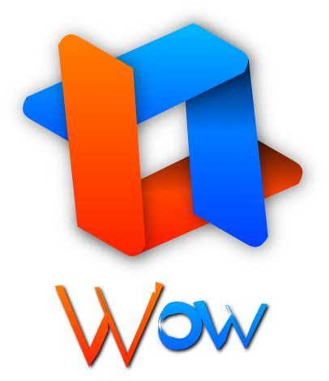
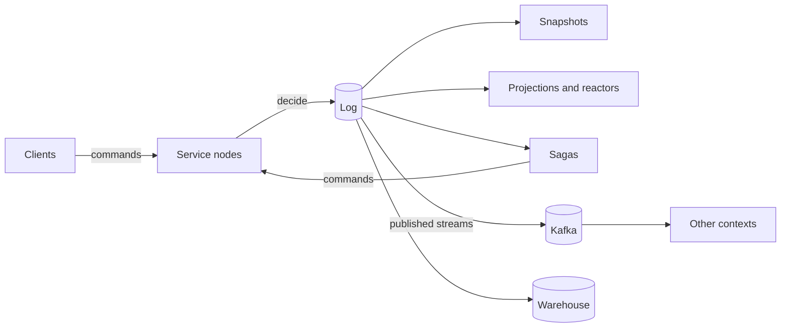

<p align="center" style="text-align:center;">
  
</p>

<h1 align="center">Wow</h1>

> **Wow 10.0 is in pre-release on this branch.** The stable 9.x line lives on the [`v9`](https://github.com/Ahoo-Wang/Wow/tree/v9) branch.

<p align="center"><strong>Domain Model as a Service</strong></p>

<p align="center">Write only the domain model, and get a system you can run: its API, its contract, its clients and its read models.</p>

<p align="center">
  <a href="https://www.kaicode.org/2026.html"></a><br/>
  <strong>KaiCode’26 Excellent Award</strong>
</p>

<p align="center">
  <a href="https://github.com/Ahoo-Wang/Wow/blob/main/LICENSE"></a>
  <a href="https://github.com/Ahoo-Wang/Wow/releases"></a>
  <a href="https://central.sonatype.com/artifact/me.ahoo.wow/wow-bom"></a>
  <a href="https://codecov.io/gh/Ahoo-Wang/Wow"></a>
  <a href="https://github.com/Ahoo-Wang/Wow/actions/workflows/ci.yml"></a>
  <a href="https://kotlin.link/"></a>
</p>

<p align="center">
  <a href="https://wow.ahoo.me/">Documentation</a> &middot; <a href="https://wow.ahoo.me/zh/">中文文档</a>
</p>

---

## What you write, and what you get

You write an aggregate: it takes a command, looks at its state, and decides the events.

<!-- sample: examples/quickstart/src/main/kotlin/me/ahoo/wow/example/quickstart/Account.kt#withdraw -->

```kotlin
fun onCommand(command: Withdraw): Withdrawn {
    if (command.amount > state.balance) {
        reject(Rejections.INSUFFICIENT_BALANCE, "The balance is ${state.balance}.")
    }
    return Withdrawn(command.amount)
}
```

and you test it in the same terms:

<!-- sample: examples/quickstart/src/test/kotlin/me/ahoo/wow/example/quickstart/AccountSpec.kt#withdraw -->

```kotlin
@Test
fun `a withdrawal the balance does not cover is rejected`() = aggregateSpec(model, id = "alice") {
    given(AccountOpened("Alice"), Deposited(100))
    whenCommand(Withdraw(150)) { expectRejected(Account.Rejections.INSUFFICIENT_BALANCE) }
    whenCommand(Withdraw(30)) {
        expectEvents(Withdrawn(30))
        expectState { balance.assert().isEqualTo(70) }
    }
}
```

From that, Wow gives you an HTTP route for every command, a state read and queries for every aggregate, an OpenAPI document, a typed TypeScript client, retries and parking for every handler, and a contract that the build checks for compatibility.

## Why Wow

- **The log is the bus.** Every commit is appended to the log, and everything else (snapshots, read models, other contexts, the warehouse) follows it from there. Nothing is lost between a write and its consequences.
- **You write decisions, not plumbing.** Aggregates decide; sagas derive commands; projections and reactors follow events. Routes, persistence, delivery and retries are the framework's.
- **Failures are data.** A handler that keeps failing parks one aggregate, recorded in a ledger; it never skips an event or stops a subscription.
- **One contract.** Routes, OpenAPI, typed clients, views and compatibility checks all come from one Manifest the compiler writes.
- **Read models are disposable.** Every read model is rebuilt from the log, so changing one needs no migration.

## Quickstart

1. Apply the Gradle plugin `me.ahoo.wow.service`, which brings the BOM `me.ahoo.wow:wow-bom` of its version.
2. Write a command, an event, a state and an aggregate.
3. `./gradlew run`, then send a command with `curl`.

The [Quickstart](https://wow.ahoo.me/start/quickstart) walks through it in about thirty minutes.

## Architecture



A service runs as one or more nodes over PostgreSQL or MongoDB; they split the log's partitions through leases in the same store. Contexts talk over Kafka. [Concepts](https://wow.ahoo.me/concepts/) explains the model.

## Modules

| Artifact | Holds |
| --- | --- |
| `me.ahoo.wow:wow-bom` | The versions of every module |
| `me.ahoo.wow:wow-api` | The annotations and types domain code uses |
| `me.ahoo.wow:wow-kernel` | The kernel the generated models build on |
| `me.ahoo.wow:wow-spring-boot` | The Spring Boot host |
| `me.ahoo.wow:wow-test` | The test DSL |
| `me.ahoo.wow:wow-postgres`, `wow-mongo` | The backends |
| `me.ahoo.wow:wow-kafka`, `wow-clickhouse`, `wow-elasticsearch` | The transport, the warehouse, search |

## TypeScript

| Package | Does |
| --- | --- |
| `@ahoo-wang/wow-client` | Commands with their waits, state reads and queries |
| `@ahoo-wang/wow-generator` | Typed clients generated from a service's Manifest |
| `@ahoo-wang/wow-react` | React hooks for queries |
| `@ahoo-wang/wow-view-engine` | Configurable data views: records, analyses and dashboards |
| `@ahoo-wang/wow-view-store` | Saved views on a Wow server |

## Platform services and examples

- [The ops service and console](platform/ops): the parked aggregates of every service in one place.
- [The view store](platform/view-store): saved views and dashboards.
- [The analytics catalog](platform/analytics/catalog): datasets across services (incubating).
- [The eShop](examples/eshop): five services on PostgreSQL, Kafka and ClickHouse, with a web UI.
- [The quickstart](examples/quickstart): the service of the Quickstart page.

## Requirements

| Component | Version |
| --- | --- |
| Java | 21 |
| Kotlin | 2.4.21 |
| KSP | 2.3.12 |
| Spring Boot | 4.1.1 |

## From 9.x

[Migrating from 9.x](https://wow.ahoo.me/migrate/) covers the source, the data and the cut-over. The 9.x line is maintained on the [`v9`](https://github.com/Ahoo-Wang/Wow/tree/v9) branch.

## Agent Skills

Six Skills help an agent write, migrate and query Wow applications: install the plugin `ahoo-wow-skills` from the Ahoo Skills Hub, or copy the [skills](skills) of an exact Wow tag into the agent's Skills directory.

## Community

- Read [Contributing](CONTRIBUTING.md), the [Code of Conduct](CODE_OF_CONDUCT.md) and the [Security Policy](SECURITY.md).
- Wow received the [KaiCode’26 Excellent Award](https://www.kaicode.org/2026.html).
- Related projects: [CosId](https://github.com/Ahoo-Wang/CosId), [CoSec](https://github.com/Ahoo-Wang/CoSec), [Simba](https://github.com/Ahoo-Wang/Simba) and [FluentAssert](https://github.com/Ahoo-Wang/FluentAssert).

## License

Wow is released under the [Apache 2.0 License](LICENSE).
