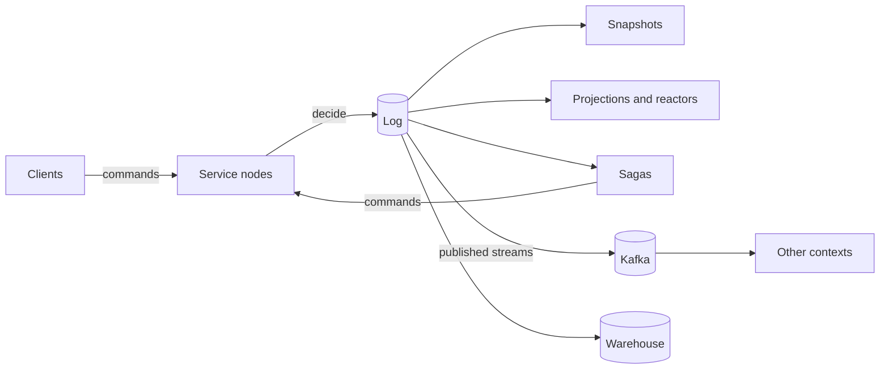

<p align="center" style="text-align:center;">
  
</p>

<h1 align="center">Wow</h1>

> **Wow 10.0 正在本分支上预发布。** 稳定的 9.x 版本线在 [`v9`](https://github.com/Ahoo-Wang/Wow/tree/v9) 分支。

<p align="center"><strong>领域模型即服务</strong></p>

<p align="center">只写领域模型，就得到一个能运行的系统：它的 API、契约、客户端和读模型。</p>

<p align="center">
  <a href="https://www.kaicode.org/2026.html"></a><br/>
  <strong>KaiCode’26 Excellent Award</strong>
</p>

<p align="center">
  <a href="https://github.com/Ahoo-Wang/Wow/blob/main/LICENSE"></a>
  <a href="https://github.com/Ahoo-Wang/Wow/releases"></a>
  <a href="https://central.sonatype.com/artifact/me.ahoo.wow/wow-bom"></a>
  <a href="https://codecov.io/gh/Ahoo-Wang/Wow"></a>
  <a href="https://github.com/Ahoo-Wang/Wow/actions/workflows/ci.yml"></a>
  <a href="https://kotlin.link/"></a>
</p>

<p align="center">
  <a href="https://wow.ahoo.me/">English documentation</a> &middot; <a href="https://wow.ahoo.me/zh/">中文文档</a>
</p>

---

## 你写什么，得到什么

你编写一个聚合：它接收一条命令，查看自己的状态，决定发生哪些事件。

<!-- sample: example/quickstart/src/main/kotlin/me/ahoo/wow/example/quickstart/Account.kt#withdraw -->

```kotlin
@OnCommand(produces = [Withdrawn::class])
fun onCommand(command: Withdraw): Decision =
    if (command.amount > state.balance) {
        Decision.reject(Rejections.INSUFFICIENT_BALANCE, "The balance is ${state.balance}.")
    } else {
        Decision.events(Withdrawn(command.amount))
    }
```

并且用同样的语言测试它：

<!-- sample: example/quickstart/src/test/kotlin/me/ahoo/wow/example/quickstart/AccountSpec.kt#withdraw -->

```kotlin
@Test
fun `a withdrawal the balance does not cover is rejected`() = aggregateSpec(model, id = "alice") {
    given(AccountOpened("Alice"), Deposited(100))
    whenCommand(Withdraw(150)) { expectRejected(Account.Rejections.INSUFFICIENT_BALANCE) }
    whenCommand(Withdraw(30)) {
        expectEvents(Withdrawn(30))
        expectState { balance.assert().isEqualTo(70) }
    }
}
```

由此，Wow 给你每条命令的 HTTP 路由、每个聚合的状态读取和查询、一份 OpenAPI 文档、一个类型化的 TypeScript 客户端、每个处理函数的重试与停放，以及一份由构建检查兼容性的契约。

## 为什么选择 Wow

- **日志就是总线。** 每次提交都追加到日志，其他一切（快照、读模型、其他上下文、数仓）都从那里跟随它。写入与它的后果之间不会丢失任何东西。
- **你写的是决定，而不是管道。** 聚合做出决定；Saga 派生命令；投影和反应器跟随事件。路由、持久化、投递和重试都由框架负责。
- **失败是数据。** 一再失败的处理函数会停放一个聚合，并记进台账；它从不跳过事件，也不停止订阅。
- **一份契约。** 路由、OpenAPI、类型化客户端、视图和兼容检查，都来自编译器写出的同一份 Manifest。
- **读模型可以丢弃。** 每个读模型都能从日志重建，所以改变它不需要迁移。

## 快速开始

1. 应用 Gradle 插件 `me.ahoo.wow` 和 BOM `me.ahoo.wow:wow-bom`。
2. 编写一条命令、一个事件、一个状态和一个聚合。
3. `./gradlew run`，然后用 `curl` 发送一条命令。

[快速开始](https://wow.ahoo.me/zh/start/quickstart)用大约三十分钟带你走完。

## 架构



一个服务以一个或多个节点运行在 PostgreSQL 或 MongoDB 之上；它们通过同一个存储中的租约划分日志的分区。上下文之间通过 Kafka 通信。模型见[概念](https://wow.ahoo.me/zh/concepts/)。

## 模块

| 制品 | 包含 |
| --- | --- |
| `me.ahoo.wow:wow-bom` | 每个模块的版本 |
| `me.ahoo.wow:wow-api` | 领域代码使用的注解和类型 |
| `me.ahoo.wow:wow-kernel` | 生成的模型所基于的内核 |
| `me.ahoo.wow:wow-spring-boot` | Spring Boot 宿主 |
| `me.ahoo.wow:wow-test` | 测试 DSL |
| `me.ahoo.wow:wow-postgres`、`wow-mongo` | 后端 |
| `me.ahoo.wow:wow-kafka`、`wow-clickhouse`、`wow-elasticsearch` | 传输、数仓、检索 |

## TypeScript

| 包 | 作用 |
| --- | --- |
| `@ahoo-wang/wow-client` | 带等待的命令、状态读取和查询 |
| `@ahoo-wang/wow-generator` | 从服务的 Manifest 生成类型化客户端 |
| `@ahoo-wang/wow-react` | 用于查询的 React hooks |
| `@ahoo-wang/wow-view-engine` | 可配置的数据视图：记录、分析和仪表盘 |
| `@ahoo-wang/wow-view-store` | 保存在 Wow 服务端的视图 |

## 平台服务与示例

- [ops 服务与控制台](platform/ops)：把每个服务停放的聚合汇集到一处。
- [视图存储](platform/view-store)：保存的视图和仪表盘。
- [分析目录](platform/analytics/catalog)：跨服务的数据集（孵化中）。
- [eShop](example/eshop)：基于 PostgreSQL、Kafka 和 ClickHouse 的五个服务，带 Web 界面。
- [quickstart](example/quickstart)：快速开始页面中的那个服务。

## 环境要求

| 组件 | 版本 |
| --- | --- |
| Java | 21 |
| Kotlin | 2.4.21 |
| KSP | 2.3.12 |
| Spring Boot | 4.1.1 |

## 从 9.x 迁移

[从 9.x 迁移](https://wow.ahoo.me/zh/migrate/)涵盖源码、数据和切换。9.x 版本线在 [`v9`](https://github.com/Ahoo-Wang/Wow/tree/v9) 分支上维护。

## Agent Skills

六个 Skill 帮助 Agent 编写、迁移和查询 Wow 应用：从 Ahoo Skills Hub 安装插件 `ahoo-wow-skills`，或者把某个确切 Wow tag 下的 [skills](skills) 复制到 Agent 的 Skills 目录。

## 社区

- 阅读[贡献指南](CONTRIBUTING.md)、[行为准则](CODE_OF_CONDUCT.md)和[安全策略](SECURITY.md)。
- Wow 荣获 [KaiCode’26 Excellent Award](https://www.kaicode.org/2026.html)。
- 相关项目：[CosId](https://github.com/Ahoo-Wang/CosId)、[CoSec](https://github.com/Ahoo-Wang/CoSec)、[Simba](https://github.com/Ahoo-Wang/Simba) 和 [FluentAssert](https://github.com/Ahoo-Wang/FluentAssert)。

## 许可证

Wow 以 [Apache 2.0 许可证](LICENSE)发布。
