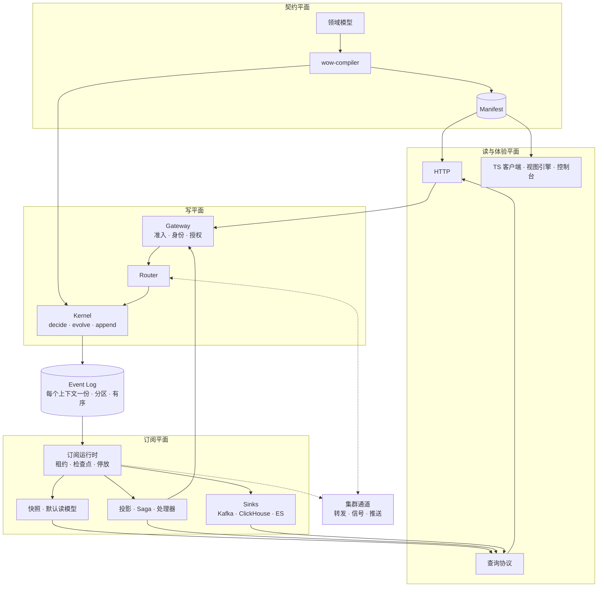

# Wow V10 目标架构

日期：2026-10-11。基线：`main` `b5813af56f`（9.8.0）。状态：已实现（实现以代码为准）；待决事项见 [决策台账](decisions.md)。

本文只写高层结论与理由。接口、算法与细节在专题文档 [01](01-programming-model.md)～[08](08-data-protocols.md)。

## 1. 立场

本文回答：**如果今天从零设计 Wow，它应该是什么样子。** 9.x 的实现、冻结面与兼容债都不是约束。

**部署前提**（D35）：一个系统的所有服务部署在同一个集群内，彼此可以直接调用；跨服务的等待信号与服务内的集群通道都建立在这个前提上。内部端口不对集群外暴露，且集群内部流量也要认证（D226，修订 D35 的「受信任」）：转发与信号要求集群令牌或服务身份，调用路由按服务身份授权。

历史只在一个地方处理：**迁移层**。用户从 9.x 带来的源码由 Skill 一次性改写，数据由工具一次性导入（[07](07-migration.md)）。V10 本身零兼容代码。

9.x 的设计记录与审查发现（命令链路 v9、9.3.0 重构等）只当证据：它们说明了哪些机制在真实负载下出过问题。已废弃的 KaeX 是同一问题的另一种回答，本文在它停下的地方继续往前（§6）。

## 2. 价值

Wow 让开发者**只写领域模型**，就得到一个能上线的系统：

1. **写**：把意图变成恰好一次的状态变更。基于最新已提交状态做出确定的决定，用一次原子追加提交；并发写者由版本唯一键裁决。
2. **传**：把已提交的事实至少一次地交给所有观察者，观察者可以随时从头重放。
3. **用**：从同一份领域模型推出 REST、客户端、查询、视图与看板，不必再写代码，也不必再部署一套 BI。

衡量标准：**领域模型之外的每一行代码，都是 Wow 欠用户的；每一个机制，都要能从这三件事推出来。**

## 3. 公理

| # | 公理 | 一句话 |
|---|---|---|
| A1 | 只写一处 | 追加是唯一的写；发布、快照、投影、索引、数仓都是日志的派生读 |
| A2 | 日志就是总线 | 限界上下文之内，持久订阅就是带检查点读日志；跨上下文走发布的事件流 |
| A3 | 决定与演化分离 | `decide` 产出事件；`evolve` 只把事件应用到状态，不做 I/O。状态可以照常写成可变对象，原子性与每个版本的稳定视图由内核保证 |
| A4 | 编译期绑定 | 模型由编译器生成，运行期无反射、无扫描 |
| A5 | 协程原生 | `suspend` 与 `Flow` 贯穿 API、SPI 与内核；用户编程模型可以继续用 Reactor，由独立的适配器转换 |
| A6 | 身份是一个值 | `AggregateRef(上下文, 聚合, 租户, ID)` 只在准入时决定一次；唯一键都含租户 |
| A7 | 读模型可重放 | 每个订阅有检查点，可以重置、重建、回填 |
| A8 | 失败是数据 | 失败进入台账；不跳过，只停放出错的聚合 |
| A9 | 契约只有一份 | Manifest 是唯一来源，REST、OpenAPI、客户端、视图、Skills 都是投影 |
| A10 | 不绑定宿主 | 运行时不依赖 Spring |
| A11 | 状态即读模型 | 聚合最新状态（快照）是默认读模型，零代码可查询 |

## 4. 总体架构

| 平面 | 职责 | 关键结论 | 详见 |
|---|---|---|---|
| 契约 | 从领域模型生成绑定与 Manifest | 两种写法（DSL、注解）编译成同一个模型；领域事件用 revision 演进 | [01](01-programming-model.md)、[05](05-read-and-contract.md) |
| 写 | 准入、路由、执行、追加 | 正确性靠版本唯一键，不靠单写者；亲和路由是性能手段；默认等待 `SNAPSHOT`，写后即可查（D69） | [02](02-write-path.md) |
| 日志 | 唯一事实源 | 每个上下文一份；位置是按提交可见顺序分配的分区序号；PostgreSQL 与 MongoDB 都是一等后端 | [03](03-log-and-snapshot.md) |
| 订阅 | 一切派生 | 共享尾随、按聚合停放失败、可重放；跨上下文的事件与命令都经 Kafka | [04](04-subscriptions.md) |
| 读 | 查询与体验 | 快照是默认读模型；Manifest 驱动 REST 与客户端；身份来自主体而非路径 | [03](03-log-and-snapshot.md)、[05](05-read-and-contract.md) |

一个服务的节点之间只有一条集群通道，承载命令转发、等待信号与新条目推送。服务之间（跨上下文）的异步消息只经 Kafka：事件走发布的事件流，命令走目标上下文的命令主题；同一上下文内的异步命令也可以选它做持久摄入。同步调用（`Wow-Call`）与跨服务的等待信号经目标服务的内部端口，带服务身份认证（D193、D226）。等待可以跨上下文：信号直接发往发起**节点**的内部端口（D65）。

## 5. 与 9.x 相比

| 主题 | 9.x | V10 |
|---|---|---|
| 发布 | 先追加再发布到总线（双写：追加后、发布前崩溃，事件永不发布） | 没有事件总线；订阅读日志，崩溃后续读 |
| 事件通道 | 领域事件与状态事件两条总线，彼此无序 | 一份日志；状态由读侧演化随附 |
| 状态 | 可变对象；失败时靠丢弃并重载兜底 | 可变（默认）或不可变都支持；原子性与版本视图由内核在构造上保证 |
| 绑定 | 运行时反射 | KSP 编译期生成 |
| 异步 | Reactor（Reactor Kafka 已停止维护） | 协程；Reactor 写法经 `wow-reactor` 适配 |
| 失败 | 默认记日志后确认 | 失败台账，停放聚合 |
| 读模型 | 快照即读模型；投影不可重建 | 快照仍是默认读模型；一切读模型可重建 |
| 契约 | OpenAPI 加 `x-wow-*` 扩展 | Manifest |
| 兼容 | 冻结面与兼容债 | 零兼容，迁移层一次性处理 |

## 6. 与 KaeX 的关系

KaeX mvp 分支有约 1.1 万行可运行代码，它独立得出了与 V10 相同的几个结论：亲和路由只是性能手段、分区哈希含租户、等待信号路由回发起节点、追加之后是不可撤销区；也用代码证明了 V10 绕开的几个难点：按 ID 扫描会跳过晚提交的条目、按实例存水位随实例数增长、一个检查点管多个函数会重复副作用、fencing 做了又删。

采纳：协程优先、五类函数、编译期绑定、单一事件来源、模块按端口思考。超越：KaeX 保留了事件总线、命令总线与进程内 outbox；V10 用「日志即总线」把三者都化掉。不采纳：KaeX「默认继承 Wow、无证据不改」的治理规则，因为 V10 的立场就是不受历史约束。

## 7. 风险

架构成立依赖五个待验证的假设（分区序号的吞吐、亲和路由的收益、协程内核的性能、KSP 的覆盖、Skill 迁移的可靠性），各自先做 spike，有明确的放弃条件。见 [决策台账](decisions.md) 的「待验证的假设」。

## 8. 验收底线

1. 任意时刻崩溃，不丢失已提交的事实。
2. 读模型（含快照）可以从头重建。
3. 两个租户使用相同的 ID，互不影响。
4. 稳态下存储的读压力不随订阅数量增长（落后订阅的追赶读除外）。
5. 领域模型之外，用户不需要写一行基础设施代码。
