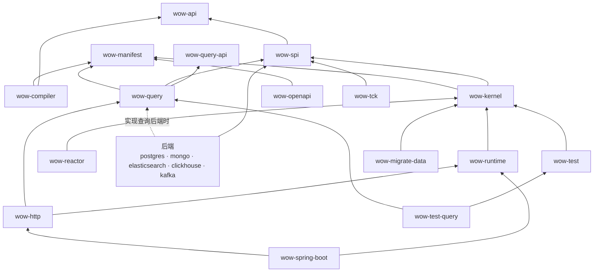

# V10 模块与目录

日期：2026-10-11。基线：9.8.0（`v9` 上的 `b5813af56f`）。状态：已实现（实现以代码为准，偏离记在决策的「实现」说明里；2026-10-22 复核分支与路径）。上位文档：[00 目标架构](00-architecture.md)（A4、A5、A10）。相关决定：D9、D10、D27、D29、D30、D31、D41～D44、D125、D126、D132、D144、D146、D147。

## 1. 划分原则

一个边界值得成为模块，只有四个理由；都不满足的，用包划分：

1. **依赖隔离**：用户只为自己选的技术付出依赖（选 Mongo 不必带上 PostgreSQL 驱动）。
2. **有独立的消费者**：有人只需要它（社区后端的实现者只需要端口，测试 DSL 只需要内核）。
3. **独立的公开面**：它有自己的 ABI 承诺。
4. **架构约束要由编译器守住**：同一模块里，「内核不得依赖集群通道」只能靠评审。

按这四条复审上一版：

| 上一版 | 问题 | 修正 |
|---|---|---|
| `wow-runtime` 装下 Gateway、内核、集群通道、订阅、等待、生命周期 | 又一个 9.x 的 `wow-core`（3.8 万行）；测试 DSL 与迁移工具只需要内核，却要带上整个运行时；「内核不碰集群」无法由编译器守住 | 拆出 `wow-kernel`（理由 2、4），D43 |
| 端口定义在 `wow-runtime` 里 | D12 让社区按合同自行实现后端，实现者与 TCK 只需要端口 | 端口独立为 `wow-spi`（理由 2），D43 |
| 按角色拆后端：`wow-log-mongo` 与 `wow-query-mongo` | 选 Mongo 的用户两个都要，同一个驱动与连接被拆开；9.x 的 `wow-mongo` 本来就在一个模块里实现事件存储、快照、查询与预留键 | 一种技术一个模块（理由 1），D42 |
| 漏了查询引擎 | 只列了协议与后端，9.x 1.5 万行的 `wow-query`（准入、能力表、编译）没有归属 | 补 `wow-query` |
| 漏了 Manifest 的类型 | 编译器写、运行时与 OpenAPI 读，类型放在哪里没说 | `wow-manifest`（取代 `wow-metadata`） |
| starter 靠 Gradle 特性变体拉依赖 | 特性变体只在 Gradle 里有效，Maven 用户只能手工加；自动配置本来就按类路径生效 | 一个自动配置模块，后端由用户直接加技术模块，D44 |

## 2. 模块

| 层 | 模块 | 内容 | 取代 9.x 的 |
|---|---|---|---|
| 契约 | `wow-api` | 领域代码会 import 的东西与对外线上契约的值类型；只依赖 `wow-annotations`、`wow-query-api` 与 kotlinx-coroutines（§2.1，D66、D282） | wow-api（重新设计，去掉查询协议） |
| 契约 | `wow-query-api` | 查询协议：`FilterExpression`、聚合、窗口；查询字段注解（`@Sensitive` 等）；纯数据，包名仍是 `me.ahoo.wow.api.query`（D125） | wow-api 的 `api.query` 包 |
| 契约 | `wow-manifest` | Manifest 的类型与 JSON schema；纯数据 | wow-metadata |
| 编译 | `wow-compiler` | KSP：绑定代码与 Manifest；只依赖 `wow-api` 与 `wow-manifest` | wow-compiler |
| 编译 | `wow-manifest-tools` | 构建期内省：victools 生成 schema、状态指纹、片段补全与合并；只在 `wow-gradle-plugin` 的隔离 Worker 里运行（D83） | — |
| 编译 | `wow-gradle-plugin` | Gradle 插件 `me.ahoo.wow`：接好 KSP，构建期内省 schema、合并服务级 Manifest（D83） | wow-schema 的构建期部分 |
| 内核 | `wow-spi` | 全部端口（日志、快照、检查点、租约、失败台账、预留键、`Sink`、`TopicProducer`、`PartitionedSource`）与值类型（含 `StateEventRecord`、`StateView`、Kafka 信封与其编解码，D132），`@WowSpi` | wow-core 的 SPI |
| 内核 | `wow-kernel` | `AggregateModel`、decide → evolve → append 循环、结局查明、事件编解码与 revision 升级、状态版本视图、内存日志 | wow-core 的内核 |
| 内核 | `wow-runtime` | Gateway 与准入、Router、集群通道、Executor 与状态缓存、订阅运行时、等待、观测接缝、生命周期；状态点读（最新、按版本、按时间、轨迹，D231） | wow-core 的其余部分 |
| 内核 | `wow-reactor` | 领域处理函数的 Reactor 适配：返回 `Mono`/`Flux` 的处理函数（`awaitResult`，D9）；只依赖 `wow-kernel`，领域模块用它不会带上运行时（D149，#4328）。调用方用的 `ReactiveCommandGateway`、`ReactiveQueryGateway` 需要运行时，不放这里：有需求时另设 `wow-runtime-reactor`（依赖 `wow-runtime` 与 `wow-reactor`） | wow-core 的 Reactor 形态 |
| 查询 | `wow-query` | 查询引擎：准入、能力表、编译到后端；快照、数据集与 `events` 三个查询模型的网关；读的可见性（状态、数据集）；数据集；`QueryJson`；后端合同测试 `QueryBackendSpec`。9.x 的协程移植（D126、D231） | wow-query |
| 后端 | `wow-postgres` | 日志、快照、查询、检查点、租约、台账、预留键（D10、D27） | （新增） |
| 后端 | `wow-mongo` | 同上，MongoDB（D11） | wow-mongo |
| 后端 | `wow-elasticsearch` | 快照、查询、事件检索 Sink（D13）；M6 之后的 6.7（D131） | wow-elasticsearch |
| 后端 | `wow-clickhouse` | 数据集查询后端、数仓 Sink（D18、D142） | wow-clickhouse、wow-bi |
| 后端 | `wow-kafka` | Kafka Router、Sink、Kafka 来源的订阅、跨上下文命令的传输；只依赖 `wow-spi` 与 `kafka-clients`，语义在运行时（D31、D33、D132） | wow-kafka |
| 边缘 | `wow-http` | 由 Manifest 物化路由、problem+json、SSE、信号入口（D30、D35）；只做协议适配，读的语义在 `wow-query` 与 `wow-runtime`（D231） | wow-webflux、wow-rest-contract |
| 边缘 | `wow-openapi` | Manifest → OpenAPI；swagger 依赖只在这里 | wow-openapi、wow-schema |
| 集成 | `wow-cosec` | 准入与查询的授权策略（身份作用域、ABAC 标签） | wow-cosec |
| 集成 | `wow-opentelemetry` | 观测接缝的追踪与指标 | wow-opentelemetry |
| 宿主 | `wow-spring-boot` | 自动配置：按类路径装配，只做装配（D44） | wow-spring、wow-spring-boot-starter |
| 测试 | `wow-test` | 函数式测试 DSL（聚合、订阅）；只依赖 `wow-kernel` | wow-test、wow-mock |
| 测试 | `wow-test-query` | 处理器规格的真实内存查询（`memoryQueries`、`givenSnapshots`，D342）；依赖 `wow-test` 与 `wow-query`，`wow-test` 仍只依赖 `wow-kernel` | — |
| 测试 | `wow-tck` | 端口合同测试；只依赖 `wow-spi` | wow-tck |
| 迁移 | `wow-migrate-data` | 数据迁移工具（[07](07-migration.md)） | （新增） |
| 发布 | `wow-bom`、`wow-dependencies` | BOM 与依赖版本 | 同名 |

平台模块（ops、view-store、analytics 的 catalog；dataset-registry 已并入 analytics catalog，D251）保持 9.x 的 `api / domain / starter / server` 四件套；它们是 Wow 应用，只依赖公开模块，用来证明框架。M7 把它们作为新的 V10 项目建在 `platform/<名字>/`（D146）。

示例：eShop（`example/eshop/`，D158、D159）：五个上下文各有 `api`、`domain`、`server` 三个项目（`:eshop-<上下文>-*`）与只用于测试、不发布的 `:eshop-e2e`，都只能依赖 V10 模块（D118）；原 `:shop-*`、`:inventory-*` 与 `:example-e2e` 已由 D204 收拢进 eShop 并删除（#4432）。

9.x 中删除或并入上表的：wow-redis（D12）、wow-bi（D18）、wow-spring、wow-mock、wow-schema、wow-rest-contract、wow-metadata。已定（D187）：wow-models 迁到 V10（`extensions/models`，P.8）；放弃 wow-apiclient（由 Manifest 生成的客户端替代）与 wow-cocache。

### 2.1 `wow-api` 的内容（D66）

`wow-api` 只放两类东西：领域代码会 import 的（注解、`Decision`、`DecideScope`、订阅处理函数拿到的 `StateEvent` 与上下文、`Scope`），以及对外线上契约的值类型（`Command`、`CommandResult`、`WaitPlan`、`Rejection`）。框架内部的接口不放进来。

```text
me.ahoo.wow.api
├── aggregate   AggregateType、AggregateRef、Scope
├── decide      Command、Causation、Decision、Rejection、DecideScope
├── subscribe   StateEvent、ReactContext、SagaContext、ProjectContext（含 executionId）
├── result      CommandResult、FunctionInfo、ErrorInfo、Violation、WaitPlan、Hop
├── lifecycle   删除、恢复、转移所有者、转移空间、打标签：系统命令与系统事件
├── schedule    定时命令（ScheduleJobs、Schedules，D166）
├── read        读侧入口（QueryApi、ReadRows、DatasetName）
├── client      CommandClient
├── caller      Caller、Operator、TargetScope
├── ledger      失败账本（Ledger，D312）
├── wire        线上的头（WowHeaders 等）
├── id          Ids
├── naming      TypeNames（D282 之后保留在此，A-5）
└── annotation  V10 注解集（[01](01-programming-model.md) §3，D67）；稳定性标记（`@InternalWowApi`、`@ExperimentalWowApi`、`@WowSpi`）在 `wow-annotations`（D282）
```

包的划分以 `api/api` 的 ABI 文件为准，本表只说明用途。

9.x 的其余部分的去向：

| 9.x 包 | 规模 | 去向 |
|---|---|---|
| `query/**` | 约 6,600 行 | M6 移植为 V10 的 `:query-api`，去掉 `Condition`（6.1a，D125） |
| `modeling`（`*Capable` 混入接口）、`naming`、`messaging`（`Header`、`Message`、`FunctionInfo*`） | 约 1,900 行 | 删除；`FunctionInfo` 的语义进 `CommandResult`（D60） |
| `command`（`CommandMessage`、`CommandResultAccessor`…）、`event`（`DomainEvent`、`EventMessage`） | 约 850 行 | 删除，由 `Command`、`StateEvent` 取代 |
| 生命周期事件、`exception/ErrorInfo`、`abac` | 约 1,100 行 | 按 V10 语义重做（`lifecycle`、`result`；标签进生命周期命令） |

**现状**：Wow 10 的 `wow-api` 在 `api/api`（Gradle 项目 `:api`，artifactId `wow-api`，D85、D87），只放上表的包；查询协议在 `api/query-api`。9.x 的 `wow-api` 与它的查询代码已随 9.3c 删除（D262），只在 `v9` 分支。

## 3. 依赖方向



图是概略。权威的依赖清单是架构测试的 `ArchitectureRules.ALLOWED_PROJECT_DEPENDENCIES`，此外还有：`wow-http → wow-openapi`、`wow-cosec → wow-http`、`wow-opentelemetry → wow-runtime, wow-query`、`wow-migrate-data → wow-postgres, wow-mongo`，以及 `extensions/` 下的 `wow-models`、`wow-cosid`。

由架构测试强制：

- `wow-api`、`wow-query-api`、`wow-manifest` 没有运行时依赖。
- `wow-kernel` 不依赖集群、订阅、等待与任何驱动；`wow-runtime` 只依赖 kotlinx-coroutines 与 Jackson，不依赖 Spring、Reactor 与驱动。
- 后端只依赖 `wow-spi`（实现查询后端时再依赖 `wow-query`），后端之间互不依赖。
- Reactor 只出现在 `wow-reactor` 与 WebFlux 适配层；swagger 只出现在 `wow-openapi`；只有 `wow-spring-boot` 依赖 Spring Boot。
- 观测只经固定接缝挂入，不改变处理结果。
- 任何模块都不依赖 `wow-migrate-data`，也不出现 9.x 的类型名与配置键（[07](07-migration.md) §4），拒绝 9.x 遗留物的两处检测器除外（编译器的 `ModelNames.FRAMEWORK_PACKAGES` 与 Gradle 插件的 `WowPlugin.NINE_X_PROCESSORS`）；由架构测试 `PositiveRules`（`CORE_IMPORTS`、`NINE_X_NAMES`、`NINE_X_KEYS`、`NINE_X_DETECTORS`）强制（R5.C-10，#4937）。

## 4. 目录结构（D41）

9.x（现在在 `v9` 分支）有 20 多个 `wow-*` 平铺在根目录，测试、补偿、示例又各自成组，结构不一致。V10 按 §2 的层分目录；V10 模块的 Gradle 项目名与目录不带 `wow-` 前缀，artifactId 与 jar 名由根构建统一设为 `wow-<名字>`（D87）；下表列的是 artifactId，目录名去掉前缀即是（如 `wow-kernel` 在 `core/kernel`）：

```text
api/            wow-api  wow-query-api  wow-manifest
compiler/       wow-compiler  wow-gradle-plugin  wow-manifest-tools
core/           wow-spi  wow-kernel  wow-runtime  wow-reactor
query/          wow-query  query-tck
backends/       wow-postgres  wow-mongo  wow-elasticsearch  wow-clickhouse  wow-kafka
edge/           wow-http  wow-client  wow-openapi  wow-cosec  wow-opentelemetry
host/           wow-spring-boot
test/           test-dsl  test-query  tck  tck-containers  architecture  code-coverage-report  benchmarks/  migration-rehearsal（不发布）  routing-spike  lease-spike（spike）
extensions/     wow-models  wow-cosid
migration/      wow-migrate-data
bom/            bom/（wow-bom，项目 :bom）  dependencies/（wow-dependencies，项目 :wow-dependencies）
platform/       ops/  view-store/  analytics/（平台服务，不发布）
example/        eshop/（D204）  quickstart/（D217）  java-smoke/
deploy/         各服务的 Kubernetes 清单（eshop-ordering 等）
typescript/     wow-client  wow-react  wow-generator  wow-view-engine  wow-view-store  storybook  integration-test
documentation/  docs/（文档站）  designs/（本目录）；skills/  build-logic/  config/ 在根目录
```

**现状（2026-10-22）**：9.x 的 `wow-*` 平铺模块已随 9.3c 全部删除（D262），9.x 只在 `v9` 分支；`v10` 已改名为 `main`（D265 ④）。名称中的版本特例已去掉（N-1）：`wow-dependencies` 移到 `bom/dependencies/`、`deploy/v10/` 移到 `deploy/`、基准测试在 `test/benchmarks/`（BM-1）。已发布模块的清单与 ABI 规则见 AGENTS.md 的「Releasing a pre-release」与「Binary Compatibility」。

演进的历史（D85 新旧并存、D87 项目名、D90 ABI 校验、D146 平台新建于 `platform/`、前向合并）见决策台账；它们在 9.x 删除后不再约束目录。

## 5. 平台基线

- JVM：最低 21，CI 同时在 25 上测试（D29）；换取虚拟线程（`@Blocking` 派发，D36）与 Java 的 record、sealed、模式匹配。
- 异步：协程（D9）；Reactor 写法由 `wow-reactor` 适配，WebFlux 宿主也经它接入。
- PostgreSQL 驱动：D27。
- Maven 坐标：`groupId` 仍是 `me.ahoo.wow`，`artifactId` 与 §2 的模块名相同；不使用 Gradle 特性变体（D44）。

## 6. 待细化

- ~~`wow-it` 的内容~~：已定，不设 `wow-it`：端到端在 `:eshop-e2e`，多节点与故障注入在各模块的集成测试，迁移演练在 `test/migration-rehearsal`。
- 发布模块清单：已定（R.1、D216），即 `build.gradle.kts` 的 `publishProjects`（`abiProjects` 加 `:migrate-data`、`:manifest-tools` 与两个 BOM）。
