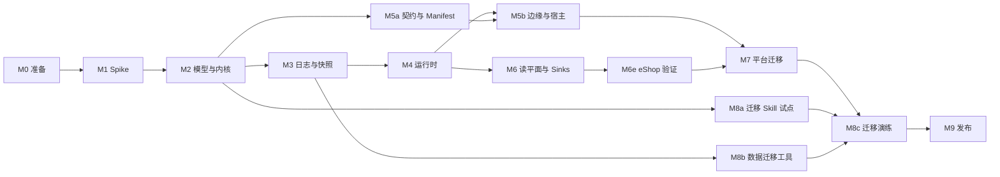

# Wow 10 路线图

日期：2026-10-22（初稿 2026-10-11，基线 `main` `b5813af56f`）。状态：持续维护。架构见 [00](00-architecture.md)，待决事项见 [决策台账](decisions.md)。

本页只写里程碑、工作包、依赖与出口；不写逐步实施计划。工作包完成时，在本页把状态改为「完成」并注明 PR；里程碑全部完成后，更新相关专题文档的状态。

## 1. 分支与发布

Wow 10 在默认分支 `main` 上开发与发布；9.x 的维护线是 `v9`。（开发期 Wow 10 在长期分支 `v10` 上，D2；2026-10-21 按 D265 ④ 把 `v10` 改名为 `main`、原 main 改名为 `v9`，不做合并。）

| 规则 | 内容 |
|---|---|
| `main` | Wow 10 的开发与发布线。改动走 PR、squash 合并；必需检查为 PR Safety 与 `ci-gate`（`ci-gate` 在上传覆盖率的 PR 上等 `codecov/patch`）；协调者审查后开启自动合并 |
| `v9` | 9.x 维护线：只修缺陷，自有的工作流与发布准入；Renovate 只给它补丁与安全更新（#4753）；文档站的 `/9.x/` 由 `main` 的部署工作流从 `v9` 构建（DI-6） |
| CI | 唯一的 `ci.yml`，按改动范围运行；PR 上不跑 Node 22（main 推送与夜间跑）；负载、浸泡与基准只在 GitHub Actions 上跑。9 → 10 不混部，由迁移演练取代 `mixed-version`；10.x 内相邻次版本须能滚动升级（D48），`mixed-version` 在 10.0 GA 后以「上一个 10.x 次版本 + 当前构建」重新启用 |
| 预发布 | `10.0.0-alpha.3`（2026-10-15）、`10.0.0-alpha.4`（2026-10-22）；不做兼容性承诺。打标签与对外发布须用户确认，rc 与 GA 须用户确认（D202） |
| GA | 从 `main` 发 `10.0.0`；GA 时的事项见 CI-3 |

## 2. 里程碑总览

里程碑出口只作 CI 门槛；第一个预发布按 D217 在 M7 之后发出，之后的预发布不绑定里程碑（D202）。

| 里程碑 | 目标 | 出口门槛 | 必须先拍板的决定 |
|---|---|---|---|
| M0 准备 | 分支、CI、守护规则、决定评审、模块与目录骨架 | CI 覆盖开发线 | （已全部拍板） |
| M1 Spike | 验证 H1～H4、H6 | 各 spike 报告入库 | — |
| M2 模型与内核 | 领域模型能写、能测 | CI 绿 | （已全部拍板） |
| M3 日志与快照 | 唯一事实源成立 | CI 绿（含 TCK） | （已全部拍板） |
| M4 运行时 | 多节点下写、订阅、等待闭环 | CI 绿（含 4.9 故障注入） | （已全部拍板） |
| M5 契约、边缘与宿主 | 由 Manifest 驱动的 HTTP 与客户端 | CI 绿（含 `shop-server` 端到端） | （已全部拍板） |
| M6 读平面与 Sinks | 快照查询、跨上下文、数仓 | CI 绿（含 `:example-e2e`） | （已全部拍板，D125～D149） |
| M6e eShop 验证 | 经典 eShop 的 5 个上下文全跑在 V10 上，验证 M1～M6 的能力与开发体验（D158～D160） | CI 绿（含 `:eshop-e2e` 的下单全链路与故障场景）；`DX-GAPS.md` 里阻塞 M7 的条目已补 | （已全部拍板） |
| M7 平台迁移 | 平台模块跑在 V10 上 | CI 绿；API 冻结，V10 模块开始 ABI 转储与校验（D88、D147） | 入口：`09-capability-parity.md` 入库，缺失项补齐或获用户批准豁免（D183）；即 M6p 的 P.1～P.5 完成（D184） |
| M8 迁移层 | 源码与数据一次性迁移 | CI 绿（含 8c.1 演练） | （已全部拍板） |
| M9 发布 | rc 与 GA | `10.0.0`（打标签前须用户确认，D124） | （已全部拍板） |

里程碑状态（2026-10-22）：M0～M8 完成；M9 进行中：API 已冻结（#4740），分支已切换（CI-3），文档站已上线（9.1），`10.0.0-alpha.4` 已发布（9.3）；余下 rc 与 GA（9.4）。

## 3. 工作包

状态（2026-10-22）：M0～M8 的工作包全部完成，表中未逐行标注的也已完成；M9 一节逐项标注。未排期的后续事项在 §6。

### M0 准备

| WP | 内容 | 出口 |
|---|---|---|
| 0.1 | **已完成。** 从 main 切出 `v10`；CI 工作流与发布准入覆盖 `v10` | 完成：Ahoo-Wang/Wow#4210；`v10` 的必需检查与 main 相同（不含 `mixed-version-gate`） |
| 0.2 | **已完成。** 架构测试骨架：[06](06-modules.md) §3 的依赖规则、禁止 `@Deprecated` 与 `compat(...)` | 完成：`test/architecture`（模块依赖图、禁止的外部依赖、兼容标记，各带夹具自测） |
| 0.3 | **已完成。** 决策台账评审：拍板 M2 之前必须定的决定 | 完成：除等 spike 数据的 D6、D10、D27、D28 外全部拍板 |
| 0.4 | **已完成。** 模块与目录骨架：按 [06](06-modules.md) §4 建立 V10 的空模块与目录；平台目录暂不搬迁 | 完成：10 个 V10 模块（孵化中、JDK 21），CI 路径过滤覆盖新目录 |

### M1 Spike

每个 spike 在 `v10` 上独立分支完成，产出结论与原始数据（`test/benchmarks/results/`），代码不合入。

| WP | 假设 | 出口 |
|---|---|---|
| 1.1 | **已完成。** H1 分区序号分配的吞吐（PostgreSQL 两种方式；MongoDB 事务与分组提交） | 单分区与 64 分区的吞吐、p99、尾随延迟；不跳过的故障注入结果；PostgreSQL 完成：单语句分配，64 分区约 3 万次/秒（Ahoo-Wang/Wow#4216）；MongoDB 完成：属主分组提交约 4.4～5.6 千次/秒，无属主时塌缩，见 `test/benchmarks/results/reports/v10-h1-mongo-partition-sequence.md` |
| 1.2 | **已完成。** H2 亲和路由的收益：阶段 1 进程内 3 节点 + 真实 PostgreSQL（Local、Partitioned、入口哈希三组）；阶段 2 在 4.2 之后用 3 个 JVM 复测并测属主故障（设计见决策台账 H2） | 阶段 1 的报告与 D6 拍板；阶段 2 的确认报告；阶段 1 完成：D6 定为 Partitioned（2026-10-12，[报告](../../../test/benchmarks/results/reports/v10-h2-routing.md)，Ahoo-Wang/Wow#4255） |
| 1.3 | **已完成。** H3 协程内核的性能 | 与 9.3 Reactor 内核同一 JMH 基准的吞吐与分配率；同步与 `suspend` 处理函数分别测，验证快速路径无续体分配；完成：V10 快约 7.7 倍、分配减半，见 `test/benchmarks/results/reports/v10-h3-kernel-comparison.md` |
| 1.4 | **已完成。** H4 KSP 的覆盖 | example、compensation、view-store 与 transfer（Java 源码）的注解模型由 KSP 生成，与 9.x 运行时解析结果比对；完成：38 个命令处理函数中 27 个直接绑定，11 个经 Skill 改写签名（D49），见 `test/benchmarks/results/reports/v10-h4-ksp-coverage.md` |
| 1.5 | **已完成。** H6 存储租约：成员、属主收敛与再平衡（PostgreSQL、MongoDB） | 收敛时间、迁移分区数、交接期间的重复处理比例；完成（[报告](../../../test/benchmarks/results/reports/v10-h6-leases.md)，Ahoo-Wang/Wow#4278） |

H5（Skill 迁移）依赖 V10 API，放在 M8a。

### M2 模型与内核

| WP | 内容 | 出口 |
|---|---|---|
| 2.1 | **已完成。** `wow-api`：`AggregateRef`、`Command`、`EventStream`、`StateEvent`、`Decision`、`Rejection`、revision | API 评审通过；ABI 转储开始记录；完成：身份、命令、决定类型（Ahoo-Wang/Wow#4212）；`StateEvent<S>`、`@Revision`（Ahoo-Wang/Wow#4250） |
| 2.2 | **已完成。** DSL 写法与 `AggregateModel` | 内存中可执行；完成 |
| 2.3 | **已完成。** `wow-compiler`：注解 → 绑定代码（按签名选定同步、`suspend`、Reactor 调用；`@Blocking` 派发）；Manifest v0（聚合、命令、事件） | 生成结果可复现；与 DSL 产出同一模型；完成 |
| 2.4 | **已完成（#4267）。** 内核：两级去重与命令指纹（D46）、decide → evolve → append、冲突重试、结局查明、生命周期事件、`onAppendFailure`；可变状态失败时的丢弃重载与提交时的版本视图 | 内核特征测试；完成 |
| 2.5 | **已完成。** 事件 revision 与升级链 | 多 revision 的读取测试；完成：升级函数逐级升级、事件改名的别名（Ahoo-Wang/Wow#4215） |
| 2.6 | **已完成。** 测试 DSL 与内存日志；decide 修改状态的检测（F4） | example 领域用 V10 写法通过全部领域测试；完成：`aggregateSpec`，暂放 `wow-kernel` 的 testFixtures，`wow-test` 原地重写时搬入；默认检测 decide 修改状态（Ahoo-Wang/Wow#4215） |
| 2.7 | **已完成。** `wow-reactor`：返回 `Mono`/`Flux` 的处理函数的 KSP 生成调用、`ReactiveCommandGateway`、`ReactiveQueryGateway` | example 领域保留 Reactor 写法的处理函数通过测试；完成 |
| 2.8 | **已完成。** 预留键端口与内核的回滚（D38）；after 钩子（D39） | 唯一性约束的领域测试；after 钩子完成（Ahoo-Wang/Wow#4215）；预留键端口与 PostgreSQL 实现完成（Ahoo-Wang/Wow#4222）；`DecideScope.reserve` 完成：待确认预留随追加确认、失败时释放、崩溃时过期（R8），键归聚合所有；预留随日志条目记录、由内置订阅确认（D50，Ahoo-Wang/Wow#4260）完成 |

### M3 日志与快照

| WP | 内容 | 出口 |
|---|---|---|
| 3.1 | **已完成。** `EventLog` 合同与 TCK（唯一键、版本连续、位置不跳过、续读一致） | 内存实现通过；完成：`EventLogSpec`（`wow-spi` 的 testFixtures），内存与 PostgreSQL 实现均通过（Ahoo-Wang/Wow#4216） |
| 3.2 | **已完成。** PostgreSQL 实现（含检查点、租约、失败台账、预留键） | TCK 全绿；故障注入不跳过；日志完成（Ahoo-Wang/Wow#4216）；快照（Ahoo-Wang/Wow#4219）、检查点与租约（Ahoo-Wang/Wow#4221）、失败台账与预留键（Ahoo-Wang/Wow#4222）完成，合同测试在 `wow-spi` 的 testFixtures，内存实现在 `wow-kernel` |
| 3.3 | **已完成。** MongoDB 实现（D11，一等后端；含分组提交与预留键） | 同上；完成 |
| 3.4 | **已完成。** 快照存储合同与 TCK；schema 指纹；Mongo、ES、PostgreSQL 实现 | TCK 全绿；完成 |

### M4 运行时

| WP | 内容 | 出口 |
|---|---|---|
| 4.1 | **已完成（#4227）。** Executor 与状态缓存 | 每聚合顺序测试；完成：每聚合一条公平车道（不同聚合互不阻塞、车道有上限、关闭即拒绝并等待在途命令），`StateCache` 取出放回语义与 `LruStateCache` |
| 4.2a | **已完成（#4251）。** 集群通道（与传输无关，D77）：`ClusterChannel` 端口与转发消息（D78、D80）、HRW 无主对账（D70）、主动交接、降级 Local（D71）、租约组与成员地址（D72）、进程内回环传输 | 单 JVM 多节点测试：属主收敛、交接顺序、属主被杀后降级、超时后去重；完成（Ahoo-Wang/Wow#4251） |
| 4.2b | **已完成（#4296）。** 集群通道的真实传输：宿主在独立内部端口上起 h2c 服务、`wow-http` 提供路由、客户端用 JDK `HttpClient`（D26、D89） | 3 个 JVM 互相转发；节点上下线时命令不中断（H6 的数据） |
| 4.3 | **已完成。** Router：Partitioned、Local（随 4.2a 实现） | 转发与降级测试；完成（Ahoo-Wang/Wow#4251） |
| 4.4 | **已完成（#4233）。** 订阅运行时：共享尾随、追赶读、检查点、分区内并行 | 读压力不随订阅数增长 |
| 4.5 | **已完成（#4233）。** 失败停放与台账；重放与蓝绿重建 | 停放与恢复测试 |
| 4.6 | **已完成（#4256、#4317）。** 内置快照订阅；历史状态（按版本、按时间、追溯，D40） | 快照与日志一致；历史状态与重放一致；完成：内置快照订阅（Ahoo-Wang/Wow#4256）；第二部分历史状态（`?at=`、`/state/trace`，可从已在该时刻前提交的快照开始，Ahoo-Wang/Wow#4317） |
| 4.7 | **已完成（#4241）。** 等待：三个阶段（D61）、链式等待（含早到信号缓存，D62）、重复请求补查（D63）、超时（D64）、`WaitContext` | 跨节点等待测试；乱序信号测试 |
| 4.10 | **已完成（#4319）。** 订阅的测试 DSL：投影、Saga、处理器的 given/when/then 与重放测试（KaeX 指出 9.x 测试 DSL 缺投影） | example 的投影与 Saga 有 DSL 测试 |
| 4.8 | **已完成。** 观测接缝、生命周期与停机 | 持续入流下停机在时限内完成 |
| 4.9 | **已完成。** 3 节点故障注入：任意时刻杀进程 | 不丢事实；读模型最终一致（M4 出口） |

### M5 契约、边缘与宿主

| WP | 内容 | 出口 |
|---|---|---|
| 5a.1 | **已完成（#4259）。** Manifest 完整版（路由、错误码、查询能力、订阅、发布流）；Jackson 内省生成 schema 的 Gradle 任务（D73）；服务级合并与 `GET /wow/manifest`（D74） | schema 评审；完成（v0：Ahoo-Wang/Wow#4259：模型、片段与合并、`wow-gradle-plugin` 与 `wow-manifest-tools`、victools 生成 schema，D83、D84；其余随 M5 合并） |
| 5a.4 | Manifest 兼容性门禁（D76）：与上一个已发布版本比较，主版本内的破坏性差异使 CI 失败 | 加法与破坏的分类测试；在 example 服务上演示 |
| 5a.2 | **已完成（#4460）。** `wow-openapi`：Manifest → OpenAPI | 快照测试 |
| 5a.3 | **已完成（#4462）。** `wow-generator` 读 Manifest；`wow-client` V10 | 对 Manifest 快照的生成测试（对真实服务的契约测试在 5b.2） |
| 5a.1c | **已完成（#4469）。** Manifest 补齐（5a.3 发现）：状态 schema 的 `required`（Kotlin 非空且无默认值）、命令与事件的描述（KDoc 或 `@Description`）、生命周期命令的请求体写进 `$defs`；更新 eShop 的兼容基线 | 生成的 TypeScript 状态类型字段按实际可空性生成；描述出现在客户端注释里 |
| 5b.1 | **已完成（#4294）。** 准入：身份、授权（CoSec）、改写与校验扩展点 | 安全测试（冒充、越权、身份冲突） |
| 5b.2 | **已完成（#4302）。** `wow-http`：路由物化、problem+json、SSE 等待 | example-server 的 REST 契约测试；TS 客户端对它的契约测试 |
| 5b.3 | **已完成（#4307）。** `wow-spring-boot` 宿主 | example-server 启动并通过端到端测试（M5 出口） |

### M6 读平面与 Sinks

设计见 D125～D149。先串行做两个前置 PR，再分三路并行；各路用自己的 `*Properties` 与自动配置文件，Manifest 与 `FrameworkErrors` 只在 6.0a 改（D148），`ServiceNode` 只由 K 路改，S 路使用 K 路的 Sink 与解码器、不改它们。规模：S < 500 行，M 500～1500，L 1500～3000。

**前置**（串行）：

| WP | 内容 | 规模 | 出口 |
|---|---|---|---|
| 6.00 | **已完成（#4322）。** `:query`（`query/query`）、`:kafka`、`:clickhouse`、`:example-e2e` 的骨架；settings；`V10Rules`（允许的依赖、`REPLACED_9X`）；`build.gradle.kts` 的 `v10Projects` 与 `v10IntegrationTestProjects`；`ci-scope.mjs`；三个空的自动配置类（Query、Kafka、ClickHouse），已列入 `AutoConfiguration.imports` | S | `v10Check` 与架构测试通过 |
| 6.0e | 调用方与操作人（D163、D165）：`Caller` 移到 `:api` 并由命令与查询共用，`QueryCaller(caller, entry, selection)`，查询策略读 `caller`；`wow-api` 的 `Operator`；`Command`、线上形式、`EventStreamRecord`、`StateEventRecord`、`SnapshotRecord`（`operator`、`firstOperator`）；准入由 `Caller` 转换，派生命令继承；三个后端的日志与快照列；查询系统字段；迁移映射 `command_operator` | M | 审计端到端：HTTP 命令 → 事件流 → 快照查询按操作人过滤；Saga 派生命令继承根操作人 |
| 6.0g | **已完成（#4420）。** 按聚合配置存储（D177）：命名存储实例 `wow.stores`；日志分组（每组分区序号、组内尾部合并）；检查点按组；定时器、台账随组；查询按聚合路由；启动校验 | M | 6.8 | 两个存储（PostgreSQL 与 MongoDB）混合的上下文端到端：分区、订阅、定时器、交接都正确 |
| 6.0f | **已完成（#4395）。** ID 生成器（D171）：`:spi` 的 `GlobalIdGenerator`、`AggregateIdGenerator`，准入改用两者，`DecideScope`/`SagaContext` 的 `ids`；可选模块 `:cosid`（`extensions/cosid`）；宿主配置 `wow.aggregates."ctx.agg".id-generator`；架构规则 | S～M | 默认实现、按聚合配置、CosId 适配、领域内取 ID 的测试；依赖 6.0e |
| 6.0h | **已完成（#4388）。** 命令转换（D182）：`CommandTransformer` 与 `@MountedCommand`、准入顺序调整与再授权、`transformedFrom`、预留键目标解析器；删除 `CommandRewriter` | M | M7 之前 | 按用户名改密码、挂载命令导入、外部回调三个场景的端到端测试 |
| 6.0i | **已完成。** v9 → V10 能力核对（D183）：只读审计，产出 `09-capability-parity.md` 与缺失项清单 | S～M | M7 之前 | 能力对照表入库；缺失项逐条有决定 |
| 6.0d | **已完成（#4343）。** 存储按（上下文，聚合）拆分：PostgreSQL 与 MongoDB 的日志表/集合（D162）；MongoDB 的快照集合（D161，PostgreSQL 的快照表在 6.2a） | M | `EventLogSpec` 与快照 TCK 全绿；分区尾部归并与去重测试 |
| 6.0a | **已完成（#4330）。** M6 的全部 Manifest 字段与编译器写入：`queries`（D128）、`published`、`derives`、跨上下文的 `SubscriptionSource`（D138）、`@OnRejected` 订阅（D136）；`FrameworkErrors` 的查询错误码（D130，含 D150 的 `wow.query.timeout`） | M | Manifest 快照测试；依赖 6.00 |

**Q 路**（查询模块、`edge/http`、`QueryAutoConfiguration`）：

| WP | 内容 | 规模 | 依赖 | 出口 |
|---|---|---|---|---|
| 6.1a | **已完成（#4320）。** `:query-api`：9.x `api.query` 的纯数据移植，去掉 `Condition`（D125）；补丁：`@QueryIndex`（D151） | L（机械） | 6.00 | 9.x 编解码的金样测试 |
| 6.1b | **已完成（#4334、#4336）。** `:query` 引擎核心、`QueryJson`、`QueryBackendSpec` TCK、内存后端（D126）；有界计数、分页 `total` 与执行超时（D150） | L | 6.1a | 查询 TCK |
| 6.1c | **已完成（#4344）。** 由 Manifest 得到 schema、敏感字段与脱敏、能力描述、作用域与 ABAC 策略（D129） | L | 6.1b、6.1e | 作用域与 ABAC 测试 |
| 6.1d | **已完成（#4374）。** 数据集模型（目录、网关、动态注册） | M | 6.1b | 数据集测试 |
| 6.2a | **已完成（#4338）。** PostgreSQL 快照查询（D131）；固定部分索引与 `x-wow-index` 表达式索引（D151）；快照表改为按上下文与聚合（D161） | L | 6.1b | `QueryBackendSpec` 全绿 |
| 6.2c | **已完成（#4375）。** HTTP 查询路由（D127）、`events` 模型、宿主装配、shop 端到端 | M | 6.1c、6.2a | shop 的查询契约测试 |
| 6.2e | **已完成（#4466）。** 快照重建、修复与回填（D172）：`stateRevision` 与表的修订号认领、后台就地重建、`wow.snapshot.Rebuild`、多快照目标与回填、`primary` 切换、查询的 `rebuilding` 标记；兼容门禁对状态结构（与 5a.4 衔接） | M | 6.2c | 修订号升高后的就地重建、滚动升级与回滚、换存储回填与切换的测试 |
| 6.2f | **已完成。** 创建时客户端带 ID（D176）：路由与准入，`wow.aggregate.exists` | S | 6.2c | 自带 ID 创建、重复创建拒绝的测试 |
| 6.2d | **已完成（#4465）。** 计数缓存：以快照写入检查点为校验值，结合查询指纹与调用方作用域（D152） | S | 6.2c | 重复计数命中缓存、写入后失效 |

**K 路**（运行时、`:spi`、`:kafka`、编译器绑定、示例、`KafkaAutoConfiguration`）：

| WP | 内容 | 规模 | 依赖 | 出口 |
|---|---|---|---|---|
| 6.0b | **已完成（#4327）。** 订阅绑定：`:kernel` 的 `ProcessorBinding`、KSP 生成、运行时适配（D149）、`SagaContext` 的上下文内派发、多读者状态视图与 `stateEvents` 解码器（D133）；阻塞 K 路与 S 路 | L | 6.0a | shop 的 Saga 与投影在运行时执行；完成 |
| 6.0c | **已完成（#4333）。** 本上下文的拒绝交给 `@OnRejected`、等待立即失败（D153）；订阅起点配置（D154）；发布声明（D156） | M | 6.0a、6.0b | 拒绝不停放、`@OnRejected` 补偿与起点覆盖的测试 |
| 6.3a | **已完成（#4335）。** `:spi` 的端口与信封（D132）；`:kafka` 传输；Kafka Sink | M | 6.0b | Sink 的集成测试 |
| 6.3b | **已完成（#4351）。** Kafka 来源的订阅运行时：租约分配、停放与按 key 重扫（D134、D140） | L | 6.3a | 来源订阅的停放与恢复测试 |
| 6.3c | **已完成（#4337）。** 对端 Manifest：Gradle 插件 `wowPeers` 与 `ContractDirectory`（D139） | M | 6.0a | 插件与加载测试 |
| 6.3d | **已完成（#4353）。** 命令入口、跨上下文命令、回执、`@OnRejected`（D135～D137） | L | 6.3b、6.3c | 拒绝回执的至少一次测试 |
| 6.3e | **已完成（#4358）。** inventory 上下文与 `:example-e2e`（D144） | M | 6.3d | 两个上下文之间的 Saga 端到端（含拒绝后 `CancelOrder`） |
| 6.3f | **已完成（#4461）。** 台账发布与最小的 ops 领域（D141） | M | 6.3d | wow-ops 汇总 example 的台账，重试与跳过回到所属服务 |
| 6.5 | **已完成（#4396）。** Kafka Router（D143） | S | 6.3d | 202 之后杀节点，每条命令都已提交 |
| 6.6 | **已完成（#4367）。** 跨上下文等待：`WaitContext` 随命令信封与发布记录传递、目标入口与 Kafka 来源订阅发信号、`ContractDirectory` 校验链与 `derives`（D138）、信号去重带来源上下文；信号入口与直达发起节点不变（D34、D35、D65、D109） | M | 6.3e | `create-order` 等待 `handled(OrderSaga.onOrderCreated) > committed(inventory)`；inventory 拒绝时立即失败；`ship-order` 等待 `handled(inventory/…)`；发起节点中途被杀时信号被丢弃、不重试 |

**S 路**（`manifest-tools`、`backends/mongo`、`:clickhouse`、`ClickHouseAutoConfiguration`）：

| WP | 内容 | 规模 | 依赖 | 出口 |
|---|---|---|---|---|
| 6.1e | **已完成（#4332）。** `manifest-tools` 写出查询的 `x-wow-*` 关键字（含 `x-wow-index`，D151） | M | 6.0a | schema 快照测试 |
| 6.2b | **已完成（#4352）。** MongoDB 快照查询（D131）；固定复合索引与 `x-wow-index` 索引（D151）；快照集合改为按上下文与聚合（D161） | L | 6.1b | `QueryBackendSpec` 全绿 |
| 6.4a | **已完成（#4376）。** ClickHouse 数据集后端（从 9.x 移植） | M | 6.1d | 数据集查询的集成测试 |
| 6.4b | **已完成（#4368）。** ClickHouse Sink：基表 `_state_events` 加物化视图 `_state`、`_events` 与展平视图（D142、D164） | M | 6.0b、6.3a | Sink 的集成测试 |
| 6.4c | 全 V10 的分析端到端（D145）：shop → Sink → 展平表 → 文件里声明的数据集 → V10 数据集查询路由；analytics 服务的端到端移到 7.2c（D201 延期到 M9） | S | 6.4a、6.4b | `:example-e2e` 通过 |

**定时命令**（D166）：

| WP | 内容 | 规模 | 依赖 | 出口 |
|---|---|---|---|---|
| 6.3g | **已完成（#4396）。** Kafka 主题管理（D168）：`wow.kafka.topics.ddl` 三态与分区数校验；消费中扩分区的元数据刷新 | S | 6.3d | 主题自动创建与校验测试；扩分区后新分区被消费 |
| 6.9 | **已完成（#4452）。** 可观测性 `:opentelemetry`（D174）：追踪传播、各环节 span、Micrometer 指标 | M | 6.3d、6.8 | 端到端追踪贯穿 HTTP → 提交 → 订阅 → Kafka；指标测试 |
| 6.8 | 持久化定时命令：`:api` 的 `schedule`/`cancelSchedule`（`DecideScope`、`SagaContext`）；事件流 `schedules`；`TimerStore` 与契约测试（内存、PostgreSQL、MongoDB）；`timers` 订阅与按分区的 `TimerRunner`；停放与重试；Manifest；配置；shop「30 分钟未支付取消」 | M | 6.3d | 交接、提交后标记前崩溃、取消竞态、晚触发、跨上下文的测试；eShop E.3 的宽限期用它 |
| 6.8b | **已完成（#4425）。** 定时设计修订的核心部分（D198）：`wow.ScheduleSet`/`ScheduleCancelled` 取代 `schedules` 字段，快照字段 `schedules`；规则模型与 API（删旧重载）；Saga 定时改系统命令；`TimerStore` 加 `rule`、`slot`、原子推进与条件批量写；每节点一个触发循环；积压限速；触发时核对到期 | M | 6.8、与 6.0g 协调 | 后端 TCK 覆盖新形状；多分区多组下每节点每轮一次查询；积压按限速；时钟回拨不提前；Saga 定时被拒交 `@OnRejected` |
| 6.8c | **已完成（#4458）。** 定时设计修订的能力部分（D198）：cron 计算与错过策略；`@OnSchedule`（`SYSTEM`、`TENANT`、分片）与内置聚合 `<ctx>.schedule`、`Enable`/`Reschedule`/`Disable`；本节点近期定时器入时间轮；指南 | M | 6.8b | 月度周期连续触发与合并错过槽；租户各自时区的作业；分片作业恰好一次 |

**发版前必做**（D167）：6.7 Elasticsearch（快照存储、查询、事件检索 Sink；3.4 的 ES 快照存储并入），L，M6 之后、M8c 之前（D131）。

### M6e eShop 验证

参照经典 eShop 参考应用（D158～D160）。全部在 `example/eshop/` 下，只依赖 V10 模块，只凭公开文档与 Skill 编写；发现的开发体验缺口记进 `example/eshop/DX-GAPS.md`。

| WP | 内容 | 依赖 | 出口 |
|---|---|---|---|
| E.D | **已完成。** V10 开发指南与 `wow-develop` Skill 的 V10 版（D170）：「V10 快速开始」、生成代码与测试 DSL、配置项清单 | E.0 | 之后的 E.1～E.5 只凭它们编写 |
| E.R | **已完成（#4380）。** 约束与选择（D169）：上下文名规则的编译期校验；`wow.contexts.include` / `exclude` | E.0 | eShop 两个服务可共用一个 JVM |
| E.0 | **已完成（#4342）。** 骨架：5 个上下文的 `-api`、`-domain`、`-server` 与 `:eshop-e2e`；settings、`v10Projects`、V10Rules（D118 扩展到 `eshop-*`）、`ci-scope.mjs`、9.x workflow 的排除项 | 6.00 | `v10Check` 与架构测试通过 |
| E.1 | **已完成（#4383）。** `catalog`：商品、品牌、类目；`@QueryIndex`；快照查询 | E.0、6.2c | 目录查询的契约测试 |
| E.2 | **已完成（#4384）。** `basket`：按所有者的购物篮；结账发跨上下文命令到 `ordering` | E.0、6.3d | 结账端到端 |
| E.3 | `ordering`：订单状态机（已提交 → 待校验 → 库存已确认 → 已支付 → 已发货 / 已取消）；下单流程 Saga 与宽限期 | E.2、6.3d、6.6、6.8 | 状态机与 Saga 测试；宽限期用定时命令（D166） |
| E.4 | `inventory`：库存预留与确认；库存不足的拒绝经回执交给 `ordering` 的 `@OnRejected` 取消订单 | E.0、6.3d | 拒绝补偿的端到端 |
| E.5 | **已完成（#4385）。** `payment`：模拟支付网关的反应器，成功与失败两路 | E.3 | 支付成功与失败的端到端 |
| E.6 | **已完成（#4386）。** `:eshop-e2e`：5 个服务加 PostgreSQL、Kafka、ClickHouse；下单全链路的 `Wow-Wait` 等待链、跨上下文拒绝、节点被杀、销售数据集查询；压测脚本 | E.1～E.5、6.4b、6.6 | 全链路与故障场景通过；压测基线入库 |
| E.7 | Web UI：用 5a.3 生成的 TypeScript 客户端（D160）；**移到 M7**，与 7.3 一起做（D181） | E.6、5a.3 | UI 的端到端 |
| E.8 | **已完成（#4432）。** 示例收拢（D204）：eShop 补齐命令转换、生命周期、查询 DSL、较晚加入的订阅起点与 Sink 到数据集的断言，然后删除 `example/shop`、`example/inventory`、`example/e2e` | E.6、P.13 | 覆盖不丢（被删测试的场景在 eShop 都有对应）；构建与 CI 不再引用它们 |

并行：5a.2～5a.4 与 E.1～E.6 同时推进；E.7 移到 M7（D181）。M6e 期间冻结范围：新议题只登记，除非阻塞 E.1～E.6（D181）。

### M6p 能力补齐

来自 [09 能力对照](09-capability-parity.md) 上一版 §13 的补齐项（D184；结案见 09 §18，2026-10-17 复核的缺口见 09 §17 与 D229）；放弃的项见 D185～D188。P.1～P.5、P.9 与 P.10～P.13、C.1 是 M7 的入口门槛（D183、D196），6.0g 在 C.1 之前（D197），P.6～P.8 在 M8 之前；M7 前先核心后全能力（D196）。

| WP | 内容 | 规模 | 时机 | 出口 |
|---|---|---|---|---|
| P.1 | **已完成（#4389）。** 停放的长周期自动重试（9.x `CompensationScheduler`、`RetrySpec`）；按条运维操作 `MarkRecoverable`、`ApplyRetrySpec` 与 Resume、Skip 的路由；失败通知 webhook | M | M7 前 | 停放后按退避自动恢复的测试；运维路由与通知的端到端 |
| P.2 | **已完成（#4393）。** Kotlin 查询 DSL；编译器生成字段常量 `<State>Properties`；查询语言参考（DX G15） | M | M7 前 | DSL 与 JSON 查询等价的测试；指南新增查询参考页 |
| P.3 | **已完成（#4394）。** 按订阅的重试与超时（9.x `@Retry`），注解与 `wow.subscriptions.[…]` 配置 | S | M7 前 | 预算耗尽后停放的测试 |
| P.4 | **已完成（#4394）。** V10 的 K8s 部署清单：内部端口、PostgreSQL、Kafka | S | M7 前 | 清单可在本地集群起 eShop 一个服务 |
| P.5 | **已完成（#4392）。** 测试 DSL：`SagaSpec`、投影与反应器测试、`fork`/`ref` 分叉、`givenState`、按类型 `expectError` | M | M7 前 | eShop 与 shop 的 Saga 测试改用它 |
| P.6 | **已完成（#4510）。** 升级时丢弃过时事件（9.x `DroppedEvent`）：`@AggregateRoot(retiredEvents)` 声明退役的事件名，读取时跳过（D219）；导入时丢弃已由 8b.1 的 `drop` 映射完成 | S | M8 前 | 含已退役事件类型的历史可导入、可加载，订阅越过不停放 |
| P.7 | **已完成（#4512）。** 从状态提取 ABAC 标签（9.x `StateAggregateTagsExtractor`）：状态上的 `@Tags` 成员，推导出的键按键覆盖应用的标签（D220） | S～M | M8 前 | 标签随状态变化的查询策略测试 |
| P.8 | **已完成（#4514）。** `wow-models` 迁到 V10（`EnumText`、`StatusCapable`、`Tree` 聚合） | M | M8 前 | 各自的 V10 测试 |
| P.9 | **已完成（#4414）。** 测试模块与门禁（D196，原「`TestValidator`、Testcontainers 夹具、发布 `wow-tck`」，提前）：`:test`（测试 DSL，从 `:kernel` 测试夹具移出）、`:tck`（SPI 规格从 `:spi` 测试夹具移出，加 `TestValidator`、Testcontainers 夹具）；各模块改依赖它们；CI 门禁写明 | M | M7 前（核心阶段） | 各后端经 `:tck` 跑全部规格；eShop 与 shop 的测试只依赖 `:test`；发布在 M8 |
| P.10 | **已完成（#4408）。** 聚合归属与作用域继承（D189）：`Ownership` 声明、Manifest、查询准入；派生、补偿、定时命令继承根命令作用域；指南写两级调用方与 CoSec 解析；等待链放宽（D190）；创建类命令不带 ID 时由目标生成器分配、准入先按请求 ID 查（D191，含 Saga 派生的创建命令）；编译器支持 `@Retry`（P.3 的后续） | M | M7 前 | catalog 接上带所有者的解析器后买家能读商品、员工能改；结账产生的订单属于买家（去掉 `buyerId` 绕行）；eShop 结账等待不再需要多余 peer 与跳数配置 |
| P.11 | **已完成（#4455）。** 跨上下文成功回执 `@OnCommitted`（D192）：`CommandCommitted<C>`、`replyTo` 的成功回执标记、编译器与 Manifest、提交即发并在推进偏移量之前写回执主题 | S～M | M7 前 | 重投与重复请求下回执去重、单号不变的测试；eShop 的 `StockConfirmationSaga` 去掉读库存流的绕行（G23） |
| P.12 | **已完成（#4468）。** 跨上下文同步调用客户端（D193）：Saga 经它调用对方的 HTTP 命令网关，自动带确定的请求 ID、根作用域与操作人（服务凭证，目标 CoSec 只对服务身份信任声明的根作用域）、等待链头；对方地址配置 | M | M7 前 | 对方宕机时按预算重试后停放、恢复后单号不变；买家结账经同步调用创建的单据属于买家 |
| P.13 | **已完成（#4419）。** 订阅起点、指南发现的不一致与派生命令的作用域（D194、D195、D199）：派生命令不对已存在的目标做作用域检查，删除 `CartSaga` 的收窄；`@OnEvent(start)`、跨上下文订阅默认 `BEGINNING`；内部端口默认绑成员地址；`@AggregateRoot(snapshot = false)`；读重试 `max-attempts` 接上；指南写明 Decider DSL 只用于测试 | S～M | M7 前 | 新加入的库存服务不丢已发货订单（去掉 inventory 的 `start: beginning` 配置，G10）；关闭快照的聚合无 `SNAPSHOT` 阶段的等待测试 |
| P.14 | **已完成（#4551）。** 状态点读的响应脱敏（D229 G-2）：`GET …/state`、`?version=`、`?at=`、`/state/trace` 与 `events` 模型按查询 schema 应用遮罩；默认请求事实 `remote_ip`、`user_agent`（G-10） | S | GA 前（安全回归，beta 前） | 脱敏与请求事实的端到端测试 |
| P.15 | **已完成（#4575）。** 平台服务的生产形态（D229 G-3）：ops、view-store 服务带 `:cosec`、`:opentelemetry`；控制台 CoSec 登录；`deploy/` 补平台服务的 K8s 清单 | S | GA 前（8c.1 之前） | 带 CoSec 的端到端；清单可在本地集群起服务 |
| P.16 | **已完成（D243）。** `@Retry` 的可恢复性分类（D229 G-6）与系统性故障暂停（D243）：带默认值的 `recoverable`、`unrecoverable` 属性与可恢复分类端口；三类——不可恢复直接停放、可恢复按聚合重试后停放、系统性暂停整个分区并持续重试（指标 `wow.subscription.paused`） | M | GA 前 | 不可恢复的失败不重试；下游抖动不停放聚合、恢复后自动继续 |
| T.1 | **已完成（#4588）。** 测试 DSL 的 fork（D245）：复制运行时而不重放、可选的 `@TestFactory` 测试树、在断言块里 fork、处理器规范同样支持 | M | GA 前 | fork 不再调用 mock；一个 fork 失败不影响其他 fork；IDE 里显示场景树 |
| P.17 | **已完成（#4682 Java 门面，`example/java-smoke`）。** Java 用户体验的说明与冒烟测试（D229 G-8，Java 门面与阻塞桥在 10.x）；迁移 Skill 的漂移（09 复核 §4.2，含 G-13 请求头别名、`@QueryReference`、自定义 Jackson 模块、查询路由对照） | S | GA 前 | Java 领域的冒烟测试；Skill 评测通过 |
| P.18 | **已完成（#4567）。** 应用标识 `app_id`（D232）：标准请求事实 `app_id`（`CallerResolver` 只填已认证的值，CoSec 实现取认证过的应用）、`Caller` 标准属性 `app`、派生命令继承的可传播事实白名单；view-store 与 analytics 改读它并删除各自的解析；P.14 之后 | 事件流的请求头带认证过的 `app_id`；客户端自报的 `CoSec-App-Id` 不被采信；Saga 派生的命令带上游的 `app_id`；view-store 与 analytics 的行为不变 |
| P.18b | **已完成（#4569）。** `app_id` 的来源（D236）：注入模式的信任开关（默认关闭）；`Wow-Call` 携带根请求的可传播事实 | 注入模式开关开启时记录网关注入的应用；同步调用的目标记录根请求的 `app_id` |
| P.19 | **已完成（#4574）。** springdoc 桥接（D233，G-14）：`:spring-boot` 的 `compileOnly` springdoc 与 swagger-core、`OpenApiCustomizer` 合并 Manifest 文档进默认文档、`wow` 分组、路径或组件冲突启动失败、`OpenApiOptions` 的 securitySchemes 由宿主按调用方解析器填写、只含公开端口路由 | eShop 一个服务的 `/v3/api-docs` 同含 Wow 路由与应用的 Controller 并通过 3.1 schema 校验；`wow` 分组只含 Wow 路由；冲突的路径让启动失败；Swagger UI 打开且 Try it out 带身份；内部端口路由不在文档里 |
| P.20 | **已完成（#4572、#4597）。** 对端契约随 api 的 jar 发布（D234）：第一步 Gradle 插件（类视图读类路径、`generateWowContract`、domain 与 api 两侧的配置与装配、防错检查、功能测试）与运行时（从类路径读契约、删除 `wowPeers`、`CollectPeerManifests`、`serviceOf`），改写约 20 个测试与夹具及 eShop 的 3 个服务；第二步省略 ref 的写法与租户规则 | eShop 各服务不再写 `wowPeers`，跨上下文的命令、订阅与等待链校验照旧；发布的 api jar 带契约、POM 不提 domain；配置缓存可用；省略 ref 只在允许的处理函数里编译通过 |
| C.1 | **已完成（#4440、#4442、#4444、#4448）。** 核心加固（D196）：eShop 全链路的故障注入（杀节点、重启 PostgreSQL 与 Kafka）与 1 小时以上浸泡，核对不变量（事件不丢不重、检查点单调、停放为 0、等待不悬挂）；清理 `v10` CI 历史中的偶发失败；夜跑 | M | M7 前（核心阶段，P.9 之后） | 连续两轮无异常 |

### M7 平台迁移

平台模块是 `platform/<名字>/` 下新建的 V10 项目，9.x 目录留到 M9（D146）；领域用迁移 Skill 移植（H5 的自用）。

| WP | 内容 | 出口 |
|---|---|---|
| 7.1 | **已完成（#4475、#4484、#4490）。** wow-ops 取代 compensation：7.1a `platform/ops/{ops-api, ops-domain, ops-server}`，6.3f 的 `parked` 聚合，快照即读模型、经 V10 查询路由查询；7.1b 控制台（TypeScript，在 7.3a 之后） | 控制台端到端 |
| 7.2 | 7.2a view-store（需 6.2b）跑在 V10 上；7.2b dataset-registry 与 7.2c analytics 延期到发版之前（M9 的 9.3b，D201） | view-store 端到端 |
| 7.3 | **已完成（#4480）。** 控制台与 view-engine 接 V10 客户端；需 5a.3 与 6.2c 的路由形状 | Storybook 与 dashboard 对 V10 服务的测试（M7 出口：API 冻结，D147） |

顺序：5a.3 尽早并行 → 7.2a view-store → 7.1a ops 服务 → 7.3 → 7.1b ops 控制台。7.2b、7.2c 延期到 M9（D201）。

**7.2b dataset-registry 与 7.2c analytics 延期到发版之前**（D201，用户 2026-10-14），开工前仍须先与用户讨论确认设计。

### M7.5 全面审查与架构基准（D221、D222）

用户 2026-10-15：M8 迁移层之前先做一次全面审查，审查完成后做基准测试，以验证新架构的先进性；基准方案按端到端第一性商定（D224）。顺序：P.7、P.8 合并 → 审查 → 修复 → 基准 → M8（8a.2、8c.1）。路线图 9.2 的基准报告提前到这里。

| WP | 内容 | 出口 |
|---|---|---|
| A.1 | 内核与 SPI：`:api`、`:kernel`、`:spi`、`:runtime`、`:reactor`（正确性、并发与取消、失败与重试、停放、租约与分区、内存与资源释放） | 发现清单（P0/P1/P2，含位置与复现思路） |
| A.2 | **已完成（#4520）。** 后端：PostgreSQL、MongoDB、Kafka、ClickHouse、`:query`、`:tck`（事务边界、幂等、序号与偏移、查询准入与注入、容器测试的覆盖） | 同上 |
| A.3 | **已完成（#4522）。** 宿主与平台：`:http`、`:spring-boot`、CoSec 与 ABAC、调用方信任（D208）、可观测性、ops 与 view-store 服务、TS 客户端与控制台的 V10 接入 | 同上 |
| A.4 | **已完成（#4532、#4536）。** 编程模型与工具：`:compiler`、Manifest 与兼容门、Gradle 插件、测试 DSL、迁移工具；冻结后的公开面（D216）在 beta 前的一致性与可演进性 | 同上 |
| A.5 | **已完成（#4537）。** 横切：设计文档与代码的一致性、热路径与分配、配置项的默认值与命名、错误码与拒绝的一致性 | 同上 |
| A.F | **已完成（#4516、#4519～#4537）。** 修复：P0、P1 全部修复；P2 逐条定去向（修、登记到 10.x、放弃）；审查结论交用户确认 | 用户确认审查通过 |
| A.M | 读路径的模块归属（D231，P.14 之后，与 R2.3-6 合做）：`EventQueryGateway`、`StateVisibility`、`DatasetVisibility` 与 A3-11 的可见性组合移到 `:query`，`StateReads` 移到 `:runtime`；`:kernel` 去掉 `api(:manifest)`；架构测试新规则 | `:http` 的 `query`、`read` 包不直接读日志与内核；行为与 REST 不变 |
| A.M2 | **第一步已完成（#4570）；第二步（ClickHouse 的 `events` 后端）放 10.x（D242）。** 三种查询模型共用一个引擎（D235）：第一步 `events` 收进 `QueryGateway`（事件日志后端 MongoDB、PostgreSQL 与内存，events 的 schema 提供者，A3-11 并入策略，HTTP 一个分支，TS 客户端与 view-engine 数据源，`expand("events")` 与准入规则）；第二步 ClickHouse 的 `events` 后端（`ARRAY JOIN`） | view-engine 能对事件流做过滤、分组与展开聚合；`EventQueryGateway` 删除；未展开的多值根级指标与排序被拒绝；退役事件不出现在结果里 |
| R3-S | **已完成（#4580）。** 读侧安全与宿主缺陷（R3.3-3、R3.4-1、X-13、X-14）：没有快照网关时 `events` 失败即关闭（以 `StateReads.committed` 评估策略，做不到即拒绝）；内存扫描只给内存存储并随 `wow.query.memory.enabled`；CoSec 两个解析器的 Bean 冲突；inject 模式内部解析器校验令牌 | ABAC 打开、`snapshot=false`、标签不匹配时读到 0 条事件；应用自带后端时不提供 `events`；CoSec 启用的宿主能启动；伪造的服务主体被拒 |
| R3-D | **已完成（#4578）。** 安全默认值（R3.5-1）：`wow.backend=AUTO` 找不到持久后端时启动失败，除非显式 `memory`、开发 profile 或内部端口只绑回环 | 缺持久后端的生产配置启动失败并说明原因 |
| RT | **已完成（#4579）。** 运行时批（R2.1-8、X-10、X-11、X-12）：主题订阅加入失败纳入重试与半启动恢复；`ClusterOptions` 的心跳与超时校验；定时缓存有界；`WaitWithdrawalTest` 去时序依赖 | 加入失败的节点最终读到主题；错误的心跳配置启动失败 |
| R3-B | **已完成（#4598）。** 读写隔离（R3.4-2、R3.4-3）：每个存储的查询并发舱壁（超出 429）、PG 只读 DataSource、写库上 `events` 默认收紧；等待登记上限 | 并发列表查询不拖慢命令；超额等待降级或 429 |
| R3-B2 | **已完成（#4605）。** `GET /state` 首个快照之前回退到日志（D246 ⑥）：点读在快照存储没有该聚合时按日志重放得到当前状态与版本，ETag 照常；聚合不存在仍是 404 | 新建聚合在首个快照写入前点读返回当前状态 |
| R3-B3 | 查询并发上限按写入压力动态调整（D252）：追加延迟与连接池等待两个信号，每存储 AIMD，下限 1、上限为池的一半或读源池大小；（持有时间移到 R3-B4）；指标与健康组；计时测量之前完成 | 写入压力上升时查询上限自动下降、命令延迟稳定（R3-B 饥饿测试的变体）；写入健康时查询上限回升 |
| R3-B4 | **已完成（#4618）。** 可续读的流式查询（D253）：SSE 事件带 `id:` 游标令牌、`Last-Event-ID` 续读、流式列表按键分页分块推送、`end` 事件与持有时间、聚合与 JSON 列表的查询超时；TS 客户端续读；R3-B3 合并后开工，计时测量之前完成 | 持有时间到期、断线、节点重启后续读不重不漏；调小并发上限能在一个分块内收回名额 |
| R4-Q1 | **已完成**（2026-10-20：#4615）。 点读加固（D254，Q-1、Q-5、Q-6、Q-7、Q-4 状态读部分）：历史点读与 trace 经 `ReplayGate`、流式折叠与重放长度上限、先查最新快照的租户与范围与策略；看不到即 404；ETag 含状态指纹与掩码；点读进 `QueryObserver` 与审计；状态读参数错误改用查询错误码 | 50 万事件的聚合上循环历史读不撑爆堆、超限 429；被拒调用者不触发重放 |
| R4-Q2 | **已完成**（2026-10-20：#4663、#4665、#4670）。 events 可见性下推（D254 ①）：策略编译为过滤、声明适用模型、批量钉住、描述符列约束；events 计数缓存按日志位置 | 启用 ABAC 时跨聚合时间线可用 |
| R4-Q3 | **已完成（#4624）。** 类型化读 API（D254 ②）：`QueryApi`、KSP 状态类型、调用者范围与显式 `trusted()`、进程内默认预算、Java 门面；`SubscriptionContext` 与对端服务的读 | Saga 与对端服务不再手写无类型的读 |
| R4-Q4 | **已完成（#4687）。** 派生读一致性（D254 ⑥）：计数缓存在已确认写时失效或分页总数默认不缓存；点读最小版本 | 跨节点分页总数与行一致；命令后点读可要求最小版本 |
| R4-Q5 | **Q5a 已完成（#4740，2026-10-21 API 冻结）；Q5b 冻结后只做增量，未排期。** 契约与客户端保真（D254 ⑤）：OpenAPI 查询描述、TS 精度、时区、投影类型、改名的增量路径 | 生成器得到精确的查询类型；TS 不丢精度 |
| R4-Q7 | **已完成（#4695、#4701）。** 小修（D254 ③⑦）：超时 504、错误码统一、ClickHouse 并列分页唯一键与 TCK 用例、跨租户范围 | — |
| DX-1 | **已完成**（2026-10-20：DX-1b #4636、#4639、#4642；DX-1c #4674；DX-1d #4667）。 契约推导的名字与类型（D256）：api 的 jar 带上生成的上下文常量、`ref`、查询字段常量；错误码本地名加前缀推导；`derives` 收类或推导；对端事件类型化解码；`call` 进 Manifest；`@OnRejected` 可返回 `Unit`；与 R4-Q3 一起设计 | eShop 里不再手写上下文常量、`AggregateType("…")`、全名错误码、字符串 `derives` 与事件名匹配 |
| DX-2 | **已完成（#4678、#4679、#4681）。** DX 小修（D256）：本地开发的内存传输开关（G27）、数据集 schema 由目录服务提供、不进 Manifest（G31，D267 ⑦）、约定的 `integrationTest` 源集（G17）、跨上下文租户的文档与启动校验（G13） | eShop 的这四条 DX 缺口关闭 |
| B.G | **已完成（#4607、#4610、#4617、#4627）。** 写存储批处理（D248）：**B.G-1** PostgreSQL 原生 `appendAll`（一次分配 N 个序号、多行 `INSERT`、单条冲突单独失败、序号无空洞）；**B.G-2** 快照批量写与合并（`SnapshotStore.saveAll`，PostgreSQL、MongoDB、Elasticsearch 实现，快照订阅按批合并）；**B.G-3** 本节点的提交在内存里交给本地订阅（D249）；各一个 PR，计时测量之前完成 | `EventLogSpec` 与 `SnapshotStoreSpec` 的批量用例全过；计数测量中每条命令的往返次数与写放大下降 |
| B.G-4 · B.G-5 | **已完成**（2026-10-20：#4628、#4627）。 B.G-4 按聚合从日志推导的精确去重集合（D261，条件 C1～C6）；B.G-5 先记录状态视图再交给本地订阅（D261）；计时测量之前完成 | 热聚合上每条会追加的命令少 1 次往返；E3 的 Saga 不再因状态视图未命中多读存储 |
| R3-H | **已完成（#4594）。** 健康模型（R3.5-3）：Actuator 的 `wow` 健康组（ownership、subscriptions、stores、topics、ledger），区分 readiness 与 liveness；K8s 清单改用 `/actuator/health/*` | 存储宕机或分区为 0 时就绪探针失败 |
| R3-A | **已完成（#4591、#4595、#4596）。** 宿主瘦身与后端 SPI（D237、R3.1-1、R3.3-1、R3.2-1、R3.3-2）：`:query` 的 `ReadFacade` 与 `QueryEngine.Builder`，`:runtime` 的存储布局与后端选择，`HostStoreProvider` SPI（内置 PG、Mongo 也走它），共享工具下沉 `:spi`，查询与 Sink 合同进 `:tck`；拆 2～3 个 PR，在 ES 6.7 之前完成 | 非 Spring 宿主可用同一组合；社区后端只按 SPI 与 TCK 即可接入并保留按聚合放置 |
| R3-F | **已完成（#4683）。** 冻结前收窄（R3.2-3）：`:query` 的 schema 内部类型标 `@InternalWowApi` | `query.api` 只留策略、上下文与模型名 |
| TS-9x | **已完成**（2026-10-20：#4659、#4669）。 **并入 9.3c**（D246 ②）。npm 包清理 9.x（D239 ①）：`wow-client`、`wow-view-store`、`wow-view-engine` 等删除 9.x 客户端与协议代码，根入口为 V10，补齐 V10 子入口里只在根入口有的公共能力；分析与补偿控制台改用 V10 客户端或随 9.x 线保留 ；D265 ②：`/v10` 子路径提升为包根、不留别名，`src/v10`、API 报告、测试目录与 `WowV10Headers` 等随之改名；删除 9.x 查询 DSL 的 `schema/query/`；兼容性台账 `docs/compat-debt.md` 与其检查在 TS 条目清完后退役 ；D266：wow-react 移植到 V10 客户端（view-engine、storybook、integration-test 一并改到 V10 根入口）；wow-generator 删除读 Wow 扩展的 OpenAPI 路径，保留 Manifest 与通用 OpenAPI；`EXTRA_PACKAGES` 改为 ops 控制台；并入残留审查 R08～R20；分两个 PR：先删除，后提升根入口与移植 | 根入口只有 V10，没有 `/v10` 子路径；包里没有 9.x 协议代码；GA 前完成 |
| PS-1 | **已完成（#4585）。** 槽位间接层（D240 ①）：`Partitioner` 先算 4096 个槽位再取模 P，P 须为 2 的幂且整除 4096（启动校验）；分区元数据在格式 1 内预留父分区与纪元；TCK 证明现有分区结果不变 | 对现有日志、检查点、Kafka 分区零影响；非法 P 启动失败 |
| PS-2 | **已完成**：每个分区空闲约 1.34～1.43 次往返/秒，默认 P 保持 64（D246 ①）。每个分区的空闲成本测量（D240 ②） | 测量报告入库与默认 P 的结论 |
| B.0 | **已完成（#4541）。** 基准领域与负载工具（D224）：两边各实现一份语义相同的「账户 + 转账 Saga」基准领域（9.x 与 V10 各一个基准专用模块，逐行对齐业务逻辑）；Kotlin 开环负载生成器（JDK HttpClient、自写的对数线性直方图，独立 JVM，不加新依赖）；环境编排与资源采集 | 两边的基准服务能起、负载工具能跑通 E1 |
| B.1 | **已完成（2026-10-22，[报告](https://github.com/Ahoo-Wang/Wow/blob/26f1fa05030db5bcaeae70c34b6531dd1938c821/test/benchmarks/results/reports/v10-vs-9x.md)，#4815）。** E1 写入：客户端等到命令已处理；单节点；9.x MongoDB 加 Kafka，V10 MongoDB 与 PostgreSQL（V10 的 PostgreSQL 单列，不与 9.x 比） | 吞吐、p50/p99/p999、最差一秒 p99，与每节点 CPU、堆、GC、存储读写同时采集 |
| B.2 | **已完成（2026-10-22，[报告](https://github.com/Ahoo-Wang/Wow/blob/26f1fa05030db5bcaeae70c34b6531dd1938c821/test/benchmarks/results/reports/v10-vs-9x.md)，#4815）。** E2 写后读、E3 跨聚合链路：等到快照或投影可见再读到新状态；等到转账 Saga 两边入账 | 同上 |
| B.3 | **已完成（2026-10-22，[报告](https://github.com/Ahoo-Wang/Wow/blob/26f1fa05030db5bcaeae70c34b6531dd1938c821/test/benchmarks/results/reports/v10-vs-9x.md)，#4815）。** E4 读：按 ID 读状态、列表查询 | 同上 |
| B.4 | **已完成（2026-10-23，[报告](https://github.com/Ahoo-Wang/Wow/blob/26f1fa05030db5bcaeae70c34b6531dd1938c821/test/benchmarks/results/reports/v10-vs-9x.md)）。** 首次 L4 的 E5 两个任务因 §6 性能第 1 项（节点之间的等待信号超时）失败（Actions 39722970362）；修复后重跑（Actions 39893318539）：没有丢弃的信号、没有等待超时，两次灌数与各稳态轮零失败；交接轮最差一秒 p99 1.6～7.4 s（租约 TTL 10 s），失败的请求是负载生成器继续发往已停节点的（§6 性能第 6 项）。 E5 集群：1 节点对 3 节点跑 E1 与 E3，负载分布为均匀、Zipf（s = 1.1）、热点 | 同上 |
| B.D | **已完成（#4546）。** 诊断（不作结论）：端到端出现差距时，用同构对照（去掉总线、同一存储）与 JMH 内核微基准（H3 复测）定位差距来自哪一层 | 报告中的归因 |
| B.R | **已完成（2026-10-22）**：[报告](https://github.com/Ahoo-Wang/Wow/blob/26f1fa05030db5bcaeae70c34b6531dd1938c821/test/benchmarks/results/reports/v10-vs-9x.md)，数据来自 Actions 运行 39722957720（L3）与 39722970362（L4）。报告：`test/benchmarks/results/reports/v10-vs-9x.md` 与原始数据（JSON、直方图）入库；方法、环境、可复现命令；结论只来自端到端，V10 不占优的项如实写明并分析原因；本机同机测得的结果标明为方向性 | 报告入库 |

### M8 迁移层

| WP | 内容 | 出口 |
|---|---|---|
| 8a.1 | **已完成（#4316）。** `skills/wow-migrate/references/v9-to-v10.md` 初稿；example 试点（M2 之后即可开始） | example 由 Skill 升级后通过测试；完成：9.x 到 V10 领域源码的参考（Ahoo-Wang/Wow#4316） |
| 8a.2 | **进行中（2026-10-22）：用户在 Gemini 上跑评测，结果回来后登记。** H5：5 个 9.x 领域作为 eval；`wow-client` 的 `v9-to-v10` 参考。**用户 2026-10-19：延期到代码稳定后再做**；准备已完成（门禁 G0～G8、每领域 3 次、≥ 80% 且无 UNSAFE、`scripts/eval-h5.mjs`、开跑前须修 Skill 漂移与写参照迁移） | eval 通过率达标 |
| 8b.1 | **已完成（#4479）。** `wow-migrate-data`：映射表核对、全量导入、增量追尾 | 9.x example 数据导入 |
| 8b.2 | **已完成（#4488）。** 逐聚合校验与快照生成 | 零差异报告 |
| 8b.3 | **已完成（#4536）。** 9.x `PrepareKey` 预留导入（D227 ③，审查 A4-8）：按所属聚合取租户、按映射写成已确认的 `TENANT` 或 `SYSTEM` 预留；映射核对覆盖全部预留名；`compare` 校验同 owner；全部事件被丢弃的流以 `retire` 导入（审查 A4-7） | 预留对比零差异 |
| 8b.4 | **已完成（#4550）。** 补偿数据迁移（D229 G-1）：9.x 补偿服务里未解决的 `ExecutionFailed` 导入各服务的停放台账（含重试规格与可恢复标记）；`compare` 校验 | 未解决执行的对比零差异；8c.1 前完成 |
| 8c.0 | **已完成（#4703）。** 反向导出（D32）：`migrate-data export` 把 V10 中 9.x 已有类型的事件以 9.x 编解码写回 9.x 事件流；V10 独有类型拒绝并逐一列出；可续跑、幂等；按计数与 9.x 状态校验 | 切换后已写入仍可回滚；8c.1 前完成 |
| 8c.0b | **已完成（#4712、#4734）。** 待命节点（D267 ⑫）：`wow.standby` 启动只读、拒绝命令、不跑订阅；内部端口 `POST /wow/node/resume` 逐节点恢复并审计 | 双跑窗口内 V10 不写入、不重放 9.x 已处理的事件；8c.1 前完成 |
| 8c.1 | **已完成（2026-10-21：#4705，5 万订单；离线停写 243.4 s、在线 159.5 s，两种回滚与拒绝导出）。** 蓝绿演练：example（以迁移测试夹具领域搭仅供演练的 V10 宿主，不发布）、compensation、view-store 的生产形数据；双跑窗口为 V10 服务读、`migrate-data tail` 跟随 9.x 写入，再原子切换写入，记录滞后、窗口时长与停写时刻 | 一次完整切换，含切换后写入再回滚与写入前回滚两种演练（D32）；另记一次离线切换（D267 ⑳，默认方式）的停写时长（M8 出口） |

### M9 发布

| WP | 内容 | 出口 |
|---|---|---|
| 9.1 | **已完成（2026-10-22：W0、W1 A～K、补缺 L～O，中英文；DI-6 #4699 上线）。** 文档全面重写（用户 2026-10-13：开发期间不维护文档）：以代码与设计文档为准重写文档站 V10 版本（指南、迁移指南、契约页）；设计文档照常维护 | 中英文结构对齐；与代码一致 |
| 9.2 | **已完成（2026-10-22）：[`v10-vs-9x.md`](https://github.com/Ahoo-Wang/Wow/blob/26f1fa05030db5bcaeae70c34b6531dd1938c821/test/benchmarks/results/reports/v10-vs-9x.md) 入库，取代初步的计数报告；9.x 的 JMH 报告在 `results/reports/9.x/`。对比 9.x（MongoDB）上限约 2 倍、每次操作的 CPU 与分配更低，同速率下 E1 的 p50 更高；三节点下发现等待信号超时的缺陷（§6 性能第 1 项）。** 基准报告：与 9.x 的同场景对比 | `test/benchmarks/results/` 入库（D265 ③） |
| R.1 | **已完成（#4500）。** 发布配置（D205）：V10 模块开启发布（artifactId 按 D87）、BOM、npm 预发布 dist-tag（`alpha`/`beta`，不动 `latest`）、Docker 预发布镜像不动 `latest`；发布与准入的工作流随之调整 | 发布演练（dry-run）通过；第一个预发布之前完成 |
| 9.3 | **`10.0.0-alpha.3`（2026-10-15）、`10.0.0-alpha.4`（2026-10-22，用户选择 alpha.4 而非 rc）已发布：Maven Central、npm `alpha`、镜像与 GitHub 预发布。** 试用反馈收敛；第一个预发布 `10.0.0-alpha.1` 提前到 M7 完成后、R.1 与最小快速开始之后（D217，不做兼容性承诺）；之后的 alpha、beta 自行发布（D202） | 无阻塞问题 |
| 9.3a | 平台目录搬迁到 `platform/`：取消 | 由 D146 取消：平台在 M7 新建于 `platform/<名字>/`，9.x 目录随 M9 删除 |
| 9.3b | 7.2b-1、7.2b-2 已完成（#4661、#4671、#4672、#4673），7.2c-1 已完成（#4675），7.2c-2、7.2c-3 已完成（#4692、#4716）。 数仓数据集与分析平台目录（D238；D251 改名为 `analytics` 平台的 `catalog` 服务，控制面与数据面分离；数据集查询走查询舱壁，默认上限 8，D247；取代原「7.2b、7.2c 跑在 V10 上」）：**7.2b-1** 注册表服务（平台服务，聚合与生命周期）与数据源目录——`WarehouseCatalog` 的 ClickHouse 实现、Sink 写 `wow_catalog` 与信任规则（D241）、分析师宽表的起草（`system.columns`）与审查；**7.2b-2** 宽表定义的编译与发布（join、选列、过滤、计算列，敏感性血缘、租户 join、主体聚合）、来源变化时重新编译与「需要修订」；**7.2c-1** 分发（注册表发布流）与查询（注册表服务默认提供，其他服务可订阅）、行的聚合引用；**7.2c-2** 数据负责人的管理页面（控制台迁到 V10 客户端）与视图引擎按聚合引用给出操作；**7.2c-3** 视图引擎的独立数据集视图（跨服务看板，D238 ⑨） | 两类来源都能发布宽表并被查询；敏感字段按继承脱敏；来源 schema 变化后数据集标为需要修订而不出错；行上的操作发到拥有该聚合的服务；端到端（D145） |
| 9.3c | **已完成**（2026-10-20：#4640、#4651、#4652、#4653、#4654）。**GA 前清理 v9**（D244，D262 提前：最后一次前向合并后立即分波删除，基准对照用旁路分支 `v10-9x-baseline`，不再等 7.2b/7.2c）：最后一次前向合并后，分波删除 9.x——示例与测试 → 9.x 平台（compensation、view-store、dataset-registry、analytics）→ 24 个 `wow-*` 核心模块与 `test/wow-*` → 9.x 的 CI、部署、文档、构建与覆盖率的双轨配置；加架构规则禁止依赖已删模块；前提是 7.2b/7.2c、TS-9x 落地，B.1～B.4 的 9.x 基线已测 | `v10` 分支里没有 9.x 代码与 `wow.scope` 的 9.x 范围；全部 V10 门禁照常 |
| CI-1 | **已完成**（2026-10-20：#4655（缓存命中后 Check 约 8.5 分钟））。 CI 提速一期（D265 ①）：推送 v10 时写 Gradle 缓存；集成测试按后端拆成 3～4 路并行；`codecov.yml` 加 `after_n_builds`；不改名称。9.3c 收尾后立即做 | 典型 PR 的 Check 命中缓存；集成测试墙钟约 5 分钟；不再有部分上传的覆盖率误报 |
| CI-2 | **已完成（#4689、#4726）。** CI 重构二期与去特例（D265 ①②）：合并成 `ci.yml`，按影响范围执行，唯一必需检查 `ci-gate`，启用合并队列；构建任务、工作流、任务名、范围输出、Codecov flag 与组件去掉 `v10` 前缀，不留别名；排队 PR 合完后做，必需检查与合并队列由用户改设置 | 典型 PR 的 CI 墙钟 6～8 分钟；PR 不再手动合入最新 v10 再重跑；构建与 CI 里没有 `v10` 特例 |
| N-1 | **已完成（#4742、#4766、#4767、#4769）。** 代码与仓库去特例（D265 ②③）：代码注释与报错里的「V10」改为平常措辞（`migration/**` 除外）；`V10Rules`、`V10Annotations`、`deploy/`、Skill 的 `v10-service` 等改名；`wow-dependencies/` 移到 `bom/dependencies/`（坐标不变）；CI-2 之后做 | 除 D265 ⑤ 的保留项外，仓库里没有 `v10` 特例 |
| BM-1 | **已完成（#4668）。** 基准测试迁到 `test/benchmarks/`（D265 ③，用户决定）：harness、`:benchmark-load`、`:benchmark-server`、results，工作流 `bench.yml`；作为基准工作流叠加 PR 的最后一个 | 根目录没有 `wow-benchmarks/` |
| H-1 | **已完成**（2026-10-20：#4657）。 仓库卫生（D266，残留审查 R24、R05、R07、R27、R29）：V10 指南里指向已删除示例的链接改到 eShop，并给文档链接测试加上 `blob`/`tree` 目标存在性检查；删除构建脚本里已为空的 9.x 发布排除块；PR 标签规则改为 V10 目录；清理 todo 台账；删除 `schema/` | 文档站从 v10 部署时没有 404；V10 的 PR 有领域标签 |
| SK-1 | **已完成（#4754、#4761、#4768、#4770、#4773）。** Skill 改写为 V10（D266 ③）：wow-develop、wow-client、wow-view-*、wow-data-query 与 skills README；9.x 参考留在 main；DX-1d 之后，与 9.1 并行 | v10 上的 Skill 只教 V10 |
| B.O-1 | **已完成（由 B.O-2～B.O-5 处理）。** 周期性多秒停顿（首份瓶颈线索，2026-10-20）：PG@10 万、预填充、80% 负载下每 6～7 秒有 2～4 秒 p50 由约 3 ms 升到 100～770 ms；已排除 GC、安全点、PG 检查点；服务端 3 核用掉约 2.6 核；状态缓存 4096 远小于 10 万聚合；1 千数据稳态下有缺口读。探测（在含 OV-1、OV-2 的基线上）：50% 负载、后台任务逐秒时间线、间隔对照、缓存加大、A/A 复测 | 找到主导原因并派出 B.O-n 优化 |
| B.O-2～B.O-5 | **已完成**（#4685、#4688、#4719）：测量去干扰；状态缓存按堆定；PostgreSQL 提交合并（D267 ⑲） | 60% 负载下 p50/p99 优于 v10、无忙拒绝 |
| F-1 · F-2 | 偶发失败修复：**已完成**。F-1 #4662 `StateViews` 记录与读取各自两次加锁导致漏读视图（真实缺陷）；F-2 #4664 Kafka 主题可见性竞争与健康探测语义（D267 ④） | 主线 CI 连续全绿 |
| CI-3 | **已完成：分支切换（2026-10-21：#4738、#4739、#4741；Renovate 管 main 与 v9，#4753）；GA 时的发布事项（2026-10-22，#4817）：发布准入与镜像工作流放行正式版标签 `v10.x.y`，`release-plan.mjs` 统一决定 npm dist-tag、镜像标签与 GitHub 发布（最新版本线才给 `latest`，旧线补丁用 `release-X.Y`），更早主版本的标签拒绝；`tree/v10/` 链接已无，`nightly.yml` 已在 `main` 上。** 分支切换（D265 ④，rc 时做：SW-1 与 9.x 侧 PR 先行，约 2～3 小时）：分支改名与默认分支；GA 时：工作流分支过滤、发布门禁放行正式版标签、npm `latest`、文档 `tree/v10/` 链接、`nightly.yml` 与 `release.yml` 整理 | 正式版标签能发布；定时任务在默认分支生效 |
| 9.4 | **待用户决定**（`10.0.0-alpha.4` 已于 2026-10-22 发布；§6 的「GA 前」事项与性能项已全部完成：信号超时已修、B.4 已重跑、MongoDB 属主分配序号 D271、追加队列默认开启 D248 ④；rc 之前在 Actions 上重跑 L3 与 L4 刷新基准报告）。rc（须用户确认，D202）：分支已在 2026-10-21 切换（CI-3）；rc 的时间由用户决定，之后发 `10.0.0`（打标签前问用户） | GA |

## 4. 并行与关键路径

M0～M8 已完成；M9 余下 rc 与 GA（9.4）。到 GA 的关键路径：试用反馈（9.3）→ 路线图 §6 的「GA 前」事项（已完成）→ 在 Actions 上重跑 L3、L4 刷新基准报告 → rc → `10.0.0`。

## 5. 当前进度与下一步

当前位置、进行中与下一步、推进的工作方式见[进度](progress.md)。

## 6. 已登记、未排期的事项

rc 之后不丢的清单：每一项写明来源，排期时再拆成路线图行。

### GA 前

| 事项 | 来源 |
| --- | --- |
| ~~文档缺页~~：已补（2026-10-22：L～O 组 #4784、#4789、#4791、#4792；`reference/api-stability` 并入 api-levels）。原清单：P0 `start/index`、`start/why-wow`；P1、P2 各页；CONTRIBUTING.md 的 V10 重写 | [文档方案](docs-plan.md) §10（用户 2026-10-22） |
| ~~9.x 站点导航的 API 文档链接 `/9.x/dokka/` 为 404~~：已修，v9 去掉导航项并修正 sitemap（#4785），DI-6 增加 9.x Storybook（#4786） | DI-6 上线后的检查（2026-10-22） |
| ~~TypeScript 参考~~：已补（#4792）。原条目：TypeScript 参考 `reference/typescript/*`：符号索引生成器推广到 wow-client、wow-react、wow-view-store（wow-react 先补 API 报告），生成页面并加检查；目前只有 wow-generator 与 wow-view-engine 有 | 文档方案 §2.9 的逐条核对（2026-10-22） |
| ~~AGENTS.md 中过时~~：已改（#4791）。原条目：AGENTS.md 中过时的 9.x 内容（代码风格的 CommandBus 示例、ABI 一节、已删除的文档治理页链接） | 同上 |

### 10.x 候选

| 事项 | 来源 |
| --- | --- |
| Manifest 与 OpenAPI 输出命令体上的 Jakarta 约束（`@Positive`→`exclusiveMinimum`、`@NotBlank`→`minLength`、`@Size`、`@Pattern` 等），让生成的 TS 客户端与表单也带上约束；示例已改为用 Jakarta 校验输入（D106），生成器尚不读取这些注解。增加 schema 关键字在 Manifest 兼容性检查里是破坏性的，须定好对已发布契约的处理 | 用户 2026-10-22，Jakarta 校验改造 |
| 移动订阅检查点的运维工具（路由、运维动作或命令行） | D267 ㉒ |
| 节点恢复时并行获取分区：现为逐个获取，每个约 140 ms，64 个分区约 9 秒，计入迁移停写 | 8c.1 发现 10（#4705） |
| `wow-operate` Skill | [文档方案](docs-plan.md) §9 |
| 单个聚合类型的日志按分区拆到多个数据库：现在一个聚合类型的日志只在一个数据库上（`wow.stores` 只能按聚合类型分库），它的写入上限就是一个主库的上限。分区与 4,096 个槽位（D240）已给出拆分的单位，须设计「分区 → 存储」的映射，以及租约、预留、检查点与跨库读取（`events` 查询、快照查询）的归属；分区随在线分裂（D240 ③）移动时映射怎样跟随。不依赖 Citus 等分布式 PostgreSQL。备选实现：MongoDB 分片集群，片键取分区号，用 zone 把同一分区的计数器与日志固定在同一分片上，使每次追加仍是单分片事务（片键不对齐时成为跨分片的分布式事务）；扩容交给 MongoDB 的均衡器，代价是单分片吞吐约为 PostgreSQL 的六分之一（H1、D11），且 10.0 只在副本集上验证过；须与「分区 → 存储」映射一起评估 | 用户 2026-10-22，生产部署中 PostgreSQL 的水平扩容；MongoDB 备选同日 |

### 性能优化（按收益排序）

来自全面基准（Actions 运行 39722957720 的 L3 与 39722970362 的 L4，4 核 runner，10 万账户；2026-10-22），数据见[基准报告](https://github.com/Ahoo-Wang/Wow/blob/26f1fa05030db5bcaeae70c34b6531dd1938c821/test/benchmarks/results/reports/v10-vs-9x.md)的「Room for optimization」一节。先登记，不派工；排期时由用户决定。

| 序 | 事项 | 证据 | 来源 |
| --- | --- | --- | --- |
| 1 | ~~**节点之间的等待信号超时（缺陷）**~~：已查明并修复（#4822，2026-10-22）。根因：E5 的灌数（并发 256）与预填充（闭环）全速运行时，三个节点与 Kafka、PostgreSQL 共用的 3 个 CPU 被占满（每个节点 0.7 核以上，PSI cpu.some 830～920 ms/s，steal 0、iowait 约 0.5%），事件循环排不到 CPU，信号请求超过原先固定的 1 秒而被丢弃，灌数的已提交请求答 `504`。不是低负载下的缺陷：正式测量（150/s、50/s）时每个节点约 0.1 核，没有一次停顿；报告里「节点信号」一栏是节点启动以来的累计数，把灌数阶段的丢弃算进了稳态那一行（诊断运行 39761235594 的超时全在 10:14～10:19，正式测量 10:22:54 才开始）。修复：信号请求给到等待的截止时间，截止已过的不再发送（`expired`）；诊断运行 39804842155 在同样的灌数饱和下一个信号也没丢。余下归入第 6 项：集群表的节点信号应只算正式测量期间的增量 | 三节点 E5 每次运行丢弃 287～1,378 个信号（原因 `failed`，日志为 `HttpTimeoutException`，几乎全部发往同一个节点），50/s、服务端 0.54 核时也有；灌数时 132（PostgreSQL）与 115（MongoDB）次创建已提交却答 `504 wow.wait.timeout`。原因未定：JDK 客户端与 Reactor Netty 1.3.7 内部端口之间的 HTTP/2 连接，或接收端的信号入口 | L4 `e5-pg`、`e5-mongo` |
| 2 | 中等负载下的尾延迟：找出停顿出在 Saga 等待、Kafka 一跳、PostgreSQL 提交合并还是状态缓存淘汰，并消除。**已查（2026-10-22）：L4 `sustainable-pg` 的长尾主要是测量开头的积压，不是稳态停顿。** 各探测最差的一秒几乎都在测量的第 0～1 秒，之后逐秒衰减（E1 906/s：第 0 秒 p50 582 ms，第 5 秒起每秒 p99 中位 17 ms、最大 72 ms，整轮 p99 却是 623 ms 而被判不可持续；E3 487/s：前 5 秒最大 1.66 s，之后中位 101 ms）。发送滞后最多 70 ms，不是负载生成器；PostgreSQL 的提交合并在 PostgreSQL 上本就关闭（`AppendQueueOptions.POSTGRES`）。积压来自预热之前：每个探测在全速闭环的 prime（约 66 s）之后只预热 10 s（`CAPACITY.warmUp`），4 核 runner 上来不及回到稳态；本机（10 核）同样 prime 加 10 s 预热、60% 负载，第 0 秒 p99 只有 11 ms。用户同意后（2026-10-22），prime 之后先等节点安静（`load settle`：每个节点连续 3 s 低于 0.25 核，最多 180 s）再预热，Actions 运行 39870041854 重跑 `sustainable-*`：PostgreSQL E1 1,318/s（饱和 2,481/s 的 53%）、E3 580/s（53%）；MongoDB E1 423/s（22%）、E2 297/s（28%）、E3 186/s（22%）。不能全算在等待上：runner 从 Xeon 8370C 换成了 EPYC 9V45，代码也多了 D268、D269（PostgreSQL E1 CPU 2.76→1.59 ms/op）；节点在 prime 后 3～4 s 就安静了。可持续速率附近，测量开头的尖峰已不见（PostgreSQL E1 1,318/s 第 0 秒 197 ms，之后中位 17 ms），但接近上限的探测仍从第 0 秒起逐秒衰减（1,395/s：1.2 s→227 ms）。采样器的嫌疑已排除（2026-10-22，Actions 运行 39888333484，`sustainable-pg`）：把采样器挪到预热之前启动，测量前约 11.5 s 就绪，接近上限的 E1 1,199/s 仍从第 0 秒 1.29 s 逐秒衰减到 242 ms，故未合入。可持续速率 E1 1,124/s（饱和 2,398/s 的 47%）、E3 460/s（50%），runner 为 Xeon 8573C。结论：中等负载下没有找到产品的停顿；余下的开头衰减是接近上限时余量小、从空闲切到满速形成的队列排得慢，10 s 预热不够，归入第 6 项。成对对比（等待与不等待）不再做：prime 后的等待只要 3～4 s，留着它不花什么 | p99 ≤ 200 ms 的可持续速率只到饱和的 37%（E1）与 50%（E3，PostgreSQL），MongoDB 16%～22%；E1（PostgreSQL）60% 负载时 p99 0.9～3.1 s，服务端与数据库都未饱和；本机 E1 80% 时 p99 1.04 s。B.O-2～B.O-5 之后仍在 | L4 `sustainable-*`；L3 `e1-pg-uniform`、`e3-pg`；本机基准 |
| 3 | ~~MongoDB 的追加：属主分配序号，去掉分区计数器与多文档事务~~：已做（D271，2026-10-23，[原型](../../test/benchmarks/results/reports/v10-d271-mongo-sequences-spike.md)、[实测](../../test/benchmarks/results/reports/v10-d271-mongo-sequences.md)）。本机：每次操作往返 E1 −48%、E3 −59%，分配 −29%、−38%；追加队列开（MongoDB 默认）时闭环峰值 E1 3,169/s 对 `main` 2,772/s、E3 1,526/s 对 1,238/s，各并发度 p50 更低。Actions（39929517589，与上次同为 EPYC 9V45）：MongoDB 可持续速率 E1 423→771/s、E2 297→569/s、E3 186→259/s，CPU/op 下降 26%～41%，约为同机 PostgreSQL 的 58%（E1）与 45%（E3）；三节点稳态零失败，交接最差一秒 p99 3.0～5.9 s | 同速率下 E1 的 p50 为 9.x 的 2.1～3.9 倍、MongoDB CPU 1.7 对 1.35 核；可持续速率约为 PostgreSQL 的三分之一；E1 每次 6.02 次往返（计数器 findAndModify 0.97、commitTransaction 0.93） | L3 `vs-9x-e1`、`component-mongo`；L4 `sustainable-mongo`；D250 |
| 4 | ~~每次操作的存储往返~~：已做（D268，2026-10-22）。E1 的语句拆分为读快照 1、读尾部 1、追加 1（基准依次轮转账户，状态缓存全部未命中）；快照与尾部合成一条语句后，本机 L1（PostgreSQL E1，10 万账户）为 2.22 次/op（原 3.32）。原条目：状态缓存未命中时的加载；先拆分语句，再定缓存大小或批量加载 | PostgreSQL E1 3.31 次/op、E3 5.46 次/op，缓存命中时的理想约为 1 条追加 | L3 `component-pg` |
| 5 | 每次操作的内存分配与 CPU：序列化、信封与载荷的复制。**第一批已做**（2026-10-22）：按表与行数缓存 PostgreSQL 每次现拼的 SQL（快照写入、D268 的读取），缓存 `AggregateType`、`AggregateRef` 的哈希值；本机 L1（PostgreSQL E1，10 万账户）107→98.5 KB/op。**第二批已做**（D269）：订阅状态按需解码、状态事件信封直接写成字节；本机 L1 E1 98.5→82.1 KB/op、E3 245.8→200.0 KB/op，往返不变。余下：订阅端把状态与事件文本先解析成 JSON 树；SPI 的状态与载荷改为 JSON 文本，先量再做（D272，用户 2026-10-23）。**已量，不做**（2026-10-23）：本机 PostgreSQL E3 400/s、1 万账户、JFR，订阅端解析树占分配 2.8%、CPU 约 0.9%，写信封（含遍历树）占分配 3.2%、CPU 4.5%；改成文本省下解析与部分遍历，估计分配约 4%，低于 5% 的门槛。现在的树也是唯一一种表示，不为这点收益改 SPI | PostgreSQL E1 约 100 KiB/op、E3 约 243 KiB/op；E3 在可持续速率下约 5.6 ms CPU/op；MongoDB 约为其 3 倍 | L3 `component-*`；L4 `sustainable-pg` |
| 6 | ~~基准工具~~：已修（2026-10-23）：交接轮里负载生成器像带被动健康检查的负载均衡器那样跳过连接失败的节点，被拒绝（未发出）的操作改发下一个节点并计为 `rerouted`；灌数失败的账户最多补三轮（先读是否已存在，不存在才重开），仍缺才判失败；组件套件不再输出成对对比表（`NaN` 行）；容量探测预热改为 30 s。余下：30 秒预热在 4 核 runner 上仍可能达不到稳态（各轮前后半段超出界限），只作异常提示。**再加**（2026-10-24）：扫描档位因子 `--growth`（4 时 1、4、16、64、256、1024 六档，一个会话省约 3.5 分钟）、ABAB 对比工具 `bench.sh compare`（#4868）；`--tmpfs` 把存储的数据放进内存，ABAB 不再被 Docker Desktop 磁盘的刷盘卡顿（最长 0.7～5 s）干扰，基线仍用磁盘；存储改用生产式参数（PostgreSQL `max_wal_size=8GB`、`checkpoint_timeout=15min`、`wal_compression=lz4`，MongoDB 缓存 2 GB）。原则（用户 2026-10-24）：每项改动只对当前 main 做 ABAB，上一次就是基线；测试环境的改动直接采用，不做新旧环境的对比 | E5 两个任务失败；交接轮 1,474、1,618 次 `ClosedChannelException`；`component-*` 的 summary | L3、L4 运行产物 |
| 7 | ~~**MongoDB 的加载合成一次往返**~~：已试，不合入（2026-10-23）。快照与尾部用一个数据库级聚合读取（`$lookup` 按快照版本取尾部与此前的请求键），往返如预期少一次（L1 E1 3.32→2.30 次/命令），但 ABAB 四轮里 E1 服务端 CPU 两对都高约 11%（0.89～0.90→1.00～1.01 ms），MongoDB CPU 与 50% 负载的延迟两对都更差，并发 1 的 p50 不降（1.20～1.45→1.43～1.49 ms）；容器内直接计时，两次读取每次 0.38～0.39 ms，一个聚合 0.40 ms。本机回环一次往返只有几十微秒，一次加载约 0.4 ms 花在执行上，带 `$expr` 的关联 `$lookup` 的执行成本抵掉了省下的往返；MongoDB 加载的杠杆在执行成本与次数（状态缓存），不在往返。补丁与原始数据随报告保存 | 本机 L1 MongoDB E1 每命令 3.32 次往返（PostgreSQL 2.79）；10 万均匀账户、1 GB 堆时约 74% 的命令要加载 | [本机基线](../../test/benchmarks/results/reports/v10-local-baseline.md#candidate-1-tried-one-aggregation-on-mongodb)（2026-10-23） |
| 8 | **MongoDB 的内存分配**：快照存储、日志尾部与驱动的解码。**第一批**（2026-10-24）：驱动每次调用都把构建器写的管道渲染一遍，最后一个阶段还要再渲染一次（检查 `$out`），尾部读取的编码占节点分配 9.7%；改为固定阶段只渲染一次、匹配与限制直接构建 BSON 后，L1 每命令分配 E1 224→199 KB（−11%）、E3 425→401 KB（−5.6%），往返不变。**第二批**：快照写入改为 BSON（状态从 JSON 文本流式转成 BSON，过滤与更新直接构建 BSON），L1 每命令分配 E1 −3.3%、E3 −4.5%，每写一份快照约省 7 KB；两批合计 L1 E1 224→190 KB（−15%）、E3 425→380 KB（−11%）。快照读取改读原始 BSON 已试，不合入：同一基线上 L1 分配不变（E1 190→189～190 KB），补丁随报告保存。端到端 ABAB：两批合计每命令分配 −12%（E1、E3 两轮一致），服务端 CPU E3 −4%（两对）、E1 −6%/0%，在单轮噪声边缘；MongoDB CPU 与延迟不变。分配继续降对 CPU 帮助有限，后续转向耗 CPU 的部分 | 服务端每命令 220 KB（PostgreSQL 102 KB），L1 为 PostgreSQL 的 2.6 倍；三者约占三分之二；虚拟线程载体占节点 CPU 的 40% | 同上 |
| 9 | ~~**PostgreSQL 每命令的 WAL 落盘**~~：快照批次异步提交已试，本机不采纳（2026-10-24）：只在快照批次的事务里 `SET LOCAL synchronous_commit TO OFF`，三轮 ABAB 每命令刷盘少五分之一到三分之一，但 E3 服务端 CPU 每轮高 6～19%，PostgreSQL CPU 不降，E1 在噪声内（本机每次刷盘 0.15～0.36 ms，省下的刷盘便宜；每批多一条语句，提交更快使快照订阅的批次变小）。补丁随[报告](../../test/benchmarks/results/reports/v10-local-baseline.md#tried-and-ruled-out)保存；刷盘慢得多的存储（网络盘）需在那里另做配对测量。原条目：派生数据（快照、检查点）的提交不等落盘，或合成更少的事务。涉及持久性语义，先讨论（D267 ⑲ 保留全库 `synchronous_commit` 开启） | 50% 负载起每秒 80%～85% 的时间在刷 WAL（每次 0.54 ms）；之后同机的会话每次刷盘只要 0.14 ms，E1 p99 降到 3～5 ms，WAL 每秒仍忙一半时间但不再排队。Docker Desktop 的 fsync 在会话之间差约 4 倍，本机结论只在同一 ABAB 内成立（2026-10-24，[本机基线](../../test/benchmarks/results/reports/v10-local-baseline.md#tried-and-ruled-out)）；每命令追加 0.93 次提交，另有快照语句 0.54、检查点 0.27 | 同上 |
| 10 | ~~**热点聚合一次提交多条命令**~~：已做（2026-10-24，D273）。同一聚合车道里排队的纯命令依次决定、一次追加（`wow.executor.max-batch`，默认 32），`appendAll` 接受同一聚合的连续流、按前缀提交。本机三轮 ABAB：一个热点账户时闭环峰值 PostgreSQL 2.3～2.6 倍、MongoDB 2.2～3.7 倍，Zipf 1.5～1.7 倍、1.8～2.3 倍；不成批时每命令成本不变。Actions 验证随下一次 L3 | Zipf 下吞吐从并发 32 起不再增长、p50 保持 2～3 ms：最热的车道逐条提交 | 同上 |
| 11 | ~~HTTP：每个请求的 WebFlux 路由匹配~~：已做（2026-10-24）。重新录制（状态缓存之后的 `main`，单个聚合类型）：HTTP 占节点分配 11%，路由匹配本身 2.6%、约节点 CPU 的 1.7%，其余是 Netty 解码与请求头，分散在许多帧；原排名的「22%、主要是路由」不再成立。但匹配随路由数线性增长（每条约 50 ns，每个聚合 18 条）：改为按 `/{context}/{aggregate}` 一次查表、只匹配该聚合的路由（有路由不在本聚合路径下时仍为一个列表）。微基准：50 个聚合时最后一个聚合的命令 31.2→1.1 µs，10 个时 6.7→1.0 µs，1 个时 0.80→1.09 µs（+0.3 µs，约每命令 0.05%）；基准只有一个聚合类型，端到端看不出，[本机基线](../../test/benchmarks/results/reports/v10-local-baseline.md#candidate-5-the-http-routes-found-by-aggregate) | Netty 线程占节点 CPU 17%；PostgreSQL E1 22% 的分配在 HTTP，主要是路由（路径解析、属性、谓词） | 同上 |
| 12 | 状态缓存的淘汰策略换成 W-TinyLFU（Caffeine）：抗扫描（一次批量操作碰遍大量聚合时不挤走热点）、并发与按权重限容现成。先不做：本机证据显示未命中来自容量（每项预分配 3 KB），不是策略，均匀访问下任何策略命中率相近、热点键下 LRU 已高；按权重限容已自己实现；Caffeine 的维护异步、上限近似，取出独占、放回的语义需另行验证；核心模块依赖保持精简。触发条件：批量扫描场景或热点命中率有明显提升空间时，在 `StateCache` 接口后做 Caffeine 实现，ABAB 比较命中率、每命令 CPU 与延迟 | 用户 2026-10-24 讨论；[本机基线](../../test/benchmarks/results/reports/v10-local-baseline.md) |
| 13 | ~~**状态缓存按字节计量**~~：已做（2026-10-24）。每个缓存项的最近请求数组原为 256 条预分配（3 KB），默认容量按此计数，1 GB 堆约 2.56 万个状态，10 万均匀账户时 74% 的命令要加载。改为数组从 8 条按需翻倍、默认按堆的十分之一的估算字节限容（每状态 1 KB 加其数组，至少 4096 个满状态），配置的 `capacity` 仍按个数。ABAB（两轮、两后端）：默认装下全部账户，读取少 55～57%；MongoDB 每命令 CPU 降 39～69%、节点降 6～30%、E3 p50 由 62～145 ms 到 4～5 ms；PostgreSQL 读取同样减少，CPU 与延迟随会话磁盘双向波动；最大堆用量反而更低（780～855 MB，原 820～871 MB）。MongoDB 日志记住的最新序号随后按堆定大小（与状态缓存最多能装的个数一致，1 GB 约 10.5 万），缓存命中时的查询 E1 0.35→0.05、E3 0.70→0.01 次/命令，本机 CPU 在噪声内。**已查并修正**（2026-10-24，D274）：热点流量之后数组变大，每个状态又固定按 1 KB 估算（实测约 0.58 KB），1 GB 在扫描后只装下约 6.6 万个状态；改为按每类状态的实测 JSON 长度计重后扫描后仍装下全部 10 万个，读取 PostgreSQL −70%、MongoDB 归零，闭环峰值 PostgreSQL +34～42%、MongoDB +22～24%，[本机基线](../../test/benchmarks/results/reports/v10-local-baseline.md#the-state-cache-what-holding-every-account-buys) | [本机基线](../../test/benchmarks/results/reports/v10-local-baseline.md#the-state-cache-what-holding-every-account-buys) |
| 14 | ~~**MongoDB 跨分区组提交**~~：已做（2026-10-24，D275）。各分区此刻交来的组由两个合并器轮流合成一次 `appendAll`，MongoDB 每个集合一次有序 `insertMany`。本机内存盘 ABAB：E1 p50 −25%、p99 −45%、每命令 MongoDB CPU −32%、节点 −17%；E3 在噪声内、MongoDB CPU −9% | 每个分区的组只有一两条，MongoDB 每次插入调用约 180 µs 的固定开销 | [本机基线](../../test/benchmarks/results/reports/v10-local-baseline.md#mongodb-several-partitions-groups-in-one-call-d275) |
| 15 | **PostgreSQL 跨分区组提交**：一条语句更新多个分区的计数器（按分区号排序加锁防死锁），一次提交（一次 fsync）覆盖多个分区；冲突时按分区退回。**GA 前做**，D275 之后，单独 ABAB | 本机 E1 每命令约 1～2 次提交 | 同上 |
| 16 | **E3（Saga）的成本拆分**：每命令节点 CPU 1.2～1.7 ms，约为 E1 的 3 倍；先用 JFR 与分配采样按环节（命令、Kafka、等待信号、快照）拆出成本，再定优化点 | 同上 | 同上 |
| 17 | ~~**MongoDB 日志位置作 `_id`**~~：已做（2026-10-24，D276；GA 前，格式版本仍为 1）：`_id` = `partition << 51 \| sequence`（long），替代「分区、序号」唯一索引，`partition`、`sequence` 字段保留不建索引；不用聚簇集合（实测无收益，需 5.3+）；alpha 的数据要求重建，打开 ObjectId `_id` 的旧库时拒绝启动。实测每次插入 mongod CPU −14%、索引 −30%，端到端约 0.4%；收益主要是索引更小与以后按分区范围分片 | 一次插入维护四棵树 | 同上 |
| 18 | ~~**MongoDB 集群部署验证**~~：已做（2026-10-25，D277，[报告](../../test/benchmarks/results/reports/v10-mongo-sharding.md)）：三节点副本集与两分片集群上集成测试和 TCK 全部通过并进夜间 CI；故障切换（让位、`kill -9` 主节点）不丢已确认的提交，顺带修正写关注被打断时的结局（未知，而非不可用）；日志与快照在 mongos 上自动分片，端到端 ABAB 与 `main` 在噪声内。operate/ 的部署文档另行审阅。原条目：（**GA 前做**，用户 2026-10-24；排在第 17 项之后；分片集群上日志与快照自动分片，D277，用户 2026-10-25）：三节点副本集（`w:majority` 真正跨节点；主节点切换中的结局未知、序号终局、尾随与租约恢复），分片集群（经 mongos，按 db 指定主分片），各跑集成测试与 TCK，放进夜间 CI；之后写 `operate/` 的 MongoDB 生产部署文档（中英文） | 10.0 只在单节点副本集上验证过 | — |
| 19 | **基准刷新**（里程碑时做）：M4 Pro 完整重跑（含 D273～D275 的 `main`）**已做**（2026-10-25，`ed04b1728`，[快照](../../test/benchmarks/results/reports/v10-m4pro-snapshot.md)）：E1 均匀峰值 PostgreSQL ≥ 21,204/s、MongoDB ≥ 15,667/s，Zipf 9,352/s、13,273/s，E3 ≥ 4,390/s、≥ 3,169/s；两次全新会话每命令成本相差 2% 以内；1 GB 与 2 GB 堆一次扫描后每命令成本相同。rc 前在 Actions 上重跑 L3 与 L4（基线提交移到上一个里程碑）。日常的改动只对当前 `main` 做 ABAB（用户 2026-10-24） | — | — |
| 20 | **四种扫描之后状态缓存不再命中**（M4 Pro 快照发现，2026-10-25）：同一节点跑完 E1 均匀、Zipf、单热点与 E3 四种扫描后，定速 E1 约三分之一的命令要加载聚合（MongoDB 每命令 0.34 次查询，全新会话 0.001），PostgreSQL 每命令读 24 行、19 个磁盘块（全新会话 2.2 行、0 块），25% 负载即出现 `wow.command.busy`；预热 30 秒加测量 60 秒内不恢复。原因未查实（每个账户约 17 条命令，最近请求的环不超过 32 槽；E3 扫描约 35 万个转账及其 saga）。先在本机复现（E3 扫描后定速 E1，统计状态缓存的内容），再定修法；长期运行的节点更接近这种状态，ABAB 的协议也要加一段扫描后的定速 | 生产节点长期运行 | [快照](../../test/benchmarks/results/reports/v10-m4pro-snapshot.md#found-after-the-four-sweeps-the-cache-misses-and-the-fixed-rates-fail) |

### 条件到达时做

| 事项 | 条件与落点 | 来源 |
| --- | --- | --- |
