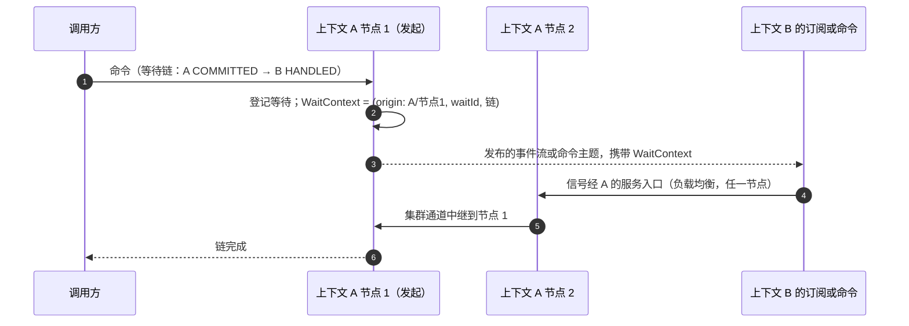

# V10 订阅与等待

日期：2026-10-11。基线：`main` `b5813af56f`。状态：草案。上位文档：[00 目标架构](00-architecture.md)（A2、A7、A8）。相关决定：D5、D14、D15、D23、D25。

## 1. 订阅运行时

```kotlin
subscription("cart-projection") {
    source(context = "example", aggregates = setOf("cart"))
    project<CartState> { event -> repository.upsert(event.state, ifNewer = event.version) }
}
```

订阅 = 名字 + 过滤器 + **一个**处理函数（React、Saga、Project）。一个处理器类里声明了多个处理函数时，KSP 把每个函数编成一个独立订阅（名字为 `处理器.函数`）。原因来自 KaeX mvp 的 BUG-B：一个检查点覆盖多个函数时，部分成功、部分失败会让重放重复触发已成功的函数，mvp 只好再加一层「每个函数的子水位」。共享尾随让订阅几乎没有额外成本，所以直接让检查点与函数一一对应。运行时负责：

- **分区租约**：单位是（订阅组，分区）。订阅组即部署单元（一个服务），同一服务的所有订阅共享分区属主；租约存在存储里，过期按节点时钟计算，部署要求节点间时钟偏差远小于租约 TTL（D53）。
- **共享尾随**：属主对每个分区只开一个尾随读，进程内扇出给本服务所有订阅，各订阅有自己的检查点。落后的订阅先按位置区间追赶读，追平后并入。存储读压力与订阅数无关。
- **状态随附**：处理函数拿到 `StateEvent`（事件流加提交后状态）。状态不在日志里：属主节点直接使用提交时序列化的版本视图（[01](01-programming-model.md) §2）；没有视图时（重放、属主切换），由运行时用快照加尾部演化得到，所以订阅所在服务必须带有该上下文的领域模型。处理函数拿到的是视图的副本，改动它不影响任何人。
- **分区内并行**：同一聚合串行，不同聚合并行。检查点 = 已连续完成的最低位置，按分区存储，数量与聚合实例数无关（KaeX mvp 按聚合实例存水位，存储随实例数增长）。每个分区的在途条目数有上限：一个慢聚合会拖住检查点，崩溃后要重放的范围由这个上限封顶（R3-2）。
- **顺序保证只有一条**（R2-1）：同一聚合的事件按版本顺序到达。不同聚合之间（哪怕在同一分区、哪怕一个是另一个的 Saga 派生结果）不保证顺序；跨聚合的投影必须能容忍乱序，例如按各聚合的版本分别守卫。
- **不需要 fencing**（D45）：租约交接时，旧属主可能短暂与新属主同时处理同一分区。这不破坏正确性：命令由版本唯一键保证至多一个写者成功；订阅的副作用由确定性 ID 幂等（Saga 的请求 ID、`executionId`、按版本守卫的投影）；检查点写入只前进不后退，台账写入按（订阅，聚合，位置）幂等。所以重复处理是安全的，只是浪费。KaeX mvp 实现过 fencing token 后又整体删除，理由相同：对不幂等的副作用，有租约也只能做到至少一次。
- **至少一次**：Saga 派生命令有确定的请求 ID，派生命令的完成条件见 [01](01-programming-model.md) §1；投影按版本守卫写入。

## 2. 失败：停放，不跳过

重试超过上限，就停放**这个聚合**：台账记一条（订阅，聚合，起始版本，原因），其他聚合照常推进；该聚合后续的条目不复制、不暂存，检查点越过它们。修复后从台账重试或跳过：恢复时按聚合从日志读取起始版本之后的事件流（日志本来就支持按聚合读，[03](03-log-and-snapshot.md) §1），所以台账大小与停放的聚合数有关，与停放期间的写入量无关（R3-1）。9.x 的补偿模块因此变成「失败台账 + 控制台」（wow-ops，D14），重试天然定向，不再广播。

台账写在**出错服务自己的存储**里：停放必须与检查点原子地可靠，不能依赖一个远程服务。wow-ops 是汇总与操作面：各服务经 Kafka Sink 发布台账的变化，wow-ops 订阅后汇总展示；重试与跳过作为命令发回所属服务（跨上下文命令，D33），由该服务在本地执行。

## 3. 重放与回填

- 重置检查点即重建读模型；新订阅可选从头或从当前位置开始。
- 蓝绿重建：新版本投影用新订阅名从头追，追平后切换读流量，删除旧订阅。读模型结构变化不需要迁移脚本。

## 4. Sinks

| Sink | 用途 | 取代 9.x 的 |
|---|---|---|
| Kafka | 发布给其他上下文与外部系统，带版本的信封；事件先升级到当前 revision 再发布，revision 变化是公开语言的变化，记入 Manifest | 事件总线与状态事件总线 |
| ClickHouse | 数仓与数据集源表，直接写入 | wow-bi 的 Kafka 引擎同步脚本（D18） |
| Elasticsearch | 事件全文检索 | ES 事件存储 |

## 5. 跨上下文

日志是限界上下文私有的（D23）。跨上下文走**发布的事件流**：上游 Kafka Sink 发布 `StateEvent`（其 schema 在 Manifest 中，是上下文的公开语言）；下游订阅以该主题为来源，语义完全相同（分区、检查点 = 偏移量连续低水位、停放、信号），处理函数不感知来源。9.x 的补偿收集、跨上下文 Saga 都在这里。跨上下文的**命令**不走这条路，见 [02](02-write-path.md) §2（D33）。

**跨上下文命令被拒绝时，发起方要知道**（对抗验证 F5，D47）：D33 让 Saga 在命令被目标上下文持久接收时就完成，若目标随后拒绝（例如库存不足），原设计只把拒绝记进目标自己的失败台账，发起方的 Saga 无从得知、也就无法补偿。拒绝是业务结果，不是运维故障。所以目标上下文把跨上下文命令的结局（`CommandRejected`，含根命令 ID、发起的 Saga 与 `executionId`、原因）发布出去；发起方的 Saga 可以声明对它的处理函数来补偿。只有执行时的技术故障才进入目标的失败台账。

回执怎样做到至少一次（R7，复审 F5 的修复）：拒绝不改变状态，不能写进日志（A1：日志只记聚合的事实）。它也不需要日志：跨上下文命令来自 Kafka 命令主题，目标先把回执写入发起上下文的回执主题，**再**确认命令消息的偏移量。中途崩溃，命令会被重投、重新决定、再次拒绝、再次发回执；回执带确定性 ID（命令 ID），发起方按它去重。

## 6. 等待

### 6.1 阶段

| 阶段 | 含义 | 9.x 对应 |
|---|---|---|
| `ACCEPTED` | 通过准入；只有经 Kafka 路由才表示持久 | SENT |
| `COMMITTED`（默认） | 已追加到日志 | PROCESSED |
| `SNAPSHOT` | 快照已写到这次提交的版本：写后即可查 | SNAPSHOT |
| `HANDLED(context.subscription)` | 指定订阅已处理这次提交；订阅可以在任何上下文 | PROJECTED、EVENT_HANDLED、SAGA_HANDLED |

等待目标是一个**链**：每一跳是（上下文，阶段，订阅），链上的命令用根命令 ID 关联。例如「订单提交 → 库存上下文的 Saga 已处理 → 它派生的扣减命令在库存上下文 `COMMITTED`」。链上任何一跳失败（拒绝、停放），等待方立即收到失败与原因，而不是等到超时。

### 6.2 跨上下文等待

跨上下文等待是 Wow 的重要特性（9.x 已支持），V10 保留，并去掉 9.x 的两个前提：跨服务的**节点**互相可达，以及按节点地址寻址。

原理：等待是观察，不是正确性的一部分（命令链路 P12）。信号丢了，等待方得到超时，事实不受影响。所以信号的投递只要求「尽力而为、低延迟」，不需要持久。



- **WaitContext 随消息走**：等待计划在准入时变成类型化的 `WaitContext`（发起服务、发起节点、`waitId`、剩余的链）。它作为传输元数据（D25）出现在三个地方：日志条目、跨上下文的命令消息（D33）、Kafka Sink 发布的信封。只在等待超出 `COMMITTED` 时才写，不属于事实，领域代码看不到。
- **按服务寻址，节点内中继**：下游发出的信号发往**发起服务**的信号入口，由负载均衡交给任意节点；收到的节点若不是发起节点，经集群通道（[02](02-write-path.md) §3）中继。跨服务只需要服务级可达，和任何服务间调用一样；节点扩缩、重启都不影响寻址。
- **信号传输只有 HTTP**（D35）：下游直接调用发起服务的信号入口，一跳。服务之间能直接调用是部署前提，不提供经 Kafka 的替代传输。
- **服务定位**：发起服务的入口地址由 `ServiceLocator` 解析（默认读配置；Kubernetes 下按服务名约定）。
- **信任边界**：信号入口与集群通道都只在同一个集群内使用，集群内部流量受信任，不做认证（D35）。不认证的前提是它们**到不了集群外**：信号能直接完成等待并把结果交给调用方，若信号入口和公开 REST 在同一端口、经同一个入口网关暴露，外部就能伪造任意命令的结果（对抗验证 F6）。所以信号入口与集群通道只监听独立的内部端口，公开入口不转发它们。同一信号按（`waitId`，跳，来源）去重，这是幂等，不是安全措施。
- **不阻塞下游**：发信号是下游处理完成后的旁路动作，不进入它的检查点与失败判定；Saga 本身的完成条件不变（跨上下文命令到持久 `ACCEPTED` 即完成，D33），等待方仍能沿链等到目标上下文的 `COMMITTED` 或更后的阶段。
- **先登记，后发送；早到的信号要缓存**：等待在命令发出之前登记。链上后一跳的信号可能先于前一跳到达（例如 Saga 派生命令的 `COMMITTED` 早于 Saga 自己的 `HANDLED`），等待方先缓存，前一跳到达后按链回放（KaeX 检查表 C7）。
- **发起节点下线**：等待随节点消失，中继找不到目标即丢弃信号；调用方按超时或重连处理。

## 7. 待细化

- 租约的时长、续约与抢占；属主切换时在途处理的交接。
- 停放的粒度（聚合）与台账的数据结构；台账里条目的保留期。
- Kafka 来源的订阅如何与 Kafka 消费组协作（自管偏移量还是用消费组）。
- 链式等待的表达（DSL 与 `Prefer` 头）与链的最大长度。
- 信号入口的限流，以及信号风暴（一条命令扇出到大量订阅）时的合并。
