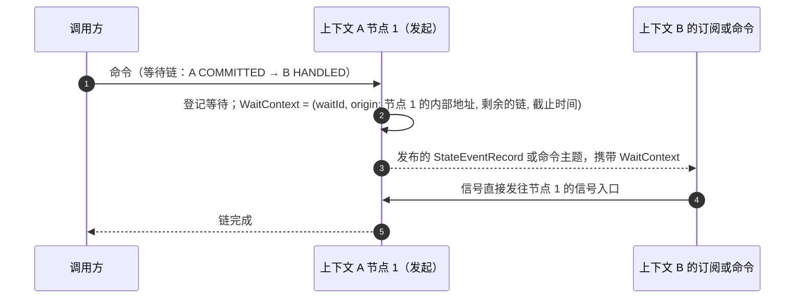

# V10 订阅与等待

日期：2026-10-11。基线：`main` `b5813af56f`。状态：草案。上位文档：[00 目标架构](00-architecture.md)（A2、A7、A8）。相关决定：D5、D14、D15、D23、D25、D133～D141、D149。

## 1. 订阅运行时

```kotlin
subscription("cart-projection") {
    source(context = "example", aggregates = setOf("cart"))
    project<CartState> { event -> repository.upsert(event.state, ifNewer = event.version) }
}
```

订阅的 `context`（6.6）：读别的上下文流的订阅，以**读它的上下文**的名义发等待信号与登记台账，而不是来源上下文。

订阅 = 名字 + 过滤器 + **一个**处理函数（React、Saga、Project）。一个处理器类里声明了多个处理函数时，KSP 把每个函数编成一个独立订阅（名字为 `处理器.函数`）。原因来自 KaeX mvp 的 BUG-B：一个检查点覆盖多个函数时，部分成功、部分失败会让重放重复触发已成功的函数，mvp 只好再加一层「每个函数的子水位」。共享尾随让订阅几乎没有额外成本，所以直接让检查点与函数一一对应。运行时负责：

- **分区租约**：单位是（租约组，分区），租约组是（服务，上下文）（D72）：分区按上下文的日志划分，一个服务承载多个上下文时各自有独立的 P 与租约；同一组内命令路由与所有订阅共享分区属主；租约存在存储里，过期按节点时钟计算，部署要求节点间时钟偏差远小于租约 TTL（D53）。
- **共享尾随**：属主对每个分区只开一个尾随读，进程内扇出给本服务所有订阅，各订阅有自己的检查点。落后的订阅先按位置区间追赶读，追平后并入。存储读压力与订阅数无关。
- **状态随附**：处理函数拿到 `StateEvent`（事件流加提交后状态）。状态不在日志里：属主节点直接使用提交时序列化的版本视图（[01](01-programming-model.md) §2）；没有视图时（重放、属主切换），由运行时用快照加尾部演化得到，所以订阅所在服务必须带有该上下文的领域模型。视图是多读者的（D133）：凡有状态消费者（快照、Sink、订阅）的聚合类型都记进共享缓存，读不到时退回 `Kernel.stateAt`，全部经共享的 `EntryDecoder.stateEvents` 解码。处理函数拿到的是视图的副本，改动它不影响任何人。
- **分区内并行**：同一聚合串行，不同聚合并行。检查点 = 已连续完成的最低位置，按分区存储，数量与聚合实例数无关（KaeX mvp 按聚合实例存水位，存储随实例数增长）。每个分区的在途条目数有上限：一个慢聚合会拖住检查点，崩溃后要重放的范围由这个上限封顶（R3-2）。
- **顺序保证只有一条**（R2-1）：同一聚合的事件按版本顺序到达。不同聚合之间（哪怕在同一分区、哪怕一个是另一个的 Saga 派生结果）不保证顺序；跨聚合的投影必须能容忍乱序，例如按各聚合的版本分别守卫。
- **不需要 fencing**（D45）：租约交接时，旧属主可能短暂与新属主同时处理同一分区。这不破坏正确性：命令由版本唯一键保证至多一个写者成功；订阅的副作用由确定性 ID 幂等（Saga 的请求 ID、`executionId`、按版本守卫的投影）；检查点写入只前进不后退，台账写入按（订阅，聚合，位置）幂等。所以重复处理是安全的，只是浪费。KaeX mvp 实现过 fencing token 后又整体删除，理由相同：对不幂等的副作用，有租约也只能做到至少一次。
- **至少一次**：Saga 派生命令有确定的请求 ID，派生命令的完成条件见 [01](01-programming-model.md) §1；投影按版本守卫写入。
- **注解绑定**（D149）：KSP 为 `@Projection`、`@Reactor`、`@Saga` 生成与运行时无关的 `ProcessorBinding`（在 `:kernel`），经 `ModelProvider.processors(dependencies)` 暴露，`:runtime` 把它们适配成订阅。

## 2. 失败：停放，不跳过

Saga 派生的命令被拒绝不算失败：不重试、不停放，交给 Saga 的 `@OnRejected`（未声明才停放），等待立即失败（D153）。技术故障重试超过上限，就停放**这个聚合**：台账记一条（订阅，聚合，起始版本，原因），其他聚合照常推进；该聚合后续的条目不复制、不暂存，检查点越过它们。修复后从台账重试或跳过：恢复时按聚合从日志读取起始版本之后的事件流（日志本来就支持按聚合读，[03](03-log-and-snapshot.md) §1），所以台账大小与停放的聚合数有关，与停放期间的写入量无关（R3-1）。9.x 的补偿模块因此变成「失败台账 + 控制台」（wow-ops，D14），重试天然定向，不再广播。

台账写在**出错服务自己的存储**里：停放必须与检查点原子地可靠，不能依赖一个远程服务。wow-ops 是汇总与操作面（D141，修订原先「经 Kafka Sink 发布台账变化」的写法）：各服务把台账变化作为跨上下文命令（`RecordParked`、`RecordResolved`，请求 ID 确定）发给 `ops` 上下文的 `parked` 聚合，对账循环按 `FailureLedger.list` 定期重发；重试与跳过是系统命令 `wow.ledger.Resume`、`wow.ledger.Skip`，发到所属服务的命令主题（D33），运行时把它写成台账条目上的请求（`FailureLedger.request`），持有该分区的节点在对账时取走并在本地执行。

**长周期恢复与运维**（D184 的 P.1，#4389）：停放条目按退避（每次翻倍，自上次重试起算）自动重试，用尽后标为 exhausted（同 9.x `isRetryable = false`，不置 `UNRECOVERABLE`），`ApplyRetrySpec` 可恢复自动重试；定时器条目不自动重试。运维路由 `/wow/ops/parked`（列表、单条、resume、skip、mark-recoverable、apply-retry-spec）默认关闭（`wow.ops.enabled`），四个动作是系统命令 `wow.ledger.*`，经 `CommandAuthorizer` 授权；`ParkedNotifier` 推送通用或企业微信 webhook（`wow.ops.webhook.*`）。按订阅的重试与超时（P.3）由 `@Retry` 或 `wow.subscriptions.[…].retry.*` 声明，预算写进 Manifest。

## 3. 重放与回填

- 重置检查点即重建读模型；新订阅的起点默认是投影从头、反应器与 Saga 从末尾，可配置为 `beginning`、`end` 或某个时间，只对没有检查点的订阅生效（D154）；读其他上下文事件流的订阅默认从头，注解 `@OnEvent(start = …)` 可声明起点，宿主配置覆盖注解（D194）。
- 蓝绿重建：新版本投影用新订阅名从头追，追平后切换读流量，删除旧订阅。读模型结构变化不需要迁移脚本。

## 4. Sinks

| Sink | 用途 | 取代 9.x 的 |
|---|---|---|
| Kafka | 发布给其他上下文与外部系统，带版本的信封；事件先升级到当前 revision 再发布，revision 变化是公开语言的变化，记入 Manifest | 事件总线与状态事件总线 |
| ClickHouse | 数仓与数据集源表，直接写入：每个聚合类型一张 `_state`、一张 `_events`，加生成的 `_state_flat` 视图（D142） | wow-bi 的 Kafka 引擎同步脚本（D18） |
| Elasticsearch | 事件全文检索；M6 之后的 6.7（D131） | ES 事件存储 |

## 5. 跨上下文

日志是限界上下文私有的（D23）。跨上下文走**发布的事件流**：上游 Kafka Sink 发布 `StateEventRecord`（D81；其 schema 在 Manifest 中，是上下文的公开语言）；下游订阅以该主题为来源，语义完全相同（分区、检查点 = 偏移量连续低水位、停放、信号），处理函数不感知来源。9.x 的补偿收集、跨上下文 Saga 都在这里。跨上下文的**命令**不走这条路，见 [02](02-write-path.md) §2（D33）。

- **声明**（D138）：`@OnEvent(aggregates = ["ctx.agg"])` 指向其他上下文的聚合；主题是 `wow.<ctx>.<agg>.state`（D135）。
- **分配与偏移量**（D134）：不用 Kafka 消费组。主题分区按 V10 租约分配（对分区做 HRW，租约组 `(服务, "topic:<名字>")`，手动 `assign()`），偏移量存在 `CheckpointStore`；每个（节点，主题）一个消费者，扇出给该主题上的全部订阅，共享尾随因此成立，停放也与检查点同在本服务的存储里。
- **停放与恢复**：主题不能按聚合读，所以台账记下来源偏移量（`ParkedAggregate.fromPosition`），恢复时从它重扫那个分区、只取 key 为停放引用的记录；保留期已过的条目不可恢复，只能跳过。
- **上游不带状态**（D140）：处理函数可以声明 `StateEvent<OrderView?>`；启动时按对端 Manifest 的 `published.includeState` 检查，上游不带状态而 `S` 不可空即拒绝启动。

**跨上下文命令被拒绝时，发起方要知道**（对抗验证 F5，D47）：D33 让 Saga 在命令被目标上下文持久接收时就完成，若目标随后拒绝（例如库存不足），原设计只把拒绝记进目标自己的失败台账，发起方的 Saga 无从得知、也就无法补偿。拒绝是业务结果，不是运维故障。所以目标上下文把跨上下文命令的结局（`CommandRejected`，含根命令 ID、发起的 Saga 与 `executionId`、原因）发布出去；发起方的 Saga 可以声明对它的处理函数来补偿。落地（D136）：命令线上形式带可选的 `replyTo: {context, subscription}`，回执写入 `wow.<replyTo.context>.receipts`，发起方交给 Saga 的 `@OnRejected` 处理函数（参数 `CommandRejected<C>` 与 `SagaContext`），按命令 ID 去重。只有执行时的技术故障才进入目标的失败台账。

回执怎样做到至少一次（R7，复审 F5 的修复）：拒绝不改变状态，不能写进日志（A1：日志只记聚合的事实）。它也不需要日志：跨上下文命令来自 Kafka 命令主题，目标先把回执写入发起上下文的回执主题，**再**确认命令消息的偏移量。中途崩溃，命令会被重投、重新决定、再次拒绝、再次发回执；回执带确定性 ID（命令 ID），发起方按它去重。

**成功回执与同步调用**（D192、D193，DX G23）：发起方 Saga 声明 `@OnCommitted`（参数 `CommandCommitted<C>`：`ref`、聚合 ID、版本、`CommandResult`，不带状态）后，派生命令的 `replyTo` 带成功回执标记，目标提交即按上述同一顺序写回执主题、再推进偏移量；重复请求带原结果重发，单号不变。需要同步拿到对方结果时，Saga 用框架的同步调用客户端经对方的 HTTP 命令网关发送：沿用根命令的请求 ID，以服务凭证传根作用域与操作人，带等待链头；对方不可用按订阅的重试预算处理。默认仍是命令主题加回执。

## 6. 等待

### 6.1 阶段与链

| 阶段 | 含义 | 9.x 对应 |
|---|---|---|
| `ACCEPTED` | 通过准入；只有经 Kafka 路由才表示持久 | SENT |
| `COMMITTED` | 已追加到日志 | PROCESSED |
| `HANDLED(context.subscription)` | 指定订阅已处理这次提交；订阅可以在任何上下文。`SNAPSHOT` 即 `HANDLED(snapshot)`，**是默认**（D69） | SNAPSHOT、PROJECTED、EVENT_HANDLED、SAGA_HANDLED |

- **阶段只有三个**（D61）：快照由内置订阅 `snapshot` 写入，`SNAPSHOT` 只是 `HANDLED(snapshot)` 的简写；订阅的种类（投影、React、Saga）由 Manifest 给出，不再各占一个阶段。
- **默认等待快照**（D69）：快照是默认读模型（A6），命令返回时快照已写到这次提交的版本，调用方紧接着查询就能读到自己的写入。代价：
  - 延迟多出快照订阅的处理时间（同批同聚合合并写入，[03](03-log-and-snapshot.md) §3）。
  - 每条条目都要写 `WaitContext`（D25 的「只在超出 `COMMITTED` 时写」因此成为常态，约百余字节的传输段）。
  - 快照订阅停放或落后时，默认等待会超时；超时结果说明已到 `COMMITTED`，调用方知道事实已提交。
  - 某个聚合关闭了快照（[03](03-log-and-snapshot.md) §3「按聚合可关闭」）时，它的默认等待退回 `COMMITTED`。
- **等待目标是一条链**（D62）：每一跳是（上下文，阶段，订阅），链上的命令用根命令 ID（`correlationId`，[08](08-data-protocols.md) §4）关联。例如「订单 `COMMITTED` → 支付上下文的 Saga 已处理 → 它派生的命令在库存上下文 `COMMITTED`」。
  - 只有 **Saga 跳**之后还能接跳，后面的跳作用于该 Saga 从这次提交派生的命令；投影与 React 跳必须是最后一跳。最多 4 跳。准入按 Manifest 校验链，不合法直接拒绝，不等到超时。
  - Saga 跳的信号带上派生命令的 ID 列表（`CommandResult.derived`），派生的命令**全部**到达下一跳才算完成；派生 0 条时这一跳直接完成。计划在这一跳之后还有跳时，等待以「链已结束」收尾（D212）：最终结果停在这一跳、状态如实，带 `chainEnded: true` 与未到达的跳 `pending`，不报成计划终点的成功；SSE 以同一个结果收尾。
  - 链上任何一跳失败（拒绝、停放），等待方立即收到失败与原因，而不是等到超时。
- **重复请求**（D63）：请求被判为已提交时，后续的 `HANDLED` 可能早已发生、信号已经发过。本上下文的订阅按检查点补查：检查点越过这次提交的位置、且台账里没有停放该聚合，就算已处理。跨上下文的跳无从补查，结果停在 `COMMITTED`、`duplicate = true`，由调用方决定。
- **超时**（D64）：调用方给出超时，默认 10 秒，服务端有上限（默认 60 秒）。截止时间随 `WaitContext` 下发，过期后下游不再发信号。超时的结果是 `FAILED / wow.wait.timeout`，带上已经到达的最后一跳，调用方知道卡在哪里。
- **HTTP**：等待计划由请求头声明，例如 `Wow-Wait: handled(order.payment-saga) > committed(inventory)` 与 `Wow-Wait-Timeout: 10s`（语法在实现时定稿）；`Accept: text/event-stream` 时每到一跳推送一个 `CommandResult`，否则只返回最后一跳或第一个失败。

### 6.2 数据形状（[08](08-data-protocols.md)）

```kotlin
data class WaitPlan(val hops: List<Hop>, val timeout: Duration)       // 调用方声明，只留在发起节点
data class Hop(val stage: Stage, val context: String? = null, val subscription: String? = null)
data class WaitContext(                                               // 传输段，随消息流转（D25）
    val waitId: String,
    val origin: Origin,          // 发起节点：内部地址（实例 IP:内部端口）与服务名
    val remaining: List<Hop>,    // 还没到的跳
    val deadline: Long,          // 绝对截止时间
)
data class WaitSignal(val format: Int, val waitId: String, val result: CommandResult)
```

### 6.3 跨上下文等待

跨上下文等待是 Wow 的重要特性（9.x 已支持），V10 保留。

原理：等待是观察，不是正确性的一部分（命令链路 P12）。信号丢了，等待方得到超时，事实不受影响。所以信号的投递只要求「尽力而为、低延迟」，不需要持久。



- **WaitContext 随消息走**：它作为传输元数据（D25）出现在三个地方：日志条目、跨上下文的命令消息（D33）、Kafka Sink 发布的信封。只在等待超出 `COMMITTED` 时才写，不属于事实，领域代码看不到。
- **信号直接发往发起节点**（D65）：`WaitContext.origin` 是发起节点的内部地址，下游一跳送达，不经负载均衡，也不经集群通道中继。部署前提保证同一集群内实例之间可直接调用（D35）；发起节点若已下线，客户端连接也已断开，送不到的信号直接丢弃，不重试。地址只在等待期间有意义，过了截止时间就作废。
- **信号传输只有 HTTP**（D35）：不提供经 Kafka 的替代传输。
- **跨上下文的链校验**（D138、D139）：`SubscriptionDirectory` 由基于本地与对端 Manifest 的 `ContractDirectory` 实现；Saga 声明了 `@OnEvent(derives = [...])` 时，准入还检查它之后的 `committed(ctx)` 在其中，不声明不检查。
- **信任边界**：信号入口与集群通道都只在同一个集群内使用，集群内部流量受信任，不做认证（D35）。不认证的前提是它们**到不了集群外**：信号能直接完成等待并把结果交给调用方，若信号入口和公开 REST 在同一端口、经同一个入口网关暴露，外部就能伪造任意命令的结果（对抗验证 F6）。所以信号入口与集群通道只监听独立的内部端口，公开入口不转发它们。同一信号按（`waitId`，跳，来源）去重，这是幂等，不是安全措施。
- **不阻塞下游**：发信号是下游处理完成后的旁路动作，不进入它的检查点与失败判定；Saga 本身的完成条件不变（跨上下文命令到持久 `ACCEPTED` 即完成，D33），等待方仍能沿链等到目标上下文的 `COMMITTED` 或更后的阶段。
- **先登记，后发送；早到的信号要缓存**：等待在命令发出之前登记。链上后一跳的信号可能先于前一跳到达（例如 Saga 派生命令的 `COMMITTED` 早于 Saga 自己的 `HANDLED`），等待方按 `waitId` 先缓存，前一跳到达后按链回放（KaeX 检查表 C7）。

## 7. 待细化

- 停放的粒度（聚合）与台账的数据结构；台账里条目的保留期。
- 信号入口的限流，以及信号风暴（一条命令扇出到大量订阅）时的合并。
