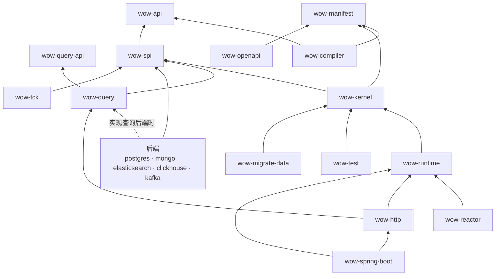

# V10 模块与目录

日期：2026-10-11。基线：`main` `b5813af56f`。状态：草案。上位文档：[00 目标架构](00-architecture.md)（A4、A5、A10）。相关决定：D9、D10、D27、D29、D30、D31、D41～D44。

## 1. 划分原则

一个边界值得成为模块，只有四个理由；都不满足的，用包划分：

1. **依赖隔离**：用户只为自己选的技术付出依赖（选 Mongo 不必带上 PostgreSQL 驱动）。
2. **有独立的消费者**：有人只需要它（社区后端的实现者只需要端口，测试 DSL 只需要内核）。
3. **独立的公开面**：它有自己的 ABI 承诺。
4. **架构约束要由编译器守住**：同一模块里，「内核不得依赖集群通道」只能靠评审。

按这四条复审上一版：

| 上一版 | 问题 | 修正 |
|---|---|---|
| `wow-runtime` 装下 Gateway、内核、集群通道、订阅、等待、生命周期 | 又一个 9.x 的 `wow-core`（3.8 万行）；测试 DSL 与迁移工具只需要内核，却要带上整个运行时；「内核不碰集群」无法由编译器守住 | 拆出 `wow-kernel`（理由 2、4），D43 |
| 端口定义在 `wow-runtime` 里 | D12 让社区按合同自行实现后端，实现者与 TCK 只需要端口 | 端口独立为 `wow-spi`（理由 2），D43 |
| 按角色拆后端：`wow-log-mongo` 与 `wow-query-mongo` | 选 Mongo 的用户两个都要，同一个驱动与连接被拆开；9.x 的 `wow-mongo` 本来就在一个模块里实现事件存储、快照、查询与预留键 | 一种技术一个模块（理由 1），D42 |
| 漏了查询引擎 | 只列了协议与后端，9.x 1.5 万行的 `wow-query`（准入、能力表、编译）没有归属 | 补 `wow-query` |
| 漏了 Manifest 的类型 | 编译器写、运行时与 OpenAPI 读，类型放在哪里没说 | `wow-manifest`（取代 `wow-metadata`） |
| starter 靠 Gradle 特性变体拉依赖 | 特性变体只在 Gradle 里有效，Maven 用户只能手工加；自动配置本来就按类路径生效 | 一个自动配置模块，后端由用户直接加技术模块，D44 |

## 2. 模块

| 层 | 模块 | 内容 | 取代 9.x 的 |
|---|---|---|---|
| 契约 | `wow-api` | 领域代码会 import 的东西与对外线上契约的值类型，无依赖（§2.1，D66） | wow-api（重新设计，去掉查询协议） |
| 契约 | `wow-query-api` | 查询协议：`FilterExpression`、聚合、窗口 | wow-api 的 `api.query` 包 |
| 契约 | `wow-manifest` | Manifest 的类型与 JSON schema；纯数据 | wow-metadata |
| 编译 | `wow-compiler` | KSP：绑定代码与 Manifest；只依赖 `wow-api` 与 `wow-manifest` | wow-compiler |
| 编译 | `wow-gradle-plugin` | Gradle 插件 `me.ahoo.wow`：接好 KSP，构建期内省 schema、合并服务级 Manifest（D83） | wow-schema 的构建期部分 |
| 内核 | `wow-spi` | 全部端口（日志、快照、检查点、租约、失败台账、预留键、Sink）与值类型，`@WowSpi` | wow-core 的 SPI |
| 内核 | `wow-kernel` | `AggregateModel`、decide → evolve → append 循环、结局查明、事件编解码与 revision 升级、状态版本视图、内存日志 | wow-core 的内核 |
| 内核 | `wow-runtime` | Gateway 与准入、Router、集群通道、Executor 与状态缓存、订阅运行时、等待、观测接缝、生命周期 | wow-core 的其余部分 |
| 内核 | `wow-reactor` | 用户编程模型的 Reactor 适配：返回 `Mono`/`Flux` 的处理函数、`ReactiveCommandGateway`、`ReactiveQueryGateway`（D9） | wow-core 的 Reactor 形态 |
| 查询 | `wow-query` | 查询引擎：准入、能力表、编译到后端；数据集 | wow-query |
| 后端 | `wow-postgres` | 日志、快照、查询、检查点、租约、台账、预留键（D10、D27） | （新增） |
| 后端 | `wow-mongo` | 同上，MongoDB（D11） | wow-mongo |
| 后端 | `wow-elasticsearch` | 快照、查询、事件检索 Sink（D13） | wow-elasticsearch |
| 后端 | `wow-clickhouse` | 查询、数仓 Sink（D18） | wow-clickhouse、wow-bi |
| 后端 | `wow-kafka` | Kafka Router、Sink、Kafka 来源的订阅、跨上下文命令；直接基于 `kafka-clients`（D31、D33） | wow-kafka |
| 边缘 | `wow-http` | 由 Manifest 物化路由、problem+json、SSE、信号入口（D30、D35） | wow-webflux、wow-rest-contract |
| 边缘 | `wow-openapi` | Manifest → OpenAPI；swagger 依赖只在这里 | wow-openapi、wow-schema |
| 集成 | `wow-cosec` | 准入与查询的授权策略（身份作用域、ABAC 标签） | wow-cosec |
| 集成 | `wow-opentelemetry` | 观测接缝的追踪与指标 | wow-opentelemetry |
| 宿主 | `wow-spring-boot` | 自动配置：按类路径装配，只做装配（D44） | wow-spring、wow-spring-boot-starter |
| 测试 | `wow-test` | 函数式测试 DSL（聚合、订阅）；只依赖 `wow-kernel` | wow-test、wow-mock |
| 测试 | `wow-tck` | 端口合同测试；只依赖 `wow-spi` | wow-tck |
| 迁移 | `wow-migrate-data` | 数据迁移工具（[07](07-migration.md)） | （新增） |
| 发布 | `wow-bom`、`wow-dependencies` | BOM 与依赖版本 | 同名 |

平台模块（wow-ops、view-store、dataset-registry、analytics）保持 9.x 的 `api / domain / starter / server` 四件套；它们是 Wow 应用，只依赖公开模块，用来证明框架。

9.x 中删除或并入上表的：wow-redis（D12）、wow-bi（D18）、wow-spring、wow-mock、wow-schema、wow-rest-contract、wow-metadata。去留未定的：wow-apiclient（Kotlin 客户端可能改由 Manifest 生成）、wow-cocache、wow-models，见 §6。

### 2.1 `wow-api` 的内容（D66）

`wow-api` 只放两类东西：领域代码会 import 的（注解、`Decision`、`DecideScope`、订阅处理函数拿到的 `StateEvent` 与上下文、`Scope`），以及对外线上契约的值类型（`Command`、`CommandResult`、`WaitPlan`、`Rejection`）。框架内部的接口不放进来。

```text
me.ahoo.wow.api
├── aggregate   AggregateType、AggregateRef、Scope
├── decide      Command、Causation、Decision、Rejection、DecideScope
├── subscribe   StateEvent、ReactContext、SagaContext、ProjectContext（含 executionId）
├── result      CommandResult、FunctionInfo、ErrorInfo、Violation、WaitPlan、Hop
├── lifecycle   删除、恢复、转移所有者、转移空间、打标签：系统命令与系统事件
└── annotation  V10 注解集（[01](01-programming-model.md) §3，D67）
```

9.x 的其余部分的去向：

| 9.x 包 | 规模 | 去向 |
|---|---|---|
| `query/**` | 约 6,600 行 | 搬入 `wow-query-api`（M9，§4） |
| `modeling`（`*Capable` 混入接口）、`naming`、`messaging`（`Header`、`Message`、`FunctionInfo*`） | 约 1,900 行 | 删除；`FunctionInfo` 的语义进 `CommandResult`（D60） |
| `command`（`CommandMessage`、`CommandResultAccessor`…）、`event`（`DomainEvent`、`EventMessage`） | 约 850 行 | 删除，由 `Command`、`StateEvent` 取代 |
| 生命周期事件、`exception/ErrorInfo`、`abac` | 约 1,100 行 | 按 V10 语义重做（`lifecycle`、`result`；标签进生命周期命令） |

**时机**：`wow-api` 与 9.x 同名，只能原地演进（§4）；`v10` 上仍有 9.x 的 `wow-core` 及约 15 个模块依赖旧类型。所以 V10 的包现在就补齐、KSP 改为只认 V10 注解（同名注解原地沿用，D79）；9.x 的包在替换 `wow-core` 的里程碑里一并删除，`query` 在 M9 搬走。

## 3. 依赖方向



由架构测试强制：

- `wow-api`、`wow-query-api`、`wow-manifest` 没有运行时依赖。
- `wow-kernel` 不依赖集群、订阅、等待与任何驱动；`wow-runtime` 只依赖 kotlinx-coroutines 与 Jackson，不依赖 Spring、Reactor 与驱动。
- 后端只依赖 `wow-spi`（实现查询后端时再依赖 `wow-query`），后端之间互不依赖。
- Reactor 只出现在 `wow-reactor` 与 WebFlux 适配层；swagger 只出现在 `wow-openapi`；只有 `wow-spring-boot` 依赖 Spring Boot。
- 观测只经固定接缝挂入，不改变处理结果。
- 任何模块都不依赖 `wow-migrate-data`，也不出现 9.x 的类型名与配置键（[07](07-migration.md) §4）。

## 4. 目录结构（D41）

9.x 有 20 多个 `wow-*` 平铺在根目录，测试、补偿、示例又各自成组，结构不一致。V10 按 §2 的层分目录；Gradle 项目名仍是 `:wow-xxx`，用 `projectDir` 指向子目录（9.x 的 `test/`、`compensation/` 已经这样做）：

```text
api/            wow-api  wow-query-api  wow-manifest
compiler/       wow-compiler  wow-gradle-plugin
core/           wow-spi  wow-kernel  wow-runtime  wow-reactor
query/          wow-query
backends/       wow-postgres  wow-mongo  wow-elasticsearch  wow-clickhouse  wow-kafka
edge/           wow-http  wow-openapi  wow-cosec  wow-opentelemetry
host/           wow-spring-boot
test/           wow-test  wow-tck  wow-it  wow-benchmarks
migration/      wow-migrate-data
bom/            wow-bom  wow-dependencies
platform/       ops/  view-store/  dataset-registry/  analytics/
example/        （同 9.x）
typescript/     （同 9.x）
documentation/  docs/  skills/  build-logic/  config/  （同 9.x）
```

**搬迁时机**：`v10` 分支每周合入 main（[路线图](roadmap.md) §1）。main 上仍在活跃变化的目录（`typescript/`、`view-store/`、`dataset-registry/`、`analytics/`、`compensation/dashboard/`、`documentation/`）若在分支上提早搬家，每次前向合并都会冲突。所以：

- V10 **新名字**的模块在 M0 就按新结构建立：`wow-manifest`、`wow-query-api`、`wow-spi`、`wow-kernel`、`wow-runtime`、`wow-reactor`、`wow-postgres`、`wow-http`、`wow-spring-boot`、`wow-migrate-data`，以及架构测试 `wow-architecture`（`test/`）。它们在孵化中：照常构建与测试，不发布、不做 ABI 校验，用 JDK 21（D29）。
- 与 9.x **同名**、原地演进的模块（`wow-api`、`wow-query`、`wow-compiler`、`wow-mongo`、`wow-elasticsearch`、`wow-clickhouse`、`wow-kafka`、`wow-openapi`、`wow-cosec`、`wow-opentelemetry`、`wow-test`、`wow-tck`、BOM）在被重写的里程碑里随重写一起搬到新目录；其中 main 上仍在活跃变化的（`wow-api` 的查询部分、`wow-query`、`wow-clickhouse` 等）放到 M9 搬迁，理由同平台目录。Gradle 项目名唯一，同名模块不能新旧并存，所以它们只能原地演进。
- 被整体替换的 9.x 模块（`wow-core`、`wow-spring`、`wow-spring-boot-starter`、`wow-webflux`、`wow-rest-contract`、`wow-redis`、`wow-bi`、`wow-schema`、`wow-metadata`、`wow-mock`）留在原地，在替换它的里程碑里删除。
- 平台目录在 M9 合入 main 之前，用一个只做搬迁的提交移到 `platform/`；CI 路径过滤（`ci-scope.mjs`）与部署工作流的 `paths` 在同一个提交里更新。

## 5. 平台基线

- JVM：最低 21，CI 同时在 25 上测试（D29）；换取虚拟线程（`@Blocking` 派发，D36）与 Java 的 record、sealed、模式匹配。
- 异步：协程（D9）；Reactor 写法由 `wow-reactor` 适配，WebFlux 宿主也经它接入。
- PostgreSQL 驱动：D27。
- Maven 坐标：`groupId` 仍是 `me.ahoo.wow`，`artifactId` 与 §2 的模块名相同；不使用 Gradle 特性变体（D44）。

## 6. 待细化

- `wow-apiclient`、`wow-cocache`、`wow-models` 的去留与替代。
- `wow-it` 的内容：端到端、多节点、迁移演练是否各成模块。
- 发布模块清单与 ABI 转储从哪个里程碑开始强制。
