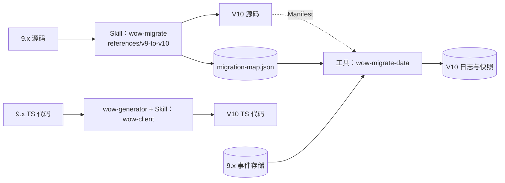

# V10 迁移层

日期：2026-10-11。基线：`main` `b5813af56f`。状态：草案。上位文档：[00 目标架构](00-architecture.md) §1。相关决定：D1、D3、D20、D21、D22。

## 1. 原则

1. **兼容只在一处**：9.x 的类型名、注解、配置键、REST 形状、存储与线上格式，只存在于迁移层。
2. **一次性**：源码与数据各升级一次；完成后项目不再依赖迁移层。
3. **源码交给 Skill，数据交给工具**（D3）：源码迁移是语义改写（`@OnError` 改 Saga、身份与订阅声明、路由与配置的取舍），规则引擎只能做机械部分；数据迁移要处理全部历史，必须确定、可重放、可校验。
4. **正确性靠门禁，不靠改写者**：源码以「编译通过、领域测试通过」验收；数据以「逐聚合重建的状态与 9.x 一致」验收，这同时检验了溯源函数的改写。
5. **一张映射表，由工具核对**：Skill 改动事件类型时写入 `migration-map.json`；数据工具先拿它对照 9.x 存储里实际出现的事件类型与 V10 的 Manifest，缺一条就不开始。

## 2. 源码迁移：Skill

扩展已有的 `skills/wow-migrate`（它已负责下游应用的破坏性迁移，自带授权边界、证据门禁与 eval），新增 `references/v9-to-v10.md`。9.x 到 V10 的源码知识只写在这里：

| 对象 | 机械程度 |
|---|---|
| 构建：模块与 starter feature 对照 | 高 |
| 配置：`wow.*` 键的改名、删除与「不再有对应概念」 | 高 |
| 聚合：注解改写、返回 `Decision`、异常改 `Rejection` | 中 |
| 状态：保留可变写法，只改注解与签名（D7） | 高 |
| `@OnError`：只记日志的删除，做补偿的改 Saga | 低 |
| Saga 与处理器：改订阅声明，订阅名取 9.x 处理器名 | 中 |
| 网关调用：改为 `suspend`（`wow-reactor` 目前只提供处理函数返回 `Mono`/`Flux` 的适配，没有 Reactor 网关）；`CommandBus` 注入改为网关 | 高 |
| 查询：Condition 改 `FilterExpression`；`raw()` 需和用户确认 | 中 |
| 测试：改函数式 DSL | 中 |
| `@AfterCommand`：改为 V10 的 after 钩子，语义不变（D39） | 高 |

两条硬规则：拿不准的改写就问用户，或留 `TODO(wow-migrate)` 并保证编译失败；完成报告列出改动文件、人工确认点、映射表全部条目与门禁结果。正确性由 eval 保证（H5）。

TS 侧（D20）：`wow-generator` 按 Manifest 重新生成客户端；应用代码由 `wow-client` Skill 改写（新增 `v9-to-v10` 参考）；门禁为 `tsc`、lint 与应用测试。

## 3. 数据迁移：`wow-migrate-data`

蓝绿切换，9.x 集群在迁移期间继续服务：

1. **核对映射表**（§1 原则 5）。映射表除事件的改名、改 revision、`drop` 外，还有 `retire`（按退役名原样写入，由目标聚合的 `retiredEvents` 跳过，流的版本保留；核对要求该名在 Manifest 的 `retired` 里，并在导入前报告 `drop` 会丢空的流，审查 A4-7）与聚合下的 `reservations: [{from, namespace, tenancy, ownerId}]`（9.x `PrepareKey` 的映射，核对要求存储里每个 `PrepareKey` 名都有映射，审查 A4-8）。
2. **全量导入**：用 9.x 编解码器读取，按映射表转换，按提交时间写入 V10 日志；保留事件流 ID、版本、请求 ID、提交时间；租户化身份由 9.x 的聚合 ID 与租户组成；等待头等传输字段丢弃。
3. **增量追尾**：9.x 存储没有可续读位置，按提交时间回看一个窗口反复扫描，重复由版本唯一键吸收；9.x 停写后做最后一遍完整扫描。
4. **校验**：每个聚合重建到 9.x 快照所在的版本，规范化 JSON 比较。「零差异」不一定能达到（对抗验证 F7）：9.x 的快照可能带着已修复的缺陷（例如 9.2 的 B9 在追加前就演化了状态），也有聚合没有快照、无从比较。所以差异逐类审定：每一类必须解释为「9.x 的已知缺陷」或「有意的语义变化」并由人签字，**存在未解释的差异就不切换**；报告同时给出有快照可比的聚合占比。
5. **预留**（D227 ③）：导入在事件流之后把 9.x 永久确认的 `PrepareKey` 写成 V10 的已确认预留，租户取所属聚合 9.x 流的租户（取不到或不唯一的标为未解决、不导入），按映射为 `TENANT` 或 `SYSTEM`；待确认与过期的键跳过；`compare` 校验每个键在 V10 有同一 owner 的预留。追尾不跟随预留，切换前最后一次重新导入补上新确认的键。
6. **快照**：校验时重建出的状态直接写成 V10 快照，切换时读服务无空窗。
7. **切换**：9.x 停写 → 迁移器排空 → 流量切到 V10；自定义投影由订阅重建。

另外：跨租户相撞的 ID 列入报告由人裁决；外部 Kafka 消费者（含 BI 的 ClickHouse Kafka 引擎表）在切换时同步改接 V10 的 Kafka Sink，不提供「9.x 格式 Sink」（D229 G-4）；9.x 的 Elasticsearch 事件存储不作为迁移来源，先在 9.x 侧迁到 MongoDB（D229 G-5，同 D213）；补偿、视图存储、数据集注册表的数据走同一路径，未解决的补偿执行由 `migrate-data` 导入各服务的停放台账（D229 G-1，8b.4）。

## 4. 清洁度守护

- 架构测试：`migration/` 之外不依赖它，不出现 9.x 类型名与配置键；9.x 源码知识只在 Skill 参考里。
- `v10` 分支禁止 `@Deprecated` 与 `compat(...)` 标记；`docs/compat-debt.md` 与 `check:compat-debt` 删除，换成禁止标记的检查。
- 以后的演进（D22）：框架格式只在下一次迁移层里变化；领域事件 revision 属于用户模型（[01](01-programming-model.md) §8）。

## 5. 寿命与支持范围（D21）

只支持从 9.x 最后一个次版本升级到 10.0；10.x 期间维护，11.0 删除。用户先升到 9.x 的最后一个次版本，再迁移。

## 6. 分区数与重分区（D239 ③，D240 修订）

每个上下文的分区数 P 在建日志时设定（D28，默认 64）。P 封住的是**单个上下文的写入上限**（约为 P 乘以单分区上限）与**可分担写入的节点数**；节点数少于 P 时，扩缩容只是重新分配租约，本来就能滚动完成，不需要改 P。

- **槽位间接层**（D240 ①，10.0）：聚合先哈希到固定的 4096 个槽位，分区 `= slot mod P`，P 必须是 2 的幂且整除 4096。这一层让以后按倍数分裂时，每个聚合只会从父分区移到它自己的子分区。
- **按倍数在线分裂**（D240 ③，10.x）：父分区关闭、子分区接着写，读者先读完父分区再读子分区；历史原地可读，不搬运，调整的成本与历史数据量无关。
- **离线方案**（应急，在线分裂可用之前）：停写或蓝绿切换 → 新建分区数不同的日志与命令主题 → 按聚合导入全部事件流 → 按快照与检查点重建读模型与订阅位置 → 切换流量。成本与历史数据量成正比，还要停写或临时多一套存储与 Kafka，跨上下文的消费者也要切换，只在必要时使用。
- **容量规划**：P 按峰值写入选定；默认值是否提高由每个分区的空闲成本测量决定（D240 ②）。

## 7. 待细化

- `migration-map.json` 的 schema。
- 规范化 JSON 比较的规则（字段顺序、数值精度、空值）。
- 大数据量下的导入吞吐与断点续传；迁移期间的监控指标。
- 回滚：切换后 V10 已写入时，如何回到 9.x（是否提供 V10 → 9.x 的反向导出）。
