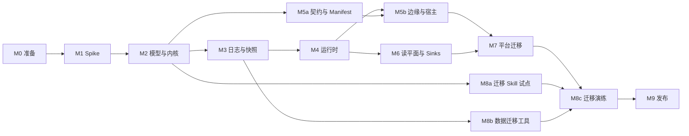

# V10 路线图

日期：2026-10-11。基线：`main` `b5813af56f`。状态：草案。架构见 [00](00-architecture.md)，待决事项见 [决策台账](decisions.md)。

本页只写里程碑、工作包、依赖与出口；不写逐步实施计划。工作包完成时，在本页把状态改为「完成」并注明 PR；里程碑全部完成后，更新相关专题文档的状态。

## 1. 分支与发布

V10 在长期分支 `v10` 上开发，全部完成后一次合入 main（D2）。main 继续作为 9.x 的发布线。

| 规则 | 内容 |
|---|---|
| 前向合并 | main 至少每周合入 `v10` 一次（`git merge`，不 cherry-pick），冲突在 `v10` 上解决；`v10` 完成前不合入 main。前向合并**本地合并、本地验证后直接推送**合并提交，不走 PR：仓库禁用了合并提交（`allow_merge_commit: false`），PR 只能 squash 或 rebase，都会丢掉 main 这个父提交，下次合并会把解决过的冲突再冲突一遍 |
| 其余改动走 PR | 工作包、决策台账与设计文档的修改都开 PR 合入 `v10`，squash 合并；工作包完成时在本页注明 PR。合并前在本地预演合并后的状态，通过后用 `gh pr merge --squash --admin --match-head-commit <已验证的提交>` 合并，与 main 的做法一致 |
| 分支保护 | `v10` 要求经 PR 合入，不要求审批，禁止强制推送与删除；`enforce_admins` 关闭（与 main 一致），所以管理员仍能直接推送前向合并。M0 的 0.1 让 CI 覆盖 `v10` 之后，再把与 main 相同的门禁设为必需检查 |
| main 上的分工 | V10 要替换的 JVM 运行时模块（wow-core 运行时、总线、存储、补偿）在 main 上只修缺陷；V10 沿用的部分（查询协议、view-engine、数据集、TS 包）照常开发，经前向合并进入 `v10` |
| CI | `local-test`、`contract-test`、`integration-test`、`typescript*` 覆盖 `v10`；9 → 10 不混部，由迁移演练取代 `mixed-version`；但 10.x 内相邻次版本必须能滚动升级（D48），所以 `mixed-version` 在 10.0 GA 后以「上一个 10.x 次版本 + 当前构建」重新启用 |
| 预发布 | 发布准入允许从 `v10` 发 `10.0.0-alpha.n` / `beta.n` / `rc.n`（npm `next` dist-tag，不动 `latest`） |
| 合入 | M9 的出口满足后：先从 main 切出 `release-9.x`，再把 `v10` 合入 main，从 main 发 `10.0.0` |

## 2. 里程碑总览



| 里程碑 | 目标 | 预发布 | 必须先拍板的决定 |
|---|---|---|---|
| M0 准备 | 分支、CI、守护规则、决定评审、模块与目录骨架 | — | （已全部拍板） |
| M1 Spike | 验证 H1～H4、H6 | — | — |
| M2 模型与内核 | 领域模型能写、能测 | — | （已全部拍板） |
| M3 日志与快照 | 唯一事实源成立 | — | （已全部拍板） |
| M4 运行时 | 多节点下写、订阅、等待闭环 | `alpha.1` | D6（待 H2） |
| M5 契约、边缘与宿主 | 由 Manifest 驱动的 HTTP 与客户端 | `alpha.2` | （已全部拍板） |
| M6 读平面与 Sinks | 快照查询、跨上下文、数仓 | `beta.1` | （已全部拍板） |
| M7 平台迁移 | 平台模块跑在 V10 上 | `beta.2` | （已全部拍板） |
| M8 迁移层 | 源码与数据一次性迁移 | `rc.1` | （已全部拍板） |
| M9 发布 | GA 与合入 main | `10.0.0` | （已全部拍板） |

## 3. 工作包

### M0 准备

| WP | 内容 | 出口 |
|---|---|---|
| 0.1 | 从 main 切出 `v10`；CI 工作流与发布准入覆盖 `v10` | 完成：Ahoo-Wang/Wow#4210；`v10` 的必需检查与 main 相同（不含 `mixed-version-gate`） |
| 0.2 | 架构测试骨架：[06](06-modules.md) §3 的依赖规则、禁止 `@Deprecated` 与 `compat(...)` | 完成：`test/wow-architecture`（模块依赖图、禁止的外部依赖、兼容标记，各带夹具自测） |
| 0.3 | 决策台账评审：拍板 M2 之前必须定的决定 | 完成：除等 spike 数据的 D6、D10、D27、D28 外全部拍板 |
| 0.4 | 模块与目录骨架：按 [06](06-modules.md) §4 建立 V10 的空模块与目录；平台目录暂不搬迁 | 完成：10 个 V10 模块（孵化中、JDK 21），CI 路径过滤覆盖新目录 |

### M1 Spike

每个 spike 在 `v10` 上独立分支完成，产出结论与原始数据（`wow-benchmarks/results/`），代码不合入。

| WP | 假设 | 出口 |
|---|---|---|
| 1.1 | H1 分区序号分配的吞吐（PostgreSQL 两种方式；MongoDB 事务与分组提交） | 单分区与 64 分区的吞吐、p99、尾随延迟；不跳过的故障注入结果；PostgreSQL 完成：单语句分配，64 分区约 3 万次/秒（Ahoo-Wang/Wow#4216）；MongoDB 完成：属主分组提交约 4.4～5.6 千次/秒，无属主时塌缩，见 `wow-benchmarks/results/reports/v10-h1-mongo-partition-sequence.md` |
| 1.2 | H2 亲和路由的收益：阶段 1 进程内 3 节点 + 真实 PostgreSQL（Local、Partitioned、入口哈希三组）；阶段 2 在 4.2 之后用 3 个 JVM 复测并测属主故障（设计见决策台账 H2） | 阶段 1 的报告与 D6 拍板；阶段 2 的确认报告 |
| 1.3 | H3 协程内核的性能 | 与 9.3 Reactor 内核同一 JMH 基准的吞吐与分配率；同步与 `suspend` 处理函数分别测，验证快速路径无续体分配；完成：V10 快约 7.7 倍、分配减半，见 `wow-benchmarks/results/reports/v10-h3-kernel-comparison.md` |
| 1.4 | H4 KSP 的覆盖 | example、compensation、view-store 与 transfer（Java 源码）的注解模型由 KSP 生成，与 9.x 运行时解析结果比对；完成：38 个命令处理函数中 27 个直接绑定，11 个经 Skill 改写签名（D49），见 `wow-benchmarks/results/reports/v10-h4-ksp-coverage.md` |
| 1.5 | H6 存储租约：成员、属主收敛与再平衡（PostgreSQL、MongoDB） | 收敛时间、迁移分区数、交接期间的重复处理比例 |

H5（Skill 迁移）依赖 V10 API，放在 M8a。

### M2 模型与内核

| WP | 内容 | 出口 |
|---|---|---|
| 2.1 | `wow-api`：`AggregateRef`、`Command`、`EventStream`、`StateEvent`、`Decision`、`Rejection`、revision | API 评审通过；ABI 转储开始记录；完成：身份、命令、决定类型（Ahoo-Wang/Wow#4212）；`StateEvent<S>`、`@Revision`（Ahoo-Wang/Wow#4250） |
| 2.2 | DSL 写法与 `AggregateModel` | 内存中可执行；进行中：DSL 与 `AggregateModel`（Ahoo-Wang/Wow#4212） |
| 2.3 | `wow-compiler`：注解 → 绑定代码（按签名选定同步、`suspend`、Reactor 调用；`@Blocking` 派发）；Manifest v0（聚合、命令、事件） | 生成结果可复现；与 DSL 产出同一模型；进行中：`ModelSymbolProcessor` 生成内核模型（同步、`suspend`、Reactor、依赖参数、`Command<X>`、创建三态、after 钩子），`wow.model=report` 输出覆盖报告；`@Blocking` 派发与 Manifest 待做 |
| 2.4 | 内核：两级去重与命令指纹（D46）、decide → evolve → append、冲突重试、结局查明、生命周期事件、`onAppendFailure`；可变状态失败时的丢弃重载与提交时的版本视图 | 内核特征测试；进行中：去重与指纹、提交循环、冲突重试、结局查明（Ahoo-Wang/Wow#4212）；生命周期事件、版本视图、`onAppendFailure` 待做；丢弃重载完成（`StateCache`：未提交即丢弃）；`onAppendFailure` 与 `afterAppend`（`DecideScope`）完成（Ahoo-Wang/Wow#4215） |
| 2.5 | 事件 revision 与升级链 | 多 revision 的读取测试；完成：升级函数逐级升级、事件改名的别名（Ahoo-Wang/Wow#4215） |
| 2.6 | 测试 DSL 与内存日志；decide 修改状态的检测（F4） | example 领域用 V10 写法通过全部领域测试；完成：`aggregateSpec`，暂放 `wow-kernel` 的 testFixtures，`wow-test` 原地重写时搬入；默认检测 decide 修改状态（Ahoo-Wang/Wow#4215） |
| 2.7 | `wow-reactor`：返回 `Mono`/`Flux` 的处理函数的 KSP 生成调用、`ReactiveCommandGateway`、`ReactiveQueryGateway` | example 领域保留 Reactor 写法的处理函数通过测试；进行中：`awaitResult` 与生成代码对 `Mono`/`Flux` 返回的调用；两个 Gateway 待做 |
| 2.8 | 预留键端口与内核的回滚（D38）；after 钩子（D39） | 唯一性约束的领域测试；after 钩子完成（Ahoo-Wang/Wow#4215）；预留键端口与 PostgreSQL 实现完成（Ahoo-Wang/Wow#4222）；`DecideScope.reserve` 完成：待确认预留随追加确认、失败时释放、崩溃时过期（R8），键归聚合所有；预留随日志条目记录、由内置订阅确认（D50）待做 |

### M3 日志与快照

| WP | 内容 | 出口 |
|---|---|---|
| 3.1 | `EventLog` 合同与 TCK（唯一键、版本连续、位置不跳过、续读一致） | 内存实现通过；完成：`EventLogSpec`（`wow-spi` 的 testFixtures），内存与 PostgreSQL 实现均通过（Ahoo-Wang/Wow#4216） |
| 3.2 | PostgreSQL 实现（含检查点、租约、失败台账、预留键） | TCK 全绿；故障注入不跳过；日志完成（Ahoo-Wang/Wow#4216）；快照（Ahoo-Wang/Wow#4219）、检查点与租约（Ahoo-Wang/Wow#4221）、失败台账与预留键（Ahoo-Wang/Wow#4222）完成，合同测试在 `wow-spi` 的 testFixtures，内存实现在 `wow-kernel` |
| 3.3 | MongoDB 实现（D11，一等后端；含分组提交与预留键） | 同上；进行中：日志与分组提交（`appendAll`，冲突时拆回逐条）通过 `EventLogSpec`；快照、检查点、租约、台账、预留键待做 |
| 3.4 | 快照存储合同与 TCK；schema 指纹；Mongo、ES、PostgreSQL 实现 | TCK 全绿；进行中：`SnapshotStoreSpec`、内存与 PostgreSQL 实现（Ahoo-Wang/Wow#4219）；Mongo、ES 待做 |

### M4 运行时

| WP | 内容 | 出口 |
|---|---|---|
| 4.1 | Executor 与状态缓存 | 每聚合顺序测试；完成：每聚合一条公平车道（不同聚合互不阻塞、车道有上限、关闭即拒绝并等待在途命令），`StateCache` 取出放回语义与 `LruStateCache` |
| 4.2a | 集群通道（与传输无关，D77）：`ClusterChannel` 端口与转发消息（D78、D80）、HRW 无主对账（D70）、主动交接、降级 Local（D71）、租约组与成员地址（D72）、进程内回环传输 | 单 JVM 多节点测试：属主收敛、交接顺序、属主被杀后降级、超时后去重 |
| 4.2b | 集群通道的真实传输：宿主的 HTTP/2 栈（D26） | 3 个 JVM 互相转发；节点上下线时命令不中断（H6 的数据） |
| 4.3 | Router：Partitioned、Local（随 4.2a 实现） | 转发与降级测试 |
| 4.4 | 订阅运行时：共享尾随、追赶读、检查点、分区内并行 | 读压力不随订阅数增长 |
| 4.5 | 失败停放与台账；重放与蓝绿重建 | 停放与恢复测试 |
| 4.6 | 内置快照订阅；历史状态（按版本、按时间、追溯，D40） | 快照与日志一致；历史状态与重放一致 |
| 4.7 | 等待：三个阶段（D61）、链式等待（含早到信号缓存，D62）、重复请求补查（D63）、超时（D64）、`WaitContext` | 跨节点等待测试；乱序信号测试 |
| 4.10 | 订阅的测试 DSL：投影、Saga、处理器的 given/when/then 与重放测试（KaeX 指出 9.x 测试 DSL 缺投影） | example 的投影与 Saga 有 DSL 测试 |
| 4.8 | 观测接缝、生命周期与停机 | 持续入流下停机在时限内完成 |
| 4.9 | 3 节点故障注入：任意时刻杀进程 | 不丢事实；读模型最终一致 → 发 `alpha.1` |

### M5 契约、边缘与宿主

| WP | 内容 | 出口 |
|---|---|---|
| 5a.1 | Manifest 完整版（路由、错误码、查询能力、订阅、发布流）；Jackson 内省生成 schema 的 Gradle 任务（D73）；服务级合并与 `GET /wow/manifest`（D74） | schema 评审 |
| 5a.4 | Manifest 兼容性门禁（D76）：与上一个已发布版本比较，主版本内的破坏性差异使 CI 失败 | 加法与破坏的分类测试；在 example 服务上演示 |
| 5a.2 | `wow-openapi`：Manifest → OpenAPI | 快照测试 |
| 5a.3 | `wow-generator` 读 Manifest；`wow-client` V10 | 对 Manifest 快照的生成测试（对真实服务的契约测试在 5b.2） |
| 5b.1 | 准入：身份、授权（CoSec）、改写与校验扩展点 | 安全测试（冒充、越权、身份冲突） |
| 5b.2 | `wow-http`：路由物化、problem+json、SSE 等待 | example-server 的 REST 契约测试；TS 客户端对它的契约测试 |
| 5b.3 | `wow-spring-boot` 宿主 | example-server 启动并通过端到端测试 → 发 `alpha.2` |

### M6 读平面与 Sinks

| WP | 内容 | 出口 |
|---|---|---|
| 6.1 | `wow-query-api` 拆分；删除 Condition | 查询 TCK |
| 6.2 | 查询后端改查快照与投影（Mongo、ES、PostgreSQL、ClickHouse） | 查询契约测试 |
| 6.3 | Kafka Sink 与 Kafka 来源的订阅；跨上下文命令经目标命令主题投递（D33） | 两个上下文之间的 Saga 端到端（example 新增一个上下文，transfer 只有一个上下文不适用）；wow-ops 汇总 example 的台账 |
| 6.4 | ClickHouse Sink；数据集源表 | 分析服务端到端 → 发 `beta.1` |
| 6.5 | Kafka Router（持久摄入） | 异步命令不丢测试 |
| 6.6 | 跨上下文等待：信号入口（HTTP）、信号直接发往发起节点（D34、D35、D65） | 两个上下文的链式等待端到端：调用方等到下游上下文的 `COMMITTED` 与 `HANDLED`；下游拒绝时立即失败；发起节点下线时信号被丢弃、不重试 |

### M7 平台迁移

| WP | 内容 | 出口 |
|---|---|---|
| 7.1 | wow-ops（失败台账与控制台）取代 compensation | 控制台端到端 |
| 7.2 | view-store、dataset-registry、analytics 跑在 V10 上 | 各自端到端 |
| 7.3 | 控制台与 view-engine 接 V10 客户端 | Storybook 与 dashboard 测试 → 发 `beta.2` |

### M8 迁移层

| WP | 内容 | 出口 |
|---|---|---|
| 8a.1 | `skills/wow-migrate/references/v9-to-v10.md` 初稿；example 试点（M2 之后即可开始） | example 由 Skill 升级后通过测试 |
| 8a.2 | H5：5 个 9.x 领域作为 eval；`wow-client` 的 `v9-to-v10` 参考 | eval 通过率达标 |
| 8b.1 | `wow-migrate-data`：映射表核对、全量导入、增量追尾 | 9.x example 数据导入 |
| 8b.2 | 逐聚合校验与快照生成 | 零差异报告 |
| 8c.1 | 蓝绿演练：example、compensation、view-store 的生产形数据 | 一次完整切换（含回滚演练，D32）→ 发 `rc.1` |

### M9 发布

| WP | 内容 | 出口 |
|---|---|---|
| 9.1 | 文档站 V10 版本：指南、迁移指南、契约页 | 中英文结构对齐 |
| 9.2 | 基准报告：与 9.x 的同场景对比 | `wow-benchmarks/results/` 入库 |
| 9.3 | rc 试用反馈收敛 | 无阻塞问题 |
| 9.3a | 平台目录搬迁到 `platform/`（只做搬迁的一个提交），同步 `ci-scope.mjs` 与部署工作流的 `paths` | CI 全绿 |
| 9.4 | 切 `release-9.x`；`v10` 合入 main；发 `10.0.0` | GA |

## 4. 并行与关键路径

关键路径：M1 → M2 → M3 → M4 → M6 → M7 → M8c → M9。可并行：M5a 与 M3 同时（都只依赖 M2）；M8a 在 M2 之后即可试点；M8b 在 M3 之后开始。同一时间最多三路，避免改同一批模块。

## 5. 当前进度与下一步（2026-10-12 交接）

本节是换会话继续推进的入口：先读本节，再读[决策台账](decisions.md)（D1～D82 已定，只剩 D6 待 H2 证据）与 [08 数据协议](08-data-protocols.md)。

**工作方式**：主会话只做协调与审查；实现交给隔离 worktree 里的子代理，子代理开 PR 到 `v10` 但不合并；主会话审查后在本地对合并结果做演练（完整验证命令全绿），再 `gh pr merge --squash --admin --match-head-commit <完整 SHA>`。子代理的说明里必须写明：JUnit 测试函数返回 `Unit`（否则被静默跳过，按 `build/test-results` 的 XML 核对数量）；改动公开面时更新 `wow-api`、`wow-mongo` 的 ABI 转储；先 `detekt --auto-correct`；不改设计文档（由主会话改）；互相并行的子代理不碰同一批文件。

完整验证命令：

```text
./gradlew :wow-api:check :wow-spi:check :wow-kernel:check :wow-runtime:check :wow-reactor:check :wow-compiler:test :wow-postgres:check :wow-postgres:integrationTest :wow-mongo:check :wow-mongo:integrationTest :wow-kernel-benchmarks:compileJmhKotlin :wow-architecture:test detekt
```

**已合并到 `v10`**：内核（decide → evolve → append、去重、冲突重试、结局查明、after 钩子、revision 升级、`Creation` 三态、`DecideScope` 的补偿 / `putResult` / `reserve`、`StateCache` 取出放回、快照加尾部加载与状态 schema 指纹）；SPI 与三套后端（内存、PostgreSQL、MongoDB）的日志、快照、检查点、租约与成员、失败台账（含 `repark`）、预留键，日志带传输段、`head`、`positionOf` 与格式版本表；08 数据协议（`Scope`、`Causation`、`commandType`、`Transport`）；KSP 模型处理器（H4）；`wow-reactor` 的 `awaitResult`；运行时的 `Executor`、`LruStateCache`、订阅运行时核心（共享尾随、追赶并入、分区内并行、连续低水位、停放与恢复）、等待（4.7：`WaitCoordinator`、链、早到缓存、重复请求补查、超时；单服务内）；V10 注解集与 `wow-api` 的 `subscribe` 包（Ahoo-Wang/Wow#4250：KSP 只认 V10 注解，删除的注解与命令字段上的身份注解报编译错误，事件的 `@Name` / `@Revision` / `@Alias` 进入模型，订阅类的形状校验）。H1、H3、H4 已有报告（`wow-benchmarks/results/reports/v10-h*.md`）。

**进行中**：H2 阶段 1，原子代理仍在另一台电脑上运行（进行中的代码与部分结果在远程分支 `claude/v10-spike-h2-wip`），完成后会推送 `claude/v10-spike-h2` 并开 PR，不要另派子代理重复执行；主会话审查报告 `wow-benchmarks/results/reports/v10-h2-routing.md`，按决策台账 H2 行预先登记的标准把结论记入 D6，再合并。4.2a 的 PR（Ahoo-Wang/Wow#4251）在审查后的返工中。

**下一步队列**（按依赖排序；同一行内的可并行）：

| 顺序 | 工作包 | 依赖与要点 |
|---|---|---|
| 1 | 4.2a 集群通道与再平衡（D70～D72、D77、D78、D80） | HRW 无主对账、主动交接、转发失败一律降级 Local、`Member` 增加内部地址（SPI 与三套后端）、同步命令转发（进程内回环传输）；进行中（子代理） |
| 2 | 4.6 内置快照订阅 | 用 `EventCodec.snapshotOf`，作用域取自事件流的 `scope`；同批同聚合合并写入；等待的默认 `SNAPSHOT` 由它完成 |
| 2 | D50 预留确认订阅 | 按日志条目传输段确认待确认预留；恢复路径需要一条带传输段的读取 |
| 2 | 注解集的后续 | `@Upgrade`（D82）；命令的 `@Alias` 绑定（内核 `CommandType` 增加旧名）；`@Alias` 值只有一个点时报错；订阅绑定代码的生成依赖运行时提供 `StateEvent` 解码与三种上下文的实现 |
| 2 | 5a.1 Manifest v0 与 Jackson 内省 schema（D73～D74） | 注解集已合入，依赖已满足 |
| 3 | 2.4 生命周期命令与事件 | 删除、恢复、转移所有者 / 空间（在 `Kernel.scopeAfter` 接入）、标签 |
| 3 | 等待的后续 | 流式结果改为每条派生命令推一个；只有默认计划可退回 `COMMITTED`，显式要求快照而无快照订阅时拒绝；`WaitPlan` 提供 `java.time.Duration` 重载 |
| 4 | H6（租约收敛实测） | 依赖 4.2a |
| 4 | 4.2b 真实传输、H2 阶段 2 | 依赖宿主的 HTTP/2 栈（`wow-http` / `wow-spring-boot`） |

