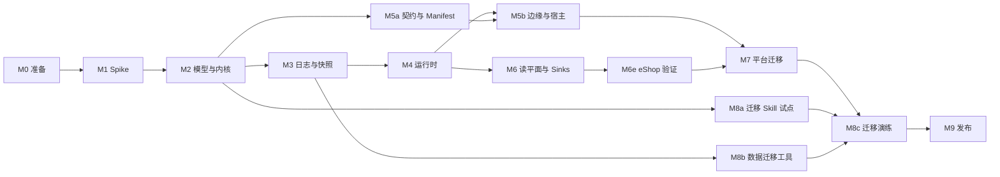

# V10 路线图

日期：2026-10-11。基线：`main` `b5813af56f`。状态：草案。架构见 [00](00-architecture.md)，待决事项见 [决策台账](decisions.md)。

本页只写里程碑、工作包、依赖与出口；不写逐步实施计划。工作包完成时，在本页把状态改为「完成」并注明 PR；里程碑全部完成后，更新相关专题文档的状态。

## 1. 分支与发布

V10 在长期分支 `v10` 上开发，全部完成后一次合入 main（D2）。main 继续作为 9.x 的发布线。

| 规则 | 内容 |
|---|---|
| 前向合并 | main 至少每周合入 `v10` 一次（`git merge`，不 cherry-pick），冲突在 `v10` 上解决；`v10` 完成前不合入 main。前向合并**本地合并、本地验证后直接推送**合并提交，不走 PR：仓库禁用了合并提交（`allow_merge_commit: false`），PR 只能 squash 或 rebase，都会丢掉 main 这个父提交，下次合并会把解决过的冲突再冲突一遍 |
| 其余改动走 PR | 工作包、决策台账与设计文档的修改都开 PR 合入 `v10`，squash 合并；工作包完成时在本页注明 PR。合并前在本地预演合并后的状态，通过后用 `gh pr merge --squash --admin --match-head-commit <已验证的提交>` 合并，与 main 的做法一致 |
| 分支保护 | `v10` 要求经 PR 合入，不要求审批，禁止强制推送与删除；`enforce_admins` 关闭（与 main 一致），所以管理员仍能直接推送前向合并。M0 的 0.1 让 CI 覆盖 `v10` 之后，再把与 main 相同的门禁设为必需检查 |
| main 上的分工 | V10 要替换的 JVM 运行时模块（wow-core 运行时、总线、存储、补偿）在 main 上只修缺陷；V10 沿用的部分（查询协议、view-engine、数据集、TS 包）照常开发，经前向合并进入 `v10` |
| CI | `local-test`、`contract-test`、`integration-test`、`typescript*` 覆盖 `v10`；9 → 10 不混部，由迁移演练取代 `mixed-version`；但 10.x 内相邻次版本必须能滚动升级（D48），所以 `mixed-version` 在 10.0 GA 后以「上一个 10.x 次版本 + 当前构建」重新启用 |
| 预发布 | 不发（D124、D147）：全部目标完成前不从 `v10` 发 `alpha` / `beta` / `rc`；里程碑出口只作 CI 门槛，版本号与发布范围在 M9 一次性准备 |
| 合入 | M9 的出口满足后：先从 main 切出 `release-9.x`，再把 `v10` 合入 main，从 main 发 `10.0.0` |

## 2. 里程碑总览

里程碑出口只作 CI 门槛，不发预发布（D124、D147）；原先的预发布一栏（`alpha.1`～`rc.1`）已删去。

| 里程碑 | 目标 | 出口门槛 | 必须先拍板的决定 |
|---|---|---|---|
| M0 准备 | 分支、CI、守护规则、决定评审、模块与目录骨架 | CI 覆盖 `v10` | （已全部拍板） |
| M1 Spike | 验证 H1～H4、H6 | 各 spike 报告入库 | — |
| M2 模型与内核 | 领域模型能写、能测 | CI 绿 | （已全部拍板） |
| M3 日志与快照 | 唯一事实源成立 | CI 绿（含 TCK） | （已全部拍板） |
| M4 运行时 | 多节点下写、订阅、等待闭环 | CI 绿（含 4.9 故障注入） | （已全部拍板） |
| M5 契约、边缘与宿主 | 由 Manifest 驱动的 HTTP 与客户端 | CI 绿（含 `shop-server` 端到端） | （已全部拍板） |
| M6 读平面与 Sinks | 快照查询、跨上下文、数仓 | CI 绿（含 `:example-e2e`） | （已全部拍板，D125～D149） |
| M6e eShop 验证 | 经典 eShop 的 5 个上下文全跑在 V10 上，验证 M1～M6 的能力与开发体验（D158～D160） | CI 绿（含 `:eshop-e2e` 的下单全链路与故障场景）；`DX-GAPS.md` 里阻塞 M7 的条目已补 | （已全部拍板） |
| M7 平台迁移 | 平台模块跑在 V10 上 | CI 绿；API 冻结，V10 模块开始 ABI 转储与校验（D88、D147） | 入口：`09-capability-parity.md` 入库，缺失项补齐或获用户批准豁免（D183）；即 M6p 的 P.1～P.5 完成（D184） |
| M8 迁移层 | 源码与数据一次性迁移 | CI 绿（含 8c.1 演练） | （已全部拍板） |
| M9 发布 | GA 与合入 main | `10.0.0`（打标签前须用户确认，D124） | （已全部拍板） |

## 3. 工作包

### M0 准备

| WP | 内容 | 出口 |
|---|---|---|
| 0.1 | 从 main 切出 `v10`；CI 工作流与发布准入覆盖 `v10` | 完成：Ahoo-Wang/Wow#4210；`v10` 的必需检查与 main 相同（不含 `mixed-version-gate`） |
| 0.2 | 架构测试骨架：[06](06-modules.md) §3 的依赖规则、禁止 `@Deprecated` 与 `compat(...)` | 完成：`test/wow-architecture`（模块依赖图、禁止的外部依赖、兼容标记，各带夹具自测） |
| 0.3 | 决策台账评审：拍板 M2 之前必须定的决定 | 完成：除等 spike 数据的 D6、D10、D27、D28 外全部拍板 |
| 0.4 | 模块与目录骨架：按 [06](06-modules.md) §4 建立 V10 的空模块与目录；平台目录暂不搬迁 | 完成：10 个 V10 模块（孵化中、JDK 21），CI 路径过滤覆盖新目录 |

### M1 Spike

每个 spike 在 `v10` 上独立分支完成，产出结论与原始数据（`wow-benchmarks/results/`），代码不合入。

| WP | 假设 | 出口 |
|---|---|---|
| 1.1 | H1 分区序号分配的吞吐（PostgreSQL 两种方式；MongoDB 事务与分组提交） | 单分区与 64 分区的吞吐、p99、尾随延迟；不跳过的故障注入结果；PostgreSQL 完成：单语句分配，64 分区约 3 万次/秒（Ahoo-Wang/Wow#4216）；MongoDB 完成：属主分组提交约 4.4～5.6 千次/秒，无属主时塌缩，见 `wow-benchmarks/results/reports/v10-h1-mongo-partition-sequence.md` |
| 1.2 | H2 亲和路由的收益：阶段 1 进程内 3 节点 + 真实 PostgreSQL（Local、Partitioned、入口哈希三组）；阶段 2 在 4.2 之后用 3 个 JVM 复测并测属主故障（设计见决策台账 H2） | 阶段 1 的报告与 D6 拍板；阶段 2 的确认报告；阶段 1 完成：D6 定为 Partitioned（2026-10-12，[报告](../../../wow-benchmarks/results/reports/v10-h2-routing.md)，Ahoo-Wang/Wow#4255） |
| 1.3 | H3 协程内核的性能 | 与 9.3 Reactor 内核同一 JMH 基准的吞吐与分配率；同步与 `suspend` 处理函数分别测，验证快速路径无续体分配；完成：V10 快约 7.7 倍、分配减半，见 `wow-benchmarks/results/reports/v10-h3-kernel-comparison.md` |
| 1.4 | H4 KSP 的覆盖 | example、compensation、view-store 与 transfer（Java 源码）的注解模型由 KSP 生成，与 9.x 运行时解析结果比对；完成：38 个命令处理函数中 27 个直接绑定，11 个经 Skill 改写签名（D49），见 `wow-benchmarks/results/reports/v10-h4-ksp-coverage.md` |
| 1.5 | H6 存储租约：成员、属主收敛与再平衡（PostgreSQL、MongoDB） | 收敛时间、迁移分区数、交接期间的重复处理比例；完成（[报告](../../../wow-benchmarks/results/reports/v10-h6-leases.md)，Ahoo-Wang/Wow#4278） |

H5（Skill 迁移）依赖 V10 API，放在 M8a。

### M2 模型与内核

| WP | 内容 | 出口 |
|---|---|---|
| 2.1 | `wow-api`：`AggregateRef`、`Command`、`EventStream`、`StateEvent`、`Decision`、`Rejection`、revision | API 评审通过；ABI 转储开始记录；完成：身份、命令、决定类型（Ahoo-Wang/Wow#4212）；`StateEvent<S>`、`@Revision`（Ahoo-Wang/Wow#4250） |
| 2.2 | DSL 写法与 `AggregateModel` | 内存中可执行；进行中：DSL 与 `AggregateModel`（Ahoo-Wang/Wow#4212） |
| 2.3 | `wow-compiler`：注解 → 绑定代码（按签名选定同步、`suspend`、Reactor 调用；`@Blocking` 派发）；Manifest v0（聚合、命令、事件） | 生成结果可复现；与 DSL 产出同一模型；进行中：`ModelSymbolProcessor` 生成内核模型（同步、`suspend`、Reactor、依赖参数、`Command<X>`、创建三态、after 钩子），`wow.model=report` 输出覆盖报告；`@Blocking` 派发与 Manifest 待做 |
| 2.4 | 内核：两级去重与命令指纹（D46）、decide → evolve → append、冲突重试、结局查明、生命周期事件、`onAppendFailure`；可变状态失败时的丢弃重载与提交时的版本视图 | 内核特征测试；进行中：去重与指纹、提交循环、冲突重试、结局查明（Ahoo-Wang/Wow#4212）；生命周期事件、版本视图、`onAppendFailure` 待做；丢弃重载完成（`StateCache`：未提交即丢弃）；`onAppendFailure` 与 `afterAppend`（`DecideScope`）完成（Ahoo-Wang/Wow#4215） |
| 2.5 | 事件 revision 与升级链 | 多 revision 的读取测试；完成：升级函数逐级升级、事件改名的别名（Ahoo-Wang/Wow#4215） |
| 2.6 | 测试 DSL 与内存日志；decide 修改状态的检测（F4） | example 领域用 V10 写法通过全部领域测试；完成：`aggregateSpec`，暂放 `wow-kernel` 的 testFixtures，`wow-test` 原地重写时搬入；默认检测 decide 修改状态（Ahoo-Wang/Wow#4215） |
| 2.7 | `wow-reactor`：返回 `Mono`/`Flux` 的处理函数的 KSP 生成调用、`ReactiveCommandGateway`、`ReactiveQueryGateway` | example 领域保留 Reactor 写法的处理函数通过测试；进行中：`awaitResult` 与生成代码对 `Mono`/`Flux` 返回的调用；两个 Gateway 待做 |
| 2.8 | 预留键端口与内核的回滚（D38）；after 钩子（D39） | 唯一性约束的领域测试；after 钩子完成（Ahoo-Wang/Wow#4215）；预留键端口与 PostgreSQL 实现完成（Ahoo-Wang/Wow#4222）；`DecideScope.reserve` 完成：待确认预留随追加确认、失败时释放、崩溃时过期（R8），键归聚合所有；预留随日志条目记录、由内置订阅确认（D50）待做 |

### M3 日志与快照

| WP | 内容 | 出口 |
|---|---|---|
| 3.1 | `EventLog` 合同与 TCK（唯一键、版本连续、位置不跳过、续读一致） | 内存实现通过；完成：`EventLogSpec`（`wow-spi` 的 testFixtures），内存与 PostgreSQL 实现均通过（Ahoo-Wang/Wow#4216） |
| 3.2 | PostgreSQL 实现（含检查点、租约、失败台账、预留键） | TCK 全绿；故障注入不跳过；日志完成（Ahoo-Wang/Wow#4216）；快照（Ahoo-Wang/Wow#4219）、检查点与租约（Ahoo-Wang/Wow#4221）、失败台账与预留键（Ahoo-Wang/Wow#4222）完成，合同测试在 `wow-spi` 的 testFixtures，内存实现在 `wow-kernel` |
| 3.3 | MongoDB 实现（D11，一等后端；含分组提交与预留键） | 同上；进行中：日志与分组提交（`appendAll`，冲突时拆回逐条）通过 `EventLogSpec`；快照、检查点、租约、台账、预留键待做 |
| 3.4 | 快照存储合同与 TCK；schema 指纹；Mongo、ES、PostgreSQL 实现 | TCK 全绿；进行中：`SnapshotStoreSpec`、内存与 PostgreSQL 实现（Ahoo-Wang/Wow#4219）；Mongo、ES 待做 |

### M4 运行时

| WP | 内容 | 出口 |
|---|---|---|
| 4.1 | Executor 与状态缓存 | 每聚合顺序测试；完成：每聚合一条公平车道（不同聚合互不阻塞、车道有上限、关闭即拒绝并等待在途命令），`StateCache` 取出放回语义与 `LruStateCache` |
| 4.2a | 集群通道（与传输无关，D77）：`ClusterChannel` 端口与转发消息（D78、D80）、HRW 无主对账（D70）、主动交接、降级 Local（D71）、租约组与成员地址（D72）、进程内回环传输 | 单 JVM 多节点测试：属主收敛、交接顺序、属主被杀后降级、超时后去重；完成（Ahoo-Wang/Wow#4251） |
| 4.2b | 集群通道的真实传输：宿主在独立内部端口上起 h2c 服务、`wow-http` 提供路由、客户端用 JDK `HttpClient`（D26、D89） | 3 个 JVM 互相转发；节点上下线时命令不中断（H6 的数据） |
| 4.3 | Router：Partitioned、Local（随 4.2a 实现） | 转发与降级测试；完成（Ahoo-Wang/Wow#4251） |
| 4.4 | 订阅运行时：共享尾随、追赶读、检查点、分区内并行 | 读压力不随订阅数增长 |
| 4.5 | 失败停放与台账；重放与蓝绿重建 | 停放与恢复测试 |
| 4.6 | 内置快照订阅；历史状态（按版本、按时间、追溯，D40） | 快照与日志一致；历史状态与重放一致；完成：内置快照订阅（Ahoo-Wang/Wow#4256）；第二部分历史状态（`?at=`、`/state/trace`，可从已在该时刻前提交的快照开始，Ahoo-Wang/Wow#4317） |
| 4.7 | 等待：三个阶段（D61）、链式等待（含早到信号缓存，D62）、重复请求补查（D63）、超时（D64）、`WaitContext` | 跨节点等待测试；乱序信号测试 |
| 4.10 | 订阅的测试 DSL：投影、Saga、处理器的 given/when/then 与重放测试（KaeX 指出 9.x 测试 DSL 缺投影） | example 的投影与 Saga 有 DSL 测试 |
| 4.8 | 观测接缝、生命周期与停机 | 持续入流下停机在时限内完成 |
| 4.9 | 3 节点故障注入：任意时刻杀进程 | 不丢事实；读模型最终一致（M4 出口） |

### M5 契约、边缘与宿主

| WP | 内容 | 出口 |
|---|---|---|
| 5a.1 | Manifest 完整版（路由、错误码、查询能力、订阅、发布流）；Jackson 内省生成 schema 的 Gradle 任务（D73）；服务级合并与 `GET /wow/manifest`（D74） | schema 评审；v0 完成（Ahoo-Wang/Wow#4259：模型、片段与合并、`wow-gradle-plugin` 与 `wow-manifest-tools`、victools 生成 schema，D83、D84）；路由、错误码、查询能力、发布流与 `GET /wow/manifest` 待做 |
| 5a.4 | Manifest 兼容性门禁（D76）：与上一个已发布版本比较，主版本内的破坏性差异使 CI 失败 | 加法与破坏的分类测试；在 example 服务上演示 |
| 5a.2 | `wow-openapi`：Manifest → OpenAPI | 快照测试 |
| 5a.3 | `wow-generator` 读 Manifest；`wow-client` V10 | 对 Manifest 快照的生成测试（对真实服务的契约测试在 5b.2） |
| 5b.1 | 准入：身份、授权（CoSec）、改写与校验扩展点 | 安全测试（冒充、越权、身份冲突） |
| 5b.2 | `wow-http`：路由物化、problem+json、SSE 等待 | example-server 的 REST 契约测试；TS 客户端对它的契约测试 |
| 5b.3 | `wow-spring-boot` 宿主 | example-server 启动并通过端到端测试（M5 出口） |

### M6 读平面与 Sinks

设计见 D125～D149。先串行做两个前置 PR，再分三路并行；各路用自己的 `*Properties` 与自动配置文件，Manifest 与 `FrameworkErrors` 只在 6.0a 改（D148），`ServiceNode` 只由 K 路改，S 路使用 K 路的 Sink 与解码器、不改它们。规模：S < 500 行，M 500～1500，L 1500～3000。

**前置**（串行）：

| WP | 内容 | 规模 | 出口 |
|---|---|---|---|
| 6.00 | `:query`（`query/query`）、`:kafka`、`:clickhouse`、`:example-e2e` 的骨架；settings；`V10Rules`（允许的依赖、`REPLACED_9X`）；`build.gradle.kts` 的 `v10Projects` 与 `v10IntegrationTestProjects`；`ci-scope.mjs`；三个空的自动配置类（Query、Kafka、ClickHouse），已列入 `AutoConfiguration.imports` | S | `v10Check` 与架构测试通过 |
| 6.0e | 调用方与操作人（D163、D165）：`Caller` 移到 `:api` 并由命令与查询共用，`QueryCaller(caller, entry, selection)`，查询策略读 `caller`；`wow-api` 的 `Operator`；`Command`、线上形式、`EventStreamRecord`、`StateEventRecord`、`SnapshotRecord`（`operator`、`firstOperator`）；准入由 `Caller` 转换，派生命令继承；三个后端的日志与快照列；查询系统字段；迁移映射 `command_operator` | M | 审计端到端：HTTP 命令 → 事件流 → 快照查询按操作人过滤；Saga 派生命令继承根操作人 |
| 6.0g | 按聚合配置存储（D177）：命名存储实例 `wow.stores`；日志分组（每组分区序号、组内尾部合并）；检查点按组；定时器、台账随组；查询按聚合路由；启动校验 | M | 6.8 | 两个存储（PostgreSQL 与 MongoDB）混合的上下文端到端：分区、订阅、定时器、交接都正确 |
| 6.0f | ID 生成器（D171）：`:spi` 的 `GlobalIdGenerator`、`AggregateIdGenerator`，准入改用两者，`DecideScope`/`SagaContext` 的 `ids`；可选模块 `:cosid`（`extensions/cosid`）；宿主配置 `wow.aggregates."ctx.agg".id-generator`；架构规则 | S～M | 默认实现、按聚合配置、CosId 适配、领域内取 ID 的测试；依赖 6.0e |
| 6.0h | 命令转换（D182）：`CommandTransformer` 与 `@MountedCommand`、准入顺序调整与再授权、`transformedFrom`、预留键目标解析器；删除 `CommandRewriter` | M | M7 之前 | 按用户名改密码、挂载命令导入、外部回调三个场景的端到端测试 |
| 6.0i | v9 → V10 能力核对（D183）：只读审计，产出 `09-capability-parity.md` 与缺失项清单 | S～M | M7 之前 | 能力对照表入库；缺失项逐条有决定 |
| 6.0d | 存储按（上下文，聚合）拆分：PostgreSQL 与 MongoDB 的日志表/集合（D162）；MongoDB 的快照集合（D161，PostgreSQL 的快照表在 6.2a） | M | `EventLogSpec` 与快照 TCK 全绿；分区尾部归并与去重测试 |
| 6.0a | M6 的全部 Manifest 字段与编译器写入：`queries`（D128）、`published`、`derives`、跨上下文的 `SubscriptionSource`（D138）、`@OnRejected` 订阅（D136）；`FrameworkErrors` 的查询错误码（D130，含 D150 的 `wow.query.timeout`） | M | Manifest 快照测试；依赖 6.00 |

**Q 路**（查询模块、`edge/http`、`QueryAutoConfiguration`）：

| WP | 内容 | 规模 | 依赖 | 出口 |
|---|---|---|---|---|
| 6.1a | `:query-api`：9.x `api.query` 的纯数据移植，去掉 `Condition`（D125）；补丁：`@QueryIndex`（D151） | L（机械） | 6.00 | 9.x 编解码的金样测试 |
| 6.1b | `:query` 引擎核心、`QueryJson`、`QueryBackendSpec` TCK、内存后端（D126）；有界计数、分页 `total` 与执行超时（D150） | L | 6.1a | 查询 TCK |
| 6.1c | 由 Manifest 得到 schema、敏感字段与脱敏、能力描述、作用域与 ABAC 策略（D129） | L | 6.1b、6.1e | 作用域与 ABAC 测试 |
| 6.1d | 数据集模型（目录、网关、动态注册） | M | 6.1b | 数据集测试 |
| 6.2a | PostgreSQL 快照查询（D131）；固定部分索引与 `x-wow-index` 表达式索引（D151）；快照表改为按上下文与聚合（D161） | L | 6.1b | `QueryBackendSpec` 全绿 |
| 6.2c | HTTP 查询路由（D127）、`events` 模型、宿主装配、shop 端到端 | M | 6.1c、6.2a | shop 的查询契约测试 |
| 6.2e | 快照重建、修复与回填（D172）：`stateRevision` 与表的修订号认领、后台就地重建、`wow.snapshot.Rebuild`、多快照目标与回填、`primary` 切换、查询的 `rebuilding` 标记；兼容门禁对状态结构（与 5a.4 衔接） | M | 6.2c | 修订号升高后的就地重建、滚动升级与回滚、换存储回填与切换的测试 |
| 6.2f | 创建时客户端带 ID（D176）：路由与准入，`wow.aggregate.exists` | S | 6.2c | 自带 ID 创建、重复创建拒绝的测试 |
| 6.2d | 计数缓存：以快照写入检查点为校验值，结合查询指纹与调用方作用域（D152） | S | 6.2c | 重复计数命中缓存、写入后失效 |

**K 路**（运行时、`:spi`、`:kafka`、编译器绑定、示例、`KafkaAutoConfiguration`）：

| WP | 内容 | 规模 | 依赖 | 出口 |
|---|---|---|---|---|
| 6.0b | 订阅绑定：`:kernel` 的 `ProcessorBinding`、KSP 生成、运行时适配（D149）、`SagaContext` 的上下文内派发、多读者状态视图与 `stateEvents` 解码器（D133）；阻塞 K 路与 S 路 | L | 6.0a | shop 的 Saga 与投影在运行时执行；进行中：KSP 订阅绑定 |
| 6.0c | 本上下文的拒绝交给 `@OnRejected`、等待立即失败（D153）；订阅起点配置（D154）；发布声明（D156） | M | 6.0a、6.0b | 拒绝不停放、`@OnRejected` 补偿与起点覆盖的测试 |
| 6.3a | `:spi` 的端口与信封（D132）；`:kafka` 传输；Kafka Sink | M | 6.0b | Sink 的集成测试 |
| 6.3b | Kafka 来源的订阅运行时：租约分配、停放与按 key 重扫（D134、D140） | L | 6.3a | 来源订阅的停放与恢复测试 |
| 6.3c | 对端 Manifest：Gradle 插件 `wowPeers` 与 `ContractDirectory`（D139） | M | 6.0a | 插件与加载测试 |
| 6.3d | 命令入口、跨上下文命令、回执、`@OnRejected`（D135～D137） | L | 6.3b、6.3c | 拒绝回执的至少一次测试 |
| 6.3e | inventory 上下文与 `:example-e2e`（D144） | M | 6.3d | 两个上下文之间的 Saga 端到端（含拒绝后 `CancelOrder`） |
| 6.3f | 台账发布与最小的 ops 领域（D141） | M | 6.3d | wow-ops 汇总 example 的台账，重试与跳过回到所属服务 |
| 6.5 | Kafka Router（D143） | S | 6.3d | 202 之后杀节点，每条命令都已提交 |
| 6.6 | 跨上下文等待：`WaitContext` 随命令信封与发布记录传递、目标入口与 Kafka 来源订阅发信号、`ContractDirectory` 校验链与 `derives`（D138）、信号去重带来源上下文；信号入口与直达发起节点不变（D34、D35、D65、D109） | M | 6.3e | `create-order` 等待 `handled(OrderSaga.onOrderCreated) > committed(inventory)`；inventory 拒绝时立即失败；`ship-order` 等待 `handled(inventory/…)`；发起节点中途被杀时信号被丢弃、不重试 |

**S 路**（`manifest-tools`、`backends/mongo`、`:clickhouse`、`ClickHouseAutoConfiguration`）：

| WP | 内容 | 规模 | 依赖 | 出口 |
|---|---|---|---|---|
| 6.1e | `manifest-tools` 写出查询的 `x-wow-*` 关键字（含 `x-wow-index`，D151） | M | 6.0a | schema 快照测试 |
| 6.2b | MongoDB 快照查询（D131）；固定复合索引与 `x-wow-index` 索引（D151）；快照集合改为按上下文与聚合（D161） | L | 6.1b | `QueryBackendSpec` 全绿 |
| 6.4a | ClickHouse 数据集后端（从 9.x 移植） | M | 6.1d | 数据集查询的集成测试 |
| 6.4b | ClickHouse Sink：基表 `_state_events` 加物化视图 `_state`、`_events` 与展平视图（D142、D164） | M | 6.0b、6.3a | Sink 的集成测试 |
| 6.4c | 全 V10 的分析端到端（D145）：shop → Sink → 展平表 → 文件里声明的数据集 → V10 数据集查询路由；analytics 服务的端到端移到 7.2c（D201 延期到 M9） | S | 6.4a、6.4b | `:example-e2e` 通过 |

**定时命令**（D166）：

| WP | 内容 | 规模 | 依赖 | 出口 |
|---|---|---|---|---|
| 6.3g | Kafka 主题管理（D168）：`wow.kafka.topics.ddl` 三态与分区数校验；消费中扩分区的元数据刷新 | S | 6.3d | 主题自动创建与校验测试；扩分区后新分区被消费 |
| 6.9 | 可观测性 `:opentelemetry`（D174）：追踪传播、各环节 span、Micrometer 指标 | M | 6.3d、6.8 | 端到端追踪贯穿 HTTP → 提交 → 订阅 → Kafka；指标测试 |
| 6.8 | 持久化定时命令：`:api` 的 `schedule`/`cancelSchedule`（`DecideScope`、`SagaContext`）；事件流 `schedules`；`TimerStore` 与契约测试（内存、PostgreSQL、MongoDB）；`timers` 订阅与按分区的 `TimerRunner`；停放与重试；Manifest；配置；shop「30 分钟未支付取消」 | M | 6.3d | 交接、提交后标记前崩溃、取消竞态、晚触发、跨上下文的测试；eShop E.3 的宽限期用它 |
| 6.8b | 定时设计修订的核心部分（D198）：`wow.ScheduleSet`/`ScheduleCancelled` 取代 `schedules` 字段，快照字段 `schedules`；规则模型与 API（删旧重载）；Saga 定时改系统命令；`TimerStore` 加 `rule`、`slot`、原子推进与条件批量写；每节点一个触发循环；积压限速；触发时核对到期 | M | 6.8、与 6.0g 协调 | 后端 TCK 覆盖新形状；多分区多组下每节点每轮一次查询；积压按限速；时钟回拨不提前；Saga 定时被拒交 `@OnRejected` |
| 6.8c | 定时设计修订的能力部分（D198）：cron 计算与错过策略；`@OnSchedule`（`SYSTEM`、`TENANT`、分片）与内置聚合 `<ctx>.schedule`、`Enable`/`Reschedule`/`Disable`；本节点近期定时器入时间轮；指南 | M | 6.8b | 月度周期连续触发与合并错过槽；租户各自时区的作业；分片作业恰好一次 |

**发版前必做**（D167）：6.7 Elasticsearch（快照存储、查询、事件检索 Sink；3.4 的 ES 快照存储并入），L，M6 之后、M8c 之前（D131）。

### M6e eShop 验证

参照经典 eShop 参考应用（D158～D160）。全部在 `example/eshop/` 下，只依赖 V10 模块，只凭公开文档与 Skill 编写；发现的开发体验缺口记进 `example/eshop/DX-GAPS.md`。

| WP | 内容 | 依赖 | 出口 |
|---|---|---|---|
| E.D | V10 开发指南与 `wow-develop` Skill 的 V10 版（D170）：「V10 快速开始」、生成代码与测试 DSL、配置项清单 | E.0 | 之后的 E.1～E.5 只凭它们编写 |
| E.R | 约束与选择（D169）：上下文名规则的编译期校验；`wow.contexts.include` / `exclude` | E.0 | eShop 两个服务可共用一个 JVM |
| E.0 | 骨架：5 个上下文的 `-api`、`-domain`、`-server` 与 `:eshop-e2e`；settings、`v10Projects`、V10Rules（D118 扩展到 `eshop-*`）、`ci-scope.mjs`、9.x workflow 的排除项 | 6.00 | `v10Check` 与架构测试通过 |
| E.1 | `catalog`：商品、品牌、类目；`@QueryIndex`；快照查询 | E.0、6.2c | 目录查询的契约测试 |
| E.2 | `basket`：按所有者的购物篮；结账发跨上下文命令到 `ordering` | E.0、6.3d | 结账端到端 |
| E.3 | `ordering`：订单状态机（已提交 → 待校验 → 库存已确认 → 已支付 → 已发货 / 已取消）；下单流程 Saga 与宽限期 | E.2、6.3d、6.6、6.8 | 状态机与 Saga 测试；宽限期用定时命令（D166） |
| E.4 | `inventory`：库存预留与确认；库存不足的拒绝经回执交给 `ordering` 的 `@OnRejected` 取消订单 | E.0、6.3d | 拒绝补偿的端到端 |
| E.5 | `payment`：模拟支付网关的反应器，成功与失败两路 | E.3 | 支付成功与失败的端到端 |
| E.6 | `:eshop-e2e`：5 个服务加 PostgreSQL、Kafka、ClickHouse；下单全链路的 `Wow-Wait` 等待链、跨上下文拒绝、节点被杀、销售数据集查询；压测脚本 | E.1～E.5、6.4b、6.6 | 全链路与故障场景通过；压测基线入库 |
| E.7 | Web UI：用 5a.3 生成的 TypeScript 客户端（D160）；**移到 M7**，与 7.3 一起做（D181） | E.6、5a.3 | UI 的端到端 |

并行：5a.2～5a.4 与 E.1～E.6 同时推进；E.7 移到 M7（D181）。M6e 期间冻结范围：新议题只登记，除非阻塞 E.1～E.6（D181）。

### M6p 能力补齐

来自 [09 能力对照](09-capability-parity.md) §13 的补齐项（D184）；放弃的项见 D185～D188。P.1～P.5、P.9 与 P.10～P.13、C.1 是 M7 的入口门槛（D183、D196），6.0g 在 C.1 之前（D197），P.6～P.8 在 M8 之前；M7 前先核心后全能力（D196）。

| WP | 内容 | 规模 | 时机 | 出口 |
|---|---|---|---|---|
| P.1 | 停放的长周期自动重试（9.x `CompensationScheduler`、`RetrySpec`）；按条运维操作 `MarkRecoverable`、`ApplyRetrySpec` 与 Resume、Skip 的路由；失败通知 webhook | M | M7 前 | 停放后按退避自动恢复的测试；运维路由与通知的端到端 |
| P.2 | Kotlin 查询 DSL；编译器生成字段常量 `<State>Properties`；查询语言参考（DX G15） | M | M7 前 | DSL 与 JSON 查询等价的测试；指南新增查询参考页 |
| P.3 | 按订阅的重试与超时（9.x `@Retry`），注解与 `wow.subscriptions.[…]` 配置 | S | M7 前 | 预算耗尽后停放的测试 |
| P.4 | V10 的 K8s 部署清单：内部端口、PostgreSQL、Kafka | S | M7 前 | 清单可在本地集群起 eShop 一个服务 |
| P.5 | 测试 DSL：`SagaSpec`、投影与反应器测试、`fork`/`ref` 分叉、`givenState`、按类型 `expectError` | M | M7 前 | eShop 与 shop 的 Saga 测试改用它 |
| P.6 | 升级时丢弃过时事件（9.x `DroppedEvent`） | S | M8 前 | 含已退役事件类型的历史可导入 |
| P.7 | 从状态提取 ABAC 标签（9.x `StateAggregateTagsExtractor`） | S～M | M8 前 | 标签随状态变化的查询策略测试 |
| P.8 | `wow-models` 迁到 V10（`EnumText`、`StatusCapable`、`Tree` 聚合） | M | M8 前 | 各自的 V10 测试 |
| P.9 | 测试模块与门禁（D196，原「`TestValidator`、Testcontainers 夹具、发布 `wow-tck`」，提前）：`:test`（测试 DSL，从 `:kernel` 测试夹具移出）、`:tck`（SPI 规格从 `:spi` 测试夹具移出，加 `TestValidator`、Testcontainers 夹具）；各模块改依赖它们；CI 门禁写明 | M | M7 前（核心阶段） | 各后端经 `:tck` 跑全部规格；eShop 与 shop 的测试只依赖 `:test`；发布在 M8 |
| P.10 | 聚合归属与作用域继承（D189）：`Ownership` 声明、Manifest、查询准入；派生、补偿、定时命令继承根命令作用域；指南写两级调用方与 CoSec 解析；等待链放宽（D190）；创建类命令不带 ID 时由目标生成器分配、准入先按请求 ID 查（D191，含 Saga 派生的创建命令）；编译器支持 `@Retry`（P.3 的后续） | M | M7 前 | catalog 接上带所有者的解析器后买家能读商品、员工能改；结账产生的订单属于买家（去掉 `buyerId` 绕行）；eShop 结账等待不再需要多余 peer 与跳数配置 |
| P.11 | 跨上下文成功回执 `@OnCommitted`（D192）：`CommandCommitted<C>`、`replyTo` 的成功回执标记、编译器与 Manifest、提交即发并在推进偏移量之前写回执主题 | S～M | M7 前 | 重投与重复请求下回执去重、单号不变的测试；eShop 的 `StockConfirmationSaga` 去掉读库存流的绕行（G23） |
| P.12 | 跨上下文同步调用客户端（D193）：Saga 经它调用对方的 HTTP 命令网关，自动带确定的请求 ID、根作用域与操作人（服务凭证，目标 CoSec 只对服务身份信任声明的根作用域）、等待链头；对方地址配置 | M | M7 前 | 对方宕机时按预算重试后停放、恢复后单号不变；买家结账经同步调用创建的单据属于买家 |
| P.13 | 订阅起点、指南发现的不一致与派生命令的作用域（D194、D195、D199）：派生命令不对已存在的目标做作用域检查，删除 `CartSaga` 的收窄；`@OnEvent(start)`、跨上下文订阅默认 `BEGINNING`；内部端口默认绑成员地址；`@AggregateRoot(snapshot = false)`；读重试 `max-attempts` 接上；指南写明 Decider DSL 只用于测试 | S～M | M7 前 | 新加入的库存服务不丢已发货订单（去掉 inventory 的 `start: beginning` 配置，G10）；关闭快照的聚合无 `SNAPSHOT` 阶段的等待测试 |
| C.1 | 核心加固（D196）：eShop 全链路的故障注入（杀节点、重启 PostgreSQL 与 Kafka）与 1 小时以上浸泡，核对不变量（事件不丢不重、检查点单调、停放为 0、等待不悬挂）；清理 `v10` CI 历史中的偶发失败；夜跑 | M | M7 前（核心阶段，P.9 之后） | 连续两轮无异常 |

### M7 平台迁移

平台模块是 `platform/<名字>/` 下新建的 V10 项目，9.x 目录留到 M9（D146）；领域用迁移 Skill 移植（H5 的自用）。

| WP | 内容 | 出口 |
|---|---|---|
| 7.1 | wow-ops 取代 compensation：7.1a `platform/ops/{ops-api, ops-domain, ops-server}`，6.3f 的 `parked` 聚合，快照即读模型、经 V10 查询路由查询；7.1b 控制台（TypeScript，在 7.3a 之后） | 控制台端到端 |
| 7.2 | 7.2a view-store（需 6.2b）跑在 V10 上；7.2b dataset-registry 与 7.2c analytics 延期到发版之前（M9 的 9.3b，D201） | view-store 端到端 |
| 7.3 | 控制台与 view-engine 接 V10 客户端；需 5a.3 与 6.2c 的路由形状 | Storybook 与 dashboard 对 V10 服务的测试（M7 出口：API 冻结，D147） |

顺序：5a.3 尽早并行 → 7.2a view-store → 7.1a ops 服务 → 7.3 → 7.1b ops 控制台。7.2b、7.2c 延期到 M9（D201）。

**7.2b dataset-registry 与 7.2c analytics 延期到发版之前**（D201，用户 2026-10-14），开工前仍须先与用户讨论确认设计。

### M8 迁移层

| WP | 内容 | 出口 |
|---|---|---|
| 8a.1 | `skills/wow-migrate/references/v9-to-v10.md` 初稿；example 试点（M2 之后即可开始） | example 由 Skill 升级后通过测试；完成：9.x 到 V10 领域源码的参考（Ahoo-Wang/Wow#4316） |
| 8a.2 | H5：5 个 9.x 领域作为 eval；`wow-client` 的 `v9-to-v10` 参考 | eval 通过率达标 |
| 8b.1 | `wow-migrate-data`：映射表核对、全量导入、增量追尾 | 9.x example 数据导入 |
| 8b.2 | 逐聚合校验与快照生成 | 零差异报告 |
| 8c.1 | 蓝绿演练：example、compensation、view-store 的生产形数据 | 一次完整切换（含回滚演练，D32）（M8 出口） |

### M9 发布

| WP | 内容 | 出口 |
|---|---|---|
| 9.1 | 文档全面重写（用户 2026-10-13：开发期间不维护文档）：以代码与设计文档为准重写文档站 V10 版本（指南、迁移指南、契约页）；设计文档照常维护 | 中英文结构对齐；与代码一致 |
| 9.2 | 基准报告：与 9.x 的同场景对比 | `wow-benchmarks/results/` 入库 |
| 9.3 | 试用反馈收敛（不发 rc，D124） | 无阻塞问题 |
| 9.3a | 平台目录搬迁到 `platform/`：取消 | 由 D146 取消：平台在 M7 新建于 `platform/<名字>/`，9.x 目录随 M9 删除 |
| 9.3b | 7.2b dataset-registry（需 6.1d、6.4a）与 7.2c analytics（需两者与 ABAC，D129）跑在 V10 上（D201，由 M7 延期）；开工前先与用户讨论设计 | 各自端到端；analytics 服务的端到端（D145） |
| 9.4 | 切 `release-9.x`；`v10` 合入 main；发 `10.0.0` | GA |

## 4. 并行与关键路径

关键路径：M1 → M2 → M3 → M4 → M6 → M6e → M7 → M8c → M9。可并行：M5a 与 M3 同时（都只依赖 M2）；M8a 在 M2 之后即可试点；M8b 在 M3 之后开始。同一时间最多三路，避免改同一批模块。

## 5. 当前进度与下一步

当前位置、进行中与下一步、推进的工作方式见[进度](progress.md)。
