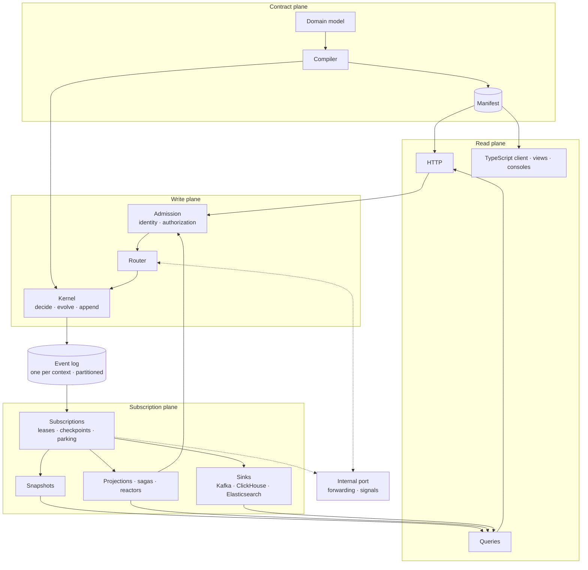

# Architecture Overview

Wow lets you write only the domain model and get a system you can run in production. This page explains what that system is made of and why it is shaped that way. Each section links to a page that goes deeper.

## Three jobs

Everything Wow does serves one of three jobs:

1. **Write.** Turn an intent into exactly one change of state. A command is decided against the latest committed state, and its events are committed in one atomic append. When two writers race, the version of the aggregate decides which one wins.
2. **Deliver.** Hand every committed fact to every observer at least once. An observer can start again from the beginning at any time.
3. **Use.** Derive the HTTP routes, the clients, the queries, the views and the dashboards from the same model, without more code and without a separate BI system.

The yardstick is simple: every line you write outside the domain model is a line Wow owes you, and every mechanism in Wow must follow from one of the three jobs.

## The rules

These rules hold everywhere in Wow. The concept pages explain each of them.

| Rule | What it means |
| --- | --- |
| One write | The append to the log is the only write. Snapshots, projections, indexes, published streams and the warehouse are all derived by reading the log. |
| The log is the bus | Inside a bounded context, a subscription is a reader of the log with a checkpoint. Between contexts, events travel on published streams. There is no separate event bus. |
| Decide, then evolve | A command function decides which events happen. A sourcing function applies an event to the state and does no I/O. |
| Bound at compile time | The compiler generates the bindings between your functions and the runtime. Nothing is discovered by reflection or classpath scanning at run time. |
| Identity is a value | An aggregate is addressed by one value: context, aggregate type, tenant and id. It is decided once, at admission. Every unique key includes the tenant. |
| Read models replay | Every subscription has a checkpoint, so every read model can be reset, rebuilt or backfilled from the log. |
| Failures are data | A handler that keeps failing parks the one aggregate it failed on and records why. Nothing is skipped in silence. |
| One contract | The Manifest is the single description of a service. HTTP routes, OpenAPI, the TypeScript client, the views and the agent Skills are derived from it. |
| Host-neutral | The runtime does not depend on Spring. Spring Boot is one host. |
| State is a read model | The latest state of each aggregate, the snapshot, is queryable as it is. You do not write a projection to read it. |

## Five planes

A command enters at the edge, is decided and appended, and its events flow on to everything that derives from them.

| Plane | What it does | Read more |
| --- | --- | --- |
| Contract | The compiler turns your aggregates and processors into bindings and a Manifest. | [Deciding and evolving](./programming-model), [One contract](./contract) |
| Write | Admission establishes who is calling and on which aggregate; the router picks the node; the kernel decides, evolves and appends. | [Writing: admission to append](./write-path), [Identity, tenancy and access](./identity) |
| Log | Each bounded context has one partitioned, ordered log. It is the only source of truth. | [The log is the bus](./event-log) |
| Subscription | Snapshots, projections, sagas, reactors and sinks all read the log, each with its own checkpoint. | [Subscriptions, failures and replay](./subscriptions), [Waiting for outcomes](./waits) |
| Read | Queries read snapshots, event streams and datasets; the HTTP edge and the TypeScript client are derived from the Manifest. | [Read models](./read-models) |

The nodes of one service talk to each other over one internal channel, the cluster channel, which forwards a command to the node that owns its aggregate. The signals that complete a wait go straight to the node the command came from. Services talk to each other through published event streams and command topics on Kafka, or through a synchronous call to the other service's internal port. [Between contexts](./cross-context) explains when to use which.

## Where Wow runs

All the services of one system run in the same cluster and can call each other directly. Each service listens on two ports: a public port for its HTTP API, and an internal port for the cluster channel, wait signals and calls from other services. The internal port is never exposed outside the cluster, and every request to it is authenticated.

A service needs a log backend, PostgreSQL or MongoDB. Kafka is needed once events or commands cross contexts. ClickHouse is needed for datasets and analytics.

## What Wow guarantees

These are the acceptance criteria the architecture is held to:

1. A crash at any moment loses no committed fact.
2. Every read model, the snapshots included, can be rebuilt from the start of the log.
3. Two tenants that use the same aggregate id do not affect each other.
4. In steady state, the read load on storage does not grow with the number of subscriptions. Only a subscription that is catching up reads more.
5. Outside the domain model, you write no infrastructure code.

## Terms

The [glossary](../reference/glossary) defines every term these pages use, with the Chinese term the Chinese pages use for it.
