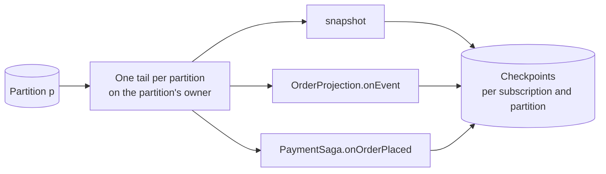

# Subscriptions, Failures and Replay

Everything that reacts to a commit is a subscription: the snapshots, your projections, sagas and reactors, and the sinks that publish to Kafka or write to ClickHouse. A subscription reads the log from a checkpoint it keeps itself. This page explains how subscriptions run, why a failure parks one aggregate and stops nothing else, and how a read model is rebuilt.

## One handler, one subscription

A subscription is a name, a filter and **one** handler function. A processor class with three handlers becomes three subscriptions, named `Processor.function`, each with its own checkpoint.

The reason is replay. If one checkpoint covered several functions and one of them failed, replaying would run the others again, and their effects would happen twice. One checkpoint per function means a replay repeats only the function that needs it. Because subscriptions share their reads of the log (below), an extra subscription costs almost nothing.

Subscriptions come only from the processors the compiler builds: `@Projection`, `@Reactor` and `@Saga` classes. There is no subscription to declare at run time.

A handler sees each commit as a **state event**: the event stream of the commit and the state of the aggregate after it. A handler can take the whole stream, or one event type, in which case it is called once for each event of that type in the stream and is not called for streams that have none.

## How subscriptions read the log

- **Leases.** The node that owns a partition runs every subscription over it. The same leases decide who executes commands, so the state a subscription needs is usually already in that node's memory.
- **Shared tailing.** The owner opens one reader per partition and hands each entry to all the subscriptions of the service. A subscription that is behind first catches up by reading a range of positions, then joins the shared reader. The read load on storage does not depend on how many subscriptions there are.
- **State with every event.** The state a handler gets is the view the kernel serialized when the version committed. When there is no such view, after a hand-over or during a replay, the runtime rebuilds it from the snapshot and the log. So a service that subscribes to a context's log must include that context's domain model. The handler gets a copy: changing it affects nobody.
- **Parallel across aggregates.** Within a partition, one aggregate's entries are handled in version order, and different aggregates are handled in parallel. The checkpoint is the lowest position up to which every entry is done, kept per partition, so its size does not grow with the number of aggregates. The entries in flight per partition are bounded, which also bounds how much is replayed after a crash.

The only ordering guarantee is per aggregate. A projection that combines several aggregates must tolerate entries of different aggregates arriving in any order, for example by keeping the version of each aggregate it has applied.

## At least once, and idempotent

A subscription delivers each entry at least once. During a hand-over, the old and the new owner of a partition may briefly handle the same entries. Wow does not fence them off; it makes repeating safe instead:

- Each handler call has a deterministic **execution id**: subscription, aggregate and version. Use it as the idempotency key of an external call.
- A command a saga sends has a request id derived from that execution id, so sending it twice commits it once.
- A projection writes guarded by the version it has applied.
- A checkpoint only moves forward, and recording a failure is idempotent.

A repeated entry wastes some work. It does not change the outcome.

## Failures park one aggregate

When a handler fails, Wow does not skip the entry and does not stop the subscription. It parks the one aggregate the handler failed on.

1. The handler's call is retried within its retry budget: five attempts, with backoff, unless the handler or the configuration says otherwise.
2. When the budget is spent, the subscription parks the aggregate: it records in the failure ledger the subscription, the aggregate, the version it stopped at and the reason. Other aggregates go on. The checkpoint moves past this aggregate's later entries without copying them anywhere.
3. A parked aggregate is retried automatically, with backoff that doubles each time, starting at minutes. When these retries are exhausted, it waits for an operator.
4. An operator resumes or skips it. Resuming reads the aggregate's stream from the log, starting at the version it stopped at, so the ledger holds one record per parked aggregate, however much was written meanwhile.

The failure ledger lives in the storage of the service that failed, because parking must be as reliable as the checkpoint it sits beside. The ops service collects the ledgers of all services into one place and is where operators act on them.

Not every failure is the aggregate's fault, so failures fall into three classes:

| Class | Example | What happens |
| --- | --- | --- |
| Unrecoverable | the handler declares the exception as unrecoverable | The aggregate is parked at once, without retrying. |
| Recoverable | most exceptions | Retried within the budget, then the aggregate is parked. |
| Systemic | the store is unavailable; a connection is refused; several different aggregates fail in a short time | The whole partition pauses and keeps retrying. No aggregate uses up its budget or is parked for an outage that is not its own. |

**Backpressure is not an outage.** A command a saga sends that is refused as busy, a wait that times out, a query refused by a bulkhead: these mean the system is loaded, not broken. The subscription retries that entry with exponential backoff and jitter and slows down the partition, so the system settles under load. If the retries run out, the aggregate is parked as usual; the partition is not paused.

**A rejection is not a failure.** When a command a saga sent is rejected, that is a business outcome. It is not retried and does not park anything. The saga handles it if it declares a handler for rejections; only a saga that declares none parks the aggregate.

## Replay and backfill

Because each subscription has a checkpoint, every read model can be rebuilt:

- **Start a new subscription**: a handler under a new name has no checkpoint, so it starts from its start position, the beginning of the log for a projection, and builds its read model again.
- **Rebuild the snapshots**: raising an aggregate's state revision, or a rebuild request, rewrites its snapshots from the log.
- **Rebuild side by side**: deploy the new version of a projection under a new subscription name, let it read from the start until it has caught up, switch the reads to it, and remove the old one. A changed read model needs no migration script.

A new subscription starts where its kind needs it to. A projection starts at the beginning of the log, so it fills in the history. A saga or a reactor starts at the end, so going live does not send commands or effects for the past. A subscription to another context's published stream starts at the beginning. A handler can declare where it starts, and configuration overrides that, either way only for a subscription that has no checkpoint yet.

Snapshots are rebuilt the same way, from the log. [Read models](./read-models#snapshots-are-a-cache) explains when.

## Sinks

A sink is a subscription that copies commits out of the service:

| Sink | What it writes |
| --- | --- |
| Kafka | The published stream of each aggregate, for other contexts and external systems. Events are upgraded to their current revision first. |
| ClickHouse | The warehouse: every commit of every aggregate, from which the current state and one row per event are derived. Datasets are built on it. |
| Elasticsearch | Copies of snapshots and event streams, for full-text search. |

Sinks follow the same rules as every subscription: checkpoints, at least once with idempotent writes, parking.
