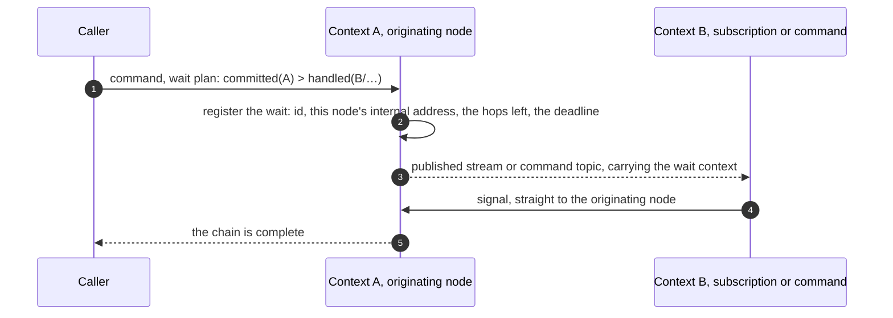

# Waiting for Outcomes

Sending a command and knowing what came of it are two different things. A command can be admitted, committed, and then handled by any number of subscriptions, some of them in other contexts. This page explains what a caller can wait for, what the default is, and how a wait works.

## Three stages

| Stage | What has happened |
| --- | --- |
| `accepted` | The command passed admission. It is durable only when it was written to a Kafka command topic. |
| `committed` | The command's events are appended to the log, or the command was settled without appending: a rejection, no change, or a duplicate. |
| `handled(subscription)` | A named subscription has handled the commit. The subscription may be in another context. |

`snapshot` is short for `handled(snapshot)`: the built-in subscription that writes snapshots has written this commit. A subscription's kind, projection, saga or reactor, comes from the Manifest, so it needs no stage of its own.

Stages travel in lowercase, as every value Wow puts on the wire does: in the `Wow-Wait` header, in a result's `hop.stage`, and in the TypeScript client's `WaitPlan`. Kotlin names them `Stage.ACCEPTED`, `Stage.COMMITTED` and `Stage.HANDLED`, and builds hops with `Hop.accepted()`, `Hop.committed()`, `Hop.handled(subscription)` and `Hop.snapshot()`. The header's keywords are read in any case, but a stage in JSON is read only in lowercase, and a stage a newer writer adds is read as unknown rather than refused.

## The default is the snapshot

A command that names no wait waits for `snapshot`. When it returns, the snapshot already holds the commit's version, so a query the caller sends next sees its own write. This is what most callers want: a form that saves and then shows the saved record, a test that sends a command and then reads the state.

The default costs a little. The answer comes after the snapshot subscription has handled the commit, not right after the append. If the snapshot subscription is parked or behind, the default wait times out; the result then says that the command reached `committed`, so the caller knows the fact is committed. An aggregate whose snapshots are turned off has no snapshot stage, and its default wait is `committed`. Only the default falls back this way: a caller that asks for `snapshot` on such an aggregate is refused at admission.

A caller that needs less can wait for `committed` or `accepted`; one that needs more can name a later stage or a chain.

## Waiting for a chain

A wait plan is a chain of hops. Each hop is a stage, with a context and, for `handled`, a subscription. For example: the order is committed, then the payment context's saga has handled it, then the command that saga sent is committed in the inventory context.

Over HTTP, the chain is a request header: `Wow-Wait: committed > handled(payment/PaymentSaga.onOrderSubmitted) > committed(inventory)`, with `Wow-Wait-Timeout: 10s`. A hop without a context is in the command's own context; `handled(context/subscription)` sets the context apart with `/`, since a subscription's name (`Processor.function`) holds a dot. The commands along a chain are related by the id of the root command, so a hop recognizes the commands that belong to the wait.

The rules for a chain:

- **Only a saga hop can be followed by another hop.** The hops after it apply to the commands that saga sent for this commit. A projection or reactor hop ends the chain.
- **A saga hop completes when every command it sent reaches the next hop.** The saga's signal lists the commands it derived. If it sent none, the hop completes at once.
- **A chain that ends early says so.** If a saga handles the commit and sends nothing, for example because a payment was declined, while the plan still has hops after it, the wait ends there. Its final result stays at the last hop actually reached, with its real status, marks `chainEnded`, and lists the hops not reached as `pending`. It is not reported as the success of the planned end.
- **A failure anywhere ends the wait at once.** If any hop is rejected or parks, the waiter gets the failure and its reason immediately, not after the timeout.
- **A chain is checked at admission.** The plan is checked against the Manifests the node knows; an invalid plan is rejected before the command runs, not discovered at the timeout. A plan has at most 16 hops by default.

When the caller accepts `text/event-stream`, the edge sends one result for each hop as it is reached, and closes the stream after the last one. Otherwise it answers with the last hop's result or the first failure.

## Timeouts

A wait times out after 10 seconds unless the request names another timeout. The service caps every timeout, at one minute by default.

A timeout says only that the waiter stopped waiting. It does not mean the command failed. The result reports `wow.wait.timeout` together with the last hop that was reached, so the caller knows where the chain stalled: a command that timed out after `committed` is committed. The deadline travels with the command along the chain, and after it passes no hop sends a signal.

## Duplicates

A request that is a duplicate was committed earlier, and its later stages may have happened long ago, with their signals long sent. For subscriptions in the same context, the node checks their checkpoints and parked aggregates: a subscription whose checkpoint is past the commit, and that has not parked the aggregate, has handled it. A hop in another context cannot be checked that way. The result then stops at `committed`, marked as a duplicate, and the caller decides what to do.

## How a wait works

A wait is an observation. It is not part of what makes the system correct: if a signal is lost, the waiter times out, and the facts are not affected. So signals are sent at most once, at low latency, and are not stored.

- **The wait is registered before the command is sent.** A later hop's signal can arrive before an earlier one's, for example when a derived command commits before the saga's own hop is reported. The originating node keeps early signals and replays them in chain order.
- **The wait context travels with the messages.** It is transport data, written only when a wait goes past `committed`: in the log entry, in a command sent to another context, in the envelope of a published stream. Domain code never sees it.
- **A signal goes straight to the originating node.** The wait context names that node's internal address, so a hop in any service reaches it in one step, without a load balancer and without relaying. A request that fails only for a moment, the node refusing connections or answering 503 while it starts or is replaced, is sent again with a short backoff while the wait lasts; the node takes a signal it receives twice once. If the node has gone, the caller's connection has gone with it, and the signal is dropped.
- **Signals do not slow the handlers down.** A subscription sends its signal after it has handled an entry, outside its checkpoint and its failure handling.
- **Signals stay inside.** The signal endpoint is on the internal port only, never on the public one: if signals could arrive from outside, anyone could fake the result of any command. The network policy that lets only the platform's own pods reach the internal port is its boundary, and it takes a signal from any service of the system that names itself (`Wow-Service`). See [Identity, tenancy and access](./identity#the-internal-port).
