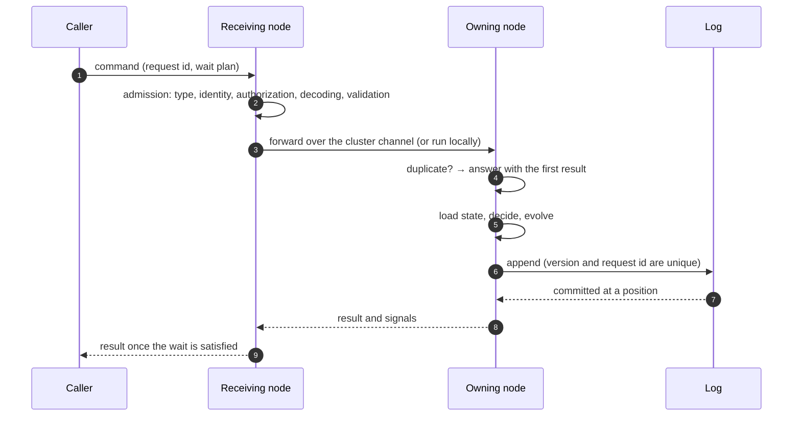

# Writing: Admission to Append

A command enters a service, is decided against the latest state, and either commits events or is rejected. This page follows a command through each step and explains which part of the system is responsible for which guarantee.

## Admission

Admission turns a request into a command the kernel can trust. In order, it:

1. finds the command type the request names;
2. establishes the identity: which aggregate, in which tenant, for which owner and space. Each fact has one rule, and conflicting sources reject the request;
3. checks that the caller may perform this action;
4. decodes the body and validates it;
5. lets a configured transformer rewrite the command, without changing its identity;
6. builds the command, which nothing changes afterwards.

Every entry point admits the same way: HTTP, a command sent by a saga, a command read from a Kafka command topic, a synchronous call from another service. Admission also records the wait plan on the command. The default plan waits until the snapshot holds the commit, so a caller can read its own write as soon as the command returns ([Waiting for outcomes](./waits)).

A command that has no aggregate id yet, a creation, gets one at admission. If the same caller already committed a creation with the same request id, admission reuses that id, so a retried creation does not create a second aggregate.

## Routing

The router decides which node executes the command.

Correctness does not depend on the choice. Two nodes that execute commands for the same aggregate at the same time cannot both commit the same version: one of them gets a conflict, reloads the state and decides again. A single writer per aggregate is not what makes writing correct.

It is what makes writing fast. If any node could execute any command, each node would hold the state of only a fraction of the aggregates in its cache, each command would read the state from storage, and busy aggregates would conflict often. One hop over the cluster channel costs less than those reads. So by default commands are **partitioned**: each node owns a share of the log's partitions, and a command for an aggregate in a partition the receiving node does not own is forwarded to its owner.

| Router | What it does | Use it for |
| --- | --- | --- |
| Partitioned (default) | Runs the command on the owner of the aggregate's partition, forwarding it if needed | Several nodes |
| Local | Runs the command where it arrived | One node; the memory backend |
| Kafka (per aggregate type) | Writes the command to the context's command topic; the partition's owner consumes it | Asynchronous commands that must survive a crash once accepted; absorbing bursts |

When the owner cannot take a forwarded command, the receiving node runs it locally rather than wait: when the connection fails, when the peer answers that it does not own the partition, when too many forwards are in flight to it, or when no owner is known, for example during a hand-over. That costs at most a few conflict retries. But once a forwarded request has been sent, a timeout is **not** a reason to run it locally. The owner may still be deciding, and a second decision on another node would repeat whatever I/O decide does. The caller gets a timeout instead, and retries with the same request id.

## Execution

On the executing node, each aggregate with commands in flight has one lane. Its commands run one at a time, in the order they arrived. Lanes do not block each other: a command waiting on I/O holds up only its own aggregate. A lane has a bounded queue, and the node has a bound on all commands in flight. When either is full, the command is refused at once as busy (429) instead of waiting. When the node shuts down, it refuses new commands and finishes the ones in flight.

## Duplicates are found before deciding

Decide may do I/O, so a duplicate request must not run it again. Before deciding, the kernel checks whether the request id has already committed for this tenant and aggregate type. If it has, the command is answered with the first commit's result, marked as a duplicate, and nothing is decided.

The kernel keeps, with each cached aggregate state, the requests that aggregate committed most recently, derived from the log (32 by default). A request it finds there needs no extra read. When the set cannot answer for certain, the kernel asks storage. The unique key on the request id is still the guarantee: whatever the set says, a request commits at most once.

The log also records the command type each request id was used for. The same request id with a different command type is refused (`wow.command.request-id-reused`). The same request id with the same type is treated as a retry. So a request id belongs to one business request, and a client generates a new one for each.

## The kernel

For each command, the kernel:

1. takes the state: from the cache, or from the snapshot plus the log entries after it, or the initial state for a new aggregate;
2. checks the guards: the aggregate exists or not as the command's creation rule needs, is not deleted, is in the caller's scope;
3. runs decide: the command function, then the after hooks;
4. evolves the state with the new events;
5. appends the events.

If the append reports a version conflict, the kernel drops the cached state, loads it again and decides again. If the append's outcome is unknown, for example because the connection broke during the commit, the kernel looks at the version to find out whether it committed.

**After a successful append, nothing can undo the commit.** A caller that cancels, an HTTP connection that drops, a timeout: none of them stops what follows the append, which is putting the state back in the cache, recording the state view for subscriptions, and sending the signals that complete waits.

## Signals

When the commit succeeds, the executing node signals the node the command came from: in-process when they are the same node, over the cluster channel when the command was forwarded. Later stages, such as the snapshot being written or a saga handling the commit, signal the originating node directly. [Waiting for outcomes](./waits) describes it.

## The cluster channel

The nodes of one service talk to each other over one channel on their internal port. It carries forwarded commands and the owner's reply to each. The signals that complete waits arrive on the same internal port.

Membership and partition ownership come from leases in storage, not from ZooKeeper, a Kafka consumer group or a registry. Every node computes the same assignment of partitions to members, by highest random weight, and takes or gives up partitions to match it. When a node joins or leaves, only about one partition in N moves.

A planned hand-over, during scaling, a rolling upgrade or a graceful shutdown, is orderly: the old owner stops taking new commands for the partition, finishes the ones in flight within a time limit, saves the checkpoints of its subscriptions and releases the lease. The new owner starts with an empty cache and loads states from snapshots as commands arrive.

A partition's owner might pause, lose its lease and wake up still believing it owns the partition. That is safe without fencing: its commands are held by the version key, and its subscriptions' effects are idempotent ([Subscriptions, failures and replay](./subscriptions)).

The channel stays within one service. Requests on it must carry the service's cluster token, and the internal port is never exposed outside the cluster ([Identity, tenancy and access](./identity#the-internal-port)).
