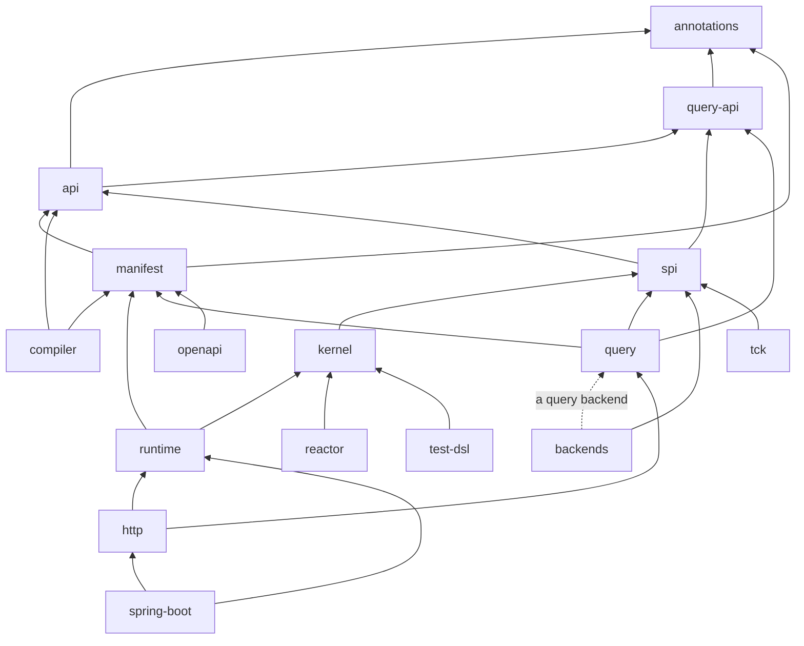

# Codebase Tour

The Wow repository holds the framework's JVM modules, its TypeScript packages, the platform services, the eShop example, the documentation site and the agent Skills. `main` holds Wow 10 only: the 9.x line lives on the `v9` branch. This page is the map; [CONTRIBUTING.md](https://github.com/Ahoo-Wang/Wow/blob/main/CONTRIBUTING.md) says how to build and propose a change.

## Layout

| Directory | Holds |
| --- | --- |
| `api/` | `:annotations`, the stability markers (`@InternalWowApi`, `@ExperimentalWowApi`, `@WowSpi`); `:api`, the programming model (annotations, `Decision`, `DecideScope`, `StateEvent`); `:manifest`, the contract as plain data; `:query-api`, the query protocol and its Kotlin DSL |
| `compiler/` | `:compiler`, the KSP processor that writes the models and Manifest fragments; `:gradle-plugin`, the plugins `me.ahoo.wow`, `me.ahoo.wow.api` and `me.ahoo.wow.service`; `:manifest-tools`, which completes and merges fragments |
| `core/` | `:spi`, the ports a backend implements; `:kernel`, the decide, evolve and append loop; `:runtime`, the node (admission, routing, the cluster channel, the executor, subscriptions, waits); `:reactor`, the Reactor adapter |
| `query/` | `:query`, the query engine; `:query-tck`, the contract every query backend passes |
| `backends/` | One module per technology: `:postgres`, `:mongo`, `:elasticsearch`, `:clickhouse`, `:kafka` |
| `edge/` | `:http`, the routes from the Manifest; `:openapi`; `:client`, the typed HTTP clients; `:cosec`; `:observability` |
| `host/` | `:spring-boot`, the auto-configuration that composes a node |
| `extensions/` | `:cosid`, `:cocache-api`, `:cocache`, `:models` |
| `migration/` | `:migrate-data`, which imports 9.x event streams |
| `test/` | `:test-dsl` (artifact `wow-test`), `:test-query`, `:test-spring-boot`, `:tck` and `:tck-containers`, `:architecture`, the benchmarks, the coverage report |
| `bom/` | `:bom` (`wow-bom`) and `:wow-dependencies` |
| `platform/` | The ops service and console, the view store, the analytics catalog |
| `examples/` | The eShop's five contexts and their e2e tests, the quickstart, the Java smoke test |
| `typescript/` | The npm packages and their Storybook, with rules of their own in `typescript/AGENTS.md` |
| `documentation/` | The site (`docs/`) and the design records (`designs/`) |
| `skills/` | The six agent Skills |

Gradle project names carry no `wow-` prefix (`:kernel` in `core/kernel`); the build publishes each as `wow-<name>`.

## Dependency direction

The authoritative list is `ArchitectureRules.ALLOWED_PROJECT_DEPENDENCIES` in `:architecture`. Its tests hold, among others:

- `:query-api` depends on `:annotations` alone, which depends on nothing, and imports no JSON library; `:manifest` builds on `:api` and imports no JSON library and no coroutines. `:api` adds two libraries, each for one reason: the coroutines' `Flow`, which its `QueryApi` streams rows with, and Jackson's tree types (`tools.jackson.databind.node`), the one shape of free-form content. A read that names no class, a state read by its aggregate type or an event no class of the model has, is an `ObjectNode`, in process and over HTTP alike. `:api` imports no other part of Jackson and no framework.
- The kernel knows nothing of the cluster, subscriptions, waits or drivers; the runtime depends on coroutines and Jackson only, not on Spring, Reactor or a driver.
- A backend depends on `:spi`, and on `:query` when it serves queries; backends never depend on each other.
- Reactor appears only in `:reactor` and the WebFlux edge, and only `:spring-boot` depends on Spring Boot.
- The eShop's domain and API modules never reach the runtime, and every application compiles against the public API: none opts into `@InternalWowApi`.
- No production source carries compatibility code: no `@Deprecated` declaration, no `compat(...)` marker, no 9.x type or deleted 9.x project.

`./gradlew :architecture:test` runs them, and `:check` includes it.

## API levels

Every public declaration of a published module is public, `@ExperimentalWowApi`, `@WowSpi` or `@InternalWowApi` ([API Levels](../reference/api-levels)). A declaration only its own module uses is `internal`; one Wow's modules share but promise nothing about is `@InternalWowApi`. The ABI dump of each published module, `<module>/api/<module>.api`, records the first three levels, and `:check` fails when a public signature changes without its dump: `./gradlew updateKotlinAbi` rewrites it, and the diff is reviewed with the change.

## Where to go next

- [Test Layers](./testing): which tests a change needs, and the CI gates.
- [Write a Backend](./backends): the SPI and its contract tests.
- [Design Records](./design-records): why the code is shaped the way it is.
- [Documentation Governance](./documentation): where each kind of document lives.
