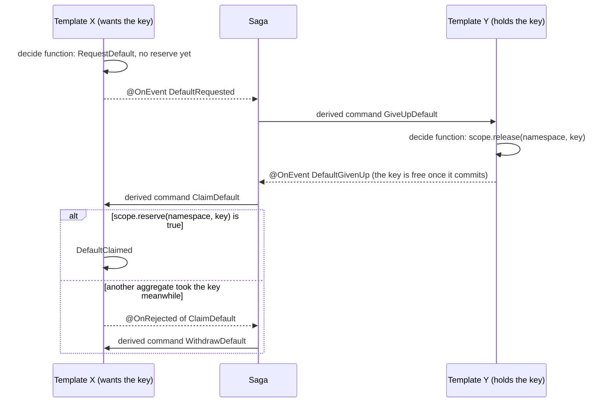

# Unique Keys Across Aggregates

An aggregate decides alone, so it cannot see whether another aggregate already uses a value. When a value must be unique across aggregates, such as a user name, an email address or a brand's name, the decision reserves it. A reservation is held by one aggregate at a time, commits with the aggregate's events, and is given up if they are not written, or if the decision is a rejection, even one that commits events. This page keeps the eShop's brand names unique.

## Reserve a key

`DecideScope.reserve(namespace, key)` reserves `key` in `namespace` for the deciding aggregate, and returns `false` when another aggregate holds it. A brand reserves its name as it takes it:

<!-- sample: examples/eshop/catalog/catalog-domain/src/main/kotlin/me/ahoo/wow/example/eshop/catalog/domain/brand/Brand.kt#take -->

```kotlin
/** Takes [name] for this brand, or rejects the command when another brand holds it. */
private suspend fun take(name: String, scope: DecideScope) {
    if (!scope.reserve(CatalogNames.BRAND_NAMES, CatalogNames.key(name))) {
        reject(Rejections.NAME_TAKEN, "Another brand is named \"${name.trim()}\".")
    }
}
```

- **The namespace** names what is unique: `eshop-catalog.brand-name`.
- **The key** is the value, normalized the way uniqueness is meant: the catalog trims and lowercases a name, so "Contoso" and " contoso " are one name.
- **The scope** of uniqueness is the aggregate's type and tenant: another tenant may hold the same key, and so may an aggregate of another type, so a brand and a category may share a name. `reserve(namespace, key, ReservationTenancy.SYSTEM)` makes a key unique across the type's tenants.
- `reserve` is a `suspend` function, so a decide function that reserves keys is written in Kotlin.

## What happens to a reservation

1. `reserve` records the key as **pending** for this aggregate, with an expiry.
2. When the decision's events are appended, the reservation is **confirmed**, unless the decision is a rejection.
3. When they are surely not appended (the decision rejects, the version conflicts and the command is decided again, or deciding fails), this attempt **gives its reservation up**. A process that dies first leaves it to expire.

A key the aggregate already holds stays held whatever an attempt does, so deciding a command again never loses it. A decision that reserves a key the aggregate already holds confirms it again for its own commit, so that the release of an earlier rename, applied late, never frees it: that costs one write to the reservation store when the command commits, so a domain that reserves on every update pays it on every command. Reserve a key when the value changes.

## Release a key

A value that changes releases its old key. `DecideScope.release(namespace, key)` releases a key the aggregate holds once the events are appended: the release commits with them, and nothing is released when they are not. A rename reserves the new key and releases the old one in one decision:

<!-- sample: examples/eshop/catalog/catalog-domain/src/main/kotlin/me/ahoo/wow/example/eshop/catalog/domain/brand/Brand.kt#rename -->

```kotlin
suspend fun onCommand(command: RenameBrand, scope: DecideScope): BrandRenamed? {
    if (command.name.trim() == state.name) return null
    take(command.name, scope)
    // A new spelling of the same name keeps its key.
    if (CatalogNames.key(command.name) != CatalogNames.key(state.name)) {
        scope.release(CatalogNames.BRAND_NAMES, CatalogNames.key(state.name))
    }
    return BrandRenamed(command.name.trim())
}
```

Deleting an aggregate releases none of its keys, so a restored aggregate still holds them. A delete that should give a key up releases it in the aggregate's own command before the delete.

## Move a key to another aggregate {#move-a-key-to-another-aggregate}

A reservation belongs to the aggregate that is deciding, and it commits with that aggregate's events. `reserve` and `release` act for the deciding aggregate alone: a decision releases only a key its aggregate holds, and no decision takes over a key another aggregate holds. 10.0 has no transfer of a reservation and no compare-and-swap of its holder, so the two changes of a key are different things:

- **Within one aggregate**, changing the key is one decision: reserve the new key and release the old one, as the rename above does. Both take effect with the events, or neither does.
- **Between aggregates**, the holder changes by a handover through a saga. The aggregate that wants the key records its request; the saga has the holder give the key up, in a command of the holder whose decision releases it; once that has committed, a command of the requester reserves it. Between the release and the claim another aggregate may take the key, so the claim can be refused, and the saga then withdraws the requester's request. The handover costs commands and events of its own, and the switch is eventually consistent: for a while no aggregate holds the key.

The names `RequestDefault`, `GiveUpDefault`, `ClaimDefault` and `WithdrawDefault` are the example's own commands, "at most one default template per tenant"; the annotations and calls are Wow's:



Each arrow out of an aggregate is a commit: its events are the saga's input, and a derived command is decided by its own target, once ([Write a Saga](./sagas)). While the handover runs the key is held by Y until Y's release commits, then by no one until X's claim commits: for that time there is no default, and any other aggregate of the type may take the key, which is why the claim can be refused. When it is, Y has already given the key up, and the key belongs to the aggregate that took it: the saga withdraws X's request and leaves the choice of a new default to a new command. A reader that must see the switch done waits for the claim's commit, not for the first command's.

## A key unique across aggregate types

A key is unique among the aggregates of one type. When a value must be unique across types, such as an email address that users and organizations share, model the uniqueness as an aggregate of its own: an aggregate whose id is the key (or one that holds the keys) is claimed by the others through its commands, and its own decisions say who holds each key.

## Where reservations are kept

An aggregate type's reservations are kept with its log, in the store `wow.aggregates.[<context>.<aggregate>].log.store` names (or the default log store), in a table or collection of their own per type: `wow_reservation__<context>__<aggregate>`. A confirmation is so as durable as the commit it belongs to. They replace 9.x's `PrepareKey`; migrate-data imports what 9.x confirmed ([Migrate the Data](../migrate/data)).

## Test it

`aggregateSpec` runs reservations against an in-memory store. `givenReservation` reserves a key for another aggregate first, so a test can check that the command is rejected when the key is taken, and `holds(namespace, key)` says whether the aggregate under test holds a key: [Test Domain Code](./testing).
