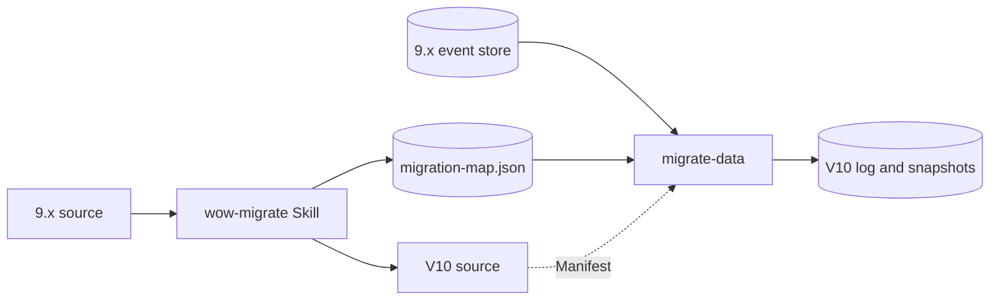

# Migrating from 9.x

Wow V10 is a redesign, not an upgrade in place. It keeps what a 9.x service is about, aggregates, commands, events, sagas, projections and queries, and rebuilds the machinery under them. This page explains what changes, what the way across looks like, and where to start.

## What changes

| Topic | 9.x | V10 |
| --- | --- | --- |
| Publishing events | Append, then publish to a bus: a crash between the two loses the event for every observer | No event bus: subscriptions read the log from their own checkpoints, and resume after a crash |
| Event channels | Domain events and state events on two buses, unordered between them | One log; the state after each commit travels with its events |
| State | Mutable objects, with a reload when something fails | Mutable (the default) or immutable; the kernel guarantees atomicity and a stable view of each version |
| Binding | Reflection at run time | Generated by the compiler at build time |
| Concurrency model | Reactor | Coroutines; Reactor handlers through an adapter module |
| Failures | Logged and acknowledged by default; retried through the compensation service | Recorded in a failure ledger; the failing aggregate is parked and retried, nothing is skipped |
| Read models | The snapshot is the read model; projections cannot be rebuilt | The snapshot is still the default read model; every read model can be rebuilt from the log |
| Contract | OpenAPI with `x-wow-*` extensions | The Manifest, from which routes, OpenAPI, clients and views are derived |
| Identity | Tenant and owner in routes and command fields | One aggregate reference decided at admission; tenant, owner and space come from the authenticated caller |
| Compatibility | Frozen surfaces and compatibility debt | No compatibility code: the migration layer converts once |

[Architecture overview](../concepts/) explains the V10 design from first principles; [9.x capabilities in V10](./capabilities) lists where each 9.x capability went.

## The way across

Migration happens once, in one place, and leaves nothing behind. V10 itself contains no 9.x code: 9.x type names, annotations, configuration keys, routes and storage formats exist only in the migration tools.

1. **Source.** The `wow-migrate` agent Skill rewrites the service's Kotlin source, configuration and clients. Rewriting is semantic, not mechanical: an error handler becomes a rejection or a saga, a processor becomes subscriptions, identity leaves the command bodies. The rewrite is accepted when the service compiles and its domain tests pass. While it renames commands and events, the Skill writes `migration-map.json`, which records every change of name or shape.
2. **Data.** The `migrate-data` tool checks the map against what the 9.x store really holds and against the V10 Manifest, imports the event history into the V10 log, and compares every aggregate it can with its 9.x snapshot. By default 9.x stops writing for the whole migration; a large system imports while 9.x serves, follows what it keeps writing, and stops only for a short final pass. The rebuilt state matching 9.x is also the proof that the rewritten evolve functions are right. [Migrate the data](./data) describes the procedure.
3. **Cut over.** 9.x keeps serving while the data is imported and compared. Cutting over is a blue-green switch: stop 9.x writing, let the tool catch up, compare, switch traffic to V10. Custom projections are rebuilt by their subscriptions; they are not migrated.

The data side follows two rules. **Nothing is guessed:** a 9.x event type, command, reserved key or failed execution that the map does not account for stops the tool before it writes anything. **No unexplained difference is accepted:** every kind of difference the comparison reports is either a known 9.x defect or an intended change, and someone signs it off before the cut-over.

## What you need

- **Start from the last 9.x minor version.** Migration is supported from the last minor version of 9.x to 10.0. Upgrade within 9.x first.
- **A 9.x MongoDB event store.** The data tool reads the 9.x MongoDB store. A service on the 9.x Redis or Elasticsearch event store moves its data to the 9.x MongoDB store first.
- **Gradle.** V10's compile-time binding runs in Gradle, through KSP and the Wow Gradle plugin. Maven builds are not supported.
- **JDK 21.**

## How long the tools are supported

The migration tools are maintained throughout 10.x and removed in 11.0. The next major version will bring its own migration from 10.x.

The 9.x line is maintained on the `v9` branch, and its documentation is served under `/9.x/`.
