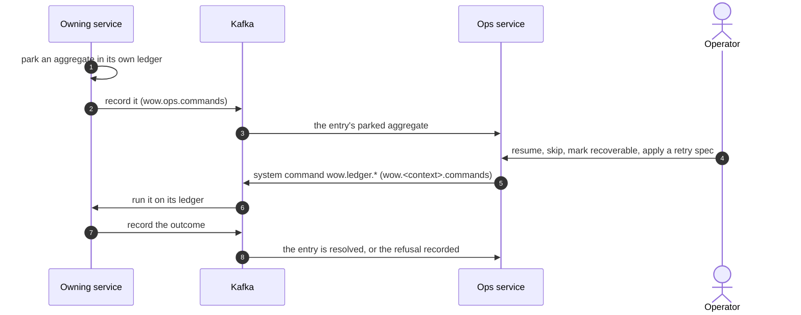

# The Ops Service and Console

When a subscription keeps failing on an aggregate, it parks that aggregate in its service's failure ledger ([Subscriptions, failures and replay](../concepts/subscriptions#failures-park-one-aggregate)). The ops service collects the ledgers of all services in one place, and its console is where operators see what is parked and decide what to do about it. This page explains how it fits together, how to deploy it, and how to work with it.

## How it fits together



- **The ledger stays with its service.** Parking must be as reliable as the checkpoint beside it, so each service keeps its failure ledger in its own store and keeps retrying parked aggregates on its own. The ops service is a view and a control panel, not where failures live.
- **Services publish their ledgers.** A service with `wow.ops.publish.enabled` sends each entry to the ops context as a command, when it parks and again on a scan every 30 seconds, so the ops service catches up after an outage. It needs the Kafka transport.
- **Ops never acts itself.** An operator's action is recorded on the entry, and the ops saga sends it to the owning service as one of the ledger's system commands, `wow.ledger.*`, on that service's command topic. The owning service runs it on its own ledger and records what came of it. It accepts these commands only from the ops context's saga.

Each entry in the ops service is one parked aggregate of one subscription, with its status:

| Status | Meaning |
| --- | --- |
| `SCHEDULED` | Parked; the owning service will retry it automatically, with backoff. |
| `EXHAUSTED` | Its automatic retries are spent; it waits for an operator. |
| `UNRECOVERABLE` | Marked as not worth retrying automatically. |
| `RESOLVED` | No longer parked: resumed successfully, or skipped. |

## Deploy it

The ops service is a Wow service on PostgreSQL and Kafka, behind CoSec, which serves its console as static files. [`deploy/ops`](https://github.com/Ahoo-Wang/Wow/tree/main/deploy/ops) holds Kubernetes manifests for two nodes, built on the same choices as the eShop services ([Deployment model](./topology)):

1. Build the image with the console in it, or use a released image.
2. Provide PostgreSQL and Kafka.
3. Create the topics the ops context owns: `wow.ops.commands`, `wow.ops.receipts` and `wow.ops.parked.state`. The command topic has exactly as many partitions as the ops context's log.
4. Set the cluster token of its internal port and the secret CoSec signs its tokens with.

Then, on **each service** whose ledger it should show, turn on publishing with `wow.ops.publish.enabled: true`. The owning service owns its own command topic, on which the operators' actions arrive.

## Who may do what

The operator signs in to the console with a CoSec access token. The service reads the operator's tenant, subject and roles from it:

<!-- sample: platform/ops/ops-server/src/main/resources/application.yaml#roles -->

```yaml
wow:
  cosec:
    # Tenant-level callers (decision D189): their scope has no owner, so they read every entry of their tenant. An
    # operator acts on the entries, a viewer reads them; the services' ledgers publish to Wow's default tenant, (0),
    # which a principal of CoSec's default tenant is in. A principal with neither role reads nothing.
    tenant-level:
      roles: ops.operator, ops.viewer
```

- `ops.operator` reads the entries and acts on them.
- `ops.viewer` only reads them.
- A principal with neither reads nothing. A request without a valid token is answered 401, and the console signs out.

The services' ledgers publish to Wow's default tenant, `(0)`. With CoSec's own authorization turned on, CoSec's policies can decide instead, as the system commands `wow.ledger.*`.

## Work with the console

- **Overview.** The home page: how many entries are parked in a time window and overall, how many need attention, are retrying, are unrecoverable or resolved; parked entries over time; the top failure clusters, contexts and failing subscriptions. Each number opens the queue it counts. It refreshes every 15 seconds.
- **Queues.** The parked entries as record views: _Needs attention_ (exhausted or unrecoverable), _Retrying_, _Unrecoverable_, _Resolved_, _Parked_ and _All_, and analyses such as _Failure clusters_, grouped by error type, context and subscription. Every field can be filtered, sorted and grouped.
- **Detail.** One entry: the error type and message as the owning service recorded them, the aggregate and the version it parked at, its attempts against its retry spec, the last operator request and how it was resolved, then its history as a timeline.
- **Actions.** Resume with a reason, skip with a reason, mark recoverable, apply a retry spec. Each asks for confirmation, works on one entry or a selection, and reports its outcome. A resolved entry takes no action, and a refusal is shown with its error code.

Resuming re-reads the aggregate's events from the version it stopped at and hands them to the subscription again, including events it had not reached yet. Skipping moves past them. Choose skip only when you know the subscription's effect for those events is not needed, or you have made up for it some other way.

The console does not show stack traces: a service records a failure as its exception type and message, which is what an operator groups and searches by.

## Without the ops service

A single service can expose its own parked entries: `wow.ops.enabled: true` serves `/wow/ops/parked` on its public port, with the same four actions, authorized as the system commands `wow.ledger.*`. It is off by default.

Each service can also notify a webhook when an aggregate parks or spends its retries: set `wow.ops.webhook.url`, with `wow.ops.webhook.format` `generic` for Wow's JSON or `wecom` for a WeCom (WeChat Work) robot, and `wow.ops.webhook.events` to choose between `parked` and `exhausted`.
