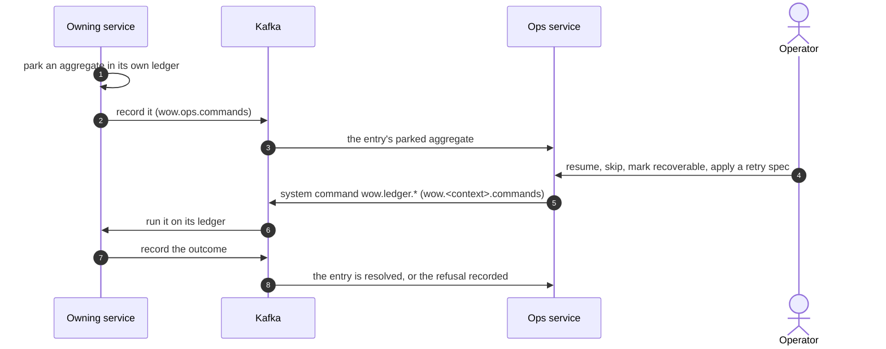

# The Ops Service and Console

When a subscription keeps failing on an aggregate, it parks that aggregate in its service's failure ledger ([Subscriptions, failures and replay](../concepts/subscriptions#failures-park-one-aggregate)). The ops service collects the ledgers of all services in one place, and its console is where operators see what is parked and decide what to do about it. This page explains how it fits together, how to deploy it, and how to work with it.

## How it fits together



- **The ledger stays with its service.** Parking must be as reliable as the checkpoint beside it, so each service keeps its failure ledger in its own store and retries its parked aggregates on its own: the node that owns an entry's partition looks for due retries every 10 seconds, 10 retries by default, the first 3 minutes after the failure and each next one twice as long after, each allowed 2 minutes (`wow.subscription.parked.*`, [Parked aggregates](../guide/failures#parked-aggregates)). The ops service retries nothing: it is a view and a control panel, not where failures live.
- **Services publish their ledgers.** A service sends each entry to the ops context as a command when it parks, when it spends its retries and after an operator's action on it, and again on a scan every 30 seconds (`wow.ops.publish.interval`), so the ops service catches up after an outage. It does so by itself once the ops service is deployed: with `wow.ops.publish.enabled` at `auto`, the default, it publishes while its topic transport (Kafka, or the in-memory topics in development) has the ops command topic, which the ops service creates, and checks at start and every `wow.kafka.topics.partition-refresh` (30 seconds). It logs `ops takes the failure ledger now: <service> publishes it (wow.ops.publish).` when it starts, and `ops does not take the failure ledger: <service> stops publishing it.` when the topic goes away. Without a transport, `auto` publishes nothing; `true` publishes whatever it finds, and refuses to start without a transport; `false` never publishes.
- **Ops never acts itself.** An operator's action is recorded on the entry, and the ops saga sends it to the owning service as one of the ledger's system commands, `wow.ledger.*`, on that service's command topic. The owning service runs it on its own ledger and records what came of it. A service that publishes its ledger takes these commands from its command topic by itself, even when it takes no other command there (`wow.kafka.command-intake.enabled` off): its subscription `wow.ledger.commands` runs the ledger's commands alone, from the end of the topic. It accepts them only from the saga of the context `wow.ops.publish.context` names, `ops` by default, and warns of any other.

Each entry in the ops service is one parked aggregate of one subscription, with its status:

| Status | Meaning |
| --- | --- |
| `SCHEDULED` | Parked; the owning service will retry it automatically, with backoff. |
| `EXHAUSTED` | Its automatic retries are spent; it waits for an operator. |
| `UNRECOVERABLE` | Marked as not worth retrying automatically, or its source no longer holds what it is parked at. |
| `RESOLVED` | No longer parked: resumed successfully, or skipped. Only the ops service shows it; the owning service has no entry left. |

## Deploy it

The ops service is a Wow service on MongoDB and Kafka (or PostgreSQL), behind CoSec, which serves its console as static files. [`deploy/ops`](https://github.com/Ahoo-Wang/Wow/tree/main/deploy/ops) holds Kubernetes manifests for two nodes, built on the same choices as the eShop services ([Deployment model](./topology)):

1. Build the image with the console in it, or use a released image.
2. Provide MongoDB and Kafka; for PostgreSQL instead, add the manifests' `postgres` component.
3. Create the topics the ops context owns: `wow.ops.commands`, `wow.ops.receipts` and `wow.ops.parked.state`. The command topic has exactly as many partitions as the ops context's log.
4. Put the CoSec gateway in front, and route the console and the ops routes through it: the gateway verifies each operator's access token, and the service parses the token it forwards, with no secret of its own ([Secure a Deployment](./security#put-the-gateway-in-front)).

Then each service on the same Kafka starts publishing its ledger by itself within `wow.kafka.topics.partition-refresh` of the ops command topic appearing, and sends the entries it parked meanwhile; a service that should not appear in the console sets `wow.ops.publish.enabled: false`. The operators' actions arrive on each owning service's own command topic, which a service that publishes its ledger reads for them by itself.

## Who may do what

The operator signs in to the console with a CoSec access token. The service reads the operator's tenant, subject and roles from it:

<!-- sample: platform/ops/ops-server/src/main/resources/application.yaml#roles -->

```yaml
wow:
  cosec:
    mode: gateway
    # Tenant-level callers: their scope has no owner, so they read every entry of their tenant. An
    # operator acts on the entries, a viewer reads them; the services' ledgers publish to Wow's default tenant, (0),
    # which a principal of CoSec's default tenant is in. A principal with neither role reads nothing.
    tenant-level:
      roles: ops.operator, ops.viewer
```

- `ops.operator` reads the entries and acts on them.
- `ops.viewer` only reads them.
- A principal with neither reads nothing. A request without a valid token is answered 401, and the console signs out.

The services' ledgers publish to Wow's default tenant, `(0)`. When CoSec authorizes the service's commands (`wow.cosec.authorizer.enabled: true`), CoSec's policies decide who is an operator instead of the role, each action judged as the request of its own route: `POST /ops/parked/{id}/resume` and the other actions on the ops service. A service that serves its own operator routes (`/wow/ops/parked`, below) judges them as its `wow.ledger.*` commands. Write a policy for each route you expose. Whoever decides, no caller may send the records (`ops.parked.RecordParked`, `RecordResolved`, `RecordActionRefused`): only the services' ledgers and the ops saga produce them.

## Work with the console

- **Overview.** The home page: how many entries are parked in a time window and overall, how many need attention, are retrying, are unrecoverable or resolved; parked entries over time; the top failure clusters, contexts and failing subscriptions. Each number opens the queue it counts. It refreshes every 15 seconds.
- **Queues.** The parked entries as record views: _Needs attention_ (exhausted or unrecoverable), _Retrying_, _Unrecoverable_, _Resolved_, _Parked_ and _All_, and analyses such as _Failure clusters_, grouped by error type, context and subscription. Every field can be filtered, sorted and grouped.
- **Detail.** One entry: the error type and message as the owning service recorded them, the aggregate and the version it parked at, its attempts against its retry spec, the last operator request and how it was resolved, then its history as a timeline.
- **Actions.** Resume with a reason, skip with a reason, mark recoverable, apply a retry spec. Each asks for confirmation and works on one entry or a selection. The console reports the action once the ops service has recorded it; what the owning service made of it arrives as the entry's next record, a resolved entry or a new status, or as a refusal shown with its error code. A resolved entry takes no action. A resume or a skip names the parking the console showed: when the aggregate was resolved and parked again meanwhile, the ops service refuses it as `ops.parked.stale`, and the owning service as `wow.ledger.stale`, so an action never skips events nobody looked at. Read the entry again and act on what it shows now.

Resuming re-reads the aggregate's events from the version it stopped at and hands them to the subscription again, including events it had not reached yet. Skipping moves past them. Choose skip only when you know the subscription's effect for those events is not needed, or you have made up for it some other way.

The console does not show stack traces: a service records a failure as its exception type and message, which is what an operator groups and searches by.

## Without the ops service

A single service can expose its own parked entries: `wow.ops.enabled: true` serves `/wow/ops/parked` on its public port, with the same four actions. It is off by default. Reading is authorized as the system command `wow.ledger.Read`, and each action as its `wow.ledger.*` command, by the application's `CommandAuthorizer`: without one, every action is refused with 403, and the host warns at startup. A resume or a skip answers 200 when this node ran it, and 202 with the outcome `REQUESTED` when it left it for the node that owns the entry's partition, which runs it on its next scan.

Each service can also notify a webhook when an aggregate parks or spends its retries: set `wow.ops.webhook.url`, with `wow.ops.webhook.format` `generic` for Wow's JSON or `wecom` for a WeCom (WeChat Work) robot, and `wow.ops.webhook.events` to choose between `parked` and `exhausted`.
