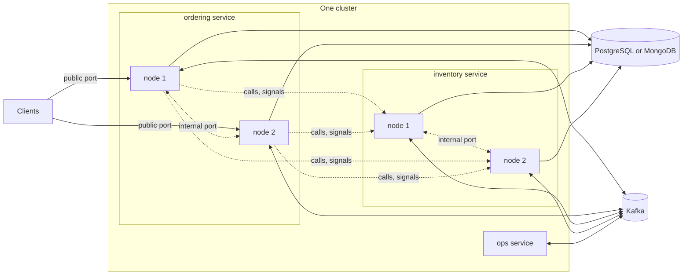

# Deployment Model

This page describes what you run when you run Wow: the services and their nodes, how nodes find each other and share work, which infrastructure each service needs, and the assumptions the design makes about the network. Read it before you plan a deployment.

## Services and nodes

A **service** is one deployable application. It hosts one or more bounded contexts: their aggregates, their processors and their HTTP API. A **node** is one running instance of a service. A service runs as many nodes as it needs, and every node of a service runs the same code.



The nodes of a service share the work through **partitions**. Each context's log has a fixed number of partitions, 64 by default, and each partition has one owner at a time. Ownership is a lease kept in the service's own store: there is no ZooKeeper, no Kafka consumer group and no registry. Every node computes the same assignment from the list of live members and takes or releases leases to match it. When a node joins or leaves, about one partition in N moves.

A node keeps one membership record per service, listing the contexts and topics it takes part in, and reads the service's members once for all of them; only the leases are per context. The store work of this coordination therefore grows with the number of nodes and, for the leases, with the contexts each runs: with the defaults, about 1.3 operations a second per node plus 1.3 per context a node runs (15 contexts on 10 nodes: about 210 a second), whatever the command traffic.

The owner of a partition executes the commands for its aggregates and runs every subscription over it. A command that arrives at another node is forwarded to the owner. When no owner can be reached, for example while a partition changes hands, the receiving node runs the command itself, and the aggregate's version keeps the result correct. [Writing: admission to append](../concepts/write-path#routing) explains the rules.

## Two ports

Each node listens on two ports:

| Port | Serves | Who reaches it |
| --- | --- | --- |
| Public (`server.port`) | The HTTP API: commands, queries, state reads, the Manifest, OpenAPI; Actuator's health endpoint | Clients, gateways, ingresses |
| Internal (`wow.internal.port`, 9090 by default) | The cluster channel between the service's own nodes; wait signals from any service; synchronous calls and reads from other services | Nodes of the system only |

The internal port is HTTP/2 without TLS (h2c). It must never be reachable from outside the platform: no public load balancer, ingress or port mapping points at it, and a network policy lets only the platform's own pods reach it. It takes no token: every request to it names the service it comes from in the `Wow-Service` header, and the network is its boundary ([Secure a deployment](./security#close-the-internal-port)).

Each node advertises the address other nodes reach its internal port at:

- `wow.node.id` names the node among the service's members; a new one is generated at each start unless set.
- `wow.internal.host` is the interface the internal port binds. Bind it to the node's private address.
- `wow.node.address` is the `host:port` other nodes use. By default it is the bound address, else this host's address, with the internal port; set it only when the peers reach the node at another address, as behind NAT, on a host with several interfaces, or in a StatefulSet whose pods have stable DNS names.

On Kubernetes, the eShop's ordering manifests take the node id and the bound address from the pod, and advertise that address, the pod's IP:

<!-- sample: deploy/eshop-ordering/deployment.yaml#node -->

```yaml
env:
  - name: POD_NAME
    valueFrom:
      fieldRef:
        fieldPath: metadata.name
  - name: POD_IP
    valueFrom:
      fieldRef:
        fieldPath: status.podIP
  - name: SERVER_PORT
    value: "8083"
  - name: WOW_INTERNAL_PORT
    value: "9093"
  # The node id is the pod's name: a replaced pod is a new member.
  - name: WOW_NODE_ID
    value: $(POD_NAME)
  # The internal port binds the pod's private address only, and the node advertises that address,
  # $(POD_IP):9093: a Deployment's pods have no DNS name of their own.
  - name: WOW_INTERNAL_HOST
    value: $(POD_IP)
```

A Deployment's pods have no DNS name of their own (a headless service publishes `<pod>.<service>` only for pods with `spec.hostname`), so the node advertises its IP. The headless service is named after the service, `eshop-ordering-service-cluster`: its SRV records name every node's address, the nodes that are not ready included, and the other services find its nodes there by the service's name alone. The [eShop ordering manifests](https://github.com/Ahoo-Wang/Wow/tree/main/deploy/eshop-ordering) are a complete template for one service.

## What a service needs

| Component | When | What for |
| --- | --- | --- |
| PostgreSQL or MongoDB | Always, in production | The log, snapshots, checkpoints, leases, the failure ledger, reserved keys and timers. MongoDB must be a replica set. |
| Kafka | When events or commands cross contexts, or an aggregate type's commands are routed through Kafka | Published streams, command topics, receipts. See [Kafka](./kafka). |
| ClickHouse | When the service writes the warehouse or serves datasets | The ClickHouse sink and dataset queries. |
| Elasticsearch | Optional | Copies of snapshots and event streams for full-text search. It never holds the log. |

### Choose a backend

A node keeps its log, snapshots, checkpoints, leases, failure ledger, reserved keys and timers in one backend, chosen by `wow.backend`:

| Backend | Module | The application provides |
| --- | --- | --- |
| `postgres` | `wow-postgres` | a `javax.sql.DataSource`: the host's of `spring.datasource.url` (with HikariCP), or the application's bean |
| `mongo` | `wow-mongo` | a `com.mongodb.client.MongoClient` on a replica set: the host's of `spring.mongodb.uri`, or the application's bean; the database is `wow.mongo.database` |
| `memory` | none | nothing: one node, whose data does not outlive it |

`auto`, the default, takes PostgreSQL or MongoDB by the bean the application has. Without either, a node refuses to start, unless a development profile is active or its internal port binds the loopback interface alone; then it runs in memory and says so. The eShop's ordering service moves to PostgreSQL with its `postgres` profile:

<!-- sample: examples/eshop/ordering/ordering-server/src/main/resources/application.yaml#postgres -->

```yaml
spring:
  config:
    activate:
      on-profile: postgres
  datasource:
    url: jdbc:postgresql://localhost:5432/eshop_ordering
    username: postgres
    password: postgres
```

The host creates its tables and collections at startup, unless `wow.ddl` says `validate` or `none`. The log and the snapshots are stored per aggregate type (`wow_log__<context>__<aggregate>`, `wow_snapshot__<context>__<aggregate>`). Named stores, `wow.stores`, split the data per aggregate instead: one aggregate's log on PostgreSQL, another's snapshots on Elasticsearch.

A system usually also runs the platform services, which are Wow services themselves: the **ops service**, which collects every service's parked aggregates and gives operators a console ([The ops service and console](./ops-console)); the **view store**, which keeps users' saved views; and the **analytics catalog**, which defines and publishes datasets.

## Assumptions

The design rests on a few assumptions about the environment. A deployment that breaks one of them breaks a guarantee.

- **One cluster.** All the services of a system run in the same cluster and can reach each other's internal ports directly. A wait that crosses into another service is signalled by that service's nodes straight to the node the command came from.
- **Synchronized clocks.** Leases expire by the nodes' clocks. The clock skew between nodes must be far below the lease time to live, 10 seconds by default.
- **One tenant space.** All the contexts of a system share one set of tenant ids. A tenant id crosses services as it is, in commands, published streams, receipts and timers, so every service must resolve a caller's tenant the same way.
- **Adjacent versions.** During a rolling upgrade, the nodes of a service may run two adjacent minor versions of the same major version, and no wider range. A major version upgrade is a blue-green switch.
- **A fixed partition count.** A context's partition count cannot change once its log holds entries. It must be a power of two that divides 4,096. Choose it before the first deployment; 64 suits most services.

## Starting and stopping

A node opens its public port only once it has started: its backends are up, its internal port is bound and it has joined the members. It stops in the reverse order:

1. Readiness reports that the node refuses traffic, and the public server stops taking requests. Waits still open finish, within `wow.wait.max-timeout` (60 seconds).
2. The node stops taking commands for its partitions, finishes those in flight within `wow.cluster.drain-timeout` (10 seconds), saves its subscriptions' checkpoints and releases its leases. Other nodes take the partitions over.
3. The internal port closes last.

The host sizes Spring Boot's shutdown phase to fit, unless `spring.lifecycle.timeout-per-shutdown-phase` is set. Give the platform's termination grace period at least as much; the eShop manifests use 90 seconds.

With Spring Boot Actuator on the classpath, the host contributes the node's health to the readiness and liveness groups:

<!-- sample: deploy/eshop-ordering/deployment.yaml#probes -->

```yaml
startupProbe:
  httpGet:
    path: /actuator/health/readiness
    port: http
  periodSeconds: 5
  failureThreshold: 36
readinessProbe:
  httpGet:
    path: /actuator/health/readiness
    port: http
  periodSeconds: 5
  failureThreshold: 2
livenessProbe:
  httpGet:
    path: /actuator/health/liveness
    port: http
  periodSeconds: 10
  failureThreshold: 3
```

- **Readiness** fails until the node runs, while its log or lease store is down, while it owns none of its share of partitions past a hand-over grace period, or while a topic it reads is still joining.
- **Liveness** fails only when the node is stuck: its dispatcher or its commands make no progress while its stores answer. It never fails for a storage outage, and not while the node drains, so an outage does not restart every node at once.

## Standby for a migration's cut-over {#standby-for-a-migrations-cut-over}

Through the dual-run window of an [online 9.x cut-over](../migrate/data#online-cut-over-for-large-systems), `migrate-data tail` imports what 9.x keeps writing while the V10 service serves reads. Start its nodes with `wow.node.standby: true`:

- They serve state reads and queries of what the tail imports.
- They report ready (`/actuator/health/readiness` is `UP`, with their lease groups and topics marked `standby`), so the load balancer sends them those reads.
- They refuse every command with `wow.node.standby` (503), so nothing writes to V10 before the cut-over.
- They join no lease group: no subscription handles anything, no parked entry is retried, no job or schedule runs. A saga or a reactor that starts at the end of its stream starts where the stream ends at the activation, so it never acts on the imported 9.x history.

At the cut-over, once 9.x has stopped and the final pass, `compare`, `snapshot` and `backfill-tags` have run, activate each node on its internal port, naming the node's service in `Wow-Service`. The body names who activates it and why, for the audit:

```bash
curl -X POST "http://<node>:9090/wow/node/activate" \
  -H "Wow-Service: <the node's service>" -H "Content-Type: application/json" \
  -d '{"by": "<operator>", "reason": "cut-over <ticket>"}'
```

The node joins its lease groups, starts its subscriptions, its parked-entry retries, its jobs and its snapshot maintenance, then admits commands. It answers its standby status, `standby: false`, `activatedAt`, `activatedBy` and `reason`, and logs the same at `WARN`.

`GET /wow/node/standby`, with the same header, answers that status at any time. Activating a node that is not on standby changes nothing and answers when it was activated. Both routes are taken only from the node's own service: without the header they answer 401, from another service 403. Activate every node of the service: one left on standby keeps refusing commands and takes no partition.
