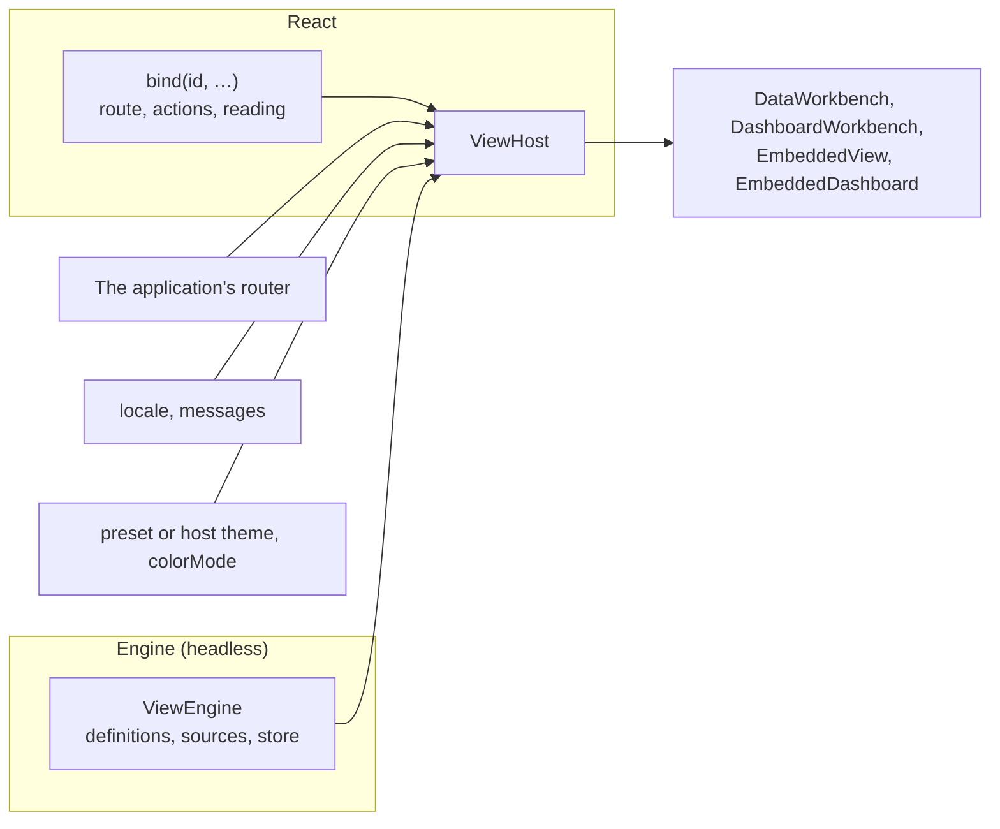

# Host the Engine

Once the definitions are written, the application wires them in: one engine with its sources and store, and one `ViewHost` around the pages that bridges the engine to the application's router, language, theme and commands. This page goes through each part.

<!-- typecheck-generated: examples/eshop/web/src/generated/ordering -->



## One engine over V10 query routes

The engine is headless: no React, no DOM. It holds the definitions, where each one's rows come from, and the store of saved views. Build it once, at the application's start, and share it with every page:

<!-- typecheck: file=engine.ts -->
<!-- typecheck-context
import type { DashboardDefinition, DataViewDefinition } from '@ahoo-wang/wow-view-engine';
declare const orders: DataViewDefinition;
declare const overview: DashboardDefinition;
declare function report(event: unknown): void;
-->

```ts
// src/views/engine.ts
import { Fetcher } from '@ahoo-wang/fetcher';
import {
  localStorageSnapshot,
  MemoryViewStore,
  ViewEngine,
} from '@ahoo-wang/wow-view-engine';
import { browserRuntimeEnvironment } from '@ahoo-wang/wow-view-engine/react';
import { OrderSnapshotQueryClient } from './generated/index.js';

// A timeout: the engine times no query itself.
const fetcher = new Fetcher({ baseURL: '/api', timeout: 30_000 });

export const engine = new ViewEngine({
  store: new MemoryViewStore({ snapshot: localStorageSnapshot('my-app:views') }),
  resources: [
    // The generated client of the order's snapshot query route, as a source.
    {
      definition: orders,
      source: new OrderSnapshotQueryClient({ fetcher }),
    },
    // A board queries nothing of its own: its panels read other resources.
    { definition: overview },
  ],
  // A failed query or save is shown where it happens; this is for monitoring.
  environment: browserRuntimeEnvironment({ onError: report }),
});
```

- **A source is a query route.** A client `wow-generator` generates for a snapshot, event or dataset query model is a source as it is: it runs the paged, cursor and aggregation queries the views need, and reads the model's live description, so the engine offers only what this deployment grants.
- **One engine per application**, never one per page or per language: pages share its query cache, descriptions and preferences, and a language change only redraws.
- **Give the fetcher a timeout.** A server that accepts the connection and never answers would otherwise hold the engine's query slots and starve a board's other panels.
- **Leave the limits alone.** The query queue makes room for a board's panels by itself, and the description supplies the server's budgets.
- In a development build without `onIssue`, the engine prints admission findings per resource. They belong in the definitions' [`admit`](./definitions#_7-check-it-with-admit) test.

Where saved views are kept is [Saved views](./storage).

## `ViewHost`: one layer around the pages

`ViewHost` is made of ports, each a bridge to something the application already has. Your router, your words and your theme stay yours:

| Prop | Port | What it does |
| --- | --- | --- |
| `engine` | data | The application's engine |
| `router` | router | Your router: `useReactRouter()` from `/react-router`, or a [`ViewRouter`](../../reference/typescript/wow-view-engine/host.md#api-ViewRouter) of your own ([below](#router-port)) |
| `navigate` | router | Every way off in your own hands; it wins over `router` |
| `locale`, `messages` | language | The language values are shown in, and the words merged over the engine's own ([below](#messages)) |
| `bindings` | commands | One `bind(id, …)` per resource: its route, actions and reading ([below](#bind)) |
| `theme`, `preset`, `brand` | theme | Follow the host's shadcn theme, or wear one of the engine's presets ([Theming](./theming)) |
| `colorMode`, `rememberColorMode` | theme | Light, dark or the system's, and where the reader's choice is kept |

<!-- typecheck: file=Host.tsx -->
<!-- typecheck-context
import { engine } from './engine';
import { BINDINGS } from './routes';
declare const ORDER_WORDS: Record<'zh-CN' | 'en', Record<string, string>>;
-->

```tsx
// src/views/Host.tsx
import type { ReactNode } from 'react';
import '@ahoo-wang/wow-view-engine/styles.css';
import '@ahoo-wang/wow-view-engine/themes/porcelain.css';
import { useReactRouter } from '@ahoo-wang/wow-view-engine/react-router';
import { ViewHost, zhCN } from '@ahoo-wang/wow-view-engine/ui';

/** One per language: the engine's own words (English by default), and the definitions' keys. */
const MESSAGES = {
  'zh-CN': { ...zhCN, ...ORDER_WORDS['zh-CN'] },
  en: ORDER_WORDS.en,
};

export function Host({
  locale,
  children,
}: {
  locale: 'zh-CN' | 'en';
  children: ReactNode;
}) {
  return (
    <ViewHost
      engine={engine}
      router={useReactRouter()}
      locale={locale}
      messages={MESSAGES[locale]}
      bindings={BINDINGS}
      preset="porcelain"
      rememberColorMode="my-app.color-mode"
    >
      {children}
    </ViewHost>
  );
}
```

Every surface under `ViewHost` takes only what differs where it stands: `<DataWorkbench definitionId="orders" />`. Hosts nest: an inner host's bindings win over the outer one's by id, and an inner host may name another engine. Only the outermost host paints `<html>`: the mode, the preset and the brand.

## `bind`: what each resource does here {#bind}

`bind(definitionId, options)` says in one place how a resource behaves in this application. Wherever it shows, in a workbench, a record's detail, a board's panel, an embed, its binding comes along:

| Option | What it is |
| --- | --- |
| `route(instanceId, target?)` | The path of the page that opens this resource on a view; `null` for a view nobody saved, which lands on the page's default |
| `actions` | The commands on its records ([Actions](./actions)) |
| `reading` | How one record reads in its detail: `title(row)` names it, `sections(context)` adds regions, `render(context)` replaces the body |
| `slots` | The escape hatch: `row`, `bulk` and `global` draw your own markup after the declared actions |

<!-- typecheck: file=routes.ts -->
<!-- typecheck-context
import type { RecordActions } from '@ahoo-wang/wow-view-engine';
declare const orderActions: RecordActions;
-->

```ts
// src/views/routes.ts
import { bind } from '@ahoo-wang/wow-view-engine/ui';

/** A workbench page on `view`, or on its default view (`null`). */
export function withView(path: string, view: string | null): string {
  return view === null ? path : `${path}?${new URLSearchParams({ view })}`;
}

// At module scope: a binding built in render is a new binding every render.
export const BINDINGS = [
  bind('orders', {
    route: view => withView('/orders', view),
    reading: { title: row => `Order ${String(row.key)}` },
    actions: orderActions,
  }),
  bind('overview', { route: board => withView('/boards', board) }),
];
```

Keep the bindings stable, at module scope or in a `useMemo`. A resource with no `route` is not a place: the navigation leaves it out.

## The router {#router-port}

With a router port, the engine keeps the address and the application syncs nothing:

- **The open view is `?view=`.** A workbench given no `instanceId` opens the address's view and writes the reader's choice back. Two workbenches on one page each read only their own definition's views.
- **The open record is `?id=`.** A bound resource's record detail follows it.
- **What is handed over goes in the history entry's state**: the view a board hands to the workbench, a board's filters and tab. With `boardsInAddress`, a board's filters and tab go into the address too, so a link opens the same board on the same day.
- A path starting with `/` goes through the router; another site opens in a new window.

`useReactRouter()` from `/react-router` makes React Router the port; React Router is an optional peer only that entry loads. Over any other router, write the two members of `ViewRouter`, `location` and `go`. **The contract is the object's identity**: a new object when the location moves, the same one while it does not:

<!-- typecheck: file=memoryRouter.ts -->

```ts
// src/views/memoryRouter.ts
import { useMemo, useState } from 'react';
import type { ViewLocation, ViewRouter } from '@ahoo-wang/wow-view-engine/ui';

export function useMemoryRouter(start: string): ViewRouter {
  const [location, setLocation] = useState<ViewLocation>(() => at(start));
  // A new object only when the location moves: what reads the address reads it again then.
  return useMemo(
    () => ({
      location,
      go: (path, options) => setLocation(at(path, options?.state)),
    }),
    [location],
  );
}

function at(path: string, state: unknown = null): ViewLocation {
  const query = path.indexOf('?');
  return query < 0
    ? { pathname: path, search: '', state }
    : { pathname: path.slice(0, query), search: path.slice(query), state };
}
```

`navigate(to)` on `ViewHost` hands you every way off, ahead of the router: use it where a navigation does one thing more, such as analytics or a leave guard.

## Navigation is data

The engine draws views; the page is yours, so there is no page-shell component. `useViewNavigation()` gives your shell the bound resources in the order registered, each with its title, path, whether it is current, and its system views:

<!-- typecheck-context
declare function Header(props: { children: React.ReactNode }): React.ReactNode;
-->

```tsx
import { DataWorkbench, useViewNavigation } from '@ahoo-wang/wow-view-engine/ui';

export function OrdersPage() {
  return <DataWorkbench definitionId="orders" />;
}

export function Places() {
  const places = useViewNavigation();
  return (
    <Header>
      <nav aria-label="Application">
        {places.map(place => (
          <a
            key={place.id}
            href={place.path}
            aria-current={place.current ? 'page' : undefined}
          >
            {place.title}
          </a>
        ))}
      </nav>
    </Header>
  );
}
```

**The page's height is yours, and it must be definite.** A workbench fills its container with its footer at the bottom, so the container needs a `height`, not a `min-height`: make the shell the viewport's height and let the content area take the rest. A page that has its own `<main>` passes `landmark="region"` to the workbench, so the page keeps one `main`.

## Embeds {#embeds}

A business page that shows what somebody already decided, such as a customer's orders, embeds it: the result and nothing else. [`EmbeddedView`](../../reference/typescript/wow-view-engine/components.md#api-EmbeddedView) shows a record or analysis view, [`EmbeddedDashboard`](../../reference/typescript/wow-view-engine/components.md#api-EmbeddedDashboard) a board. **An embed never writes**: not a view, not a board, not a preference.

<!-- typecheck-context
import type { ViewNavigation } from '@ahoo-wang/wow-view-engine';
declare function go(to: ViewNavigation): void;
-->

```tsx
import { systemInstanceId } from '@ahoo-wang/wow-view-engine';
import {
  EmbeddedDashboard,
  EmbeddedView,
} from '@ahoo-wang/wow-view-engine/ui';

export function CustomerPage({ id, name }: { id: string; name: string }) {
  return (
    <>
      {/* This customer's orders to ship: a system view, narrowed to them. */}
      <EmbeddedView
        instanceId={systemInstanceId('orders', 'to-ship')}
        scopeFilter={{
          op: 'and',
          children: [{ field: 'state.customerId', operator: 'in', value: [id] }],
        }}
        withTitle
      />
      {/* The customer's board: locked to them; the time is the reader's. */}
      <EmbeddedDashboard
        instanceId="customer-board"
        interaction="interactive"
        filterModes={{ customer: 'locked' }}
        pageValues={{ values: { customer: { items: [{ id, label: name }] } } }}
        onNavigate={go}
      />
    </>
  );
}
```

- **How far a reader may go is one explicit tier**, `interaction`: `static` by default, the result alone; `interactive` adds sorting, pages, a board's filters, follow-ups and "Open in the workbench". Further switches opt in within the tier: `withTitle`, `withSearch`, `withExport`, `detail`, `expandable` and more.
- **A board's filters each take a mode** (`filterModes`): `adjustable`, the reader's; `locked`, shown but fixed; `hidden`, not shown but still applied. Locked and hidden values are the page's and never travel through the address.
- **Every way off an embed** goes through `onNavigate`; without it, those ways do not exist.

**Locking is not a security boundary.** A locked condition is put together in the browser and sent with the query; anyone can edit the script or call the API directly. Tenancy, ownership and permissions are enforced by the Wow service, as [Read models](../../concepts/read-models#who-sees-what) describes.

## Words and locale {#messages}

The model carries keys, not copy; the words belong to the interface. The engine's own words are English; `zhCN` is the Chinese catalogue, key for key:

- `messages` is merged over the words in force: the engine's keys and the definitions' keys in one table. A Chinese host passes `{ ...zhCN, ...definitionWords }`; an English host passes the definitions' words alone.
- `locale` is the language values are shown in: an enum by its label, times through `Intl.DateTimeFormat`, in the engine's time zone.
- Changing either only redraws: nothing reopens, nothing is queried again, no draft becomes dirty.
- Reword the engine's own keys with `satisfies MessageOverrides`, so a key the engine renames fails your build:

```ts
import { zhCN, type MessageOverrides } from '@ahoo-wang/wow-view-engine/ui';

const wording = {
  'label.filter.apply': '确定',
} satisfies MessageOverrides;

export const ENGINE_WORDS = { ...zhCN, ...wording };
```

The message keys are public: a patch release renames and removes none.

## Test the wiring {#testing}

`@ahoo-wang/wow-view-engine/testing` is a headless entry for a host's unit tests, run in Node:

| Function | What it tests |
| --- | --- |
| [`admit`](../../reference/typescript/wow-view-engine/testing.md#api-admit) | Definitions and boards over their committed descriptions, every key worded ([Define views](./definitions#_7-check-it-with-admit)) |
| [`resolveNavigation`](../../reference/typescript/wow-view-engine/testing.md#api-resolveNavigation) | What a way off resolves to through your bindings, by the engine's own resolution |
| [`actionHarness`](../../reference/typescript/wow-view-engine/testing.md#api-actionHarness) | Your declared actions, read by the engine's rules ([Actions](./actions#harness)) |
| [`memorySource`](../../reference/typescript/wow-view-engine/testing.md#api-memorySource) | An in-memory source that filters, sorts, pages and aggregates with a Wow service's semantics |

The route table, with the engine's own resolution:

<!-- typecheck-context
import { BINDINGS } from './routes';
declare function expect(value: unknown): { toMatchObject(expected: unknown): void };
-->

```ts
import { resolveNavigation } from '@ahoo-wang/wow-view-engine/testing';

const bindingOf = (id: string) =>
  BINDINGS.find(binding => binding.definitionId === id);

const toShip = {
  kind: 'view',
  definitionId: 'orders',
  instanceId: 'system:orders:to-ship',
  scopeFilter: null,
  filter: null,
} as const;
expect(resolveNavigation(toShip, bindingOf)).toMatchObject({
  kind: 'route',
  path: '/orders?view=system%3Aorders%3Ato-ship',
  state: { handOver: toShip },
});
```

A page test over in-memory snapshots, with Wow's query semantics:

<!-- typecheck-context
import type { DataViewDefinition } from '@ahoo-wang/wow-view-engine';
declare const orders: DataViewDefinition;
-->

```ts
import { MemoryViewStore, ViewEngine } from '@ahoo-wang/wow-view-engine';
import { memorySource } from '@ahoo-wang/wow-view-engine/testing';

// Snapshots as the service returns them: the envelope, `state`, epoch-ms times.
const source = memorySource(
  [
    { aggregateId: 'O-1', firstEventTime: 1_790_000_000_000, state: { status: 'PAID' } },
    { aggregateId: 'O-2', firstEventTime: 1_790_000_060_000, state: { status: 'SHIPPED' } },
  ],
  // The clock BEFORE_NOW and AFTER_NOW compare against: pin it.
  { now: () => Date.parse('2026-09-27T00:00:00Z') },
);

export const testEngine = new ViewEngine({
  resources: [{ definition: orders, source }],
  store: new MemoryViewStore(),
});
```

`memorySource`'s answers are held to the server's own semantics by this package's suites, so a test sees what production gives. It evaluates filters with `mingo`, an optional peer that only `/testing` loads: add it to your dev dependencies.

## A complete host

The ops console is a complete V10 host: [`OpsHost.tsx`](https://github.com/Ahoo-Wang/Wow/blob/main/platform/ops/console/src/app/OpsHost.tsx) is its `ViewHost`; [`views/engine.ts`](https://github.com/Ahoo-Wang/Wow/blob/main/platform/ops/console/src/views/engine.ts) builds its engine over the generated query client of the parked entries; [`views/bindings.ts`](https://github.com/Ahoo-Wang/Wow/blob/main/platform/ops/console/src/views/bindings.ts) binds them, with their reading and actions.
