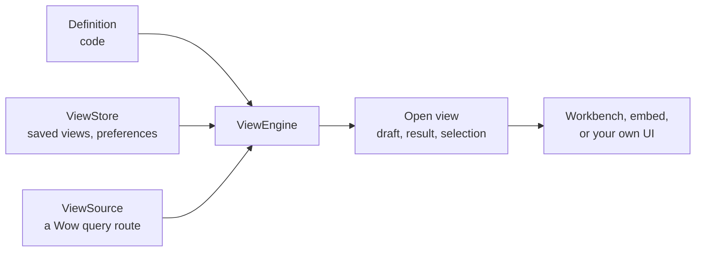

# View Engine Concepts

Most pages of a business application are the same page: a list with filters, sorting and paging, sometimes a chart, sometimes a board of numbers. Each business object gets its own copy, and every request like "add a filter" or "break this down by warehouse" becomes a code change. The data did not change; only the way of looking at it did.

`@ahoo-wang/wow-view-engine` turns that into configuration. The application declares in code **how a dataset can be looked at**: its fields, what each is called, how it filters, sorts and aggregates. Readers decide in the interface **how to look at it this time**: conditions, columns, dimensions and metrics, charts, boards. The engine compiles that choice into Wow queries, renders the result, and saves the views worth keeping.

| For | What they get |
| --- | --- |
| Readers | Filter, sort, group and chart within what the application allows; save, share and reopen views |
| Developers | One definition and one source per business object, instead of a list page, an analysis page and an overview page each |
| The product | A new way of looking at existing data is a saved view, not a release |

It is not a database, a permission system or a general page builder. The data, what can be filtered and aggregated, and who may see what all come from the Wow services behind it.

## Three facts

The design rests on three facts and derives the rest from them:

| Fact | Consequence |
| --- | --- |
| **Definitions are code** | A definition ships with the application. There is no definition service and no definition version; a saved view is checked against the current definition each time it opens. |
| **Configs are data** | A saved view is plain JSON: the reader's intent, never compiled values or component names. Only saved views and each reader's preferences are stored, with an optimistic revision and an idempotent request id. |
| **Runtime state is transient** | Drafts, results, the page, the selection live in one open view and are never stored. Reopening a view runs it from the start. |



## The parts

| Part | What it is | Lives in |
| --- | --- | --- |
| Definition (`ViewDefinition`) | How a dataset **can** be looked at: fields, their words, operators, record and analysis capabilities, and the system views that ship with it | Code |
| Source (`ViewSource`) | Where a data definition's rows come from: a Wow query route, through a generated query client | Code |
| View config (`ViewConfig`) | **How** one look looks: a record view, an analysis view or a board | Data |
| Saved view (`ViewInstance`) | A config with an id, a title, an audience and a revision | Store |
| Preferences (`ViewPreferences`) | One reader's habits on one definition: the order of views, the default view, the last tab of a board | Store |
| Engine (`ViewEngine`) | The registry of definitions, sources and the store, and of the views that are open; one per application | Memory |
| Host (`ViewHost`) | The React layer that connects the engine to the application's router, language, theme and commands | Code |

## Definitions

A definition's **facts** come from the service: each Wow query model describes itself, at `GET /{context}/{aggregate}/{model}/query` — its paths, value types, enum values, how times are kept, what is sensitive. A definition is written from that description, committed beside it, with [`defineView`](./definitions). The definition adds the **choices**: which fields readers see, in what order, in what words, what is narrowed away.

What the service can do with a field — which operators, sorts and aggregations a store supports — changes with the store, so the definition does not freeze it. At run time the engine reads the live description through the source and offers only what this deployment grants.

There are two kinds:

- A **data definition** is paired with a source and holds the record and analysis views of one dataset: a snapshot, event or dataset query model.
- A **dashboard definition** has no source. It is the catalogue its boards belong to, and their panels show views of the data definitions.

## Views

A view is one way of looking at a data definition:

| Kind | Answers | Its config holds |
| --- | --- | --- |
| Record view | "Which records, in what order": a list that pages | Conditions, sort, page size, columns, summaries, a table, card or kanban layout |
| Analysis view | "Grouped by what, measuring what": a table or chart of an aggregation | Conditions, dimensions, metrics, which groups to keep, sort, a top N, a table and a chart |

Both send only Wow queries: a record view a paged or cursor query, an analysis view an aggregation. A config stores **intent**, so it never goes stale:

```ts
import type { RecordViewConfig } from '@ahoo-wang/wow-view-engine';

export const PAID_THIS_WEEK: RecordViewConfig = {
  kind: 'record',
  filter: {
    op: 'and',
    children: [
      { field: 'state.status', operator: 'in', value: ['PAID'] },
      // "This week" is stored as intent and resolved on every run.
      {
        field: 'firstEventTime',
        operator: 'between',
        value: { type: 'preset', preset: 'thisWeek' },
      },
    ],
  },
  filterMode: 'simple',
  refresh: { interval: null },
  sort: [{ field: 'firstEventTime', direction: 'desc' }],
  pageSize: 20,
  summaries: [{ field: 'state.totalAmount', fn: 'sum' }],
  layout: 'table',
  table: {
    columns: [
      { field: 'aggregateId' },
      { field: 'state.totalAmount' },
      { field: 'firstEventTime' },
    ],
  },
  card: { title: 'aggregateId', fields: ['state.totalAmount'] },
};
```

- **The config is saved, not the browsing state.** The selection, the page and the results are never saved.
- **The config names no component.** The editor is derived from the field's kind, the operator and the value's shape, so a new interface touches no saved view.
- **A config is checked every time it opens.** It came from a store and is not trusted: a view that names a field the definition no longer has opens as needing repair, at the place it names.

## Boards

A board puts several views on one page, on a 24-column grid, optionally in tabs. A panel shows a saved view, an analysis the board owns, or content: a heading, text, an image, links. The board's filters cross definitions: a date filter reaches each panel through its definition's time field, and a board can also have a fixed scope its readers cannot change.

A saved view or board can also be **embedded** in a business page, without the workbench around it: a customer's orders on the customer's page. An embed never writes. See [Embeds](./host#embeds).

## Who sees a view

Every saved view has a scope:

| Scope | Configured by | Seen by | What an ordinary reader may do |
| --- | --- | --- | --- |
| `system` | Developers or operators | Every reader of the definition | Open it, make it the default, save a copy; not change it |
| `shared` | Readers allowed to share | Every reader of the definition | What the host's permissions allow; always save a copy |
| `personal` | Any reader | Its owner only | Everything |

System views come from three places: the definition's code; the view store service's configuration; and the store itself, where readers allowed to edit system views publish them without a release. Stored system views are global: every tenant reads them. That is why a system board may show only system views. [Where views live](./storage) explains the store.

## Revisions and conflicts

Several people and tabs changing one view is normal. The engine takes no locks:

- **Optimistic revision.** Every saved view carries an opaque revision, and every write the revision it expects. When another write got there first, this one is refused as a conflict, and the reader chooses: take theirs, write theirs over, or save a copy.
- **Idempotent request id.** One logical write has one request id. A retry after a timeout reuses it, so a retry never creates a second view.
- **An unknown outcome is neither success nor failure.** Until it is settled, the same view takes no new write, and the draft survives.

## Where to go next

| To | Read |
| --- | --- |
| Write a definition from a query model's description | [Define views](./definitions) |
| Put the engine into an application: `ViewHost`, routes, embeds, words, tests | [Host the engine](./host) |
| Offer commands on records | [Actions](./actions) |
| Keep saved views | [Saved views](./storage) |
| Wear a preset, use a brand colour, follow a shadcn theme | [Theming](./theming) |
| Keyboard, screen readers, WCAG 2.2 | [Accessibility](./accessibility) |
| Run under a strict Content Security Policy | [Content Security Policy](./csp) |
| Help your readers use the workbench | [The workbench](../../data/workbench) |
| Look up a signature | [wow-view-engine reference](../../reference/typescript/wow-view-engine/) |

Every state of every surface runs in [Storybook](/storybook/), against in-memory data.
