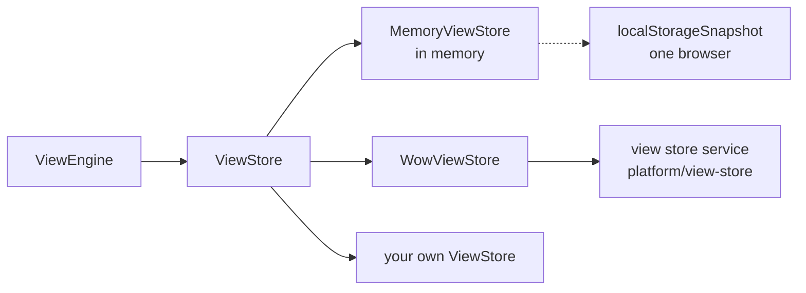

# Saved Views

Definitions, and the system views they declare, are code and ship with the front end. What readers make on the page is data: saved views, a whole record view, analysis or board config each, and each reader's preferences on each definition. The engine reads and writes both through one port, [`ViewStore`](../../reference/typescript/wow-view-engine/store.md#api-ViewStore), so changing where they are kept changes no page.



## Choose by who must see a saved view

| Store | For | Note |
| --- | --- | --- |
| [`MemoryViewStore`](../../reference/typescript/wow-view-engine/store.md#api-MemoryViewStore) | Tests, demos, a page with no saved views | Forgets on reload |
| `MemoryViewStore` with `localStorageSnapshot(key)` | Development; a tool each person uses alone | One browser's views |
| `WowViewStore` from `@ahoo-wang/wow-view-store` | Everyone else: personal, shared and system views kept by Wow's view store service | The service is a Wow service of its own |
| Your own `ViewStore` | Views that must live in a backend that is not Wow | See [below](#a-store-of-your-own) |

Whichever you choose, two rules hold, and the engine's conflict handling rests on them:

1. **Optimistic revision.** Every write carries the revision it read. A mismatch is refused as `CONFLICT`, carrying what the store holds now, and the reader chooses: take theirs, write over, or save a copy.
2. **Idempotent request id.** One logical write has one request id; a retry after a timeout reuses it, and the store answers with the first outcome instead of writing twice.

## In memory, or in one browser

`MemoryViewStore` keeps the rules honest, not convenient: a stale revision conflicts, a replayed request id answers the first outcome, and the order of the list and the limits on titles and configs are the server's. Code that is right against it behaves the same against a real backend. Seeded with a stored system view, and with only administrators allowed to edit system views:

<!-- typecheck: file=memoryStore.ts -->
<!-- typecheck-context
import type { RecordViewConfig } from '@ahoo-wang/wow-view-engine';
declare const openOrders: RecordViewConfig;
declare function isAdmin(): boolean;
-->

```ts
import { MemoryViewStore } from '@ahoo-wang/wow-view-engine';

export const memoryStore = new MemoryViewStore({
  instances: [
    {
      id: 'orders-open',
      definitionId: 'orders',
      title: 'To ship',
      scope: 'system',
      // `stored`: a system view the store keeps and can edit; without it,
      // a read-only configured view.
      stored: true,
      revision: '1',
      config: openOrders,
    },
  ],
  permissions: () => ({
    createPersonal: true,
    createShared: true,
    reorder: true,
    setDefault: true,
    // Left out, it is a refusal: system views are read-only by default.
    editSystem: isAdmin(),
    instance: () => ({ save: true, rename: true, delete: true }),
  }),
});
```

Until a backend keeps the views, `localStorageSnapshot(key)` keeps a memory store in the browser's `localStorage`, as one JSON document:

<!-- typecheck: file=devStore.ts -->

```ts
import {
  localStorageSnapshot,
  MemoryViewStore,
} from '@ahoo-wang/wow-view-engine';

export const devStore = new MemoryViewStore({
  snapshot: localStorageSnapshot('my-app:views'),
});
```

A write the browser refuses, such as a full quota, fails as `UNAVAILABLE`. Tabs do not overwrite each other: the store reads the document again before every write, merges into what another tab stored, and refuses a write another tab has moved past. The ops console keeps its operators' views this way, because the ops service hosts no view store.

## On Wow's view store {#wowviewstore-views-on-a-wow-service}

Wow's view store service, `platform/view-store`, keeps saved views, preferences and dataset wording as Wow aggregates. The front end reaches it with `WowViewStore`, through the clients generated from the service's Manifest.

### Wire it

`WowViewStore` takes a fetcher and, optionally, `permissions`. **It takes no tenant, owner, user or application**: the fetcher's interceptors carry who is asking, as they do for every other request of the application. The service takes the tenant and the owner from the caller, and keeps every view in the application the request was authorized in.

<!-- typecheck: file=viewStore.ts -->
<!-- typecheck-context
declare function hasRole(role: string): boolean;
-->

```ts
import { Fetcher } from '@ahoo-wang/fetcher';
import { CoSecConfigurer } from '@ahoo-wang/fetcher-cosec';
import {
  isSystemInstanceId,
  type ViewPermissions,
} from '@ahoo-wang/wow-view-engine';
import { WowViewStore } from '@ahoo-wang/wow-view-store';

// The gateway in front of the view store service.
const fetcher = new Fetcher({ baseURL: 'https://api.example.com', timeout: 30_000 });
new CoSecConfigurer({ appId: 'my-app' }).applyTo(fetcher);

/** The roles the service checks: the shared views' writer, the system views' writer. */
const SHARED_WRITER = 'view-store.shared-writer';
const SYSTEM_WRITER = 'view-store.system-writer';

function permissions(): ViewPermissions {
  const sharedWriter = hasRole(SHARED_WRITER);
  return {
    createPersonal: true,
    createShared: sharedWriter,
    reorder: true,
    setDefault: true,
    // Publish, edit and unpublish stored system views; left out, refused.
    editSystem: hasRole(SYSTEM_WRITER),
    instance: id => {
      // A system view declared in code is always read-only.
      const editable = !isSystemInstanceId(id);
      return {
        save: editable,
        rename: editable,
        delete: editable,
        changeAudience: editable && sharedWriter,
      };
    },
  };
}

export const store = new WowViewStore({ fetcher, permissions });
```

Hand `store` to `new ViewEngine({ store, resources })`.

### The owner is the audience

A personal view belongs to the reader. A shared view belongs to the reserved owner `(shared)`, and a stored system view to the owner `(system)` of the tenant `(platform)`; the store acts as them with the `Wow-Scope` header. "Make shared" and "Make personal" move a view to the other owner in place, keeping its id, so a board that shows it keeps showing it.

Every reader reads shared and stored system views. Writing shared views, the shared preferences and the tenant's dataset wording takes the role `view-store.shared-writer`; writing system views takes `view-store.system-writer`. The service authorizes every write; `permissions` in the front end only decides which buttons are enabled, so answer it by the same roles, or a button is enabled whose write is then refused.

| Permission | Buttons | When left out |
| --- | --- | --- |
| `createPersonal`, `createShared` | Save as a personal or a shared view | required |
| `reorder`, `setDefault` | Reorder, set as default | required |
| `instance(id).save`, `rename`, `delete` | Save, rename, delete a view | required |
| `instance(id).changeAudience` | Make shared, make personal | allowed |
| `editSystem` | Publish as a system view; edit and unpublish stored system views | **refused** |

`editSystem` is the one permission whose silence refuses: a system view reaches every reader of every tenant, so only a host that says so opens it.

### System views

A definition's view list merges system views from three places:

| Source | Where | Who changes it |
| --- | --- | --- |
| Code | The definition's `views`, ids `system:…` | Nobody: a release |
| Configured | The service's `wow.view-store.system-views` | Nobody: a restart |
| Stored | Views of the owner `(system)` in the tenant `(platform)` | Readers with `editSystem`, at once |

Publishing a view as a system view makes a copy; the source view stays as it was. A system view never changes audience.

### Writes and retries

- Every write sends the port's request id as `Wow-Request-Id` and the revision as `If-Match`, and waits for the snapshot. The service deduplicates request ids, creations included, so a retry is answered with the first attempt's outcome.
- A stale revision is `CONFLICT`, carrying the view as it is now.
- A list reads at most 1,000 views of each audience; a view past that is still read by its id.

### Errors

Every rejection is a [`ViewStoreError`](../../reference/typescript/wow-view-engine/store.md#api-ViewStoreError). The store reads the service's error code first, and the HTTP status only when no known code came back:

| Code | From | Meaning |
| --- | --- | --- |
| `CONFLICT` | `wow.aggregate.version-mismatch`, `wow.command.request-id-reused`; 409, 412 | Someone wrote first |
| `NOT_FOUND` | `wow.aggregate.not-found`, `wow.aggregate.deleted`; 404, 410 | The view is gone, or is not the caller's to see |
| `FORBIDDEN` | `wow.auth.*`, `wow.aggregate.forbidden`, a read-only system view; 401, 403 | Not this caller's to change |
| `INVALID` | The view store's validation, a missing application; 400, 422 | The request is wrong as built |
| `UNAVAILABLE` | A retryable problem, a timeout, no answer | Unknown outcome: a retry with the same request id is safe |
| `UNSUPPORTED` | A 404 with no error code | The server offers no view store |

The service's own code stays in `detail.code`; `WowViewStoreErrorCodes` names the view store's codes. The engine handles all of these; do not wrap them.

## A store of your own {#a-store-of-your-own}

Not for a Wow backend: `WowViewStore` already handles replays, audience moves, system-view versions and error codes, which is where a hand-written store goes wrong. Write a `ViewStore` only for another backend:

- Implement `list`, `get`, `create`, `save`, `rename`, `delete`, `getPreferences` and `setPreferences`. `changeAudience` and `permissions` are optional.
- Keep the two rules: a stale revision throws `CONFLICT` with the current instance; a repeated request id answers the first outcome.
- Never issue an id starting with `system:`.
- Map the backend's failures onto the codes the engine knows:

<!-- typecheck: file=storeErrors.ts -->

```ts
import {
  ViewStoreError,
  type ViewStoreErrorCode,
} from '@ahoo-wang/wow-view-engine';

const BY_STATUS: Record<number, ViewStoreErrorCode> = {
  400: 'INVALID',
  401: 'FORBIDDEN',
  403: 'FORBIDDEN',
  404: 'NOT_FOUND',
  409: 'CONFLICT',
  410: 'NOT_FOUND',
  412: 'CONFLICT',
  422: 'INVALID',
};

/** One failed answer of the backend, as an error the engine reads. */
export function storeError(status: number, message: string): ViewStoreError {
  const code = BY_STATUS[status] ?? 'UNAVAILABLE';
  // The server answered but could not handle it: the engine says "cannot
  // handle it right now" rather than "cannot reach the server".
  return new ViewStoreError(
    code,
    message,
    code === 'UNAVAILABLE' ? { reachable: true } : undefined,
  );
}
```

### Run the conformance suite

The port has a conformance suite that `MemoryViewStore` and `WowViewStore` both run: lists, visibility, writes, stale revisions, system views, replays, preferences, audience changes. It is a test file in the repository, [`viewStoreConformance.ts`](https://github.com/Ahoo-Wang/Wow/blob/v10/typescript/wow-view-engine/test/conformance/viewStoreConformance.ts), not published to npm. Copy it from the tag of the version you use, point its imports at the package, declare what your store can do, and connect it:

<!-- typecheck: skip — imports the test file copied from the repository and your own store -->

```ts
import { describeViewStoreConformance } from './viewStoreConformance';
import { MyViewStore, openTestBackend } from '../src/myViewStore';

describeViewStoreConformance({
  name: 'MyViewStore',
  capabilities: {
    owners: true, // two owners are two users
    personalViews: true,
    changeAudience: true, // implements the optional changeAudience
    idempotentCreate: true, // a replayed create answers the first view
    systemViews: { definitionId: 'conformance-system' }, // the backend serves at least one read-only system view for it
    storedSystemViews: true, // create({ scope: 'system' }) keeps an editable system view
  },
  connect: async () => {
    const backend = await openTestBackend();
    return ({ owner }) => new MyViewStore({ backend, owner });
  },
});
```

A capability you do not declare skips the cases that need it, by name.
