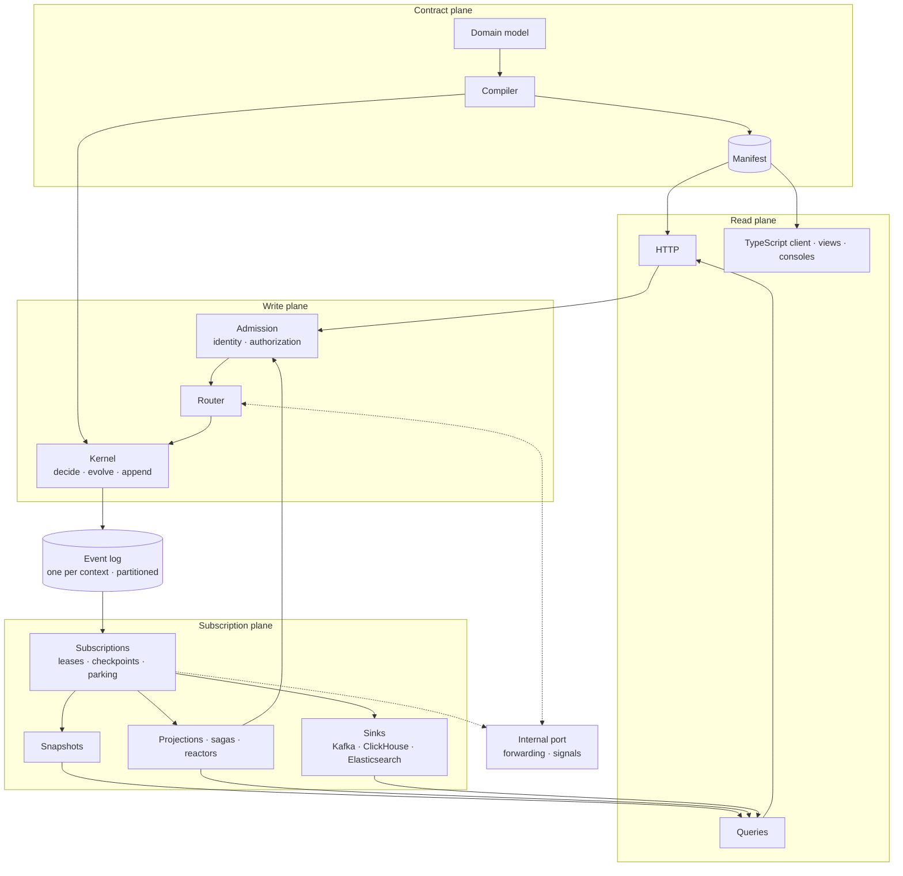

# 架构总览

用 Wow，只写领域模型，就能得到一个可以上线的系统。本页说明这个系统由什么组成、为什么是这个形状；每一节都链接到讲得更深的页面。

## 三件事 {#three-jobs}

Wow 做的每一件事，都服务于下面三件事之一：

1. **写。** 把一个意图变成恰好一次的状态变更。命令基于最新已提交的状态做出决定，它的事件用一次原子追加提交。两个写者竞争时，由聚合的版本决定谁胜出。
2. **传。** 把每一条已提交的事实至少一次地交给每一个观察者。观察者随时可以从头再来。
3. **用。** 从同一份模型推出 HTTP 路由、客户端、查询、视图和看板，不用再写代码，也不用另建一套 BI 系统。

衡量标准很简单：领域模型之外你写的每一行代码，都是 Wow 欠你的；Wow 的每一个机制，都必须能从这三件事之一推出来。

## 规则 {#the-rules}

这些规则在 Wow 的任何地方都成立，概念区的各页分别解释它们。

| 规则 | 含义 |
| --- | --- |
| 只写一处 | 追加到日志是唯一的写。快照、投影、索引、发布的事件流和数仓，都是读日志派生出来的。 |
| 日志就是总线 | 在限界上下文之内，订阅就是带检查点读日志的读者；跨上下文时，事件走发布的事件流。没有单独的事件总线。 |
| 先决定，再演化 | 命令函数决定发生哪些事件；演化函数把事件应用到状态上，不做 I/O。 |
| 编译期绑定 | 你的函数与运行时之间的绑定由编译器生成。运行时不靠反射，也不扫描类路径。 |
| 身份是一个值 | 一个聚合由一个值寻址：上下文、聚合类型、租户和 ID。它只在准入时决定一次。每个唯一键都包含租户。 |
| 读模型可重放 | 每个订阅都有检查点，所以每个读模型都能从日志重置、重建或回填。 |
| 失败是数据 | 处理函数一再失败时，停放它失败的那一个聚合并记下原因。不会悄悄跳过任何东西。 |
| 契约只有一份 | Manifest 是服务唯一的描述。HTTP 路由、OpenAPI、TypeScript 客户端、视图和 Agent Skills 都从它推出。 |
| 不绑定宿主 | 运行时不依赖 Spring，Spring Boot 只是宿主之一。 |
| 状态即读模型 | 每个聚合的最新状态，即快照，可以直接查询，不用为读它写投影。 |

## 五个平面 {#five-planes}

命令从边缘进入，被决定、被追加，它的事件再流向所有从它派生的东西。

| 平面 | 做什么 | 延伸阅读 |
| --- | --- | --- |
| 契约 | 编译器把你的聚合和处理器变成绑定和 Manifest。 | [决定与演化](./programming-model)、[一份契约](./contract) |
| 写 | 准入确定是谁在调用、调用哪个聚合；路由器选出节点；内核决定、演化并追加。 | [写：从准入到追加](./write-path)、[身份、租户与访问](./identity) |
| 日志 | 每个限界上下文有一份分区、有序的日志，它是唯一的事实来源。 | [日志就是总线](./event-log) |
| 订阅 | 快照、投影、Saga、反应器和 Sink 都读日志，各有自己的检查点。 | [订阅、失败与重放](./subscriptions)、[等待结果](./waits) |
| 读 | 查询读快照、事件流和数据集；HTTP 边缘和 TypeScript 客户端从 Manifest 推出。 | [读模型](./read-models) |

一个服务的节点之间只通过一条内部通道通信，即集群通道，它把命令转发给拥有该聚合的节点。完成等待的信号直接发回命令来自的那个节点。服务之间通过 Kafka 上发布的事件流和命令主题通信，或者同步调用对方服务的内部端口。[上下文之间](./cross-context)说明什么时候用哪一种。

## Wow 运行在哪里 {#where-wow-runs}

一个系统的所有服务运行在同一个集群里，彼此可以直接调用。每个服务监听两个端口：一个公开端口提供 HTTP API，一个内部端口承载集群通道、等待信号和来自其他服务的调用。内部端口绝不暴露到集群之外，发往它的每个请求都要认证。

服务需要一个日志后端：PostgreSQL 或 MongoDB。事件或命令跨上下文时需要 Kafka；数据集和分析需要 ClickHouse。

## Wow 保证什么 {#what-wow-guarantees}

架构必须满足这些验收标准：

1. 任意时刻崩溃，都不丢失已提交的事实。
2. 每个读模型，包括快照，都能从日志的开头重建。
3. 两个租户使用相同的聚合 ID，互不影响。
4. 稳态下，存储的读压力不随订阅数量增长；只有正在追赶的订阅会多读。
5. 领域模型之外，你不写基础设施代码。

## 术语 {#terms}

[术语表](../reference/glossary)定义了这些页面用到的每个术语，并给出中文页面使用的译名。
