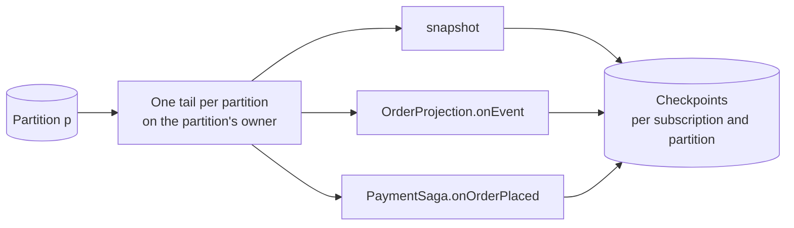

# 订阅、失败与重放

所有对提交作出反应的东西都是订阅：快照、你的投影、Saga 和反应器，以及发布到 Kafka 或写入 ClickHouse 的 Sink。订阅从它自己保存的检查点开始读日志。本页说明订阅怎样运行、为什么一次失败只停放一个聚合而不让别的东西停下，以及读模型怎样重建。

## 一个处理函数，一个订阅 {#one-handler-one-subscription}

订阅就是一个名字、一个过滤器和**一个**处理函数。一个有三个处理函数的处理器类，会变成三个订阅，名为 `Processor.function`，各有自己的检查点。

原因在于重放。如果一个检查点覆盖多个函数，其中一个失败后重放，会把其他函数也再运行一次，它们的效果就发生了两次。每个函数一个检查点，重放就只重复需要重复的那个函数。又因为订阅共享对日志的读取（见下文），多一个订阅几乎没有成本。

订阅只来自编译器构建的处理器：`@Projection`、`@Reactor` 和 `@Saga` 类。没有在运行时声明的订阅。

处理函数把每次提交看作一个**状态事件**：这次提交的事件流，以及提交之后聚合的状态。处理函数可以接收整条流，也可以只接收一种事件类型；后一种情况下，流里这种类型的每个事件各调用它一次，流里没有这种事件就不调用。

## 订阅怎样读日志 {#how-subscriptions-read-the-log}

- **租约。** 拥有一个分区的节点运行该分区上的所有订阅。决定谁执行命令的也是这些租约，所以订阅需要的状态通常已经在那个节点的内存里。
- **共享尾随。** 属主为每个分区只开一个读者，把每个条目交给服务的所有订阅。落后的订阅先按位置区间追赶读，追平后并入共享的读者。存储的读压力与订阅有多少无关。
- **每个事件都带着状态。** 处理函数拿到的状态，是这个版本提交时内核序列化的视图。没有这份视图时（交接之后或重放期间），运行时用快照和日志重建它。所以订阅一个上下文日志的服务，必须带有那个上下文的领域模型。处理函数拿到的是副本，改了它不影响任何人。
- **跨聚合并行。** 在一个分区内，同一聚合的条目按版本顺序处理，不同聚合并行处理。检查点是所有条目都已完成的最低位置，按分区保存，所以它的大小不随聚合数增长。每个分区的在途条目有上限，这也给崩溃后要重放的量封了顶。

唯一的顺序保证是按聚合的。合并多个聚合的投影，必须容忍不同聚合的条目以任意顺序到达，例如记下它对每个聚合已应用的版本。

## 至少一次，并且幂等 {#at-least-once-and-idempotent}

订阅把每个条目至少投递一次。交接期间，分区的新旧属主可能短暂地处理相同的条目。Wow 不用 fencing 把它们隔开，而是让重复变得安全：

- 每次处理函数调用都有一个确定的**执行 ID**：订阅、聚合和版本。把它用作外部调用的幂等键。
- Saga 发出的命令的请求 ID 由这个执行 ID 推出，所以发两次也只提交一次。
- 投影以它已应用的版本为守卫来写入。
- 检查点只前进不后退，记录失败是幂等的。

重复的条目会浪费一些工作，但不改变结果。

## 失败只停放一个聚合 {#failures-park-one-aggregate}

处理函数失败时，Wow 不跳过这个条目，也不停止订阅。它停放处理函数失败的那一个聚合。

1. 在重试预算之内重试这次调用：五次，带退避，除非处理函数或配置另有规定。
2. 预算用尽时，订阅停放这个聚合：在失败台账里记下订阅、聚合、停下时的版本和原因。其他聚合照常推进。检查点越过这个聚合后续的条目，不把它们复制到任何地方。
3. 停放的聚合会自动重试，退避从几分钟开始、每次翻倍。这些重试用尽后，它等待运维人员处理。
4. 运维人员恢复或跳过它。恢复时从日志读取这个聚合的流，从它停下的版本开始，所以不管停放期间写了多少，台账里每个停放的聚合只有一条记录。

失败台账存放在失败的那个服务自己的存储里，因为停放必须和它旁边的检查点一样可靠。ops 服务把所有服务的台账汇集到一处，运维人员在那里处理它们。

失败并不都是聚合自己的错，所以失败分成三类：

| 类别 | 例子 | 会发生什么 |
| --- | --- | --- |
| 不可恢复 | 处理函数声明这个异常不可恢复 | 立即停放聚合，不重试。 |
| 可恢复 | 大多数异常 | 在预算内重试，然后停放聚合。 |
| 系统性 | 存储不可用；连接被拒绝；短时间内几个不同的聚合都失败 | 整个分区暂停并持续重试。没有聚合会因为不是它自己的故障用尽预算或被停放。 |

**背压不是故障。** Saga 发出的命令因繁忙被拒、等待超时、查询被舱壁拒绝：这些说明系统负载高，而不是坏了。订阅以指数退避加抖动重试这个条目，并放慢这个分区，让系统在负载下稳定下来。重试用尽时照常停放聚合，分区不暂停。

**拒绝不是失败。** Saga 发出的命令被拒绝，是业务结果。它不重试，也不停放任何东西。Saga 声明了拒绝的处理函数，就由它处理；只有没有声明的 Saga 才会停放这个聚合。

## 重放与回填 {#replay-and-backfill}

因为每个订阅都有检查点，每个读模型都可以重建：

- **重置检查点**，订阅就从你设定的地方重新读日志。
- **并行重建**：用新的订阅名部署投影的新版本，让它从头读到追平，把读流量切到它上面，再删除旧的。读模型结构变化不需要迁移脚本。

新订阅从它的种类需要的地方开始。投影从日志开头开始，以便补齐历史。Saga 或反应器从末尾开始，这样上线不会为过去发出命令或产生效果。订阅另一个上下文发布的事件流时，从开头开始。处理函数可以声明它从哪里开始，配置可以覆盖它；两者都只对还没有检查点的订阅生效。

快照也以同样的方式从日志重建。什么时候重建，见[读模型](./read-models#snapshots-are-a-cache)。

## Sinks {#sinks}

Sink 是把提交复制到服务之外的订阅：

| Sink | 写什么 |
| --- | --- |
| Kafka | 每个聚合发布的事件流，供其他上下文和外部系统使用。事件先升级到当前修订号。 |
| ClickHouse | 数仓：每个聚合的每次提交，由它推出当前状态和每个事件一行。数据集建立在它上面。 |
| Elasticsearch | 快照和事件流的副本，用于全文检索。 |

Sink 遵守和所有订阅一样的规则：检查点、至少一次加幂等写入、停放。
