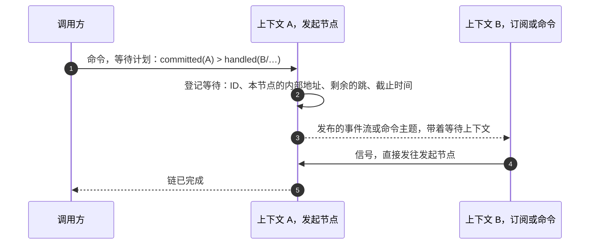

# 等待结果

发出一条命令，和知道它带来了什么，是两回事。一条命令可以被准入、被提交，然后被任意多个订阅处理，其中一些还在别的上下文里。本页说明调用方可以等待什么、默认等待什么，以及等待是怎样实现的。

## 三个阶段 {#three-stages}

| 阶段 | 已经发生了什么 |
| --- | --- |
| `ACCEPTED` | 命令通过了准入。只有写进了 Kafka 命令主题，它才是持久的。 |
| `COMMITTED` | 命令的事件已追加到日志，或者命令没有追加就有了结论：拒绝、无变化或重复。 |
| `HANDLED(subscription)` | 某个指定的订阅已处理了这次提交。这个订阅可以在另一个上下文里。 |

`SNAPSHOT` 是 `HANDLED(snapshot)` 的简写：内置的快照订阅已经写入了这次提交。订阅的种类（投影、Saga 或反应器）来自 Manifest，所以不需要各自的阶段。

## 默认等待快照 {#the-default-is-the-snapshot}

没有指定等待的命令，等待 `SNAPSHOT`。命令返回时，快照里已经是这次提交的版本，所以调用方接下来发的查询能看到自己写的东西。这正是多数调用方想要的：表单保存后展示刚保存的记录，测试发出命令后读取状态。

默认值有一点代价：回答在快照订阅处理完这次提交之后才到，而不是紧接着追加。快照订阅被停放或落后时，默认的等待会超时；这时结果会说明命令已达到 `COMMITTED`，调用方因此知道事实已经提交。关闭了快照的聚合没有快照阶段，它的默认等待是 `COMMITTED`。

需要得少的调用方可以等待 `COMMITTED` 或 `ACCEPTED`；需要得多的可以指定更后面的阶段，或者一条等待链。

## 等待一条链 {#waiting-for-a-chain}

等待计划是由跳组成的链。每一跳是一个阶段，带一个上下文，`HANDLED` 还要带一个订阅。例如：订单已提交，然后支付上下文的 Saga 已处理它，再然后那个 Saga 发出的命令已在库存上下文里提交。

在 HTTP 上，等待链是一个请求头：`Wow-Wait: handled(order/payment-saga) > committed(inventory)`，配合 `Wow-Wait-Timeout: 10s`。链上的命令通过根命令的 ID 关联起来，所以每一跳都能认出属于这次等待的命令。

等待链的规则：

- **只有 Saga 那一跳后面才能接别的跳。** 它后面的跳适用于这个 Saga 为这次提交发出的命令。投影或反应器那一跳是链的终点。
- **Saga 那一跳在它发出的每条命令都达到下一跳时完成。** Saga 的信号列出它派生的命令；它一条都没发时，这一跳立即完成。
- **提前结束的链会明说。** 如果 Saga 处理了这次提交却什么也没发（例如支付被拒），而计划在它后面还有跳，等待就在这里结束。最终结果停在实际到达的最后一跳，带着它真实的状态，标记 `chainEnded`，并把没有到达的跳列为 `pending`。它不会被报告成计划终点的成功。
- **任何地方失败都立即结束等待。** 任意一跳被拒绝或停放时，等待者立刻得到失败及其原因，而不是等到超时。
- **等待链在准入时检查。** 计划对照节点已知的 Manifest 检查；无效的计划在命令运行之前就被拒绝，而不是到超时才发现。一个计划默认最多 16 跳。

调用方接受 `text/event-stream` 时，边缘每到达一跳就发送这一跳的结果，最后一跳之后关闭流。否则它返回最后一跳的结果，或者第一个失败。

## 超时 {#timeouts}

除非请求指定了别的超时，等待在 10 秒后超时。服务给每个超时设上限，默认一分钟。

超时只说明等待者不再等了，不表示命令失败。结果报告 `wow.wait.timeout`，以及已到达的最后一跳，所以调用方知道链停在了哪里：在 `COMMITTED` 之后超时的命令，已经提交了。截止时间随命令沿链传递，过了截止时间，任何一跳都不再发信号。

## 重复 {#duplicates}

重复的请求早已提交，它后面的阶段可能早就发生过，信号也早已发出。对同一上下文里的订阅，节点检查它们的检查点和停放的聚合：检查点已越过这次提交、又没有停放这个聚合的订阅，就是已经处理过。另一个上下文里的跳没法这样检查；这时结果停在 `COMMITTED` 并标记为重复，由调用方决定怎么办。

## 等待怎样实现 {#how-a-wait-works}

等待是一种观察，不是让系统正确的一部分：信号丢了，等待者超时，事实不受影响。所以信号至多发送一次，低延迟，不存储。

- **等待在命令发出之前登记。** 后面一跳的信号可能比前面一跳的先到，例如派生命令先提交了，Saga 自己那一跳才报告。发起节点保留提前到达的信号，按链的顺序重放。
- **等待上下文随消息传递。** 它是传输段，只在等待越过 `COMMITTED` 时才写入：写在日志条目里、发往其他上下文的命令里、发布的事件流的信封里。领域代码永远看不到它。
- **信号直接发往发起节点。** 等待上下文写明了那个节点的内部地址，所以任何服务里的一跳都能一步到达它，不经负载均衡，也不经转发。节点已经不在了，调用方的连接也随之断开，信号就丢弃。
- **信号不拖慢处理函数。** 订阅在处理完一个条目之后发信号，不在它的检查点和失败处理之内。
- **信号要认证。** 信号端点只在内部端口上，绝不在公开端口上：如果信号能从外部到达，任何人都能伪造任意命令的结果。它接受服务的集群令牌或系统里另一个服务的身份。见[身份、租户与访问](./identity#the-internal-port)。
