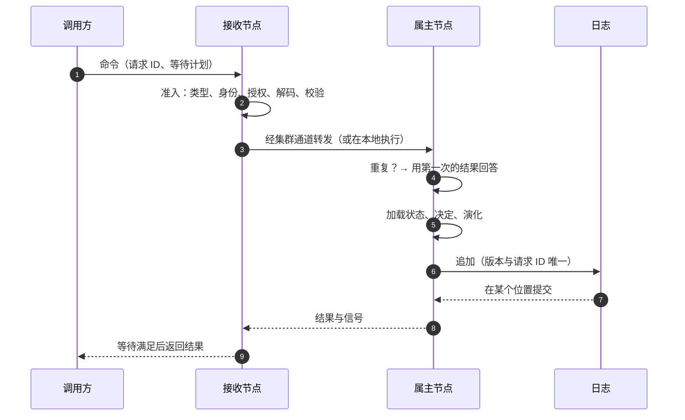

# 写：从准入到追加

命令进入服务，基于最新状态做出决定，然后要么提交事件，要么被拒绝。本页跟着一条命令走完每一步，并说明每项保证由系统的哪一部分负责。

## 准入 {#admission}

准入把一个请求变成内核可以信任的命令。它依次：

1. 找到请求指定的命令类型；
2. 确定身份：哪个聚合、哪个租户、哪个所有者和空间。每项事实只有一条规则，来源互相矛盾时拒绝请求；
3. 检查调用方是否可以执行这个动作；
4. 解码命令体并校验；
5. 让配置的转换器改写命令，但不能改变它的身份；
6. 构建命令，此后再没有东西能改它。

每个入口都以同样的方式准入：HTTP、Saga 发出的命令、从 Kafka 命令主题读到的命令、来自其他服务的同步调用。准入还把等待计划记在命令上。默认的计划一直等到快照包含这次提交，所以命令一返回，调用方就能读到自己写的东西（[等待结果](./waits)）。

还没有聚合 ID 的命令，即创建命令，在准入时得到 ID。如果同一个调用方已经用同一个请求 ID 提交过创建，准入复用那个 ID，所以重试的创建不会建出第二个聚合。

## 路由 {#routing}

路由器决定由哪个节点执行命令。

正确性不依赖这个选择。两个节点同时为同一个聚合执行命令，不可能都提交同一个版本：其中一个得到冲突，重新加载状态，再决定一次。让写入正确的不是每个聚合只有一个写者。

单写者让写入变快。如果任意节点都能执行任意命令，每个节点的缓存里只有一小部分聚合的状态，每条命令都要从存储读状态，繁忙的聚合也会频繁冲突。经集群通道多跳一次，比这些读便宜。所以命令默认是**分区路由**的：每个节点拥有日志的一部分分区，收到命令的节点若不拥有该聚合所在的分区，就把命令转发给它的属主。

| 路由器 | 做什么 | 适用场景 |
| --- | --- | --- |
| 分区（默认） | 在聚合所在分区的属主上执行命令，需要时转发 | 多个节点 |
| 本地 | 在命令到达的地方执行 | 单个节点；内存后端 |
| Kafka（按聚合类型） | 把命令写入上下文的命令主题，由分区的属主消费 | 一旦被接收就必须挺过崩溃的异步命令；吸收突发流量 |

属主接不了转发的命令时，收到命令的节点不等待，自己在本地执行：连接失败、对方回答它不拥有该分区、发往它的转发在途过多，或者不知道属主是谁（例如交接期间）。代价最多是几次冲突重试。但转发请求一旦发出，超时就**不是**在本地执行的理由。属主可能还在决定，在另一个节点上再决定一次，会重复决定函数做过的 I/O。这时调用方得到超时，再用同一个请求 ID 重试。

## 执行 {#execution}

在执行节点上，每个有在途命令的聚合有一条车道。它的命令按到达顺序逐条执行。车道之间互不阻塞：等待 I/O 的命令只拖住它自己的聚合。车道的队列有上限，节点上所有在途命令也有上限。任一个满了，命令立即以繁忙（429）被拒绝，而不是排队等待。节点关闭时拒绝新命令，并把在途的命令执行完。

## 在决定之前发现重复 {#duplicates-are-found-before-deciding}

决定可能做 I/O，所以重复的请求不能再运行一次决定。决定之前，内核检查这个请求 ID 是否已经在这个租户和聚合类型下提交过。如果提交过，就用第一次提交的结果回答这条命令，并标记为重复，什么都不决定。

内核在每个缓存的聚合状态旁边，保存该聚合最近提交的请求（从日志推出，默认 32 个）。在其中找到的请求不需要额外读取。这个集合不能确定回答时，内核去问存储。真正的保证仍然是请求 ID 上的唯一键：不管集合怎么说，一个请求至多提交一次。

日志还记录每个请求 ID 用于哪种命令类型。同一个请求 ID 用于不同的命令类型会被拒绝（`wow.command.request-id-reused`）；用于相同的类型则视为重试。所以一个请求 ID 属于一个业务请求，客户端要为每个请求生成新的 ID。

## 内核 {#the-kernel}

对每条命令，内核：

1. 取得状态：从缓存，或从快照加上它之后的日志条目，新聚合则用初始状态；
2. 检查守卫：聚合按命令的创建语义存在或不存在、没有被删除、在调用方的作用域内；
3. 运行决定：先是命令函数，然后是 after 钩子；
4. 用新事件演化状态；
5. 追加事件。

追加报告版本冲突时，内核丢掉缓存的状态，重新加载，再决定一次。追加的结果未知时，例如提交期间连接断开，内核查看版本来判断它是否已经提交。

**追加成功之后，什么都不能撤销这次提交。** 调用方取消、HTTP 连接断开、超时，都不能阻止追加之后的事情：把状态放回缓存、为订阅记录状态视图、发送完成等待的信号。

## 信号 {#signals}

提交成功时，执行节点向命令来自的节点发信号：同一节点时在进程内，命令被转发过时经集群通道。之后的阶段，例如快照写入、Saga 处理这次提交，直接向发起节点发信号。见[等待结果](./waits)。

## 集群通道 {#the-cluster-channel}

一个服务的节点之间，通过内部端口上的一条通道通信。它承载转发的命令和属主对每条命令的回复。完成等待的信号也到达同一个内部端口。

成员关系和分区归属来自存储里的租约，而不是 ZooKeeper、Kafka 消费组或注册中心。每个节点都用最高随机权重（HRW）算出同样的分区分配，并据此接管或让出分区。节点加入或离开时，只有大约 N 分之一的分区移动。

计划内的交接，例如扩缩容、滚动升级或优雅关闭，是有序的：旧属主不再接收该分区的新命令，在时限内执行完在途的命令，保存它的订阅的检查点，然后释放租约。新属主从空缓存开始，随着命令到达从快照加载状态。

分区的属主可能暂停、失去租约，醒来时仍以为自己拥有这个分区。不需要 fencing 这也是安全的：它的命令由版本唯一键把关，它的订阅的副作用是幂等的（[订阅、失败与重放](./subscriptions)）。

这条通道只在一个服务之内。通道上的请求必须带着服务的集群令牌，内部端口绝不暴露到集群之外（[身份、租户与访问](./identity#the-internal-port)）。
