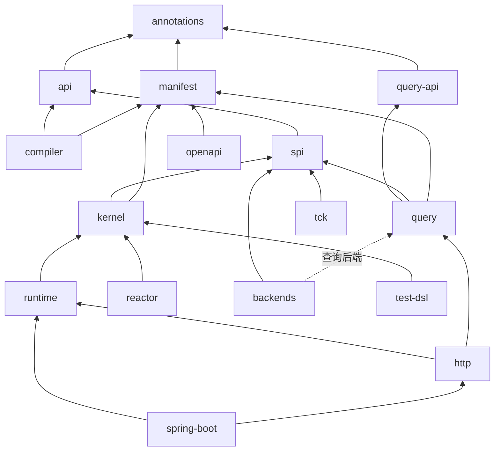

# 代码库导览

Wow 仓库包含框架的 JVM 模块、TypeScript 包、平台服务、eShop 示例、文档站点和 Agent Skills。`main` 只包含 Wow 10：9.x 线位于 `v9` 分支。本页是地图；[CONTRIBUTING.md](https://github.com/Ahoo-Wang/Wow/blob/main/CONTRIBUTING.md) 说明怎样构建以及怎样提出改动。

## 布局 {#layout}

| 目录 | 包含 |
| --- | --- |
| `api/` | `:annotations`，稳定性标记（`@InternalWowApi`、`@ExperimentalWowApi`、`@WowSpi`）；`:api`，编程模型（注解、`Decision`、`DecideScope`、`StateEvent`）；`:manifest`，以普通数据表示的契约；`:query-api`，查询协议及其 Kotlin DSL |
| `compiler/` | `:compiler`，写出模型和 Manifest 片段的 KSP 处理器；`:gradle-plugin`，插件 `me.ahoo.wow`；`:manifest-tools`，补全并合并片段 |
| `core/` | `:spi`，后端实现的端口；`:kernel`，decide、evolve 和 append 循环；`:runtime`，节点（准入、路由、集群通道、执行器、订阅、等待）；`:reactor`，Reactor 适配器 |
| `query/` | `:query`，查询引擎；`:query-tck`，每个查询后端都要通过的契约 |
| `backends/` | 每种技术一个模块：`:postgres`、`:mongo`、`:elasticsearch`、`:clickhouse`、`:kafka` |
| `edge/` | `:http`，来自 Manifest 的路由；`:openapi`；`:client`，类型化的 HTTP 客户端；`:cosec`；`:opentelemetry` |
| `host/` | `:spring-boot`，组合节点的自动配置 |
| `extensions/` | `:cosid`、`:models` |
| `migration/` | `:migrate-data`，导入 9.x 事件流 |
| `test/` | `:test-dsl`（制品 `wow-test`）、`:tck` 和 `:tck-containers`、`:architecture`、基准测试、覆盖率报告 |
| `bom/` | `:bom`（`wow-bom`）和 `:wow-dependencies` |
| `platform/` | ops 服务与控制台、视图存储、分析目录 |
| `example/` | eShop 的五个上下文及其 e2e 测试、快速开始、Java 冒烟测试 |
| `typescript/` | npm 包及其 Storybook，有自己的规则，见 `typescript/AGENTS.md` |
| `documentation/` | 站点（`docs/`）和设计记录（`designs/`） |
| `skills/` | 六个 Agent Skills |

Gradle 项目名不带 `wow-` 前缀（`core/kernel` 中的 `:kernel`）；构建把每个项目发布为 `wow-<name>`。

## 依赖方向 {#dependency-direction}

权威的列表是 `:architecture` 中的 `ArchitectureRules.ALLOWED_PROJECT_DEPENDENCIES`。它的测试保证的规则包括：

- `:api`、`:query-api` 和 `:manifest` 除了本身无依赖的 `:annotations` 之外没有运行时依赖，`:api` 不使用任何 JSON 库。
- 内核对集群、订阅、等待或驱动一无所知；运行时只依赖协程和 Jackson，不依赖 Spring、Reactor 或驱动。
- 后端依赖 `:spi`，提供查询时还依赖 `:query`；后端之间从不相互依赖。
- Reactor 只出现在 `:reactor` 和 WebFlux 边缘，只有 `:spring-boot` 依赖 Spring Boot。
- eShop 的 domain 和 API 模块从不触及运行时，每个应用都针对公开 API 编译：没有哪个选择使用 `@InternalWowApi`。
- 生产源码中没有兼容代码：没有 `@Deprecated` 声明、没有 `compat(...)` 标记、没有 9.x 类型或已删除的 9.x 项目。

`./gradlew :architecture:test` 运行它们，`:check` 包含它。

## API 级别 {#api-levels}

已发布模块的每个公开声明，都是公开、`@ExperimentalWowApi`、`@WowSpi` 或 `@InternalWowApi` 之一（[API 级别](../reference/api-levels)）。只有自己模块使用的声明是 `internal`；Wow 的模块之间共享但不做任何承诺的声明是 `@InternalWowApi`。每个已发布模块的 ABI 转储 `<module>/api/<module>.api` 记录前三个级别；公开签名改变而转储没有改变时，`:check` 失败：`./gradlew updateKotlinAbi` 会重写转储，差异与改动一起审查。

## 下一步 {#where-to-go-next}

- [测试层次](./testing)：改动需要哪些测试，以及 CI 关卡。
- [编写后端](./backends)：SPI 及其契约测试。
- [设计记录](./design-records)：代码为什么是现在的样子。
- [文档治理](./documentation)：每类文档放在哪里。
