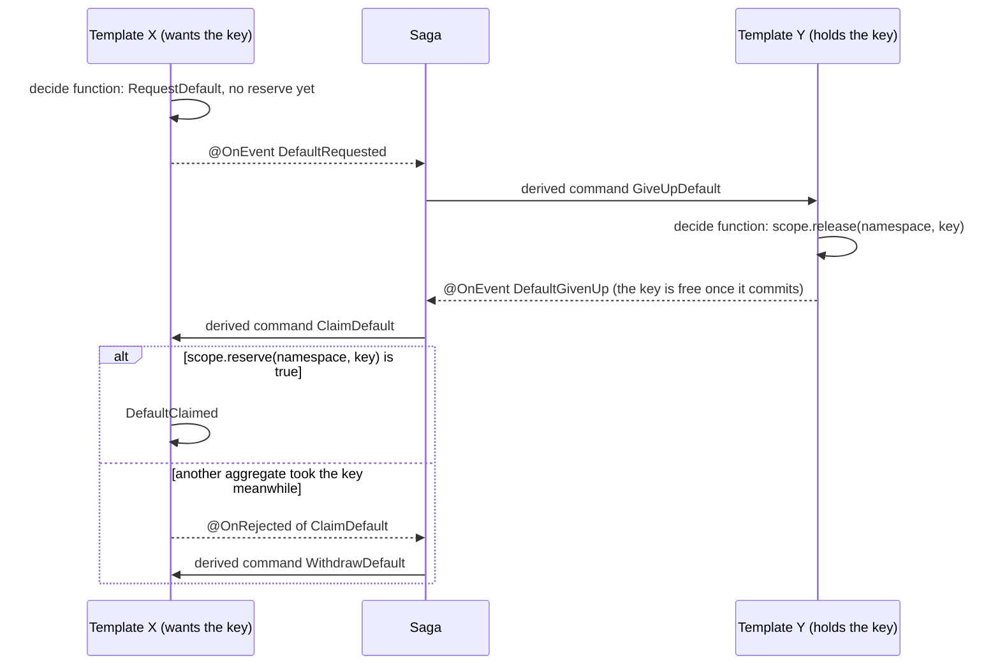

# 跨聚合的唯一键

聚合独自做出决定，所以它看不到另一个聚合是否已经用了某个值。当一个值必须在聚合之间唯一时，例如用户名、邮箱地址或品牌名，就由决定来预留它。一个预留同一时刻只被一个聚合持有，与聚合的事件一起提交；事件没有写入时，或者决定是拒绝时（即使是提交了事件的拒绝），就放弃。本页让 eShop 的品牌名保持唯一。

## 预留一个键 {#reserve-a-key}

`DecideScope.reserve(namespace, key)` 在 `namespace` 中为正在做决定的聚合预留 `key`，另一个聚合持有它时返回 `false`。品牌在取名时预留它的名字：

<!-- sample: examples/eshop/catalog/catalog-domain/src/main/kotlin/me/ahoo/wow/example/eshop/catalog/domain/brand/Brand.kt#take -->

```kotlin
/** Takes [name] for this brand, or rejects the command when another brand holds it. */
private suspend fun take(name: String, scope: DecideScope) {
    if (!scope.reserve(CatalogNames.BRAND_NAMES, CatalogNames.key(name))) {
        reject(Rejections.NAME_TAKEN, "Another brand is named \"${name.trim()}\".")
    }
}
```

- **命名空间**指明什么是唯一的：`eshop-catalog.brand-name`。
- **键**就是这个值，按唯一性的含义规范化：catalog 会去掉名字两端的空白并转成小写，所以 "Contoso" 和 " contoso " 是同一个名字。
- 唯一性的**范围**是聚合的类型和租户：另一个租户可以持有同一个键，另一种类型的聚合也可以，所以品牌和分类可以同名。`reserve(namespace, key, ReservationTenancy.SYSTEM)` 让一个键在该类型的所有租户之间唯一。
- `reserve` 是一个 `suspend` 函数，所以预留键的决定函数要用 Kotlin 写。

## 预留会经历什么 {#what-happens-to-a-reservation}

1. `reserve` 为这个聚合把键记为**待定**，并带一个过期时间。
2. 决定的事件追加之后，预留被**确认**，除非决定是拒绝。
3. 当确定事件没有追加时（决定被拒绝、版本冲突后命令重新决定，或者决定失败），这次尝试**放弃它的预留**。进程先崩溃时，就让预留过期。

聚合已经持有的键，无论某次尝试做了什么都保持持有，所以重新决定一条命令永远不会丢掉它。预留聚合已经持有的键的决定，会为它自己的提交再次确认这个键，这样较早一次重命名迟到的释放永远不会释放它：这在命令提交时多一次对预留存储的写入，所以每次更新都预留的领域会在每条命令上付出这次写入。在值改变时才预留键。

## 释放一个键 {#release-a-key}

值改变时释放它旧的键。`DecideScope.release(namespace, key)` 在事件追加之后释放聚合持有的一个键：释放与事件一起提交，事件没有追加时什么都不释放。重命名在同一次决定中预留新键、释放旧键：

<!-- sample: examples/eshop/catalog/catalog-domain/src/main/kotlin/me/ahoo/wow/example/eshop/catalog/domain/brand/Brand.kt#rename -->

```kotlin
suspend fun onCommand(command: RenameBrand, scope: DecideScope): BrandRenamed? {
    if (command.name.trim() == state.name) return null
    take(command.name, scope)
    // A new spelling of the same name keeps its key.
    if (CatalogNames.key(command.name) != CatalogNames.key(state.name)) {
        scope.release(CatalogNames.BRAND_NAMES, CatalogNames.key(state.name))
    }
    return BrandRenamed(command.name.trim())
}
```

删除聚合不会释放它的任何键，所以恢复的聚合仍持有它们。应当让出某个键的删除，要在删除之前，在聚合自己的命令里释放它。

## 把键移给另一个聚合 {#move-a-key-to-another-aggregate}

预留属于正在决策的聚合，并随这个聚合的事件一起提交。`reserve` 和 `release` 只为正在决策的聚合起作用：一次决策只释放它的聚合持有的键，也没有任何决策能接管另一个聚合持有的键。**在一个聚合内**，改键是一次决策：预留新键并释放旧键，如上面的改名所做。**在聚合之间**，按持有者更换期间可以发生什么来选做法：

| 这次更换必须做到 | 做法 |
| --- | --- |
| 可以输给并发的请求，并且有一段时间没有聚合持有这个键 | [经 Saga 交接](#handover-through-a-saga)：键仍是各聚合自己的预留 |
| 任何时刻都有持有者，中间没有别的聚合能拿走它 | [把键建成一个独立的聚合](#key-held-as-an-aggregate)，即槽位：槽位的一次提交就换掉持有者 |

为什么持有者不能在自己的决策里把预留交给另一个聚合：那样键就由一个从未为它提交过的聚合持有，接收方日志里一次迟到重放的释放就可能放掉它，而不存在、已删除或拒绝接收的接收方永远交不回它。要让这件事成立，还需要接收方自己的一次提交，那又回到了交接，只是多了一个新的存储操作；而槽位已经能在一次提交里换掉持有者。

### 经 Saga 交接 {#handover-through-a-saga}

想要这个键的聚合记下它的请求；Saga 让持有者交出键，即发一条持有者的命令，它的决策释放这个键；这条命令提交之后，再发一条请求方的命令去预留它。在释放与认领之间，别的聚合可能拿走这个键，所以认领可能被拒绝，Saga 随后撤回请求方的请求。交接要多出自己的命令和事件，切换是最终一致的：有一段时间没有任何聚合持有这个键。

`RequestDefault`、`GiveUpDefault`、`ClaimDefault` 和 `WithdrawDefault` 是这个例子（「每个租户至多一个默认模板」）自己的命令；图里的注解和调用是 Wow 的：



从聚合出发的每条箭头都是一次提交：它的事件是 Saga 的输入，派生出的命令由它自己的目标决定，且只决定一次（[编写 Saga](./sagas)）。交接进行时，键在 Y 的释放提交之前由 Y 持有，之后在 X 的认领提交之前没有人持有：这段时间里没有默认模板，同类型的任何别的聚合都可能拿走这个键，认领因此可能被拒绝。被拒绝时 Y 已经交出了键，键属于拿走它的聚合：Saga 撤回 X 的请求，选新的默认模板留给一条新的命令。必须看到切换完成的读取方，要等认领的提交，而不是第一条命令的提交。

### 把键建成一个独立的聚合 {#key-held-as-an-aggregate}

当键一刻也不能空出时，把它建成一个聚合：一个**槽位**，id 就是键，状态写明持有者。这样更换持有者就是槽位的一条命令，按它的状态决策、只提交一次，所以没有哪一刻没有持有者，中间也没有别的聚合能拿走这个键。这里不涉及预留：聚合的 id 在它的类型和租户内唯一，所以每个键只有一个槽位。同时发来的两次选择按槽位的版本排序：后一次在前一次设定的持有者上重新决策，并取代它。

对于「每个租户、每种类型至多一个默认模板」，槽位的 id 是模板的类型（`invoice`），租户是模板所在的租户，`ChooseDefaultTemplate` 是唯一更换持有者的命令：

<!-- sample: test/test-dsl/src/test/kotlin/me/ahoo/wow/test/DefaultTemplateSlotSpecTest.kt#slot -->

```kotlin
/** Makes [templateId] the default template of its [kind]: the command goes to the slot whose id is the kind. */
@AllowCreate
data class ChooseDefaultTemplate(@AggregateId val kind: String, val templateId: String)

/** [templateId] is the default template of the slot's kind, in place of [previous] (null when there was none). */
data class DefaultTemplateChosen(val templateId: String, val previous: String?)

class DefaultTemplateState {
    /** The default template of the kind: the truth a query reads. */
    var templateId: String? = null
        private set

    fun onSourcing(event: DefaultTemplateChosen) {
        templateId = event.templateId
    }
}

/** One per tenant and kind: its id is the kind, and its tenant the templates'. */
@AggregateRoot(ownership = Ownership.TENANT)
class DefaultTemplate(private val state: DefaultTemplateState) {
    fun onCommand(command: ChooseDefaultTemplate): DefaultTemplateChosen? =
        if (command.templateId == state.templateId) {
            null
        } else {
            DefaultTemplateChosen(command.templateId, previous = state.templateId)
        }
}
```

模板经一个 Saga 跟上槽位：新的默认模板被标记，被它取代的那个被取消标记，各由自己的命令完成。

<!-- sample: test/test-dsl/src/test/kotlin/me/ahoo/wow/test/DefaultTemplateSlotSpecTest.kt#saga -->

```kotlin
/** A command of the template aggregate: whether the template is its kind's default, as its own state shows it. */
data class MarkDefault(val isDefault: Boolean)

/** Lets the new default and the one it replaced follow the slot. */
@Saga
class DefaultTemplateSaga {
    @OnEvent
    fun onDefaultTemplateChosen(
        event: StateTypedEvent<DefaultTemplateState, DefaultTemplateChosen>,
    ): List<CommandRequest<MarkDefault>> {
        val tenantId = event.ref.tenantId
        return listOfNotNull(
            MarkDefault(true).toCommandRequest(to = TEMPLATE.ref(tenantId, event.event.templateId)),
            event.event.previous?.let { MarkDefault(false).toCommandRequest(to = TEMPLATE.ref(tenantId, it)) },
        )
    }

    companion object {
        /**
         * The templates' aggregate type. In a service the api's contract names it for the command's class, and
         * `toCommandRequest(templateId)` is enough.
         */
        val TEMPLATE = AggregateType("docs", "template")
    }
}
```

- **真相是槽位的状态。** 查询某种类型的默认模板时读槽位，以类型为它的 id（[读取状态](./reading-state)），而不是读模板上的标记，它们会稍晚才跟上。要发给「默认模板」的命令，先读槽位。
- **槽位看不到模板**，任何聚合都看不到别的聚合：选择一个模板之前先确认它存在，模板不在了时，由它自己对 `MarkDefault` 的拒绝来说明。
- **键是聚合 id**，所以要遵守[聚合 ID 的规则](../reference/http#aggregate-ids)：可能含 `/`、`;` 或 `\`，或编码后超过 256 个字符的键，要编码或取哈希后再作为 id。

两者都像任何聚合和 Saga 一样测试（[测试领域代码](./testing)）：

<!-- sample: test/test-dsl/src/test/kotlin/me/ahoo/wow/test/DefaultTemplateSlotSpecTest.kt#slot-spec -->

```kotlin
aggregateSpec(slot, id = "invoice") {
    given(DefaultTemplateChosen("template-1", previous = null))
    whenCommand(ChooseDefaultTemplate("invoice", "template-2")) {
        expectEvents(DefaultTemplateChosen("template-2", previous = "template-1"))
        expectState { templateId.assert().isEqualTo("template-2") }
    }
    // Choosing the default again changes nothing.
    whenCommand(ChooseDefaultTemplate("invoice", "template-2")) { expectUnchanged() }
}
```

<!-- sample: test/test-dsl/src/test/kotlin/me/ahoo/wow/test/DefaultTemplateSlotSpecTest.kt#saga-spec -->

```kotlin
sagaSpec(sagaBindings) {
    givenAggregate(slot, "invoice", DefaultTemplateChosen("template-1", previous = null))
    whenEvent(DefaultTemplateChosen("template-2", previous = "template-1")) {
        expectCommands(
            DefaultTemplateSaga.TEMPLATE.ref(DEFAULT_TENANT, "template-2") to MarkDefault(true),
            DefaultTemplateSaga.TEMPLATE.ref(DEFAULT_TENANT, "template-1") to MarkDefault(false),
        )
    }
}
```

## 跨聚合类型唯一的键 {#a-key-unique-across-aggregate-types}

一个键只在同一类型的聚合之间唯一。当一个值必须跨类型唯一时，例如用户和组织共用的电子邮件地址，就把这种唯一性建模为一个独立的聚合，如[上面的槽位](#key-held-as-an-aggregate)：以键为 id 的聚合（或持有这些键的聚合）由其他聚合通过它的命令来认领，由它自己的决策说明每个键归谁。

## 预留保存在哪里 {#where-reservations-are-kept}

一个聚合类型的预留与它的日志保存在一起，位于 `wow.aggregates.[<context>.<aggregate>].log.store` 指定的存储（或默认的日志存储）中，每个类型有自己的表或集合：`wow_reservation__<context>__<aggregate>`。因此确认与它所属的提交一样持久。它们取代了 9.x 的 `PrepareKey`；migrate-data 会导入 9.x 已确认的键（[迁移数据](../migrate/data)）。

## 测试 {#test-it}

`aggregateSpec` 对着一个内存存储运行预留。`givenReservation` 先为另一个聚合预留一个键，这样测试可以检查键被占用时命令会被拒绝；`holds(namespace, key)` 说明被测的聚合是否持有某个键：见[测试领域代码](./testing)。
