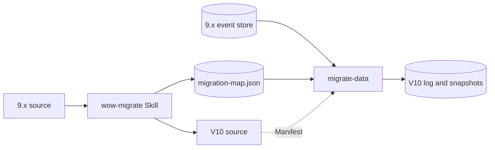

# 从 9.x 迁移

Wow V10 是一次重新设计，而不是原地升级。它保留了 9.x 服务的核心，即聚合、命令、事件、Saga、投影和查询，重建了它们底下的机制。本页说明有哪些变化、迁移的路径是什么样子，以及从哪里开始。

## 有哪些变化 {#what-changes}

| 主题 | 9.x | V10 |
| --- | --- | --- |
| 发布事件 | 先追加，再发布到总线：两步之间崩溃，所有观察者都会丢失这个事件 | 没有事件总线：订阅从自己的检查点读日志，崩溃后接着读 |
| 事件通道 | 领域事件和状态事件走两条总线，彼此无序 | 一份日志；每次提交之后的状态随它的事件一起传递 |
| 状态 | 可变对象，出错时重新加载 | 可变（默认）或不可变；内核保证原子性和每个版本的稳定视图 |
| 绑定 | 运行时反射 | 由编译器在构建期生成 |
| 并发模型 | Reactor | 协程；Reactor 写法的处理函数经适配模块接入 |
| 失败 | 默认记日志后确认；通过补偿服务重试 | 记进失败台账；停放出错的聚合并重试，不跳过任何东西 |
| 读模型 | 快照就是读模型；投影不能重建 | 快照仍是默认读模型；每个读模型都能从日志重建 |
| 契约 | 带 `x-wow-*` 扩展的 OpenAPI | Manifest，路由、OpenAPI、客户端和视图都从它推出 |
| 身份 | 租户和所有者在路由和命令字段里 | 在准入时决定的一个聚合引用；租户、所有者和空间来自已认证的调用方 |
| 兼容 | 冻结面与兼容债 | 没有兼容代码：迁移层一次性转换 |

[架构总览](../concepts/)从第一性原理解释 V10 的设计；[V10 中的 9.x 能力](./capabilities)列出每项 9.x 能力的去向。

## 迁移的路径 {#the-way-across}

迁移只发生一次、只在一处，不留任何残余。V10 本身不包含 9.x 代码：9.x 的类型名、注解、配置键、路由和存储格式只存在于迁移工具里。

1. **源码。** `wow-migrate` 这个 Agent Skill 改写服务的 Kotlin 源码、配置和客户端。改写是语义上的，不是机械替换：错误处理函数变成拒绝或 Saga，处理器变成订阅，身份离开命令体。服务能编译、领域测试通过，改写才算被接受。在重命名命令和事件的同时，Skill 写出 `migration-map.json`，记录每一处名字或形状的变化。
2. **数据。** `migrate-data` 工具对照 9.x 存储里实际有什么、对照 V10 的 Manifest 检查映射文件，把事件历史导入 V10 日志，追上 9.x 后续的写入，并把能比对的每个聚合与它的 9.x 快照比对。重建出的状态与 9.x 一致，也证明了改写后的演化函数是对的。步骤见[迁移数据](./data)。
3. **切换。** 导入和比对期间，9.x 照常提供服务。切换是一次蓝绿切换：让 9.x 停止写入，让工具追平，比对，把流量切到 V10。自定义投影由它们的订阅重建，不迁移。

数据这一侧遵守两条规则。**什么都不猜：** 映射文件没有交代的 9.x 事件类型、命令、预留键或失败的执行，会在工具写任何东西之前让它停下。**不接受无法解释的差异：** 比对报告的每一类差异，要么是已知的 9.x 缺陷，要么是有意的变化，并且在切换之前有人签字确认。

## 你需要什么 {#what-you-need}

- **从 9.x 的最后一个次版本开始。** 支持从 9.x 的最后一个次版本迁移到 10.0。先在 9.x 之内升级。
- **9.x 的 MongoDB 事件存储。** 数据工具读取 9.x 的 MongoDB 存储。使用 9.x Redis 或 Elasticsearch 事件存储的服务，先把数据迁到 9.x 的 MongoDB 存储。
- **Gradle。** V10 的编译期绑定在 Gradle 中经 KSP 和 Wow Gradle 插件运行。不支持 Maven 构建。
- **JDK 21。**

## 工具支持多久 {#how-long-the-tools-are-supported}

迁移工具在整个 10.x 期间维护，在 11.0 中移除。下一个主版本会带来它自己从 10.x 迁移的方式。

9.x 线在 `v9` 分支上维护，它的文档发布在 `/9.x/` 下。
