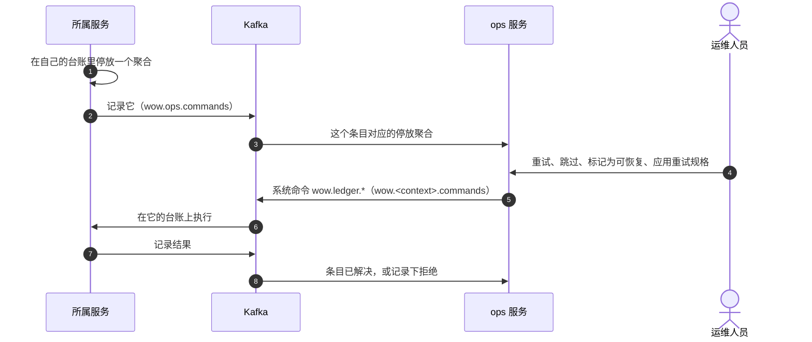

# ops 服务与控制台

订阅在某个聚合上一再失败时，会把这个聚合停放在它所在服务的失败台账里（[订阅、失败与重放](../concepts/subscriptions#failures-park-one-aggregate)）。ops 服务把所有服务的台账汇集到一处，运维人员在它的控制台里查看停放了什么、决定怎么处理。本页说明它们怎样协作、怎样部署，以及怎样使用。

## 它们怎样协作 {#how-it-fits-together}



- **台账及其重试都留在它的服务里。** 停放必须和它旁边的检查点一样可靠，所以每个服务把失败台账保存在自己的存储里，并自己重试停放的聚合，不论是否部署了 ops 服务。拥有条目所在分区的节点每 10 秒查找到期的重试（`wow.subscription.parked.scan-interval`）。一个条目默认重试 10 次（`max-retries`），第一次在失败 3 分钟后（`initial-backoff`），之后每次间隔是前一次的两倍。一次重试认领它的条目 2 分钟（`claim-ttl`），使别的节点（例如分区的下一个所有者）在此期间不会再次开始它；认领并不取消任何东西。某个订阅自己的取值写在 `wow.subscriptions.[<context>.<processor.function>].parked.*` 下（[停放的聚合](../guide/failures#parked-aggregates)）。ops 服务什么也不重试：它汇总每个服务的停放条目，是运维人员对它们执行操作的地方，不是失败存放的地方。
- **服务发布它们的台账。** 服务在停放时、重试用尽时、运维人员对条目执行操作之后，以及每 30 秒一次的扫描中（`wow.ops.publish.interval`），把每个条目作为命令发给 ops 上下文，所以 ops 服务在故障之后能追上来。ops 服务部署后，服务会自行开始发布：`wow.ops.publish.enabled` 取默认的 `auto` 时，只要它的主题传输（Kafka，或开发中的内存主题）上存在 ops 命令主题（由 ops 服务创建）就发布，并在启动时和每个 `wow.kafka.topics.partition-refresh`（30 秒）检查一次。开始时它记录 `ops takes the failure ledger now: <service> publishes it (wow.ops.publish).`，主题消失时记录 `ops does not take the failure ledger: <service> stops publishing it.`。没有传输时，`auto` 什么也不发布；`true` 不论检查结果都发布，没有传输时拒绝启动；`false` 从不发布。
- **ops 从不自己动手。** 运维人员的操作记录在条目上，由 ops 的 Saga 以台账的系统命令 `wow.ledger.*` 之一，发到所属服务的命令主题上。所属服务在自己的台账上执行它，并记录结果。发布台账的服务会自行从命令主题接收这些命令，即使它在那里不接收任何其他命令（`wow.kafka.command-intake.enabled` 关闭）：它的订阅 `wow.ledger.commands` 只执行台账的命令，从主题末尾开始读取。它只接受来自 `wow.ops.publish.context` 所指上下文（默认为 `ops`）的 Saga 的这些命令，对其他来源会发出警告。

ops 服务里的每个条目，是一个订阅里的一个停放的聚合，带有它的状态：

| 状态 | 含义 |
| --- | --- |
| `scheduled` | 已停放；所属服务会自动以退避重试它。 |
| `exhausted` | 重试耗尽：自动重试已用完；等待运维人员处理。 |
| `unrecoverable` | 被标记为不值得自动重试，或者它的来源已不再保留它停放时的位置，只能跳过。 |
| `resolved` | 不再停放：已重试成功，或已跳过。只有 ops 服务显示它；所属服务里已没有这个条目。 |

## 部署 {#deploy-it}

ops 服务是一个运行在 MongoDB 和 Kafka（或 PostgreSQL）上、位于 CoSec 之后的 Wow 服务，它以静态文件提供控制台。[`deploy/ops`](https://github.com/Ahoo-Wang/Wow/tree/main/deploy/ops) 里有两个节点的 Kubernetes 清单，做法与 eShop 的服务相同（[部署模型](./topology)）：

1. 构建包含控制台的镜像，或使用已发布的镜像。
2. 准备 MongoDB 和 Kafka；改用 PostgreSQL 时，加上清单的 `postgres` 组件。
3. 创建 ops 上下文拥有的主题：`wow.ops.commands`、`wow.ops.receipts` 和 `wow.ops.parked.state`。命令主题的分区数与 ops 上下文的日志完全相同。
4. 把 CoSec 网关放在前面，让控制台和 ops 路由都经过它：网关校验每个运维人员的访问令牌，服务读取网关转发的身份（`CoSec-Identity`），自己不持有密钥（[保护部署](./security#put-the-gateway-in-front)）。

然后，同一 Kafka 上的每个服务会在 ops 命令主题出现后的 `wow.kafka.topics.partition-refresh` 之内自行开始发布台账，并补发期间停放的条目；不应出现在控制台里的服务设置 `wow.ops.publish.enabled: false`。运维人员的操作从每个所属服务自己的命令主题到达，发布台账的服务会自行为它们读取这个主题。

## 谁能做什么 {#who-may-do-what}

运维人员用 CoSec 访问令牌登录控制台。服务从网关校验过的身份中读取运维人员的租户、主体标识和角色：

<!-- sample: platform/ops/ops-server/src/main/resources/application.yaml#roles -->

```yaml
wow:
  cosec:
    mode: gateway
    # The operators and viewers, tenant-level callers (their scope has no owner): an operator acts on the entries, a
    # viewer reads them, and a principal with neither role reads nothing (403 wow.auth.forbidden). An entry is its
    # tenant's, so no caller's owner restricts its reads: the roles do. The services' ledgers publish to Wow's
    # default tenant, (0), which a principal of CoSec's default tenant is in.
    tenant-level:
      roles: ops.operator, ops.viewer
```

- `ops.operator` 读取条目并对它们执行操作。
- `ops.viewer` 只读取条目。
- 两个角色都没有的主体什么都读不到：它对条目的查询和状态读取都返回 403 `wow.auth.forbidden`。没有有效令牌的请求返回 401，控制台随即退出登录。

各服务的台账发布到 Wow 的默认租户 `(0)`。CoSec 自己决定 ops 服务的请求、并设置 `wow.cosec.authorizer.enabled: true` 时（不是在网关之后，那里服务没有 CoSec 的决定），改由 CoSec 的文档而不是角色来决定谁能读取条目、谁是运维人员，读取按查询路由的路径判定，每个操作按它命令的动作判定：`parked/<id>` 上的 `ops:Retry`、`ops:Skip`、`ops:MarkRecoverable` 与 `ops:ApplyRetrySpec`（[动作名称](./security#action-names)）。自己提供运维路由的服务（`/wow/ops/parked`，见下文）按它的 `wow.ledger.*` 命令判定这些路由。为你暴露的每条路由编写策略。无论由谁决定，任何调用方都不能发送记录命令（`ops.parked.RecordParked`、`RecordResolved`、`RecordActionRefused`）：只有各服务的台账和 ops 的 Saga 会产生它们。

## 使用控制台 {#work-with-the-console}

- **概览。** 首页：一个时间窗口内和总共停放了多少条目，多少需要处理、计划重试、不可恢复或已解决；停放条目随时间的变化；排名靠前的失败聚类、上下文和失败的订阅。点击每个数字都会打开它所统计的队列。每 15 秒刷新一次。
- **队列。** 以记录视图展示的停放条目：_需要处理_（重试耗尽或不可恢复）、_计划重试_（有到期的重试）、_不可恢复_、_已解决_、_停放中_ 和 _全部_，以及针对全部停放条目的分析：_按上下文统计_、_失败集群_（按错误类型、上下文和订阅分组）、_失败最多的订阅_ 与 _停放趋势_。每个字段都可以过滤、排序和分组。ops 服务不保存视图，所以运维人员保存的视图只留在这个浏览器里：别人看不到，控制台也不提供它的链接。
- **详情。** 一个条目：所属服务记录的错误类型和消息、聚合及其停放时的版本、按重试规格进行的尝试、最近一次运维请求及其解决方式，然后是它的历史时间线。
- **操作。** 带原因重试、带原因跳过、标记为可恢复、应用重试规格（条目的最多重试次数、首次退避与认领租期，时长写作 `PT3M` 或 `3m`；负数次数或无法识别的时长，控制台在发送前就拒绝）。每个操作都要求确认，可以作用于一个条目或一组选中的条目。ops 服务记录下请求后，控制台说明它已发送给所属服务；所属服务处理的结果随条目的下一条记录到达，即已解决的条目或新的状态，或者作为连同错误码一起显示的拒绝。已解决的条目不接受操作。重试或跳过会指明控制台显示的那次停放：如果聚合在此期间已被解决并再次停放，ops 服务以 `ops.parked.stale` 拒绝它，所属服务以 `wow.ledger.stale` 拒绝它，所以操作永远不会跳过无人看过的事件。重新读取条目，按它现在显示的内容操作。

重试会从聚合停下的版本开始重新读取它的事件，再次交给订阅，包括订阅还没处理到的事件。跳过则越过它们。只有当你确定订阅对这些事件的效果不再需要，或者你已用别的方式弥补时，才选择跳过。

控制台不显示堆栈信息：服务把失败记录为它的异常类型和消息，这也是运维人员分组和搜索所依据的东西。

## 不用 ops 服务 {#without-the-ops-service}

单个服务也可以公开它自己的停放条目：`wow.http.ops.enabled: true` 在它的公开端口上提供 `/wow/ops/parked`，带有同样的四个操作：`retry`、`skip`、`mark-recoverable` 与 `apply-retry-spec`。它默认关闭。条目的路径先以订阅的键 `<context>.<processor.function>` 指明订阅，再指明聚合：`/wow/ops/parked/{subscription}/{context}/{aggregate}/{tenant}/{id}`。读取按系统命令 `wow.ledger.Read` 授权，每个操作按它的 `wow.ledger.*` 命令授权，由应用的 `CommandAuthorizer` 决定：没有它时，读取和操作都以 403 拒绝，宿主会在启动时警告。

- **跳过要指明它跳过的那次停放**：请求体为 `{"failedAt": <纪元毫秒>}`，即运维人员读到的条目的 `failedAt`，没有它的跳过以 400 拒绝。跳过会丢弃停放的内容，所以它必须是有人看过的那次。
- **重试可以不带 `failedAt`**，作用于条目现在的停放，因为它只是把停放的事件再交给订阅一次。
- **两者都会以 409 `wow.ledger.stale` 拒绝**，如果它指明的条目在此期间已被解决并再次停放。
- **在哪里执行。** 重试或跳过在本节点执行时回答 200，结果为 `resolved` 或 `parked`。在不拥有条目分区的节点上，它把请求留在条目上并回答 202，结果为 `requested`：所有者在下一次扫描停放条目时执行它，默认每 10 秒扫描一次。标记条目与应用重试规格立即写入台账；所有者从下一次扫描起按它们重试。

线上的取值都是小写，与 Wow 的其他地方一样：结果，以及条目的 `status`、`request` 和 `recoverable`。

同一个开关还提供 `GET /wow/ops/subscriptions`，节点各订阅的只读视图：每个订阅按它的键，带有它的组、来源（`log` 或 `topic`）、停放数，以及每个分区的位置；在本节点运行的分区还有头部位置、滞后，以及是否暂停或限流。它还列出各组在已没有订阅的名字下保存的检查点（`orphans`），也就是改名留下的东西（[改名与回卷](#rename-and-rewind)）。这个视图属于整个服务，所以调用者必须能到达每个租户（否则 403）；再由路由授权器按保留上下文 `wow` 的路由 `ops.subscriptions` 判定（CoSec 中为 `wow:ops.subscriptions`），没有授权器时，每个这样的调用者都能读取。

## 改名与回卷 {#rename-and-rewind}

订阅的名字就是它的身份：它的上下文、处理器的名字和处理函数的名字，即 `<context>.<processor.function>`，其中处理器取它的 `@Name` 或类名，处理函数取它的 `@Name` 或函数名。它的检查点、停放条目和设置都记在这个名字下。

- **改名就是一个新订阅。** 改类名、改函数名，或把处理器移到另一个上下文，都会给处理函数一个没有检查点的新名字：它从同类新订阅开始的地方开始，Saga 或反应器从已有内容的末尾开始（错过的部分它不会读），投影从开头开始（重建它的读模型）。旧名字下的条目仍停放在那里，不会再有人读取。
- **要保留位置，就把名字钉住**：用 `@Name` 给改过名的类或函数写上旧名字。没有别名。
- **每个节点在首次启动时警告**它找到的、已没有订阅的名字下的检查点，列出每个名字的位置和其下停放的条目数：`Subscription group <group> has checkpoints of subscriptions it no longer has: …`。`GET /wow/ops/subscriptions` 把它们列为 `orphans`。如果改名不是为了让订阅重新开始，就把名字钉住；否则不必理会。
- **换一个名字是唯一的回卷。** 检查点只会前进：Wow 没有把它往回设的操作。要从更早的位置再处理一次流，就用新名字部署处理函数，并设置它从哪里开始：`wow.subscriptions.[<context>.<processor.function>].start`，取值为 `beginning`、`end` 或一个时刻（[重建与重放](./replay)）。注意它的效果：新名字下的 Saga 或反应器会对它读到的内容再次发送命令、产生效果。

## Webhook {#webhooks}

每个服务还可以在聚合停放或重试用尽时通知一个 webhook：设置 `wow.ops.webhook.url`，`wow.ops.webhook.format` 设为 `generic`（Wow 的 JSON）或 `wecom`（企业微信机器人），并用 `wow.ops.webhook.events` 在 `parked` 和 `exhausted` 之间选择。
