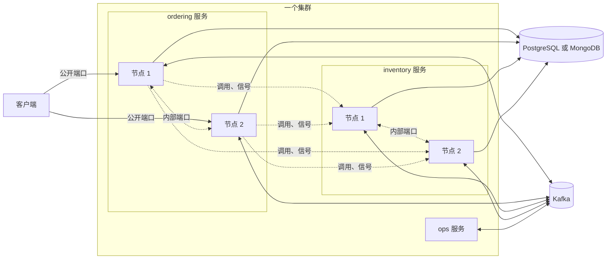

# 部署模型

本页说明运行 Wow 时你运行的是什么：服务和它们的节点、节点怎样互相发现并分担工作、每个服务需要哪些基础设施，以及设计对网络做了哪些假设。规划部署之前先读这一页。

## 服务与节点 {#services-and-nodes}

**服务**是一个可部署的应用。它承载一个或多个限界上下文：它们的聚合、处理器和 HTTP API。**节点**是服务的一个运行实例。一个服务按需要运行任意多个节点，同一服务的每个节点运行相同的代码。



服务的节点通过**分区**分担工作。每个上下文的日志有固定数量的分区，默认 64 个，每个分区同一时刻只有一个属主。归属是保存在服务自己存储里的租约：没有 ZooKeeper，没有 Kafka 消费组，也没有注册中心。每个节点都根据存活成员的列表算出同样的分配，并据此获取或释放租约。节点加入或离开时，大约 N 分之一的分区会移动。

每个节点在每个服务里只保留一条成员记录，记录里列出它参与的上下文与主题；它对所有这些只读一次服务的成员列表，只有租约按上下文划分。所以这种协调给存储带来的工作量随节点数增长，租约部分再随每个节点运行的上下文数增长：默认配置下，每个节点每秒约 1.3 次操作，再加上它运行的每个上下文每秒约 1.3 次（10 个节点各运行 15 个上下文：每秒约 210 次），与命令流量无关。

分区的属主执行该分区内聚合的命令，并运行该分区上的每个订阅。到达其他节点的命令会被转发给属主。找不到属主时，例如分区正在易手，收到命令的节点自己执行这条命令，聚合的版本保证结果正确。规则见[写：从准入到追加](../concepts/write-path#routing)。

## 两个端口 {#two-ports}

每个节点监听两个端口：

| 端口 | 承载 | 谁访问它 |
| --- | --- | --- |
| 公开（`server.port`） | HTTP API：命令、查询、状态读取、Manifest、OpenAPI；Actuator 的健康端点 | 客户端、网关、Ingress |
| 内部（`wow.internal.port`，默认 9090） | 服务自己的节点之间的集群通道；来自任何服务的等待信号；来自其他服务的同步调用和读 | 只有系统里的节点 |

内部端口是不带 TLS 的 HTTP/2（h2c）。绝不能让平台外部访问到它：不能有公网负载均衡、Ingress 或端口映射指向它，并用网络策略只让平台自己的 Pod 访问它。它不用令牌：发往它的每个请求都在 `Wow-Service` 请求头里声明自己来自哪个服务，网络是它的边界（[保护部署](./security#close-the-internal-port)）。

每个节点公布其他节点访问它内部端口所用的地址：

- `wow.node.id` 是节点在服务成员中的名字；不设置时每次启动生成一个新的。
- `wow.internal.host` 是内部端口绑定的网卡。把它绑定到节点的内网地址。
- `wow.node.address` 是其他节点使用的 `host:port`。默认是绑定的地址（没有时是本机地址）加内部端口；只有同伴要通过别的地址访问节点时才设置它，例如在 NAT 之后、有多块网卡的主机上，或 Pod 有稳定 DNS 名字的 StatefulSet 里。

在 Kubernetes 上，eShop 的 ordering 清单从 Pod 取得节点 ID 和绑定的地址，并公布这个地址，即 Pod 的 IP：

<!-- sample: deploy/eshop-ordering/deployment.yaml#node -->

```yaml
env:
  - name: POD_NAME
    valueFrom:
      fieldRef:
        fieldPath: metadata.name
  - name: POD_IP
    valueFrom:
      fieldRef:
        fieldPath: status.podIP
  - name: SERVER_PORT
    value: "8083"
  - name: WOW_INTERNAL_PORT
    value: "9093"
  # The node id is the pod's name: a replaced pod is a new member.
  - name: WOW_NODE_ID
    value: $(POD_NAME)
  # The internal port binds the pod's private address only, and the node advertises that address,
  # $(POD_IP):9093: a Deployment's pods have no DNS name of their own.
  - name: WOW_INTERNAL_HOST
    value: $(POD_IP)
```

Deployment 的 Pod 没有属于自己的 DNS 名字（headless Service 只为设置了 `spec.hostname` 的 Pod 发布 `<pod>.<service>`），所以节点公布它的 IP。headless Service 以服务的名字命名，即 `eshop-ordering-service-cluster`：它的 SRV 记录列出每个节点的地址，包括尚未就绪的节点，其他服务只凭服务名就在那里找到它的节点。[eShop ordering 清单](https://github.com/Ahoo-Wang/Wow/tree/main/deploy/eshop-ordering)是一个服务的完整模板。

## 服务需要什么 {#what-a-service-needs}

| 组件 | 什么时候需要 | 用来做什么 |
| --- | --- | --- |
| PostgreSQL 或 MongoDB | 生产环境中总是需要 | 日志、快照、检查点、租约、失败台账、预留键和定时器。MongoDB 必须是副本集。 |
| Kafka | 事件或命令跨上下文时，或者某个聚合类型的命令经 Kafka 路由时 | 发布的事件流、命令主题、回执。见 [Kafka](./kafka)。 |
| ClickHouse | 服务写数仓或提供数据集时 | ClickHouse Sink 和数据集查询。 |
| Elasticsearch | 可选 | 快照和事件流的副本，用于全文检索。它从不保存日志。 |

### 选择后端 {#choose-a-backend}

节点把它的日志、快照、检查点、租约、失败台账、预留键和定时器放在同一个后端里，由 `wow.backend` 选择：

| 后端 | 模块 | 应用提供 |
| --- | --- | --- |
| `postgres` | `wow-postgres` | 一个 `javax.sql.DataSource`：宿主用 `spring.datasource.url` 建的（需要 HikariCP），或应用自己的 Bean |
| `mongo` | `wow-mongo` | 一个连接副本集的 `com.mongodb.client.MongoClient`：宿主用 `spring.mongodb.uri` 建的，或应用自己的 Bean；数据库由 `wow.mongo.database` 指定 |
| `memory` | 无 | 什么都不用：一个节点，数据不会比它活得更久 |

默认的 `auto` 按应用提供的 Bean 选择 PostgreSQL 或 MongoDB。两者都没有时节点拒绝启动，除非处于开发 profile，或者它的内部端口只绑定在回环网卡上；这时它在内存中运行，并说明这一点。eShop 的 ordering 服务用它的 `postgres` profile 切换到 PostgreSQL：

<!-- sample: examples/eshop/ordering/ordering-server/src/main/resources/application.yaml#postgres -->

```yaml
spring:
  config:
    activate:
      on-profile: postgres
  datasource:
    url: jdbc:postgresql://localhost:5432/eshop_ordering
    username: postgres
    password: postgres
```

除非 `wow.ddl` 设为 `validate` 或 `none`，宿主在启动时创建它的表和集合。日志和快照按聚合类型存储（`wow_log__<context>__<aggregate>`、`wow_snapshot__<context>__<aggregate>`）。命名的存储 `wow.stores` 改为按聚合拆分数据：一个聚合的日志在 PostgreSQL 上，另一个聚合的快照在 Elasticsearch 上。

一个系统通常还运行平台服务，它们本身也是 Wow 服务：**ops 服务**汇集每个服务停放的聚合，并给运维人员一个控制台（[ops 服务与控制台](./ops-console)）；**视图存储**保存用户保存的视图；**分析目录**定义和发布数据集。

## 前提 {#assumptions}

设计依赖几条关于环境的前提。违反其中一条的部署，就会失去相应的保证。

- **一个集群。** 一个系统的所有服务运行在同一个集群里，可以直接访问彼此的内部端口。跨进另一个服务的等待，由那个服务的节点直接向命令来自的节点发信号。
- **时钟同步。** 租约按节点的时钟过期。节点之间的时钟偏差必须远小于租约的存活时间，默认 10 秒。
- **一个租户空间。** 一个系统的所有上下文共用一套租户 ID。租户 ID 原样跨服务传递，出现在命令、发布的事件流、回执和定时器里，所以每个服务都必须以同样的方式解析调用方的租户。
- **相邻版本。** 滚动升级期间，一个服务的节点可以运行同一主版本中相邻的两个次版本，范围不能更宽。主版本升级是一次蓝绿切换。
- **固定的分区数。** 上下文的日志一旦有了条目，它的分区数就不能再改。分区数必须是能整除 4,096 的 2 的幂。在首次部署之前选定；64 适合大多数服务。

## 启动与停止 {#starting-and-stopping}

节点只在启动完成后才打开公开端口：后端已就绪、内部端口已绑定、已加入成员。它按相反的顺序停止：

1. 就绪探针报告节点拒绝流量，公开服务器不再接收请求。仍未结束的等待在 `wow.wait.max-timeout`（60 秒）之内完成。
2. 节点不再接收其分区的命令，在 `wow.cluster.drain-timeout`（10 秒）之内执行完在途的命令，保存订阅的检查点并释放租约。其他节点接管这些分区。
3. 内部端口最后关闭。

除非设置了 `spring.lifecycle.timeout-per-shutdown-phase`，宿主会把 Spring Boot 的关闭阶段调整到足够长。平台的终止宽限期至少要给这么多；eShop 的清单用的是 90 秒。

类路径上有 Spring Boot Actuator 时，宿主把节点的健康状况加入就绪和存活分组：

<!-- sample: deploy/eshop-ordering/deployment.yaml#probes -->

```yaml
startupProbe:
  httpGet:
    path: /actuator/health/readiness
    port: http
  periodSeconds: 5
  failureThreshold: 36
readinessProbe:
  httpGet:
    path: /actuator/health/readiness
    port: http
  periodSeconds: 5
  failureThreshold: 2
livenessProbe:
  httpGet:
    path: /actuator/health/liveness
    port: http
  periodSeconds: 10
  failureThreshold: 3
```

- **就绪**在以下情况失败：节点尚未运行、它的日志存储或租约存储不可用、交接宽限期过后它仍没有拥有应得的任何分区，或者它读取的某个主题仍在加入中。
- **存活**只在节点卡住时失败：它的存储有响应，但它的调度器或命令没有进展。它从不因存储故障而失败，节点排空期间也不会失败，所以一次故障不会让所有节点同时重启。

## 迁移切换时的待机 {#standby-for-a-migrations-cut-over}

在 [9.x 在线切换](../migrate/data#online-cut-over-for-large-systems)的双轨运行窗口里，`migrate-data tail` 导入 9.x 仍在写入的数据，V10 服务则提供读取。让它的节点以 `wow.node.standby: true` 启动：

- 它们为追尾导入的数据提供状态读取和查询。
- 它们报告为就绪（`/actuator/health/readiness` 为 `UP`，其租约组与主题标为 `standby`），所以负载均衡会把这些读请求发给它们。
- 它们以 `wow.node.standby`（503）拒绝每条命令，所以切换之前没有任何东西写入 V10。
- 它们不加入任何租约组：没有订阅处理任何东西，没有停放条目被重试，也没有任务或定时运行。从流末尾开始的 Saga 或反应器，在激活时从流的末尾开始，所以永远不会对导入的 9.x 历史采取行动。

切换时，在 9.x 停止、并且最后一次遍历、`compare`、`snapshot` 和 `backfill-tags` 都已运行之后，在每个节点的内部端口上激活它，并在 `Wow-Service` 里写明节点的服务。请求体写明由谁激活、为什么激活，供审计：

```bash
curl -X POST "http://<node>:9090/wow/node/activate" \
  -H "Wow-Service: <节点的服务>" -H "Content-Type: application/json" \
  -d '{"by": "<operator>", "reason": "cut-over <ticket>"}'
```

节点加入它的租约组，启动订阅、停放条目的重试、任务和快照维护，然后开始接收命令。它返回自己的待机状态：`standby: false`、`activatedAt`、`activatedBy` 和 `reason`，并以 `WARN` 级别记录同样的内容。

`GET /wow/node/standby`（带同样的请求头）随时返回这个状态。激活一个不在待机的节点不会改变任何东西，只返回它是何时被激活的。这两条路由只接受节点自己的服务：没有这个请求头时返回 401，来自另一个服务时返回 403。要激活服务的每个节点：仍处于待机的节点会继续拒绝命令，也不接管任何分区。
