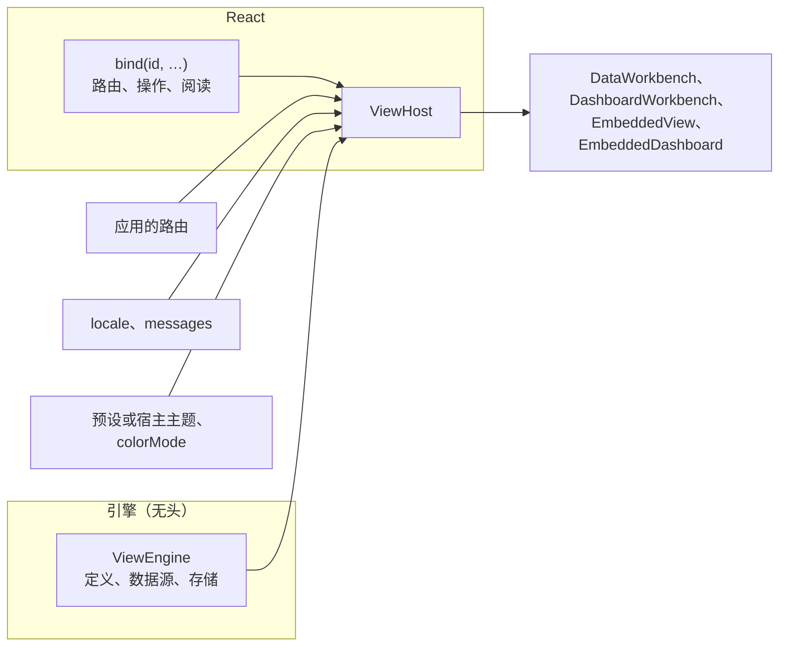

# 接入宿主

写好定义之后，应用把它们接进来：一个带数据源和存储的引擎，以及包住页面的一个 `ViewHost`，它把引擎接到应用的路由、语言、主题和命令上。本页逐一说明每个部分。

<!-- typecheck-generated: examples/eshop/web/src/generated/ordering -->



## 基于 V10 查询路由的一个引擎 {#one-engine-over-v10-query-routes}

引擎是无头的：没有 React，也没有 DOM。它持有定义、每份定义的行从哪里来，以及保存视图的存储。在应用启动时构建一次，与每个页面共享：

<!-- typecheck: file=engine.ts -->
<!-- typecheck-context
import type { DashboardDefinition, DataViewDefinition } from '@ahoo-wang/wow-view-engine';
declare const orders: DataViewDefinition;
declare const overview: DashboardDefinition;
declare function report(event: unknown): void;
-->

```ts
// src/views/engine.ts
import { Fetcher } from '@ahoo-wang/fetcher';
import {
  localStorageSnapshot,
  MemoryViewStore,
  ViewEngine,
} from '@ahoo-wang/wow-view-engine';
import { browserRuntimeEnvironment } from '@ahoo-wang/wow-view-engine/react';
import { OrderSnapshotQueryClient } from './generated/index.js';

// A timeout: the engine times no query itself.
const fetcher = new Fetcher({ baseURL: '/api', timeout: 30_000 });

export const engine = new ViewEngine({
  store: new MemoryViewStore({ snapshot: localStorageSnapshot('my-app:views') }),
  resources: [
    // The generated client of the order's snapshot query route, as a source.
    {
      definition: orders,
      source: new OrderSnapshotQueryClient({ fetcher }),
    },
    // A board queries nothing of its own: its panels read other resources.
    { definition: overview },
  ],
  // A failed query or save is shown where it happens; this is for monitoring.
  environment: browserRuntimeEnvironment({ onError: report }),
});
```

- **数据源就是一个查询路由。** `wow-generator` 为快照、事件或数据集查询模型生成的客户端本身就是数据源：它执行视图需要的分页、游标和聚合查询，并读取模型的实时描述，所以引擎只提供这次部署允许的东西。
- **每个应用一个引擎**，绝不是每个页面或每种语言一个：页面共享它的查询缓存、描述和偏好，切换语言只是重画。
- **给 fetcher 设一个超时。** 否则一个接受了连接却永不回答的服务端，会占住引擎的查询名额，让仪表盘的其他面板饿死。
- **不要改上限。** 查询队列会自己为仪表盘的面板腾出空间，描述也会提供服务端的预算。
- 在没有 `onIssue` 的开发构建中，引擎按资源打印准入发现。它们应当放进定义的 [`admit`](./definitions#_7-check-it-with-admit) 测试。

保存的视图放在哪里，见[视图存在哪里](./storage)。

## `ViewHost`：包住页面的一层 {#viewhost-one-layer-around-the-pages}

`ViewHost` 由端口组成，每个端口都通向应用已有的某样东西。你的路由、你的措辞和你的主题仍然归你：

| 属性 | 端口 | 作用 |
| --- | --- | --- |
| `engine` | 数据 | 应用的引擎 |
| `router` | 路由 | 你的路由：`/react-router` 中的 `useReactRouter()`，或你自己的 [`ViewRouter`](../../reference/typescript/wow-view-engine/host.md#api-ViewRouter)（[见下](#router-port)） |
| `navigate` | 路由 | 所有离开的方式都交到你手里；它优先于 `router` |
| `locale`、`messages` | 语言 | 值以哪种语言显示，以及合并在引擎自带措辞之上的措辞（[见下](#messages)） |
| `bindings` | 命令 | 每个资源一个 `bind(id, …)`：它的路由、操作和阅读方式（[见下](#bind)） |
| `theme`、`preset`、`brand` | 主题 | 跟随宿主的 shadcn 主题，或使用引擎的某个预设（[主题](./theming)） |
| `colorMode`、`rememberColorMode` | 主题 | 亮色、暗色或跟随系统，以及读者的选择保存在哪里 |

<!-- typecheck: file=Host.tsx -->
<!-- typecheck-context
import { engine } from './engine';
import { BINDINGS } from './routes';
declare const ORDER_WORDS: Record<'zh-CN' | 'en', Record<string, string>>;
-->

```tsx
// src/views/Host.tsx
import type { ReactNode } from 'react';
import '@ahoo-wang/wow-view-engine/styles.css';
import '@ahoo-wang/wow-view-engine/themes/porcelain.css';
import { useReactRouter } from '@ahoo-wang/wow-view-engine/react-router';
import { ViewHost, zhCN } from '@ahoo-wang/wow-view-engine/ui';

/** One per language: the engine's own words (English by default), and the definitions' keys. */
const MESSAGES = {
  'zh-CN': { ...zhCN, ...ORDER_WORDS['zh-CN'] },
  en: ORDER_WORDS.en,
};

export function Host({
  locale,
  children,
}: {
  locale: 'zh-CN' | 'en';
  children: ReactNode;
}) {
  return (
    <ViewHost
      engine={engine}
      router={useReactRouter()}
      locale={locale}
      messages={MESSAGES[locale]}
      bindings={BINDINGS}
      preset="porcelain"
      rememberColorMode="my-app.color-mode"
    >
      {children}
    </ViewHost>
  );
}
```

`ViewHost` 之下的每个界面只接收在它所在之处不同的东西：`<DataWorkbench definitionId="orders" />`。宿主可以嵌套：内层宿主的绑定按 id 优先于外层，内层宿主也可以指定另一个引擎。只有最外层的宿主在 `<html>` 上绘制明暗、预设和品牌色。

## `bind`：每个资源在这里做什么 {#bind}

`bind(definitionId, options)` 在一处说明一个资源在这个应用里的行为。它出现在哪里，无论是工作台、记录详情、仪表盘面板还是嵌入，它的绑定都随之而来：

| 选项 | 是什么 |
| --- | --- |
| `route(instanceId, target?)` | 在某个视图上打开这个资源的页面路径；没人保存过的视图传 `null`，落到页面的默认视图 |
| `actions` | 它记录上的命令（[操作](./actions)） |
| `reading` | 一条记录在详情里怎样阅读：`title(row)` 为它命名，`sections(context)` 增加区域，`render(context)` 替换正文 |
| `slots` | 逃生口：`row`、`bulk` 和 `global` 在声明的操作之后绘制你自己的标记 |

<!-- typecheck: file=routes.ts -->
<!-- typecheck-context
import type { RecordActions } from '@ahoo-wang/wow-view-engine';
declare const orderActions: RecordActions;
-->

```ts
// src/views/routes.ts
import { bind } from '@ahoo-wang/wow-view-engine/ui';

/** A workbench page on `view`, or on its default view (`null`). */
export function withView(path: string, view: string | null): string {
  return view === null ? path : `${path}?${new URLSearchParams({ view })}`;
}

// At module scope: a binding built in render is a new binding every render.
export const BINDINGS = [
  bind('orders', {
    route: view => withView('/orders', view),
    reading: { title: row => `Order ${String(row.key)}` },
    actions: orderActions,
  }),
  bind('overview', { route: board => withView('/boards', board) }),
];
```

保持绑定稳定，放在模块作用域或 `useMemo` 里。没有 `route` 的资源不是一个去处：导航会略过它。

## 路由 {#router-port}

有了路由端口，地址由引擎维护，应用不需要同步任何东西：

- **打开的视图是 `?view=`。** 没有给 `instanceId` 的工作台打开地址里的视图，并把读者的选择写回去。同一页上的两个工作台各自只读自己定义的视图。
- **打开的记录是 `?id=`。** 已绑定资源的记录详情跟随它。
- **交接的东西放在历史记录的 state 里**：仪表盘交给工作台的视图、仪表盘的筛选和标签页。设置 `boardsInAddress` 后，仪表盘的筛选和标签页也进入地址，所以一个链接会在同一天打开同一个仪表盘。
- 以 `/` 开头的路径经过路由；其他站点在新窗口中打开。

`/react-router` 中的 `useReactRouter()` 让 React Router 成为这个端口；React Router 是只有这个入口才加载的可选 peer 依赖。对其他任何路由，写出 `ViewRouter` 的两个成员 `location` 和 `go`。**契约是对象的身份**：位置变化时是一个新对象，没变时是同一个：

<!-- typecheck: file=memoryRouter.ts -->

```ts
// src/views/memoryRouter.ts
import { useMemo, useState } from 'react';
import type { ViewLocation, ViewRouter } from '@ahoo-wang/wow-view-engine/ui';

export function useMemoryRouter(start: string): ViewRouter {
  const [location, setLocation] = useState<ViewLocation>(() => at(start));
  // A new object only when the location moves: what reads the address reads it again then.
  return useMemo(
    () => ({
      location,
      go: (path, options) => setLocation(at(path, options?.state)),
    }),
    [location],
  );
}

function at(path: string, state: unknown = null): ViewLocation {
  const query = path.indexOf('?');
  return query < 0
    ? { pathname: path, search: '', state }
    : { pathname: path.slice(0, query), search: path.slice(query), state };
}
```

`ViewHost` 上的 `navigate(to)` 先于路由把每一种离开的方式交给你：在一次导航还要多做一件事的地方用它，例如埋点或离开前的确认。

## 导航是数据 {#navigation-is-data}

引擎绘制视图；页面归你，所以没有页面外壳组件。`useViewNavigation()` 按注册顺序给你的外壳提供已绑定的资源，每个都带标题、路径、是否为当前项，以及它的系统视图：

<!-- typecheck-context
declare function Header(props: { children: React.ReactNode }): React.ReactNode;
-->

```tsx
import { DataWorkbench, useViewNavigation } from '@ahoo-wang/wow-view-engine/ui';

export function OrdersPage() {
  return <DataWorkbench definitionId="orders" />;
}

export function Places() {
  const places = useViewNavigation();
  return (
    <Header>
      <nav aria-label="Application">
        {places.map(place => (
          <a
            key={place.id}
            href={place.path}
            aria-current={place.current ? 'page' : undefined}
          >
            {place.title}
          </a>
        ))}
      </nav>
    </Header>
  );
}
```

**页面的高度归你，而且必须是确定的。** 工作台撑满它的容器并把页脚放在底部，所以容器需要 `height`，而不是 `min-height`：让外壳占满视口高度，由内容区占用剩余部分。页面自己有 `<main>` 时，给工作台传 `landmark="region"`，让页面只保留一个 `main`。

## 嵌入 {#embeds}

展示某人已经决定好的东西的业务页面，例如某个客户的订单，就嵌入它：只有结果，别无其他。[`EmbeddedView`](../../reference/typescript/wow-view-engine/components.md#api-EmbeddedView) 展示一个记录视图或分析视图，[`EmbeddedDashboard`](../../reference/typescript/wow-view-engine/components.md#api-EmbeddedDashboard) 展示一个仪表盘。**嵌入从不写入**：不写视图，不写仪表盘，也不写偏好。

<!-- typecheck-context
import type { ViewNavigation } from '@ahoo-wang/wow-view-engine';
declare function go(to: ViewNavigation): void;
-->

```tsx
import { systemInstanceId } from '@ahoo-wang/wow-view-engine';
import {
  EmbeddedDashboard,
  EmbeddedView,
} from '@ahoo-wang/wow-view-engine/ui';

export function CustomerPage({ id, name }: { id: string; name: string }) {
  return (
    <>
      {/* This customer's orders to ship: a system view, narrowed to them. */}
      <EmbeddedView
        instanceId={systemInstanceId('orders', 'to-ship')}
        scopeFilter={{
          op: 'and',
          children: [{ field: 'state.customerId', operator: 'in', value: [id] }],
        }}
        withTitle
      />
      {/* The customer's board: locked to them; the time is the reader's. */}
      <EmbeddedDashboard
        instanceId="customer-board"
        interaction="interactive"
        filterModes={{ customer: 'locked' }}
        pageValues={{ values: { customer: { items: [{ id, label: name }] } } }}
        onNavigate={go}
      />
    </>
  );
}
```

- **读者能走多远是一个明确的档位** `interaction`：默认 `static`，只有结果；`interactive` 增加排序、翻页、仪表盘的筛选、后续操作和“在工作台中打开”。更多的开关在档位之内选择开启：`withTitle`、`withSearch`、`withExport`、`detail`、`expandable` 等。
- **仪表盘的每个筛选都有一个模式**（`filterModes`）：`adjustable` 归读者调整；`locked` 显示但固定；`hidden` 不显示但仍然生效。锁定和隐藏的值属于页面，从不经过地址传递。
- **嵌入的每一种离开方式**都经过 `onNavigate`；没有它，这些方式就不存在。

**锁定不是安全边界。** 锁定的条件是在浏览器里拼出来并随查询发送的；任何人都可以改脚本或直接调用 API。租户、归属和权限由 Wow 服务强制执行，见[读模型](../../concepts/read-models#who-sees-what)。

## 措辞与语言 {#messages}

模型承载的是键，不是文案；措辞属于界面。引擎自带的措辞是英文；`zhCN` 是逐键对应的中文目录：

- `messages` 合并在生效的措辞之上：引擎的键和定义的键在同一张表里。中文宿主传 `{ ...zhCN, ...definitionWords }`；英文宿主只传定义的措辞。
- `locale` 是值显示所用的语言：枚举按它的标签显示，时间经 `Intl.DateTimeFormat`、按引擎的时区显示。
- 改变两者中的任何一个都只是重画：不重新打开、不重新查询，也不会让任何草稿变脏。
- 用 `satisfies MessageOverrides` 改写引擎自带的键，这样引擎重命名了某个键时，你的构建会失败：

```ts
import { zhCN, type MessageOverrides } from '@ahoo-wang/wow-view-engine/ui';

const wording = {
  'label.filter.apply': '确定',
} satisfies MessageOverrides;

export const ENGINE_WORDS = { ...zhCN, ...wording };
```

消息键是公开的：补丁版本不会重命名或删除任何一个。

## 测试接线 {#testing}

`@ahoo-wang/wow-view-engine/testing` 是供宿主单元测试使用的无头入口，在 Node 中运行：

| 函数 | 测试什么 |
| --- | --- |
| [`admit`](../../reference/typescript/wow-view-engine/testing.md#api-admit) | 定义和仪表盘对照它们提交的描述，每个键都有措辞（[定义视图](./definitions#_7-check-it-with-admit)） |
| [`resolveNavigation`](../../reference/typescript/wow-view-engine/testing.md#api-resolveNavigation) | 一种离开方式经过你的绑定，按引擎自己的解析规则会解析成什么 |
| [`actionHarness`](../../reference/typescript/wow-view-engine/testing.md#api-actionHarness) | 你声明的操作，按引擎的规则读取（[操作](./actions#harness)） |
| [`memorySource`](../../reference/typescript/wow-view-engine/testing.md#api-memorySource) | 一个按 Wow 服务的语义过滤、排序、分页和聚合的内存数据源 |

路由表，用引擎自己的解析规则：

<!-- typecheck-context
import { BINDINGS } from './routes';
declare function expect(value: unknown): { toMatchObject(expected: unknown): void };
-->

```ts
import { resolveNavigation } from '@ahoo-wang/wow-view-engine/testing';

const bindingOf = (id: string) =>
  BINDINGS.find(binding => binding.definitionId === id);

const toShip = {
  kind: 'view',
  definitionId: 'orders',
  instanceId: 'system:orders:to-ship',
  scopeFilter: null,
  filter: null,
} as const;
expect(resolveNavigation(toShip, bindingOf)).toMatchObject({
  kind: 'route',
  path: '/orders?view=system%3Aorders%3Ato-ship',
  state: { handOver: toShip },
});
```

基于内存快照、带 Wow 查询语义的页面测试：

<!-- typecheck-context
import type { DataViewDefinition } from '@ahoo-wang/wow-view-engine';
declare const orders: DataViewDefinition;
-->

```ts
import { MemoryViewStore, ViewEngine } from '@ahoo-wang/wow-view-engine';
import { memorySource } from '@ahoo-wang/wow-view-engine/testing';

// Snapshots as the service returns them: the envelope, `state`, epoch-ms times.
const source = memorySource(
  [
    { aggregateId: 'O-1', firstEventTime: 1_790_000_000_000, state: { status: 'PAID' } },
    { aggregateId: 'O-2', firstEventTime: 1_790_000_060_000, state: { status: 'SHIPPED' } },
  ],
  // The clock BEFORE_NOW and AFTER_NOW compare against: pin it.
  { now: () => Date.parse('2026-09-27T00:00:00Z') },
);

export const testEngine = new ViewEngine({
  resources: [{ definition: orders, source }],
  store: new MemoryViewStore(),
});
```

这个包的测试套件让 `memorySource` 的回答遵守服务端自己的语义，所以测试看到的就是生产环境给出的。它用 `mingo` 求值过滤条件，`mingo` 是只有 `/testing` 才加载的可选 peer 依赖：把它加进你的开发依赖。

## 一个完整的宿主 {#a-complete-host}

ops 控制台是一个完整的 V10 宿主：[`OpsHost.tsx`](https://github.com/Ahoo-Wang/Wow/blob/main/platform/ops/console/src/app/OpsHost.tsx) 是它的 `ViewHost`；[`views/engine.ts`](https://github.com/Ahoo-Wang/Wow/blob/main/platform/ops/console/src/views/engine.ts) 基于停放条目的生成查询客户端构建它的引擎；[`views/bindings.ts`](https://github.com/Ahoo-Wang/Wow/blob/main/platform/ops/console/src/views/bindings.ts) 绑定它们，连同它们的阅读方式和操作。
