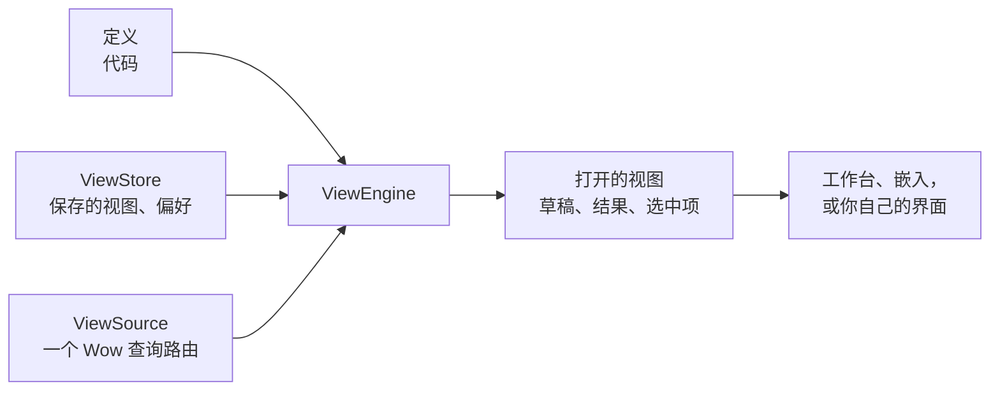

# 视图引擎的核心概念

业务应用里的大多数页面其实是同一种页面：一个带筛选、排序和分页的列表，有时加一张图，有时是一块数字仪表盘。每个业务对象都复制一份，“加一个筛选条件”“按仓库拆开看看”这样的需求，每次都变成一次代码改动。数据没有变，变的只是观察它的方式。

`@ahoo-wang/wow-view-engine` 把这件事变成配置。应用在代码里声明**一份数据集能怎样观察**：它的字段、每个字段叫什么、怎样过滤、排序和聚合。读者在界面上决定**这次怎样观察**：条件、列、维度与指标、图表、仪表盘。引擎把这次选择编译成 Wow 查询，渲染结果，并把值得保留的视图保存下来。

| 面向 | 得到什么 |
| --- | --- |
| 读者 | 在应用允许的范围内过滤、排序、分组和画图；保存、分享并重新打开视图 |
| 开发者 | 每个业务对象一份定义、一个数据源，而不是各写一个列表页、分析页和概览页 |
| 产品 | 对已有数据的一种新的观察方式是一个保存的视图，而不是一次发版 |

它不是数据库、权限系统，也不是通用的页面搭建器。数据、能过滤和聚合什么、谁能看到什么，都来自它背后的 Wow 服务。

## 三条事实 {#three-facts}

设计立足于三条事实，其余都由它们推出：

| 事实 | 推论 |
| --- | --- |
| **定义是代码** | 定义随应用发布。没有定义服务，也没有定义版本；保存的视图每次打开时都对照当前的定义检查。 |
| **配置是数据** | 保存的视图是纯 JSON：读者的意图，从不包含编译后的值或组件名。只存储保存的视图和每个读者的偏好，带乐观 revision 和幂等的请求 ID。 |
| **运行时状态是临时的** | 草稿、结果、页码、选中项都只存在于一个打开的视图里，从不存储。重新打开视图会从头运行。 |



## 组成部分 {#the-parts}

| 部分 | 是什么 | 在哪里 |
| --- | --- | --- |
| 定义（`ViewDefinition`） | 一份数据集**能**怎样观察：字段、它们的措辞、操作符、记录与分析能力，以及随它发布的系统视图 | 代码 |
| 数据源（`ViewSource`） | 数据定义的行从哪里来：一个 Wow 查询路由，经生成的查询客户端访问 | 代码 |
| 视图配置（`ViewConfig`） | 一种观察方式**具体**怎样：记录视图、分析视图或仪表盘 | 数据 |
| 保存的视图（`ViewInstance`） | 带 ID、标题、受众和 revision 的配置 | 存储 |
| 偏好（`ViewPreferences`） | 一个读者在一份定义上的习惯：视图的顺序、默认视图、仪表盘上次打开的标签页 | 存储 |
| 引擎（`ViewEngine`） | 定义、数据源和存储的注册表，以及打开着的视图；每个应用一个 | 内存 |
| 宿主（`ViewHost`） | 把引擎接到应用的路由、语言、主题和命令上的 React 层 | 代码 |

## 定义 {#definitions}

定义的**事实**来自服务：每个 Wow 查询模型都在 `GET /{context}/{aggregate}/{model}/query` 描述自己：它的路径、值类型、枚举值、时间怎样保存、什么是敏感的。定义依据这份描述、用 [`defineView`](./definitions) 写成，并提交在描述旁边。定义再加上**选择**：读者看到哪些字段、按什么顺序、用什么措辞、收窄掉什么。

服务能对一个字段做什么，例如存储支持哪些操作符、排序和聚合，随存储而变，所以定义不把它固定下来。运行时引擎通过数据源读取实时的描述，只提供这次部署允许的东西。

定义有两种：

- **数据定义**与一个数据源配对，承载一份数据集（快照、事件或数据集查询模型）的记录视图和分析视图。
- **仪表盘定义**没有数据源。它是仪表盘所属的目录，仪表盘的面板展示各数据定义的视图。

## 视图 {#views}

视图是观察一份数据定义的一种方式：

| 种类 | 回答 | 它的配置包含 |
| --- | --- | --- |
| 记录视图 | “哪些记录，按什么顺序”：一个分页的列表 | 条件、排序、每页条数、列、汇总，以及表格、卡片或看板布局 |
| 分析视图 | “按什么分组，度量什么”：一次聚合的表格或图表 | 条件、维度、指标、保留哪些分组、排序、前 N 名、表格和图表 |

两者都只发送 Wow 查询：记录视图发分页查询或游标查询，分析视图发聚合查询。配置保存的是**意图**，所以它永远不会过时：

```ts
import type { RecordViewConfig } from '@ahoo-wang/wow-view-engine';

export const PAID_THIS_WEEK: RecordViewConfig = {
  kind: 'record',
  filter: {
    op: 'and',
    children: [
      { field: 'state.status', operator: 'IN', value: ['PAID'] },
      // "This week" is stored as intent and resolved on every run.
      {
        field: 'firstEventTime',
        operator: 'BETWEEN',
        value: { type: 'preset', preset: 'thisWeek' },
      },
    ],
  },
  filterMode: 'simple',
  refresh: { interval: null },
  sort: [{ field: 'firstEventTime', direction: 'DESC' }],
  pageSize: 20,
  summaries: [{ field: 'state.totalAmount', fn: 'SUM' }],
  layout: 'table',
  table: {
    columns: [
      { field: 'aggregateId' },
      { field: 'state.totalAmount' },
      { field: 'firstEventTime' },
    ],
  },
  card: { title: 'aggregateId', fields: ['state.totalAmount'] },
};
```

- **保存的是配置，不是浏览状态。** 选中项、页码和结果从不保存。
- **配置不指明组件。** 编辑器由字段的种类、操作符和值的形状推出，所以换一套界面不会碰到任何保存的视图。
- **配置每次打开都会检查。** 它来自存储，不被信任：引用了定义里已经没有的字段的视图，会以需要修复的状态打开，并定位到它引用的地方。

## 仪表盘 {#boards}

仪表盘把几个视图放在一页上，使用 24 列网格，可以分标签页。一个面板展示一个保存的视图、一个仪表盘自有的分析，或者内容：标题、文本、图片、链接。仪表盘的筛选跨越定义：日期筛选通过每个面板所属定义的时间字段作用到它，仪表盘还可以有一个读者无法修改的固定范围。

保存的视图或仪表盘也可以**嵌入**业务页面，外面不带工作台：例如在客户页面上展示该客户的订单。嵌入从不写入。见[嵌入](./host#embeds)。

## 谁能看到视图 {#who-sees-a-view}

每个保存的视图都有一个范围：

| 范围 | 由谁配置 | 谁能看到 | 普通读者能做什么 |
| --- | --- | --- | --- |
| `system` | 开发者或运维人员 | 该定义的每个读者 | 打开它、设为默认、另存一份；不能修改 |
| `shared` | 被允许分享的读者 | 该定义的每个读者 | 宿主权限允许的事；总能另存一份 |
| `personal` | 任何读者 | 只有它的所有者 | 一切 |

系统视图有三个来源：定义的代码；视图存储服务的配置；以及存储本身，被允许编辑系统视图的读者可以不经发版就在那里发布它们。存储里的系统视图是全局的：每个租户都能读到。这也是系统仪表盘只能展示系统视图的原因。存储的细节见[视图存在哪里](./storage)。

## revision 与冲突 {#revisions-and-conflicts}

几个人、几个标签页同时修改一个视图是常态。引擎不加锁：

- **乐观 revision。** 每个保存的视图都带一个不透明的 revision，每次写入都带上它期望的 revision。另一次写入先到时，这次写入以冲突被拒绝，由读者选择：采用对方的、用自己的覆盖对方的，或者另存一份。
- **幂等的请求 ID。** 一次逻辑写入只有一个请求 ID。超时后的重试复用它，所以重试永远不会建出第二个视图。
- **结果未知既不是成功也不是失败。** 在它有定论之前，同一个视图不接受新的写入，草稿也保留着。

## 接下来读什么 {#where-to-go-next}

| 想要 | 阅读 |
| --- | --- |
| 依据查询模型的描述写一份定义 | [定义视图](./definitions) |
| 把引擎放进应用：`ViewHost`、路由、嵌入、措辞、测试 | [接入宿主](./host) |
| 在记录上提供命令 | [操作](./actions) |
| 保存视图 | [视图存在哪里](./storage) |
| 使用预设、品牌色，或跟随 shadcn 主题 | [主题](./theming) |
| 键盘、读屏、WCAG 2.2 | [可访问性](./accessibility) |
| 在严格的内容安全策略下运行 | [内容安全策略](./csp) |
| 帮助读者使用工作台 | [工作台](../../data/workbench) |
| 查一个签名 | [wow-view-engine 参考](../../reference/typescript/wow-view-engine/) |

每个界面的每种状态都在 [Storybook](/storybook/) 里对着内存数据运行。
