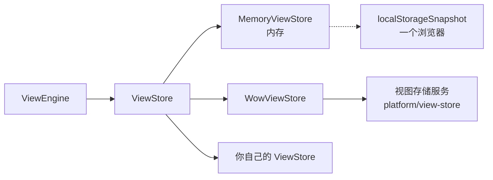

# 视图存在哪里

定义以及它们声明的系统视图是代码，随前端发布。读者在页面上做出的东西是数据：保存的视图（各自是一份完整的记录视图、分析或仪表盘配置），以及每个读者在每份定义上的偏好。引擎通过同一个端口 [`ViewStore`](../../reference/typescript/wow-view-engine/store.md#api-ViewStore) 读写这两者，所以换一个存放位置不会改动任何页面。



## 按谁必须看到保存的视图来选择 {#choose-by-who-must-see-a-saved-view}

| 存储 | 适用于 | 说明 |
| --- | --- | --- |
| [`MemoryViewStore`](../../reference/typescript/wow-view-engine/store.md#api-MemoryViewStore) | 测试、演示、没有保存视图的页面 | 刷新后丢失 |
| 带 `localStorageSnapshot(key)` 的 `MemoryViewStore` | 开发；每个人各自单独使用的工具 | 只在一个浏览器里 |
| `@ahoo-wang/wow-view-store` 中的 `WowViewStore` | 其他所有情况：个人、共享和系统视图由 Wow 的视图存储服务保存 | 这个服务本身就是一个 Wow 服务 |
| 你自己的 `ViewStore` | 视图必须放在一个不是 Wow 的后端里 | 见[下文](#a-store-of-your-own) |

无论选哪种，都有两条规则成立，引擎的冲突处理就建立在它们之上：

1. **乐观 revision。** 每次写入都带着它读到的 revision。不一致时以 `CONFLICT` 拒绝，并带上存储当前持有的内容，由读者选择：采用对方的、覆盖对方的，或者另存一份。
2. **幂等的请求 ID。** 一次逻辑写入只有一个请求 ID；超时后的重试复用它，存储用第一次的结果回答，而不是写两次。

## 内存，或一个浏览器 {#in-memory-or-in-one-browser}

`MemoryViewStore` 严守规则，而不是图方便：过期的 revision 会冲突，重放的请求 ID 返回第一次的结果，列表的顺序以及对标题和配置的限制都与服务端相同。对它正确的代码，对真实的后端也表现一致。下面的例子预置了一个存储的系统视图，并且只允许管理员编辑系统视图：

<!-- typecheck: file=memoryStore.ts -->
<!-- typecheck-context
import type { RecordViewConfig } from '@ahoo-wang/wow-view-engine';
declare const openOrders: RecordViewConfig;
declare function isAdmin(): boolean;
-->

```ts
import { MemoryViewStore } from '@ahoo-wang/wow-view-engine';

export const memoryStore = new MemoryViewStore({
  instances: [
    {
      id: 'orders-open',
      definitionId: 'orders',
      title: 'To ship',
      scope: 'system',
      // `stored`: a system view the store keeps and can edit; without it,
      // a read-only configured view.
      stored: true,
      revision: '1',
      config: openOrders,
    },
  ],
  permissions: () => ({
    createPersonal: true,
    createShared: true,
    reorder: true,
    setDefault: true,
    // Left out, it is a refusal: system views are read-only by default.
    editSystem: isAdmin(),
    instance: () => ({ save: true, rename: true, delete: true }),
  }),
});
```

在有后端保存视图之前，`localStorageSnapshot(key)` 把内存存储作为一个 JSON 文档保存在浏览器的 `localStorage` 里：

<!-- typecheck: file=devStore.ts -->

```ts
import {
  localStorageSnapshot,
  MemoryViewStore,
} from '@ahoo-wang/wow-view-engine';

export const devStore = new MemoryViewStore({
  snapshot: localStorageSnapshot('my-app:views'),
  local: true,
});
```

`local: true` 告诉引擎这些视图没有别人读取：它不共享任何视图，拒绝每一次受众变更，保存副本时不询问给谁，也不为保存的视图提供链接。浏览器拒绝的写入，例如配额已满，以 `UNAVAILABLE` 失败。标签页之间不会互相覆盖：每次写入之前，存储重新读取文档，合并进另一个标签页已存的内容，并拒绝已被另一个标签页超越的写入。ops 控制台就是这样保存运维人员的视图的，因为 ops 服务不承载视图存储。

## 在 Wow 的视图存储上 {#wowviewstore-views-on-a-wow-service}

Wow 的视图存储服务 `platform/view-store` 把保存的视图、偏好和数据集措辞保存为 Wow 聚合。前端通过 `WowViewStore`、借助从服务的 Manifest 生成的客户端访问它。

### 接上它 {#wire-it}

`WowViewStore` 接收一个 fetcher，以及可选的 `permissions`。**它不接收租户、所有者、用户或应用**：fetcher 的拦截器携带是谁在请求，就像应用的其他每个请求一样。服务从调用方获取租户和所有者，并把每个视图放在请求获得授权的那个应用里。

<!-- typecheck: file=viewStore.ts -->
<!-- typecheck-context
declare function hasRole(role: string): boolean;
-->

```ts
import { Fetcher } from '@ahoo-wang/fetcher';
import { CoSecConfigurer } from '@ahoo-wang/fetcher-cosec';
import {
  isSystemInstanceId,
  type ViewPermissions,
} from '@ahoo-wang/wow-view-engine';
import { WowViewStore } from '@ahoo-wang/wow-view-store';

// The gateway in front of the view store service.
const fetcher = new Fetcher({ baseURL: 'https://api.example.com', timeout: 30_000 });
new CoSecConfigurer({ appId: 'my-app' }).applyTo(fetcher);

/** The roles the service checks: the shared views' writer, the system views' writer. */
const SHARED_WRITER = 'view-store.shared-writer';
const SYSTEM_WRITER = 'view-store.system-writer';

function permissions(): ViewPermissions {
  const sharedWriter = hasRole(SHARED_WRITER);
  return {
    createPersonal: true,
    createShared: sharedWriter,
    reorder: true,
    setDefault: true,
    // Publish, edit and unpublish stored system views; left out, refused.
    editSystem: hasRole(SYSTEM_WRITER),
    instance: id => {
      // A system view declared in code is always read-only.
      const editable = !isSystemInstanceId(id);
      return {
        save: editable,
        rename: editable,
        delete: editable,
        changeAudience: editable && sharedWriter,
      };
    },
  };
}

export const store = new WowViewStore({ fetcher, permissions });
```

把 `store` 交给 `new ViewEngine({ store, resources })`。

### 所有者就是受众 {#the-owner-is-the-audience}

个人视图属于读者。共享视图属于保留的所有者 `(shared)`，存储的系统视图属于租户 `(platform)` 的所有者 `(system)`；存储用 `Wow-Scope` 请求头以它们的身份行事。“设为共享”和“设为个人”原地把视图移给另一个所有者，保留它的 id，所以展示它的仪表盘会继续展示它。

每个读者都能读共享视图和存储的系统视图。写共享视图、共享偏好和租户的数据集措辞需要角色 `view-store.shared-writer`；写系统视图需要 `view-store.system-writer`。服务为每次写入授权；前端的 `permissions` 只决定哪些按钮可用，所以要按同样的角色回答它，否则会有按钮可用、写入却被拒绝。

| 权限 | 按钮 | 不提供时 |
| --- | --- | --- |
| `createPersonal`、`createShared` | 另存为个人视图或共享视图 | 必填 |
| `reorder`、`setDefault` | 调整顺序、设为默认 | 必填 |
| `instance(id).save`、`rename`、`delete` | 保存、重命名、删除视图 | 必填 |
| `instance(id).changeAudience` | 设为共享、设为个人 | 允许 |
| `editSystem` | 发布为系统视图；编辑和取消发布存储的系统视图 | **拒绝** |
| `editDatasetWording` | 编辑定义的数据集的措辞：标题、记录名词与字段标签 | **拒绝** |

`editSystem` 与 `editDatasetWording` 是不提供即拒绝的权限：系统视图会到达每个租户的每个读者，数据集的措辞会到达租户的每个读者，所以只有明确说明的宿主才开放它们。

### 系统视图 {#system-views}

一份定义的视图列表合并来自三个地方的系统视图：

| 来源 | 在哪里 | 谁能修改 |
| --- | --- | --- |
| 代码 | 定义的 `views`，id 为 `system:…` | 没有人：要发版 |
| 配置 | 服务的 `wow.view-store.system-views` | 没有人：要重启 |
| 存储 | 租户 `(platform)` 中所有者 `(system)` 的视图 | 拥有 `editSystem` 的读者，立即生效 |

把一个视图发布为系统视图会复制一份；源视图保持原样。系统视图从不改变受众。

### 很长的列表 {#long-lists}

引擎一页一页地读一个定义的已保存视图，至多读 `RuntimeLimits.listedViews` 个（缺省 1000）。超过的定义列出前 1000 个，视图列表与「管理视图」写明「只列出前 1000 个视图；其余的凭链接仍能打开」：上限之外的视图仍能从它的地址或看板打开。定义的视图更多的宿主调高这个上限（`new ViewEngine({ limits: { listedViews: 5000 } })`）。

### 写入与重试 {#writes-and-retries}

- 每次写入都把端口的请求 ID 作为 `Wow-Request-Id`、把 revision 作为 `If-Match` 发送，并等待快照。服务对请求 ID 去重（包括创建），所以重试得到的是第一次尝试的结果。
- 过期的 revision 是 `CONFLICT`，并带上视图现在的样子。
- 服务对一个定义最多列出 1,000 个存储的系统视图；共享与个人视图分页读取，总数最多到 `listedViews`。超出的视图仍可按 id 读取。

### 错误 {#errors}

每次拒绝都是一个 [`ViewStoreError`](../../reference/typescript/wow-view-engine/store.md#api-ViewStoreError)。存储先读取服务的错误码，只有在没有返回已知错误码时才看 HTTP 状态：

| 代码 | 来自 | 含义 |
| --- | --- | --- |
| `CONFLICT` | `wow.aggregate.version-mismatch`、`wow.command.request-id-reused`；409、412 | 有人先写了 |
| `NOT_FOUND` | `wow.aggregate.not-found`、`wow.aggregate.deleted`；404、410 | 视图不在了，或者调用方无权看到 |
| `FORBIDDEN` | `wow.auth.*`、`wow.aggregate.forbidden`、只读的系统视图；401、403 | 调用方无权修改 |
| `INVALID` | 视图存储的校验、缺少应用；400、422 | 请求本身构造有误 |
| `UNAVAILABLE` | 可重试的问题、超时、没有回答 | 结果未知：用同一请求 ID 重试是安全的 |
| `UNSUPPORTED` | 没有错误码的 404 | 服务端不提供视图存储 |

服务自己的错误码保存在 `detail.code` 里；`WowViewStoreErrorCodes` 列出了视图存储的错误码。引擎会处理所有这些错误；不要包装它们。

## 自己实现一个存储 {#a-store-of-your-own}

不适用于 Wow 后端：`WowViewStore` 已经处理了重放、受众移动、系统视图版本和错误码，这些正是手写存储容易出错的地方。只为其他后端写 `ViewStore`：

- 实现 `list`、`get`、`create`、`save`、`rename`、`delete`、`getPreferences` 和 `setPreferences`。`changeAudience` 和 `permissions` 是可选的。
- 守住两条规则：过期的 revision 抛出带当前实例的 `CONFLICT`；重复的请求 ID 返回第一次的结果。
- `list` 一页一页地答：`{ items, nextCursor }`，第一页不带 `cursor`，之后每页带上一页的 `nextCursor`，最后一页之后为 `null`。顺序跨页不变（系统、共享、个人，各按最早创建的在前）。每个读都收 `{ signal }`，每个写都收 `{ requestId, signal }`；把 signal 交给请求。
- 绝不签发以 `system:` 开头的 id。
- 把后端的失败映射到引擎认识的错误码：

<!-- typecheck: file=storeErrors.ts -->

```ts
import {
  ViewStoreError,
  type ViewStoreErrorCode,
} from '@ahoo-wang/wow-view-engine';

const BY_STATUS: Record<number, ViewStoreErrorCode> = {
  400: 'INVALID',
  401: 'FORBIDDEN',
  403: 'FORBIDDEN',
  404: 'NOT_FOUND',
  409: 'CONFLICT',
  410: 'NOT_FOUND',
  412: 'CONFLICT',
  422: 'INVALID',
};

/** One failed answer of the backend, as an error the engine reads. */
export function storeError(status: number, message: string): ViewStoreError {
  const code = BY_STATUS[status] ?? 'UNAVAILABLE';
  // The server answered but could not handle it: the engine says "cannot
  // handle it right now" rather than "cannot reach the server".
  return new ViewStoreError(
    code,
    message,
    code === 'UNAVAILABLE' ? { reachable: true } : undefined,
  );
}
```

### 运行一致性测试套件 {#run-the-conformance-suite}

这个端口有一套一致性测试，`MemoryViewStore` 和 `WowViewStore` 都会运行：列表、可见性、写入、过期的 revision、系统视图、重放、偏好、受众变更。它是仓库里的一个测试文件 [`viewStoreConformance.ts`](https://github.com/Ahoo-Wang/Wow/blob/main/typescript/wow-view-engine/test/conformance/viewStoreConformance.ts)，没有发布到 npm。从你所用版本的 tag 复制它，把它的 import 指向这个包，声明你的存储能做什么，然后接上它：

<!-- typecheck: skip — imports the test file copied from the repository and your own store -->

```ts
import { describeViewStoreConformance } from './viewStoreConformance';
import { MyViewStore, openTestBackend } from '../src/myViewStore';

describeViewStoreConformance({
  name: 'MyViewStore',
  capabilities: {
    owners: true, // two owners are two users
    personalViews: true,
    changeAudience: true, // implements the optional changeAudience
    idempotentCreate: true, // a replayed create answers the first view
    systemViews: { definitionId: 'conformance-system' }, // the backend serves at least one read-only system view for it
    storedSystemViews: true, // create({ scope: 'system' }) keeps an editable system view
  },
  connect: async () => {
    const backend = await openTestBackend();
    return ({ owner }) => new MyViewStore({ backend, owner });
  },
});
```

没有声明的能力，会按名字跳过需要它的用例。
