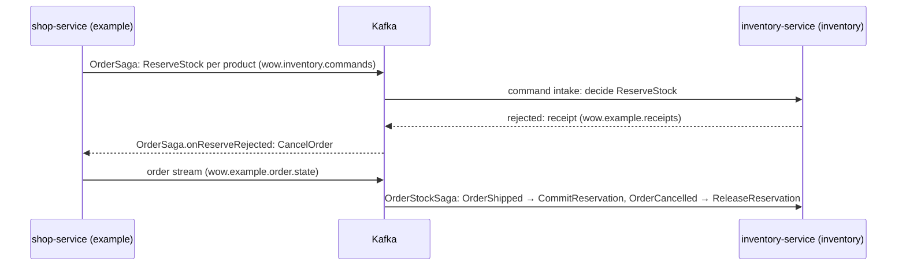

# Inventory: the example's second context

The V10 example's second bounded context (decision D144), `inventory`, served
by a service of its own beside the [shop](../shop/README.md). It has one
aggregate, `stock`, one per product, its id the product's id. It takes over
the stock the shop used to ask an `InventoryService` for: the shop's order saga
reserves an order's products here, across contexts, over Kafka.

| Module             | Holds                                                                                       |
| ------------------ | ------------------------------------------------------------------------------------------- |
| `inventory-api`    | The stock's commands and events                                                             |
| `inventory-domain` | The `stock` aggregate and `OrderStockSaga` on the shop's orders, compiled by KSP            |
| `inventory-server` | The Spring Boot application: the Wow host on Kafka, with the shop's Manifest as a peer      |

The example is built and tested with the V10 modules and never published.

## Stock

| Command              | Does                                                                                                |
| -------------------- | --------------------------------------------------------------------------------------------------- |
| `ReceiveStock`       | Adds units on hand, creating the stock on the first delivery                                        |
| `ReserveStock`       | Holds units for an order; rejected with `inventory.stock.insufficient` when fewer are available     |
| `CommitReservation`  | The order was shipped: its units leave the stock; `inventory.stock.no-reservation` without one      |
| `ReleaseReservation` | The order was cancelled: its units are available again; nothing to release changes nothing         |

The state holds `onHand`, `available` and `reservations` (units by order id).
A second `ReserveStock` for an order already reserved changes nothing, besides
the kernel's de-duplication by request id.

## The order flow



- **Commands in** (decisions D33, D135, D137): with `wow.kafka.command-intake`
  the node executes the commands other contexts send to `wow.inventory.commands`.
  The owner of log partition `p` reads command partition `p`, so the topic must
  have as many partitions as the context's log (`wow.log.partitions`, 64 by
  default); the node does not start otherwise. A command delivered again is
  decided once.
- **Receipts out** (decision D136): a rejected `ReserveStock` is answered with a
  receipt on the shop's `wow.example.receipts` before the intake moves past it.
- **The order stream** (decisions D134, D138, D156): `OrderStockSaga`'s two
  handlers, `@OnEvent(aggregates = ["example.order"])`, read
  `wow.example.order.state` with their offsets in this service's checkpoints.
  Their events are the shop's published payloads (name, revision, JSON) and
  their state is the inventory's own view of the order, `OrderView`. They start
  at the beginning of the stream (`wow.subscriptions.[…].start`), so no order
  shipped before the inventory first started is missed; the commands they
  derive have ids fixed by the record, so a record read again commits nothing
  twice.

The node checks the order stream against the shop's Manifest when it starts
(decision D139): `example/wow-peers.gradle.kts` puts it under
`META-INF/wow/peers`, as the Gradle plugin's `wowPeers` does for an application.

## Run

Kafka is required: the service's whole exchange with the shop goes through it.
With a broker on `localhost:9092` and the command topic created:

```bash
kafka-topics --bootstrap-server localhost:9092 --create --topic wow.inventory.commands --partitions 64
./gradlew -Pwow.scope=v10 :inventory-server:run
```

It serves the public routes on port 8081 and the internal port on 9091, one
node with its data in memory. The `postgres` profile serves it from
`jdbc:postgresql://localhost:5432/inventory`, as the shop's does. Run the shop
with its `kafka` profile beside it.

```bash
curl -X POST localhost:8081/inventory/stock/apple/receive-stock \
  -H 'Content-Type: application/json' -d '{"quantity":10}'
curl localhost:8081/inventory/stock/apple/state
```

`:example-e2e` (`example/e2e`) runs both services end to end on Kafka and
PostgreSQL in containers: an order reserved and committed on shipping, an
order cancelled through the receipt, commands and receipts delivered again,
and the inventory killed right after a shipment.
