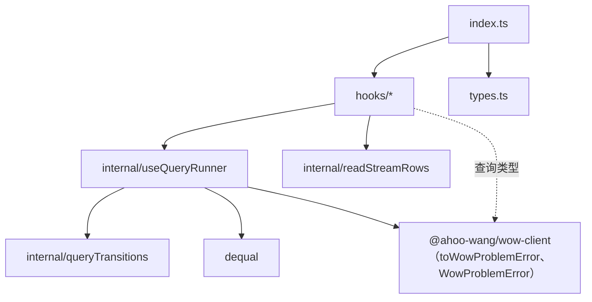

# wow-react 设计

**状态**：现行设计。2026-09 首发前的重构（B0～B4，#3354～#3383）之后，2026-10 的 D353（V1～V7）去掉了 `useFetcher*` 家族，加入游标与聚合 hook，并把 `requestOptions` 计入请求身份。重构与审查的原文在 git 历史里。
**范围**：`typescript/wow-react` 的职责、模块与依赖、请求状态机的语义表、请求身份、关键决定和以后的计划。命令与目录的速查在包的 `AGENTS.md`。

## 1. 它是做什么的，什么必须成立

wow-react 把一次 Wow 查询变成 React 组件里的状态：`status`、`result`（流型与游标型是 `items`）、`error`、`problem`，以及 `execute`、`abort`、`reset`、`getQuery`、`setQuery`。查询本身怎么构建、怎么发送，都是 wow-client 的事：每个 hook 运行调用方交来的客户端方法（`execute`），本包不拼路由、不建请求、不建客户端。

四条不变量：

1. **状态机归本包。** 请求状态机（`src/internal/useQueryRunner.ts`）是本包自己的，不依赖 `@ahoo-wang/fetcher-react`；它的语义就是第 3 节的表，9.x 内冻结。`verify-package.mjs` 在产物或声明里出现 fetcher-react 时失败。
2. **最新的查询说了算。** 每次执行取新序号并中止上一个；不再是最新的应答、`abort()` 或 `reset()` 之后到达的应答、卸载之后到达的应答，都不改变任何东西。
3. **一个状态机。** 七个 hook 都跑在同一个状态机上；流型与游标型在外面各包一层自己的行（`items`）。
4. **公开面逐名冻结。** 26 个名字列在 `test/surface/root.txt`，每个选项与返回类型的成员由 `test/hookContract.types.test.ts` 钉住。

## 2. 模块与依赖

```
src/
  index.ts                     只转出 hooks/ 与 types.ts
  types.ts                     QueryStatus、QueryExecutor、StreamExecutor、QueryHookOptions、QueryHookReturn
  hooks/use{Single,List,Paged,Count,Aggregate}Query.ts   useQueryRunner 的类型特化
  hooks/useCursorQuery.ts      状态机 + 已读各页：游标归 hook，fetchNext() 追加下一页
  hooks/useStreamQuery.ts      状态机 + readStreamRows：items、position、done
  internal/useQueryRunner.ts   唯一的请求状态机
  internal/queryTransitions.ts 第 3 节的表，纯函数，无 React
  internal/readStreamRows.ts   读带位置的行，最多每 16 ms 发布一次
```



查询类型只来自 wow-client，本包不重新定义。外部依赖：peer `react ^19.0.0`（19.0.0 冒烟过，见 RELEASING「peer 范围」；构建经 React Compiler，产物导入 `react/compiler-runtime`）、`@ahoo-wang/wow-client`（`~x.y.z`，同一个次版本）；依赖 `dequal`。`@ahoo-wang/fetcher-eventstream` 不是本包的 peer（用户 2026-09-25 定，第二轮审查 P1-11）：`src` 从不导入它，它是 wow-client 的 peer。`@ahoo-wang/fetcher` 同理（D353 起）：`src` 不再导入它，它也只是 wow-client 的 peer。TypeScript 下限是 6，包检查在 6.0 和最新的 7.x 上编译使用方代码（P1-15），不声明 `typescript` peer。

## 3. 状态机的语义

每个 hook 的行为都是这一张表；`internal/queryTransitions.ts` 是它的纯函数实现，`test/queryTransitions.test.ts` 逐格覆盖，`requestStateTable`、`streamStateTable`、`queryIdentity`、`callbacks`、`ssr`、`hydration` 六个测试文件在 React 里钉住。改一格要有意为之，并在 PR 里写明是哪一格。

| 事件                                               | `status`   | `result` / `items`                                         | `error`    | 在途请求 |
| -------------------------------------------------- | ---------- | ---------------------------------------------------------- | ---------- | -------- |
| 开始（新查询或 `execute()`）                       | `loading`  | 请求型保留上一次结果（属于旧查询）；流型清空（行是累积的） | 清空       | 中止旧的 |
| 成功                                               | `success`  | 新结果；流型 `done = true`                                 | —          | —        |
| 失败                                               | `error`    | **保留**上一次结果 / 已收到的行                            | 设置       | —        |
| `abort()`                                          | `idle`     | **保留**                                                   | 清空       | 中止     |
| `reset()`                                          | `idle`     | 清空                                                       | 清空       | 中止     |
| 卸载                                               | —          | —                                                          | —          | 中止     |
| 受控 `query`、`requestOptions`（都按内容比较）变化 | 同「开始」 | 同「开始」                                                 | 同「开始」 | 中止旧的 |
| 受控 `query` 从有值变为 `undefined`                | `idle`     | **保留**                                                   | 清空       | 中止     |

最后一行来自第二轮审查的 P1-6（2026-09-25）：`id ? singleQuery(…) : undefined` 是条件查询的常见写法，原来清空时会拿上一个查询再请求一次。现在它与 `abort()` 相同：中止在途请求，回到 `idle`，保留结果，`getQuery()` 返回 `undefined`，`execute()` 什么也不做，直到再给出查询（受控的新值，或 `setQuery()`）。`autoExecute: false` 时同样如此。按第一原理定：用户 09-24 定的方向是「出错或中止后保留结果」，清空查询是「不再需要新的结果」，不是「清空已有的结果」；要清空的调用方用 `reset()`。`queryIdentity.test.tsx` 对请求型与流型各钉四格（应答后、在途时、再给查询、`autoExecute` 关闭）。

其余规则：

- **首帧**：挂载即执行的 hook 首帧就是 `loading`，服务端渲染也一样，所以服务端与客户端首帧一致；不执行的是 `idle`。SSR 不发请求。
- **StrictMode**：第二次挂载中止第一次执行、再发一次，只落定一个结果。
- **回调**：`onSuccess`、`onError` 在状态更新之后调用；回调抛错时以 `console.warn` 报告，状态照常。
- **中止类错误**：`execute` 自己抛出 `AbortError` 时按 `abort` 处理。
- **流**：`readStreamRows` 第一批行在下一个宏任务发布，之后最多每 16 ms 发布一次，结束或出错前总会发布最后的行；流型 hook 不把 `ReadableStream` 交给组件，自己读、自己取消。执行器是客户端的 `streamRows`，每行带位置；`position` 是最后一条带位置的行的位置，与 `items` 一起清空、一起保留。组件重新挂载后续读：把保存的位置以 `requestOptions.resume.lastEventId` 传回。
- **游标**：游标归 hook，查询类型是去掉 `cursor` 的 `CursorQuery`。每次由状态机发起的执行（挂载、查询变化、`execute()`、`setQuery()`）都从第一页开始并清空 `items`；只有 `fetchNext()` 把上一页的 `nextCursor` 交给下一次执行并追加。`fetchNext()` 在加载中或没有下一页时什么也不做；失败或 `abort()` 保留已读的行和游标，再调用一次就重试同一页。
- **失败**：`error` 是 `Error`。执行器抛出的东西先经 wow-client 的 `toWowProblemError`（fetcher 的 `ExchangeError` 读成 problem），否则原样；不是 `Error` 的值包成 `new Error(String(x), { cause: x })`。`problem` 是 `error` 为 `WowProblemError` 时的同一个对象，否则 `undefined`，hook 从不编造服务端应答。

## 4. 请求身份

一次执行由什么决定：受控 `query` 的内容与 `requestOptions` 的内容（都用 `dequal`）。`requestOptions` 计入身份（D353 V3），因为 scope、space 和请求头都可能改变答案；代价是每次渲染都变的请求头值会让每次渲染都重新执行，选项的 TSDoc 写明这一点。`execute` 和回调在执行开始或落定时读取最新值，它们变化不触发执行。

## 5. 关键决定

出自 2026-09 的重构批次、第二轮审查与 D353：

- **自有公开类型**（B1）：`QueryStatus` 是字面量联合；`QueryExecutor<Q, R, O>` 的第二个参数必传，带本次执行的 `signal`。
- **自有状态机**（B3）：去掉 fetcher-react 的 peer，`dequal` 为依赖。
- **流**（B4）：按时间节流，流型 hook 只存一份 `items`。
- **只走客户端**（D353 V1）：`useFetcher*` 家族与 `Endpoint` 删除。它们重复了 `use*Query`，按手写的 URL 发请求，每次请求新建一个客户端，还把 `baseURL` 相同的无名 Fetcher 当作同一个。生成的客户端就是执行器；数据集用 `DatasetClient().dataset(…)`。客户端在组件之外创建一次。
- **没有错误类型参数**（D353 V6）：原来的 `E` 只是一个未经检查的断言（`error as E`）。现在 `error: Error`，`problem: WowProblemError | undefined`，不需要类型断言。
- **`FIELDS` 不能从 `execute` 推断**：TypeScript 不支持部分类型参数推断，所以文档一律写 `usePagedQuery<State, Fields>`；生成客户端的字段类型写作 `` `${CartAggregatedFields}` ``（P1-4，参考页有提示框）。
- **类型参数顺序**：`StreamExecutor<R, Q>` 与 `QueryExecutor<Q, R>` 相反，沿用 fetcher-react 迁来的顺序（R-13）。
- **方法经箭头函数交出**：`execute: (query, options) => client.paged(query, options)`；单独交出的方法会丢掉 `this`。

## 6. 以后

- SSR 的 `initialResult`（R-8）、Suspense：都以新增 API 的方式加。
